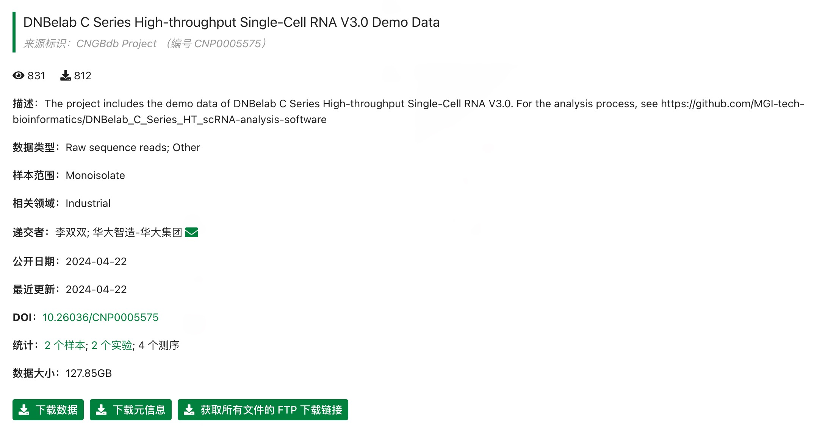

# DNBelab C Series Demo Datasets

Demo datasets are hosted on CNGB (China National GeneBank). Currently, only mouse sample data is provided.

<table>
  <thead>
    <tr>
      <th>Analysis Type</th>
      <th>Sample Information</th>
      <th>Project Link</th>
    </tr>
  </thead>
  <tbody>
    <tr>
      <td><b>scRNA-seq v3</b></td>
      <td>Mouse sample with separate cDNA and Oligo libraries.</td>
      <td><a href="https://db.cngb.org/data_resources/project/CNP0005575/" target="_blank">CNP0005575</a></td>
    </tr>
    <tr>
      <td><b>scVDJ-seq</b></td>
      <td>Mouse spleen tissue, including 5' RNA, TCR, and BCR data.</td>
      <td><a href="https://db.cngb.org/data_resources/project/CNP0006116/" target="_blank">CNP0006116</a></td>
    </tr>
    <tr>
      <td><b>scATAC-seq</b></td>
      <td>Mouse brain tissue.</td>
      <td><a href="https://db.cngb.org/data_resources/project/CNP0004369" target="_blank">CNP0004369</a></td>
    </tr>
  </tbody>
</table>

## Notes on Data Usage

<strong>scVDJ-seq Note</strong>: If you don't need to analyze the 5' RNA data, you can directly download the `singlecell.csv` file from the 5' RNA data directory on the FTP server to use as input for the VDJ pipeline.

<strong>General Note</strong>: For all datasets, visit the project link, navigate to the "Sample" or "Experiment" tabs, and find the FTP link to download the raw data for analysis.

  

*Example: Finding the FTP download link in the CNGB project page.*
