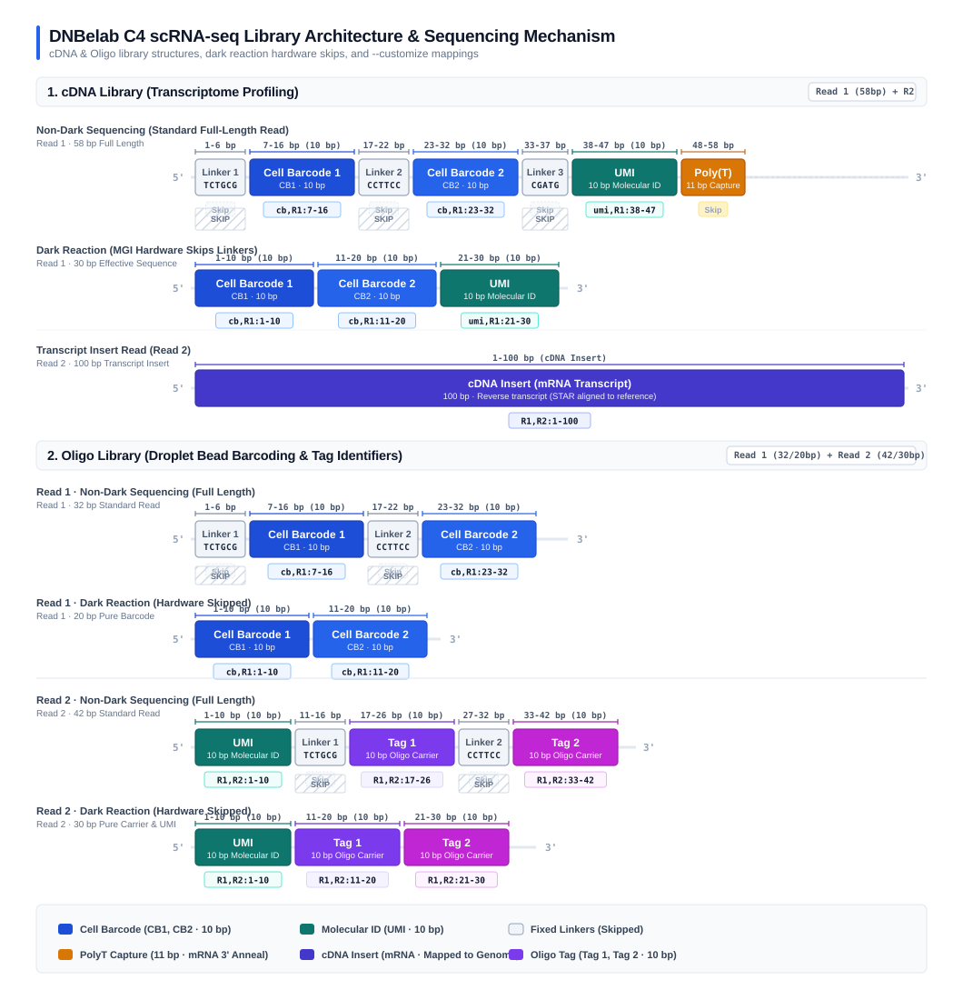
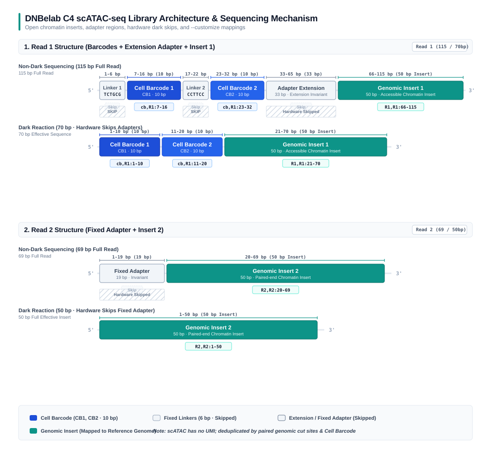
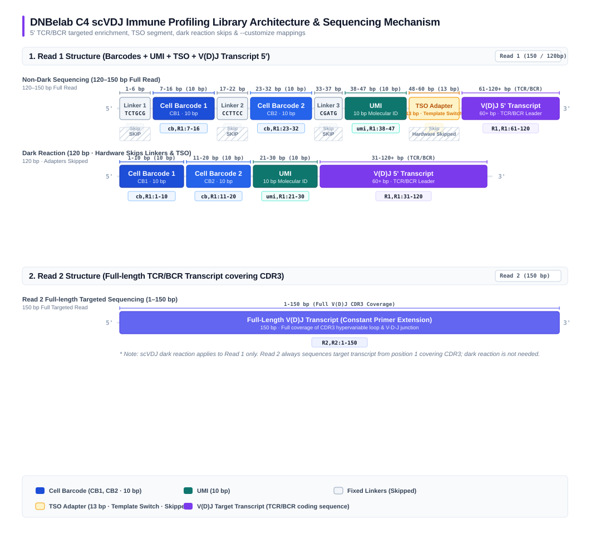

# Library Structure

DNBelab C4 series single-cell technology encompasses three major omics platforms: **scRNA-seq (transcriptome)**, **scATAC-seq (chromatin accessibility)**, and **scVDJ (immune repertoire)**. Each library features specialized physical architectures, adapter compositions, cell barcodes (CB), and unique molecular identifiers (UMI).

This document provides a comprehensive reference for physical library architectures, base coordinate intervals, invariant linker sequences, and `--customize` parameter configurations across all modalities.

---

## 1. scRNA-seq Library Structure 

DNBelab C4 single-cell RNA sequencing consists of two complementary libraries: the **cDNA library** and the **Oligo library**. The cDNA library captures transcript expression profiles, while the Oligo library records bead barcodes within droplets for cell calling and doublet discrimination.

  

### cDNA Library

The cDNA library quantifies gene expression profiles across single cells.

- **Read 1 (58 bp)**:
  - **Linker 1 (Fixed linker 1, 6 bp)**: `TCTGCG` (1–6 bp, present in non-dark sequencing only)
  - **Cell Barcode 1 (CB1, 10 bp)**: First cell barcode segment (Non-dark: 7–16 bp; Dark reaction: 1–10 bp)
  - **Linker 2 (Fixed linker 2, 6 bp)**: `CCTTCC` (17–22 bp, present in non-dark sequencing only)
  - **Cell Barcode 2 (CB2, 10 bp)**: Second cell barcode segment (Non-dark: 23–32 bp; Dark reaction: 11–20 bp)
  - **Linker 3 (Fixed linker 3, 5 bp)**: `CGATG` (33–37 bp, present in non-dark sequencing only)
  - **UMI (10 bp)**: Unique Molecular Identifier (Non-dark: 38–47 bp; Dark reaction: 21–30 bp)
  - **PolyT capture region (11 bp)**: Anneals to the mRNA 3' poly(A) tail
- **Read 2 (100 bp)**: cDNA insert (transcript sequence, mapped to the reference genome)

### Oligo Library

The Oligo library resolves bead barcodes co-encapsulated in droplets, distinguishing true single cells from multi-bead background droplets.

#### Read 1 Structure (20–32 bp)

- **Non-Dark Mode (32 bp)**:
  - **Linker 1 (6 bp)**: `TCTGCG` (1–6 bp, fixed adapter skipped)
  - **Cell Barcode 1 (CB1, 10 bp)**: First cell barcode segment (7–16 bp, extracted as `cb,R1:7-16`)
  - **Linker 2 (6 bp)**: `CCTTCC` (17–22 bp, fixed adapter skipped)
  - **Cell Barcode 2 (CB2, 10 bp)**: Second cell barcode segment (23–32 bp, extracted as `cb,R1:23-32`)
- **Dark Reaction Mode (20 bp)**:
  - The sequencer hardware skips fixed Linker 1 and Linker 2:
  - **Cell Barcode 1 (CB1, 10 bp)**: 1–10 bp, extracted as `cb,R1:1-10`
  - **Cell Barcode 2 (CB2, 10 bp)**: 11–20 bp, extracted as `cb,R1:11-20`

#### Read 2 Structure (30–42 bp)

- **Non-Dark Mode (42 bp)**:
  - **UMI (10 bp)**: Molecular unique identifier (1–10 bp, extracted as `R1,R2:1-10`)
  - **Linker 1 (6 bp)**: `TCTGCG` (11–16 bp, fixed adapter skipped)
  - **Tag 1 (10 bp)**: First bead carrier tag (17–26 bp, extracted as `R1,R2:17-26`)
  - **Linker 2 (6 bp)**: `CCTTCC` (27–32 bp, fixed adapter skipped)
  - **Tag 2 (10 bp)**: Second bead carrier tag (33–42 bp, extracted as `R1,R2:33-42`)
- **Dark Reaction Mode (30 bp)**:
  - The sequencer hardware skips fixed Linker 1 and Linker 2:
  - **UMI (10 bp)**: 1–10 bp, extracted as `R1,R2:1-10`
  - **Tag 1 (10 bp)**: 11–20 bp, extracted as `R1,R2:11-20`
  - **Tag 2 (10 bp)**: 21–30 bp, extracted as `R1,R2:21-30`

> For detailed scRNA command arguments, see [scRNA Parameters: Custom Read Structure](parameter/scRNA.md#customize).

---

## 2. scATAC-seq Library Structure 

DNBelab C4 single-cell ATAC sequencing profiles accessible chromatin landscapes. **ATAC libraries do not contain UMIs**; fragment deduplication and quantification rely on mapped genomic coordinates (cut sites) together with cell barcodes.

  

### Read 1 Structure (50–115 bp)

- **Non-dark reaction mode (115 bp)**:
  - **Linker 1 (6 bp)**: `TCTGCG` (1–6 bp, fixed linker skipped)
  - **Cell Barcode 1 (CB1, 10 bp)**: First barcode segment (7–16 bp, extracted as `cb,R1:7-16`)
  - **Linker 2 (6 bp)**: `CCTTCC` (17–22 bp, fixed linker skipped)
  - **Cell Barcode 2 (CB2, 10 bp)**: Second barcode segment (23–32 bp, extracted as `cb,R1:23-32`)
  - **Adapter extension (33 bp)**: 33–65 bp, invariant adapter extension (skipped)
  - **Chromatin DNA insert 1 (50 bp)**: 66–115 bp, genomic DNA insert (extracted as `R1,R1:66-115`)
- **Dark reaction mode (70 bp)**:
  - Sequencer hardware skips Linker 1, Linker 2, and the adapter extension:
  - **Cell Barcode 1 (CB1, 10 bp)**: 1–10 bp, extracted as `cb,R1:1-10`
  - **Cell Barcode 2 (CB2, 10 bp)**: 11–20 bp, extracted as `cb,R1:11-20`
  - **Chromatin DNA insert 1 (50 bp)**: 21–70 bp, extracted as `R1,R1:21-70`

### Read 2 Structure (50–69 bp)

- **Non-dark reaction mode (69 bp)**:
  - **Fixed adapter (19 bp)**: 1–19 bp (invariant adapter skipped)
  - **Chromatin DNA insert 2 (50 bp)**: 20–69 bp, genomic DNA insert (extracted as `R2,R2:20-69`)
- **Dark reaction mode (50 bp)**:
  - Sequencer hardware skips the 19 bp fixed adapter:
  - **Chromatin DNA insert 2 (50 bp)**: 1–50 bp, pure genomic DNA sequence (extracted as `R2,R2:1-50`)

> For scATAC parameter configurations and dark reaction options, see [scATAC Parameters: Dark Reaction & Customization](parameter/scATAC.md#darkreaction).

---

## 3. scVDJ Immune Repertoire Library Structure 

DNBelab C4 single-cell V(D)J sequencing utilizes 5' transcript barcoding combined with nested PCR target enrichment for TCR (TRA/TRB/TRD/TRG) and BCR (IGH/IGK/IGL) transcripts, enabling high-fidelity full-length contig assembly and clonotype identification.

  

### Read 1 Structure (100–150 bp)

- **Non-dark reaction mode (120–150 bp)**:
  - **Linker 1 (6 bp)**: `TCTGCG` (1–6 bp, fixed linker skipped)
  - **Cell Barcode 1 (CB1, 10 bp)**: First barcode segment (7–16 bp, extracted as `cb,R1:7-16`)
  - **Linker 2 (6 bp)**: `CCTTCC` (17–22 bp, fixed linker skipped)
  - **Cell Barcode 2 (CB2, 10 bp)**: Second barcode segment (23–32 bp, extracted as `cb,R1:23-32`)
  - **Linker 3 (5 bp)**: `CGATG` (33–37 bp, fixed linker skipped)
  - **UMI (10 bp)**: Unique Molecular Identifier (38–47 bp, extracted as `umi,R1:38-47`)
  - **TSO / Extension (13 bp)**: 48–60 bp, Template Switch Oligo sequence (skipped)
  - **V(D)J 5' transcript sequence (60+ bp)**: 61–120+ bp, extracted as `R1,R1:61-120`
- **Dark reaction mode (120 bp)**:
  - Sequencer hardware skips fixed linkers and TSO:
  - **Cell Barcode 1 (CB1, 10 bp)**: 1–10 bp, extracted as `cb,R1:1-10`
  - **Cell Barcode 2 (CB2, 10 bp)**: 11–20 bp, extracted as `cb,R1:11-20`
  - **UMI (10 bp)**: 21–30 bp, extracted as `umi,R1:21-30`
  - **V(D)J 5' transcript sequence (90+ bp)**: 31–120+ bp, extracted as `R1,R1:31-120`

### Read 2 Structure (100–150 bp)

- **Standard reverse transcript sequencing (1–150 bp)**:
  - Read 2 always reads target transcript sequence starting from base 1 (derived from C-region specific primer extension, covering CDR3 and rearranged V/D/J elements), extracted as `R2,R2:1-150`.
  - *Note: scVDJ sequencing supports R1 dark reaction or non-dark mode only. Read 2 dark reaction is neither supported nor required.*

> For scVDJ parameter options and custom structure syntax, see [scVDJ Parameters: Dark Reaction & Custom Read Structure](parameter/scVDJ.md#darkreaction).

---

## 4. Cross-Modality Library Feature & Configuration Matrix

| Modality | Library Type | Cell Barcode (CB) | UMI Length | Key Invariant Adapters | Supported Dark Reactions | Typical `--customize` Syntax (Non-dark) |
| :--- | :--- | :--- | :--- | :--- | :--- | :--- |
| **scRNA** | cDNA | 2 segments (20 bp) | 10 bp | `TCTGCG`, `CCTTCC`, `CGATG` | `auto`, `R1`, `unset` | `--customize "cb,R1:7-16;cb,R1:23-32;umi,R1:38-47;R1,R2:1-100"` |
| **scRNA** | Oligo | 2 segments (20 bp) | 10 bp | `TCTGCG`, `CCTTCC` | `auto`, `R1R2`, `R1`, `unset` | `--customize "cb,R1:7-16;cb,R1:23-32;R1,R2:1-10;R1,R2:17-26;R1,R2:33-42"` |
| **scATAC** | Chromatin Fragment | 2 segments (20 bp) | **No UMI** | `TCTGCG`, `CCTTCC`, Adapter extension, Fixed adapter | `auto`, `R1R2`, `R1`, `R2`, `unset` | `--customize "cb,R1:7-16;cb,R1:23-32;R1,R1:66-115;R2,R2:20-69"` |
| **scVDJ** | TCR / BCR | 2 segments (20 bp) | 10 bp | `TCTGCG`, `CCTTCC`, `CGATG`, TSO | `auto`, `R1`, `unset` | `--customize "cb,R1:7-16;cb,R1:23-32;umi,R1:38-47;R1,R1:61-120;R2,R2:1-150"` |
