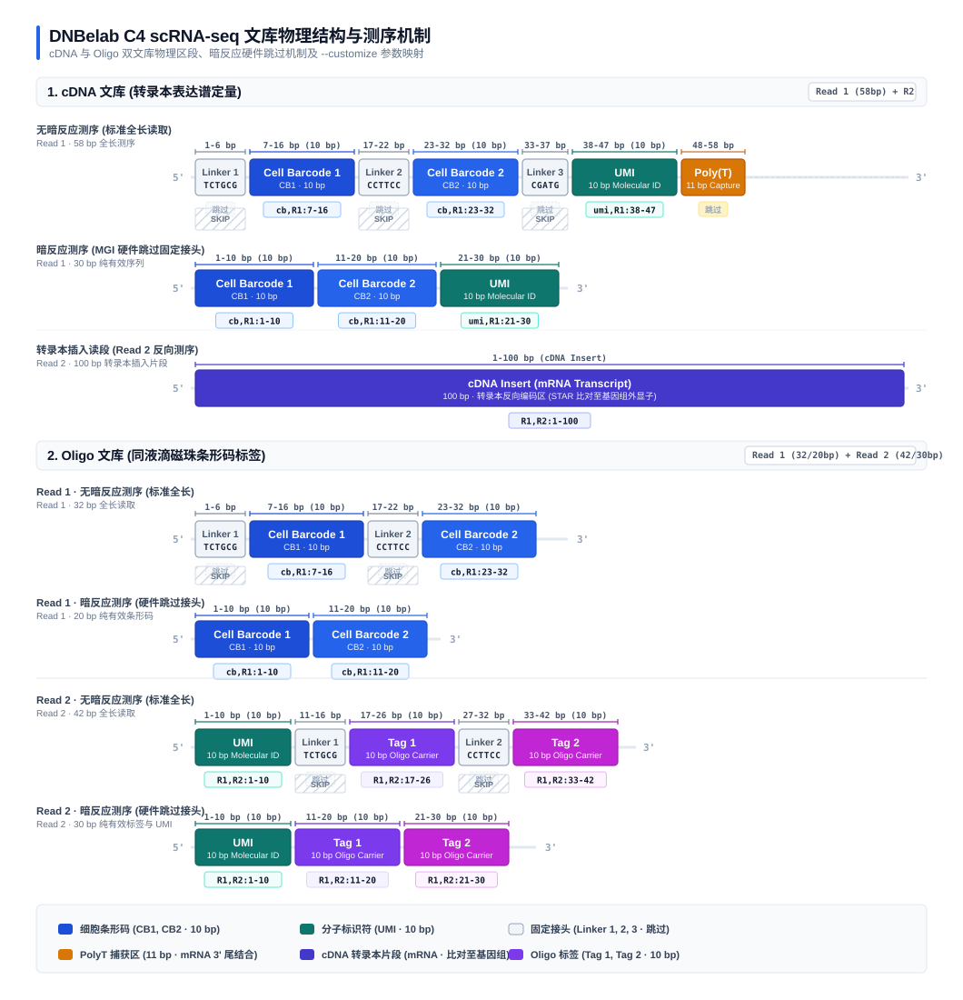
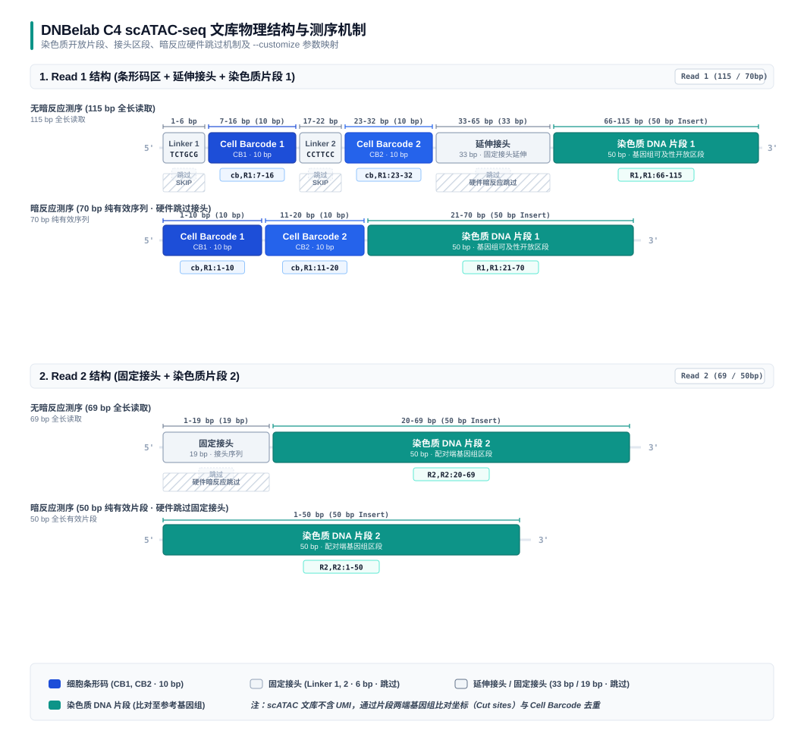
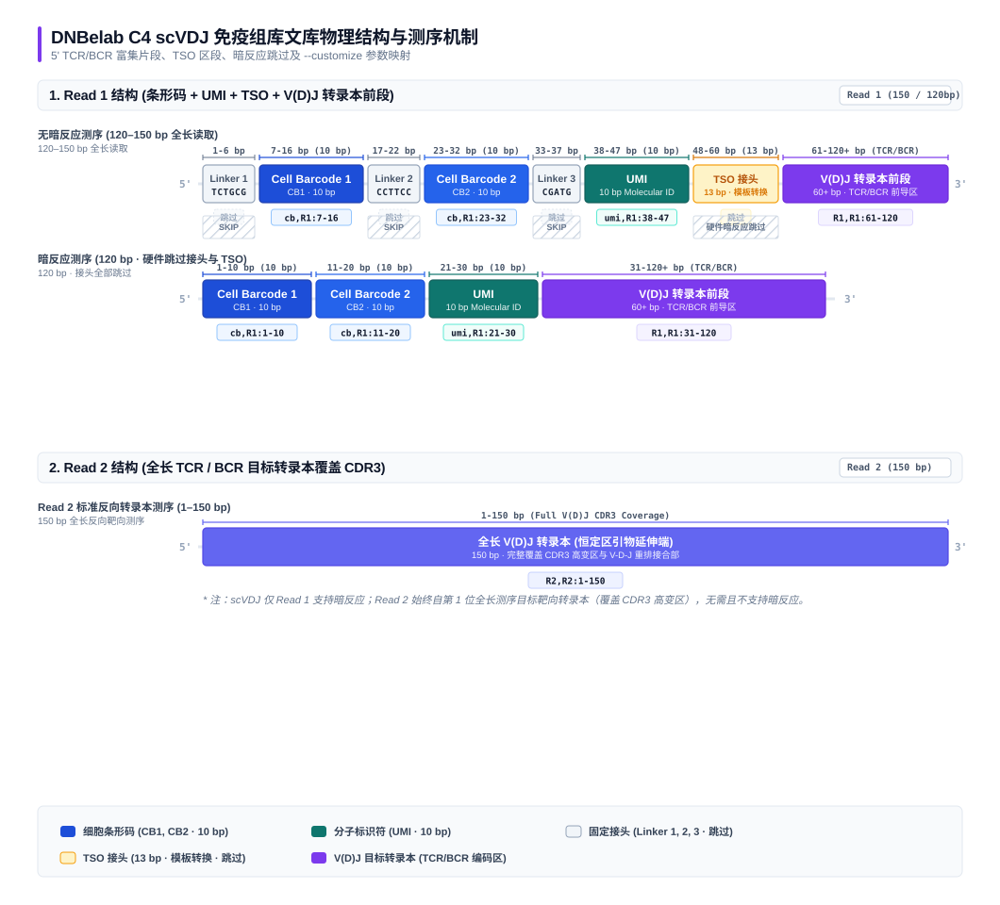

# 文库结构

DNBelab C4 系列单细胞测序技术包含 **scRNA-seq（转录组）**、**scATAC-seq（染色质开放度）** 与 **scVDJ（免疫组库）** 三大组学平台。不同文库在物理结构、接头组成、条形码（Cell Barcode）以及分子标识符（UMI）的设计上各有针对性。

本文档汇总展示各组学的物理文库全貌、碱基坐标区间、固定接头序列及 `--customize` 提取参数配置。

---

## 1. scRNA-seq 文库结构 

DNBelab C4 单细胞转录组测序包含两个相互配合的文库：**cDNA 文库** 与 **Oligo 文库**。其中 cDNA 文库捕获转录本表达信息，Oligo 文库记录液滴中微珠的捕获信息用于细胞识别与液滴解析。

  

### cDNA 文库

cDNA 文库用于测定单细胞转录组的基因表达谱。

- **Read 1 (58 bp)**：
  - **Linker 1 (固定接头 1, 6 bp)**：`TCTGCG`（1–6 bp，仅在无暗反应模式下测序出现）
  - **Cell Barcode 1 (CB1, 10 bp)**：第一段细胞条形码（无暗反应：7–16 bp；暗反应：1–10 bp）
  - **Linker 2 (固定接头 2, 6 bp)**：`CCTTCC`（17–22 bp，仅在无暗反应模式下测序出现）
  - **Cell Barcode 2 (CB2, 10 bp)**：第二段细胞条形码（无暗反应：23–32 bp；暗反应：11–20 bp）
  - **Linker 3 (固定接头 3, 5 bp)**：`CGATG`（33–37 bp，仅在无暗反应模式下测序出现）
  - **UMI (10 bp)**：分子唯一标识符（无暗反应：38–47 bp；暗反应：21–30 bp）
  - **PolyT 捕获区 (11 bp)**：用于结合 mRNA 3' 端的 poly(A) 尾
- **Read 2 (100 bp)**：cDNA 插入片段（转录本编码序列，比对至参考基因组）

### Oligo 文库

Oligo 文库用于识别同液滴内的微珠条形码，辅助区分单个细胞与多珠空液滴。

#### Read 1 结构 (20–32 bp)

- **无暗反应模式 (32 bp)**：
  - **Linker 1 (6 bp)**：`TCTGCG`（1–6 bp，固定接头跳过）
  - **Cell Barcode 1 (CB1, 10 bp)**：第一段细胞条形码（7–16 bp，提取为 `cb,R1:7-16`）
  - **Linker 2 (6 bp)**：`CCTTCC`（17–22 bp，固定接头跳过）
  - **Cell Barcode 2 (CB2, 10 bp)**：第二段细胞条形码（23–32 bp，提取为 `cb,R1:23-32`）
- **暗反应模式 (20 bp)**：
  - 测序仪硬件跳过固定 Linker 1 与 Linker 2：
  - **Cell Barcode 1 (CB1, 10 bp)**：1–10 bp，提取为 `cb,R1:1-10`
  - **Cell Barcode 2 (CB2, 10 bp)**：11–20 bp，提取为 `cb,R1:11-20`

#### Read 2 结构 (30–42 bp)

- **无暗反应模式 (42 bp)**：
  - **UMI (10 bp)**：分子唯一标识符（1–10 bp，提取为 `R1,R2:1-10`）
  - **Linker 1 (6 bp)**：`TCTGCG`（11–16 bp，固定接头跳过）
  - **Tag 1 (10 bp)**：第一段微珠标签（17–26 bp，提取为 `R1,R2:17-26`）
  - **Linker 2 (6 bp)**：`CCTTCC`（27–32 bp，固定接头跳过）
  - **Tag 2 (10 bp)**：第二段微珠标签（33–42 bp，提取为 `R1,R2:33-42`）
- **暗反应模式 (30 bp)**：
  - 测序仪硬件跳过固定 Linker 1 与 Linker 2：
  - **UMI (10 bp)**：1–10 bp，提取为 `R1,R2:1-10`
  - **Tag 1 (10 bp)**：11–20 bp，提取为 `R1,R2:11-20`
  - **Tag 2 (10 bp)**：21–30 bp，提取为 `R1,R2:21-30`

> scRNA 参数配置与自定义传参详见 [scRNA 参数说明：自定义文库结构](parameter/scRNA.md#customize)。

---

## 2. scATAC-seq 文库结构 

DNBelab C4 单细胞染色质可及性测序用于捕获开放染色质区域序列。**ATAC 文库不包含 UMI**，比对后通过插入片段两端的染色体起止位点（Cut sites）与 Cell Barcode 进行去重与丰度统计。

  

### Read 1 结构 (50–115 bp)

- **无暗反应模式 (115 bp)**：
  - **Linker 1 (6 bp)**：`TCTGCG`（1–6 bp，固定接头跳过）
  - **Cell Barcode 1 (CB1, 10 bp)**：第一段细胞条形码（7–16 bp，提取为 `cb,R1:7-16`）
  - **Linker 2 (6 bp)**：`CCTTCC`（17–22 bp，固定接头跳过）
  - **Cell Barcode 2 (CB2, 10 bp)**：第二段细胞条形码（23–32 bp，提取为 `cb,R1:23-32`）
  - **延伸接头 (33 bp)**：33–65 bp，固定接头延伸序列（跳过）
  - **染色质 DNA 片段 1 (50 bp)**：66–115 bp，有效基因组插入片段（提取为 `R1,R1:66-115`）
- **暗反应模式 (70 bp)**：
  - 测序仪硬件跳过固定 Linker 1、Linker 2 及延伸接头：
  - **Cell Barcode 1 (CB1, 10 bp)**：1–10 bp，提取为 `cb,R1:1-10`
  - **Cell Barcode 2 (CB2, 10 bp)**：11–20 bp，提取为 `cb,R1:11-20`
  - **染色质 DNA 片段 1 (50 bp)**：21–70 bp，提取为 `R1,R1:21-70`

### Read 2 结构 (50–69 bp)

- **无暗反应模式 (69 bp)**：
  - **固定接头 (19 bp)**：1–19 bp（固定接头跳过）
  - **染色质 DNA 片段 2 (50 bp)**：20–69 bp，有效基因组插入片段（提取为 `R2,R2:20-69`）
- **暗反应模式 (50 bp)**：
  - 测序仪硬件跳过 19 bp 的固定接头：
  - **染色质 DNA 片段 2 (50 bp)**：1–50 bp，全长均为有效插入片段（提取为 `R2,R2:1-50`）

> scATAC 参数配置与暗反应说明详见 [scATAC 参数说明：暗反应与文库自定义](parameter/scATAC.md#darkreaction)。

---

## 3. scVDJ 免疫组库文库结构 

DNBelab C4 单细胞免疫组库测序基于 5' 转录组建库与针对 TCR（TRA/TRB/TRG/TRD）或 BCR（IGH/IGK/IGL）的高灵敏度巢式 PCR 靶向富集，用于精确捕获全长 V(D)J 重排序列及识别克隆型。

  

### Read 1 结构 (100–150 bp)

- **无暗反应模式 (120–150 bp)**：
  - **Linker 1 (6 bp)**：`TCTGCG`（1–6 bp，固定接头跳过）
  - **Cell Barcode 1 (CB1, 10 bp)**：第一段细胞条形码（7–16 bp，提取为 `cb,R1:7-16`）
  - **Linker 2 (6 bp)**：`CCTTCC`（17–22 bp，固定接头跳过）
  - **Cell Barcode 2 (CB2, 10 bp)**：第二段细胞条形码（23–32 bp，提取为 `cb,R1:23-32`）
  - **Linker 3 (5 bp)**：`CGATG`（33–37 bp，固定接头跳过）
  - **UMI (10 bp)**：分子唯一标识符（38–47 bp，提取为 `umi,R1:38-47`）
  - **TSO / 延伸接头 (13 bp)**：48–60 bp，模板转换寡核苷酸接头（跳过）
  - **V(D)J 转录本前段序列 (60+ bp)**：61–120+ bp，提取为 `R1,R1:61-120`
- **暗反应模式 (120 bp)**：
  - 测序仪硬件跳过固定 Linker 与 TSO：
  - **Cell Barcode 1 (CB1, 10 bp)**：1–10 bp，提取为 `cb,R1:1-10`
  - **Cell Barcode 2 (CB2, 10 bp)**：11–20 bp，提取为 `cb,R1:11-20`
  - **UMI (10 bp)**：21–30 bp，提取为 `umi,R1:21-30`
  - **V(D)J 转录本前段序列 (90+ bp)**：31–120+ bp，提取为 `R1,R1:31-120`

### Read 2 结构 (100–150 bp)

- **标准反向转录本测序 (1–150 bp)**：
  - Read 2 始终从第 1 位开始测序目标转录本（来自恒定区特异性引物延伸，覆盖 CDR3 与 V/D/J 重排关键区域），提取为 `R2,R2:1-150`。
  - *注意：scVDJ 测序仅支持 R1 单端暗反应或无暗反应，Read 2 不支持且无需暗反应。*

> scVDJ 参数配置与自定义读长结构详见 [scVDJ 参数说明：暗反应与自定义读长结构](parameter/scVDJ.md#darkreaction)。

---

## 4. 全技术文库特征与配置速查

| 组学平台 | 文库类型 | 条形码 (CB) | UMI 长度 | 主要固定接头序列 | 暗反应支持 | 典型 `--customize` 配置示例 (无暗反应) |
| :--- | :--- | :--- | :--- | :--- | :--- | :--- |
| **scRNA** | cDNA | 2 段 (共 20 bp) | 10 bp | `TCTGCG`, `CCTTCC`, `CGATG` | `auto`, `R1`, `unset` | `--customize "cb,R1:7-16;cb,R1:23-32;umi,R1:38-47;R1,R2:1-100"` |
| **scRNA** | Oligo | 2 段 (共 20 bp) | 10 bp | `TCTGCG`, `CCTTCC` | `auto`, `R1R2`, `R1`, `unset` | `--customize "cb,R1:7-16;cb,R1:23-32;R1,R2:1-10;R1,R2:17-26;R1,R2:33-42"` |
| **scATAC** | 染色质片段 | 2 段 (共 20 bp) | **无 UMI** | `TCTGCG`, `CCTTCC`, 延伸接头, 固定接头 | `auto`, `R1R2`, `R1`, `R2`, `unset` | `--customize "cb,R1:7-16;cb,R1:23-32;R1,R1:66-115;R2,R2:20-69"` |
| **scVDJ** | TCR / BCR | 2 段 (共 20 bp) | 10 bp | `TCTGCG`, `CCTTCC`, `CGATG`, TSO | `auto`, `R1`, `unset` | `--customize "cb,R1:7-16;cb,R1:23-32;umi,R1:38-47;R1,R1:61-120;R2,R2:1-150"` |
