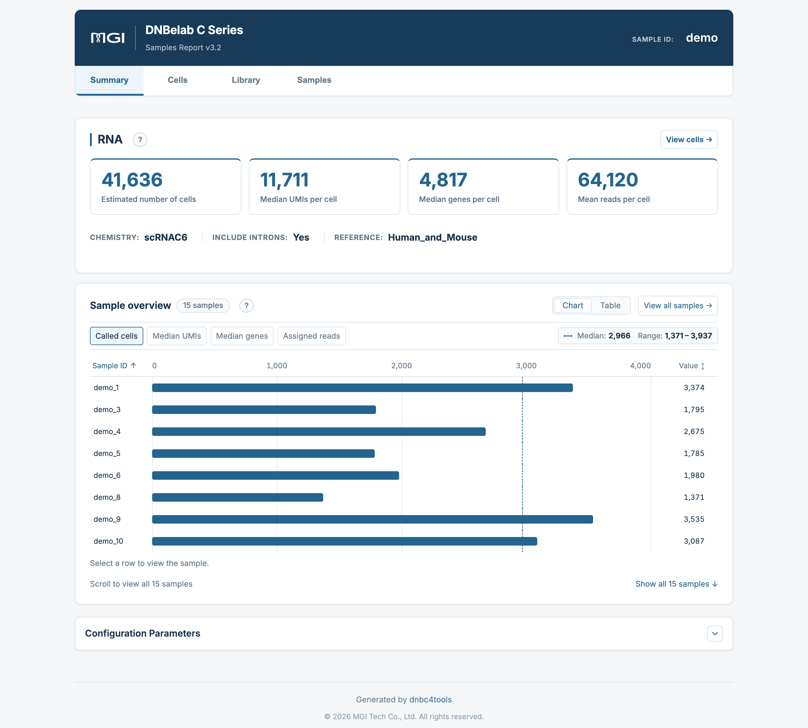
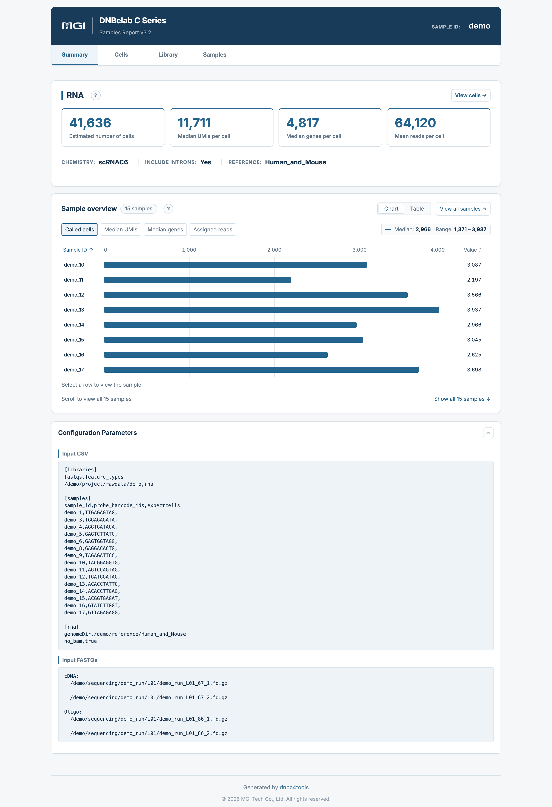
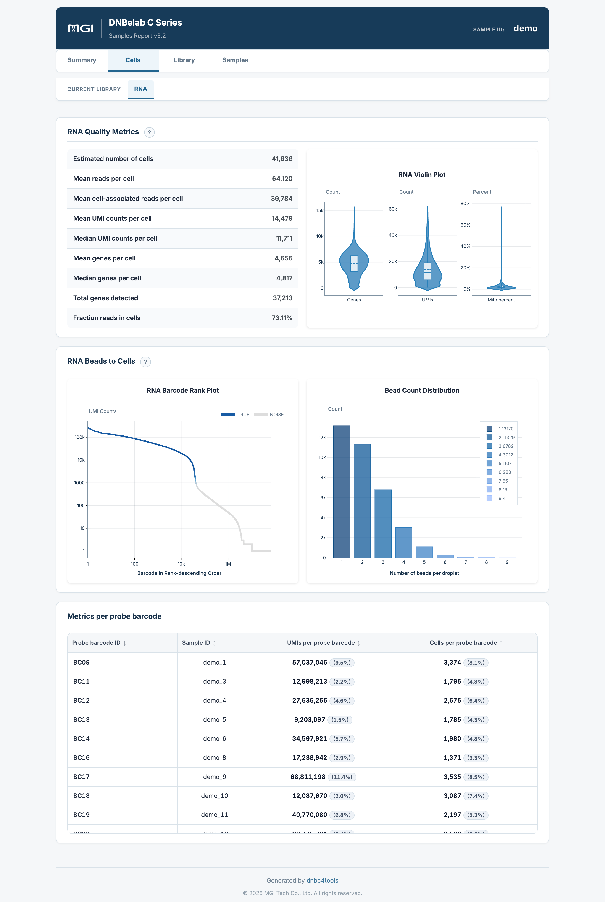
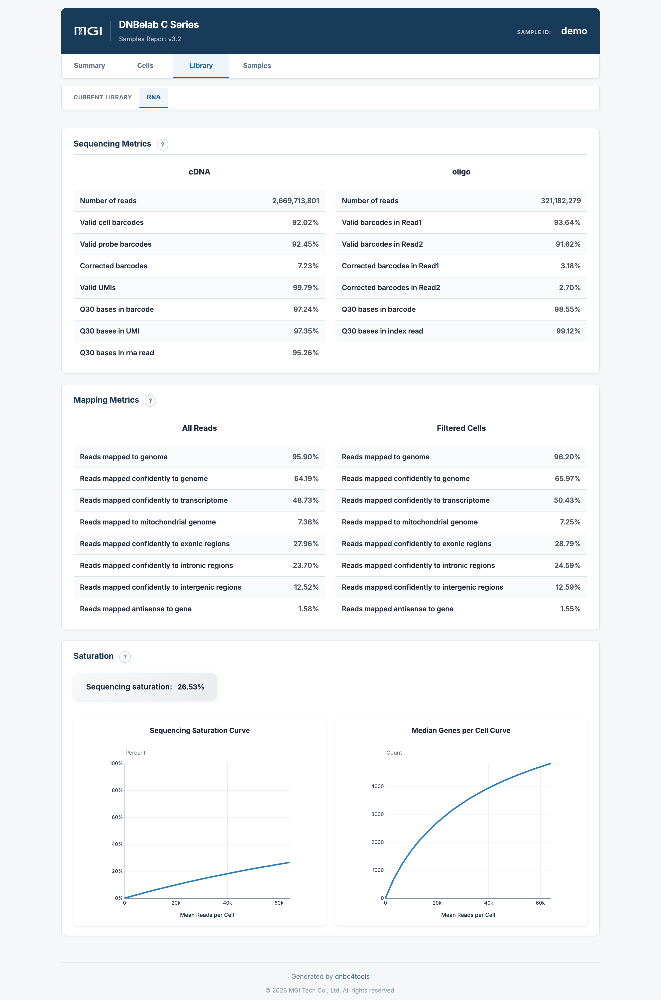
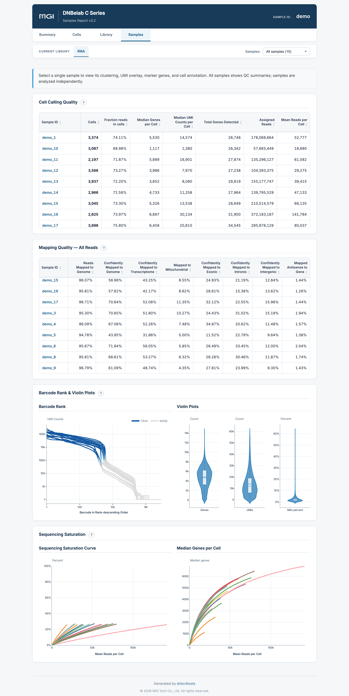
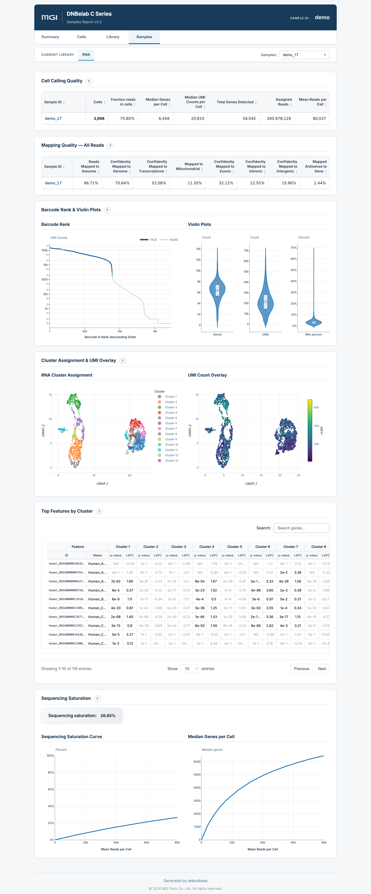

# C6 Multi-Sample Analysis Output Guide <a id="c6-multi-sample-analysis-output-guide"></a> {#c6-outputs}

> **Output scope**: Directory trees describe a typical completed run. Optional outputs depend on enabled modules and successful stages. Quality ranges below are interpretation guidance, not software pass/fail rules; use the configured thresholds and report status for this run.

C6 multi-sample RNA outputs are organized into **pooled results** and **per-sample results**. Pooled results support comparisons of sample QC metrics; per-sample results contain expression matrices, clustering results, and reports. See [Downstream Analysis](../io.md) for loading examples.

### Deliverables at a Glance <a id="deliverables-at-a-glance"></a> {#deliverables}

The table below summarizes the key deliverables of C6 multi-sample single-cell RNA analysis, file formats, primary use cases, and recommended downstream ecosystem integrations:

<div class="doc-file-table" markdown="block">

| File | Format | Purpose |
| :--- | :--- | :--- |
| `<name>_multi_report.html` | HTML | Batch summary and sample comparisons |
| `filtered_feature_bc_matrix.*` | MEX / H5 / H5AD | Pooled called-cell counts |
| `raw_feature_bc_matrix.*` | MEX / H5 | Unfiltered counts |
| `singlecell.csv.gz` | CSV.GZ | Bead/droplet metadata and cell calls |
| `multi_sample/` | CSV / TSV / JSON | Sample assignment and QC metrics |
| `per_sample_outs/<sample>/` | Directory | Per-sample matrices, analysis, and reports |
| `metrics_summary.xls` | TSV | Global QC summary |
| `oligo.records.bam`, `unassigned_alignments.bam` | BAM | Shared oligo and unassigned alignments |

</div>

File names above are relative to `outs/rna/`, except the batch report, which is under `outs/`. Exact paths appear in the directory tree below.

MEX matrices are directories; H5 and H5AD matrices are sibling files. Pooled counts do not include joint dimensionality reduction or clustering. Filter `singlecell.csv.gz` with `is_cell_barcode == 1` for called cells; read large tables in chunks. BAM files and their indexes are generated only when `[rna] no_bam` is `false` (the default). The summary and per-sample HTML reports can be opened locally in a desktop browser. See [detailed files](#detailed-files) and [report interpretation](#report-guide) below for fields, loading guidance, and report tabs.

---

The pooled and per-sample `filtered_feature_bc_matrix.h5ad` files contain raw counts before downstream analysis. Load each sample's `analysis/QC_Cluster.h5ad` for saved clustering/embeddings. Samples that are empty or fail under `sample_failure_policy=skip` may lack analysis files or HTML reports; inspect report status and `logs/run_manifest.json` instead of treating the directory tree as a mandatory bundle.

## Output Directory Structure <a id="output-directory-structure"></a><a id="directory-structure"></a> {#output-directory}

Upon completion, results are archived under `<outdir>/<name>/outs/`. BAM files and their indexes in the tree below are generated only when `[rna] no_bam` is `false` (the default); `no_bam,true` skips all BAM outputs:

```text
<outdir>/<name>/
├── outs/
│   ├── <name>_multi_report.html              # Batch multi-sample summary report (4 interactive tabs)
│   └── rna/
│       ├── raw_feature_bc_matrix/            # Global unfiltered expression matrix (MEX format)
│       ├── raw_feature_bc_matrix.h5          # Global unfiltered expression matrix (HDF5 format)
│       ├── filtered_feature_bc_matrix/       # Global real-cell expression matrix (MEX format)
│       ├── filtered_feature_bc_matrix.h5     # Global real-cell expression matrix (HDF5 format)
│       ├── filtered_feature_bc_matrix.h5ad   # Global real-cell expression matrix (AnnData format, no joint clustering)
│       ├── singlecell.csv.gz                 # Global droplet metadata table (with is_cell_barcode flag)
│       ├── metrics_summary.xls               # Global analysis metrics summary (tab-delimited TSV)
│       ├── oligo.records.bam                 # Shared Oligo alignment records (output when BAM enabled)
│       ├── unassigned_alignments.bam         # Alignments for unassigned reads (output when BAM enabled)
│       ├── multi_sample/                     # Sample demultiplexing and QC metrics
│       │   ├── per_sample_metrics.csv        # Cross-sample comparative metrics table
│       │   ├── sample_metrics_summary.xls    # Sample-level QC summary table
│       │   ├── barcode_assignment_metrics.json # Sample barcode identification and splitting statistics
│       │   └── high_occupancy_metrics.json   # High-occupancy droplet filtering statistics
│       └── per_sample_outs/<sample>/         # 【Per-Sample Output Directory】
│           ├── raw_feature_bc_matrix/        # Sample-specific unfiltered expression matrix (MEX)
│           ├── raw_feature_bc_matrix.h5      # Sample-specific unfiltered expression matrix (H5)
│           ├── filtered_feature_bc_matrix/   # Sample-specific real-cell expression matrix (MEX)
│           ├── filtered_feature_bc_matrix.h5 # Sample-specific real-cell expression matrix (H5)
│           ├── filtered_feature_bc_matrix.h5ad # Sample-specific real-cell expression matrix (AnnData format)
│           ├── <sample>_scRNA_report.html    # Sample-specific interactive HTML report
│           ├── metrics_summary.xls           # Sample-specific quality metrics table
│           ├── <sample>_alignments.bam       # Sample-specific BAM (when enabled; with .bai / .csi)
│           └── analysis/                     # Sample-specific clustering and marker gene analysis
│               ├── cluster.csv               # Cell clustering assignments & UMAP 2D coordinates
│               ├── marker.csv                # Long-format cluster marker gene differential analysis
│               ├── marker_table.csv          # Wide-format cluster marker summary table
│               ├── QC_Cluster.h5ad           # Complete AnnData object with clustering and embeddings
│               ├── raw_qc.xls                # Per-cell raw quality metrics table (TSV text)
│               ├── raw_QCplot.png            # Pre-filtering single-cell QC violin plot
│               ├── filter_QCplot.png         # Post-filtering single-cell QC violin plot
│               ├── cluster_annotation.png    # Cell type annotation scatter plot (when reference configured)
│               └── cell_classification.csv   # Species classification & multiplet calls (mixed-species only)
└── logs/
    └── run_manifest.json                      # Pipeline step status and runtime audit manifest
```

---

## Detailed File Description <a id="detailed-deliverables"></a><a id="detailed-file-description"></a> {#detailed-files}

### 1. Multi-Sample Summary Report <a id="1-multi-sample-summary-report-outsname_multi_reporthtml"></a> {#summary-report}

Path: `outs/<name>_multi_report.html`.
* **Role**: Central quality control dashboard and overview for the entire C6 multiplexed experiment.
* **Four Core Interactive Tabs**:
  * **Summary**: Batch-level summary cards (cells, median UMIs/genes), chemistry and runtime configuration, cross-sample bar chart/table comparisons, and expanded parameter manifests;
  * **Cells**: Sample-level RNA QC table, single-cell violin distributions, overlaid barcode rank curves, bead merging distributions, and probe barcode demultiplexing statistics;
  * **Library**: Shared cDNA and Oligo library sequencing fidelity (Q30, valid barcodes/UMIs), mapping breakdowns for All Reads vs. Filtered Cells, and saturation curves;
  * **Samples**: Decoupled support for all-sample comparative QC summaries (All samples mode) as well as per-sample details (Single sample mode, featuring sample-specific UMAP clustering, UMI overlays, cell type annotation, and cluster marker tables).
* For detailed metric and chart interpretations, refer to [Multi-Sample Web Report Interpretation](#web-report-interpretation) below.

### 2. Globally Merged Expression Matrix <a id="2-globally-merged-expression-matrix-filtered_feature_bc_matrix"></a> {#merged-matrix}

Path: `filtered_feature_bc_matrix.*`.
* **Role**: Pooled high-confidence count matrix for real cells across all multiplexed samples, provided in MEX, H5, and H5AD formats.
* **Feature & Design Rationale**: Preserves raw counts **without joint dimensionality reduction or clustering across samples**. For joint analysis, assess batch effects in the context of the experimental design and select an appropriate integration method.
* **Namespace Protection**: Cells in different samples may carry identical bead barcodes. Distinction relies strictly on sample barcode tags. When performing cross-sample pooling, **do not truncate barcode suffixes**; we recommend prefixing sample IDs during import into Seurat / Scanpy (e.g., `add.cell.ids = c("SampleA", "SampleB")`).

### 3. Global Droplet Metadata <a id="3-global-droplet-metadata-singlecellcsvgz"></a> {#droplet-metadata}

Path: `singlecell.csv.gz`.
Compressed in streaming gzip format, recording metrics across all beads and droplets (including ambient noise).

| Column | Description |
| :--- | :--- |
| `cell` | Aggregated cell identifier (may be blank for unassigned background droplets) |
| `reads` | Number of transcriptomic reads associated with this bead/droplet |
| `gene` | Number of distinct genes detected (UMI ≥ 1) |
| `umi` | Total number of transcript molecules (UMIs) detected |
| `is_cell_barcode` | **Real cell call flag** (`1` or `True` indicates high-confidence real cell; `0` or `False` indicates background; unmatched records may be blank) |
| `barcode` | Raw cell barcode sequence (retaining sample tag suffix) |

!!! warning "Downstream Usage Tips"
    - **Filter Real Cells**: When reading this table into R or Python, **always filter rows where `is_cell_barcode == 1`**; do not treat all rows as cells.
    - **Streaming Large Tables**: With millions of candidate droplets, reading into Python should use chunking (`pd.read_csv(..., chunksize=100_000)`) or Polars for high performance.

### 4. Per-Sample Output Directories <a id="4-per-sample-dedicated-directories-per_sample_outssample"></a> {#sample-outputs}

Path: `per_sample_outs/<sample>/`.

Each sample output directory contains the files below. Optional files are generated under the conditions described for each file:

* **Sample HTML Report (`<sample>_scRNA_report.html`)**: Sample-specific Barcode Rank Plot, UMAP cell clusters, marker gene heatmaps, and sequencing saturation curves;
* **Sample Matrices**: Independent MEX directory, H5 format, and AnnData `filtered_feature_bc_matrix.h5ad`;
* **Sample BAM File (`<sample>_alignments.bam`)**: Generated only when `[rna] no_bam` is `false`; contains only reads assigned to this sample (with `.bai` or `.csi` index) for locus inspection in IGV;
* **Sample Analysis Directory (`analysis/`)**: `dnbc4tools` independent graph clustering, differential marker analysis, and QC figures.

`marker.csv` uses the same positive-marker selection as ordinary RNA: adjusted P < 0.05, positive log fold change, and at most 50 genes per cluster. `cluster{K}_pval` in `marker_table.csv` stores an adjusted P-value despite its shorter column name. Optional `gene_symbols` is present only if available in the source metadata.

#### Per-Sample Analysis Directory Detail <a id="per-sample-analysis-directory-detail-per_sample_outssampleanalysis"></a> {#sample-analysis}

Path: `per_sample_outs/<sample>/analysis/`.

| File Name | Format | Primary Purpose & Field Description |
| :--- | :--- | :--- |
| **`cluster.csv`** | `CSV` | Single-cell cluster assignments and coordinates. Records cell barcodes (row index), `nGene`, `nUMI`, `leiden` (cluster ID), `UMAP_1`, `UMAP_2` coordinates, `Cluster` (with cell count label), and optional `Predict_number` and `Predicted cell type`. |
| **`marker.csv`** | `CSV` | Long-format differential marker gene table for cell type identification and functional enrichment. Includes `cluster`, `gene`, `score`, `avg_log2FC`, `p_val`, `p_val_adj`, `pct.1` (in-cluster fraction), and `pct.2` (out-of-cluster fraction). |
| **`marker_table.csv`** | `CSV` | Wide-format marker table suitable for cross-cluster comparison. Includes `gene_ids`, `gene_name`, and corresponding `cluster{K}_lg2fc` and `cluster{K}_pval` for each cluster. |
| **`QC_Cluster.h5ad`** | `H5AD` | Full AnnData object encompassing downstream filtering, normalization, highly variable genes, PCA, Leiden graph clustering, UMAP coordinates, `rank_genes_groups` marker statistics, and cell annotations. Use Scanpy to read the saved clustering assignments, embeddings, and marker statistics. |
| **`raw_qc.xls`** | `TSV Text` | Per-cell quality metrics table (note: tab-delimited plain text TSV, not a binary Excel spreadsheet). Rows represent cell barcodes; columns include `n_genes_by_counts`, `total_counts`, and mitochondrial percentages. |
| **`raw_QCplot.png`** | `PNG` | Pre-filtering violin distribution of cellular features (UMI counts, gene counts, and mitochondrial percentages). |
| **`filter_QCplot.png`** | `PNG` | Post-filtering violin distribution displaying the effect of QC cutoff filtering. |
| **`cluster_annotation.png`** | `PNG` | (Optional) Generated when reference annotations (HCL for human, MCA for mouse) are enabled, displaying the UMAP scatter plot projected with predicted cell types. |
| **`cell_classification.csv`** | `CSV` | (Optional) Generated in mixed-species experiments (e.g. `Human_and_Mouse`), recording species calls and multiplet calls for each cell in this sample. |

!!! note "Global Analysis Directory Scope"
    - **Single-Species C6 Runs**: The global output does not include an `outs/rna/analysis/` directory; independent clustering outputs are located exclusively in each sample's `per_sample_outs/<sample>/analysis/`.
    - **Mixed-Species Runs**: The global `outs/rna/analysis/` delivers only the global `cell_classification.csv` species assignment table.
    - **Count Matrix H5AD Location**: `filtered_feature_bc_matrix.h5ad`, serving as the count matrix deliverable, is located in the sample root `per_sample_outs/<sample>/` alongside the MEX and H5 formats.

---

## Web Report Guide <a id="web-report-interpretation"></a> <a id="multi-sample-web-report-interpretation-outsname_multi_reporthtml"></a> {#report-guide}

Path: `outs/<name>_multi_report.html`.

**Overview**: The HTML report provides shared library metrics, sample QC comparisons, and per-sample analysis results. Use the top modality navigation and left functional navigation to select a view.

!!! info "C6 Multi-Sample Quality Assessment Principles & Review Guide"
    - **Tiered Evaluation Strategy**: C6 multiplexing combines shared library construction with sample tagging. Review should proceed in three stages: **Global Library QC → Cross-Sample Uniformity → Individual Cell Biology**.
    - **Library Metrics First**: Inspect the `Library` tab first for shared cDNA and Oligo throughput, Q30 base quality, valid barcodes, and genomic mapping rates to rule out global sequencing risks.
    - **Cross-Sample Uniformity Check**: In the `Summary` and `Cells` tabs, evaluate assigned reads, cell counts, and median genes/UMIs across samples to identify outliers caused by viability differences or tagging efficiency variations.
    - **Individual Sample Biological Validation**: In the `Samples` tab or sample reports, verify UMAP cluster topology, automated cell annotations, and canonical marker gene expression for biological consistency.

### Two-Level Navigation Architecture <a id="two-level-navigation-architecture"></a> {#report-navigation}

The interactive report decouples content through primary top and secondary left navigation bars:

* **Top Modality Bar (Primary Tab)**: Displays active modality as `RNA`;
* **Left Navigation Bar (Secondary Tabs)**:
  * `Summary`: Global batch overview cards, cross-sample comparative charts, and runtime configuration;
  * `Cells`: Single-cell level QC metrics, violin distributions, barcode rank curves, bead merging, and probe demultiplexing;
  * `Library`: Physical sequencing library metrics (Q30, valid barcodes/UMIs), mapping distributions, and sequencing saturation;
  * `Samples`: Decoupled views for all-sample comparative summaries (All samples) and per-sample details (Single sample clustering and markers).

---

### Summary & Parameters <a id="tab-1-summary-parameters"></a> {#summary-and-parameters}

#### Summary Page (Assay overview) <a id="summary-page-assay-overview"></a> {#summary}

The `Summary` tab provides global batch statistics and cross-sample metric comparisons to rapidly spot outlier samples:

<div style="text-align: center; margin: 1.5rem 0;" markdown="block">

</div>

##### 1. Global Summary Cards <a id="1-global-summary-cards"></a> {#overview-metrics}

Prominent metric cards at the top highlight overall batch performance:

| Metric Card | Calculation & Statistical Scope | Interpretation & Guidance |
| :--- | :--- | :--- |
| **Estimated number of cells** | Total number of barcodes identified as real cells across all samples (sum of called cells before downstream QC). | Compare against total targeted cell input. If recovery is below expectations, review cell viability and microfluidic encapsulation alongside other QC metrics. |
| **Median UMIs per cell** | Median of per-sample median UMI counts (cross-sample median, not a pooled cell median). | Reflects the batch-wide transcript capture baseline. |
| **Median genes per cell** | Median of per-sample median detected genes (genes with UMI ≥ 1). | Reflects overall library complexity and transcriptome coverage. |
| **Mean reads per cell** | Assigned RNA read pairs / called cells in this sample, including assigned reads outside called-cell barcodes. | Measures average raw sequencing depth. Sequencing depth requirements depend on cell type, library complexity, and analysis goals. |

##### 2. Pipeline Information & Chemistry <a id="2-pipeline-information-chemistry"></a> {#pipeline-info}

Displays core execution parameters:
* **Chemistry**: Library protocol (displayed as `SCRNAC6`);
* **Include Introns**: Indicates whether intronic alignments contribute to gene expression quantification (`Yes` recommended, particularly for single-nuclei RNA-seq snRNA-seq);
* **Reference**: Reference genome and annotation build.

##### 3. Cross-Sample Comparison (Sample overview) <a id="3-cross-sample-comparison-sample-overview"></a> {#sample-comparison}

Provides toggles between **Chart** and **Table** views:
* **Chart View**: Bar charts ranking samples on the selected metric with a **dashed line marking the across-sample median**; supports sorting by `Sample ID` or `Value` to identify demultiplexing imbalances.
* **Table View**: Interactive table listing `Sample ID`, `Assigned reads` (count and percentage), `Called cells`, `Median genes`, and `Median UMIs`; click `View cells →` on any row to open details for that sample in the `Samples` tab.

---

#### Configuration Parameters <a id="configuration-parameters"></a> {#configuration}

Clicking the parameters toggle in the header expands the complete execution manifest:

<div style="text-align: center; margin: 1.5rem 0;" markdown="block">

</div>

* **Input Configuration (Input CSV)**: Fully documents the run configuration table, including library blocks (`[libraries]`), sample demultiplexing mappings and expected cell numbers (`[samples]`), and RNA alignment parameters (`[rna]`: reference genome path, `no_bam` flag, etc.);
* **Raw Sequencing Inputs (Input FASTQs)**: Records absolute physical FASTQ paths for cDNA and Oligo libraries, providing complete traceability for reproducible bioinformatics audits.

---

### Cells: Cell QC <a id="tab-2-cells-cell-quality-metrics-feature-distributions"></a> {#cell-metrics}

The `Cells` tab focuses on single-cell level QC, comparing signal specificity and cellular uniformity across samples:

<div style="text-align: center; margin: 1.5rem 0;" markdown="block">

</div>

#### 1. RNA Quality Metrics Table <a id="1-rna-quality-metrics-table"></a> {#rna-quality}

Comprehensive per-sample single-cell QC table:

| Metric | Calculation & Definition | Interpretation & Guidance |
| :--- | :--- | :--- |
| **Estimated number of cells** | Number of called real cells in this sample before downstream QC. | Evaluates whether sample-specific cell recovery meets expectations. |
| **Mean reads per cell** | Assigned RNA read pairs / called cells in this sample, including assigned reads outside called-cell barcodes. | Measures raw physical sequencing depth allocated per cell. |
| **Mean cell-associated reads per cell** | cDNA reads associated with called-cell barcodes / Total called cells. | Measures effective sequencing depth within real cells (excluding ambient loss). |
| **Mean UMI counts per cell** | Mean UMI counts detected per called cell. | Measures average transcript capture levels. |
| **Median UMI counts per cell** | Median deduplicated UMI counts per called cell. | Physical molecular capture baseline per cell. |
| **Mean genes per cell** | Mean genes detected (UMI ≥ 1) per called cell. | Evaluates average transcriptional richness. |
| **Median genes per cell** | Median genes detected (UMI ≥ 1) per called cell. | Measures cell transcriptional activity and library diversity. |
| **Total genes detected** | Total distinct genes detected in at least one cell in this sample. | Typically 15,000–35,000 for mammalian tissues. |
| **Fraction reads in cells** | Fraction of confidently mapped transcriptomic reads with valid barcodes that fall within called cells. | Assesses the fraction of reads in called cells. For low values, review cell viability, barcode assignment, and other QC metrics when investigating ambient RNA or cell damage. |

#### 2. Barcode Ranking & Bead Merging (RNA Beads to Cells) <a id="2-barcode-ranking-bead-merging-rna-beads-to-cells"></a> {#bead-merging}

* **RNA Barcode Rank Plot (Left)**: Overlays barcode rank curves for all samples on logarithmic axes. High-quality samples show a wide plateau followed by a steep drop-off at the inflection point.
* **RNA Violin Plot (Middle)**: Mitochondrial percentage violin distribution (Mito percent), monitoring cellular integrity during sample preparation and microfluidic encapsulation (typically recommended median < 10%–15%).
* **Bead Count Distribution (Right)**: Histogram showing the number of bead barcodes merged into each called cell barcode, confirming that the vast majority of droplets encapsulate a single bead.

#### 3. Probe Barcode Demultiplexing Table (Metrics per probe barcode) <a id="3-probe-barcode-demultiplexing-table-metrics-per-probe-barcode"></a> {#barcode-metrics}

Documents the demultiplexing efficiency and yield for each Sample Barcode probe:
* **Probe barcode ID**: Probe barcode identifier (e.g., `BC09`, `BC11`, `BC12`);
* **Sample ID**: Bound sample identifier (e.g., `demo_1`, `demo_3`);
* **UMIs per probe barcode**: Total UMI counts assigned to this probe and percentage share of the run;
* **Cells per probe barcode**: Total called cells assigned to this probe and percentage share of the batch.

---

### Library: Library QC <a id="tab-3-library-shared-sequencing-mapping-metrics"></a> {#library-metrics}

The `Library` tab details physical sequencing fidelity for shared cDNA and Oligo libraries, genome mapping distributions, and sequencing saturation:

<div style="text-align: center; margin: 1.5rem 0;" markdown="block">

</div>

#### 1. Sequencing Metrics <a id="1-sequencing-metrics"></a> {#sequencing-metrics}

Reports quality separately for the transcriptomic cDNA library and sample tagging Oligo library:

| Library Type | Core Metrics | Interpretation & Guidance |
| :--- | :--- | :--- |
| **cDNA Library** | • `Number of reads`: Total input raw reads<br>• `Valid cell barcodes`: Barcode whitelist matching fraction (≥ 80%)<br>• `Valid probe barcodes`: Probe barcode validity (if applicable)<br>• `Corrected barcodes`: 1bp error-corrected barcodes (5%–10%)<br>• `Valid UMIs`: Valid non-N, non-homopolymer UMI fraction (> 99%)<br>• `Q30 bases in barcode / UMI / RNA read`: Phred quality scores (> 85%) | Evaluates sequencing instrument performance and cDNA library integrity. |
| **Oligo Library** | • `Number of reads`: Total Oligo reads<br>• `Valid barcodes in Read1 / Read2`: Barcode match rate in paired reads (≥ 85%)<br>• `Corrected barcodes in Read1 / Read2`: 1bp correction rate<br>• `Q30 bases in barcode / index read`: Base quality for sample tags | Evaluates sample tagging fidelity, directly determining demultiplexing accuracy. |

#### 2. Mapping Metrics <a id="2-mapping-metrics"></a> {#mapping-metrics}

Provides views for **All Reads** (entire library) and **Filtered Cells** (real-cell reads):
* **Reads mapped to genome**: Fraction of reads aligning to the reference genome (recommended ≥ 85%–90%);
* **Reads mapped confidently to genome**: Uniquely aligned high-confidence fraction (recommended ≥ 65%–80%);
* **Reads mapped confidently to transcriptome**: Fraction aligning confidently to annotated transcripts (recommended ≥ 50%);
* **Reads mapped to mitochondrial genome**: Percentage assigned to mitochondrial genes;
* **Confidently mapped to Exonic / Intronic / Intergenic**: Alignment distribution across genomic feature classes (when `Include Introns` is enabled, both exonic and intronic reads contribute to UMI quantification);
* **Mapped antisense to gene**: Fraction aligning antisense to annotated transcripts.

#### 3. Saturation Analysis <a id="3-saturation-analysis"></a> {#saturation}

* **Sequencing Saturation Curve**: Plots sequencing saturation as a function of mean cDNA reads per cell estimated via downsampling. Saturation levels around 50%–70% generally satisfy standard clustering and cell type identification needs.
* **Median Genes per Cell Curve**: Illustrates gene discovery plateauing with sequencing depth, identifying points of diminishing returns.

---

### Samples: Sample Results <a id="tab-4-samples-per-sample-biological-deep-dive-cross-sample-comparative-summary"></a> {#samples}

The C6 report in version 3.2 provides two views in the `Samples` tab: an all-sample overview and individual sample details:

#### 1. All-Sample Overview (All samples View) <a id="1-all-sample-macro-overview-mode-all-samples-view"></a> {#all-samples}

When `All samples (15)` is selected from the dropdown menu, comprehensive comparative tables and curve previews are displayed across all multiplexed samples:

<div style="text-align: center; margin: 1.5rem 0;" markdown="block">

</div>

* **Cell Calling Quality Table**: Horizontally compares `Cells`, `Fraction reads in cells`, `Median Genes per Cell`, `Median UMI Counts per Cell`, `Mitochondrial %`, `Total Genes Detected`, `Assigned Reads`, and `Mean Reads per Cell` across all samples;
* **Mapping Quality - All Reads Table**: Horizontally compares genomic mapping rate, confident genomic rate, transcriptomic rate, exonic/intronic/intergenic breakdown, and antisense rate;
* **Cross-Sample Curve Previews**: Barcode rank curves, violin plots, and saturation curves overlaid across all samples.

---

#### 2. Sample Details (Single sample View) <a id="2-individual-sample-deep-dive-mode-single-sample-view"></a> {#sample-details}

Selecting an individual sample from the dropdown (e.g., `demo_17`) reveals its independent biological clustering and marker expression:

<div style="text-align: center; margin: 1.5rem 0;" markdown="block">

</div>

##### Sample-Specific Quick QC Cards (Cell Calling & Mapping Quality) <a id="sample-specific-quick-qc-cards-cell-calling-mapping-quality"></a> {#sample-qc}
Selecting a sample immediately updates two key metric card sets:
* **Cell Calling Quality**: Cells, Fraction reads in cells, Median Genes/UMIs, and Assigned Reads for this sample;
* **Mapping Quality — All Reads**: Genomic mapping rate, transcriptomic rate, mitochondrial ratio, and exonic/intronic proportions.

##### Independent Barcode Rank & Violin Plots <a id="independent-barcode-rank-violin-plots"></a> {#barcode-rank}
* Displays the independent Barcode Rank curve and inflection point for this sample;
* Displays independent single-cell violin plots for Genes, UMIs, and mitochondrial percentage.

##### Independent UMAP Clustering & UMI Overlay <a id="independent-umap-clustering-umi-overlay"></a> {#clusters}
* **Left Plot (RNA Cluster Assignment)**: 2D UMAP projection colored by unsupervised graph-based clusters (subsampled up to 10,000 cells for browser responsiveness; full cell sets are retained in output files);
* **Right Plot (UMI Count Overlay)**: UMAP colored by total UMI counts per cell, confirming whether clusters are driven by biological expression or sequencing depth variations.

##### Automated Cell Annotation <a id="automated-cell-annotation"></a> {#annotations}
When supported reference annotations are enabled, predicted cell identities (such as B cells, T cells, NK cells, Monocytes) are projected onto the UMAP scatter plot.

##### Differential Marker Gene Analysis (Top Features by Cluster) <a id="differential-marker-gene-analysis-top-features-by-cluster"></a> {#markers}
Interactive marker gene table comparing each cluster against remaining cells:
* **Cluster**: Cluster number;
* **Gene**: Marker gene symbol;
* **p_val_adj**: Adjusted p-value returned by Scanpy `rank_genes_groups`;
* **avg_log2FC**: Log2 fold change of gene expression in this cluster;
* **pct.1 / pct.2**: Percentage of cells expressing the gene within vs. outside the cluster.

##### Sample Saturation Analysis <a id="sample-saturation-analysis"></a> {#sample-saturation}
Displays independent sequencing saturation and median genes per cell curves for this sample.

---

## Core Metrics & Denominator Scope <a id="core-metrics-scope"></a><a id="core-metrics-definitions"></a> <a id="core-metrics-denominator-scope"></a> {#metric-definitions}

The denominators used for C6 metrics are defined below:

| Metric | Scope & Calculation Definition |
| :--- | :--- |
| **Assigned Reads** | Actual read pairs assigned to this sample based on Sample Barcode recognition (not total raw reads). |
| **Mean Reads per Cell** | `Assigned Reads / Cells` within the sample (shows N/A if cell count is 0). |
| **Mean cell-associated reads per cell** | cDNA reads associated with called-cell barcodes / Total called cells, representing effective sequencing depth within real cells. |
| **Fraction Reads in Cells** | Confidently mapped transcriptomic reads from called cells divided by total valid-barcode reads in this sample. |
| **Mapping Quality** | Calculated using evaluated reads assigned to this sample; does not pool cross-sample reads. |
| **cDNA Valid Barcodes** | Stably reported as 100% when Assigned Reads > 0 (describes the subset already assigned). |
| **Library-Level Metrics (Q30 / Valid UMI)** | Measures shared sequencing quality; annotated as `cDNA QC scope`. |
| **Sample Barcode Validity** | Fraction of Oligo reads matching the expected sample barcode whitelist. |
