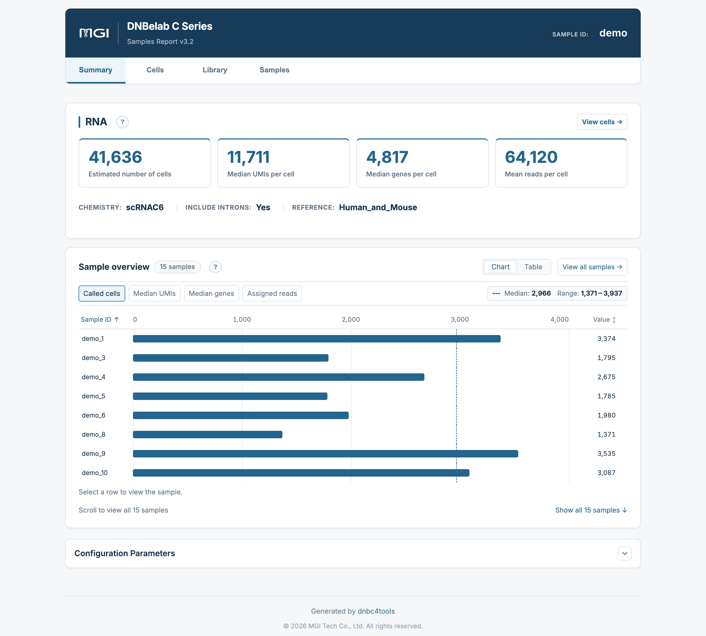
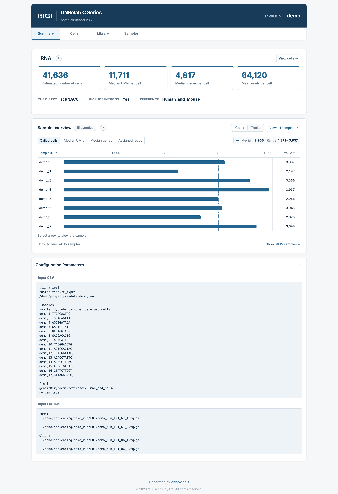
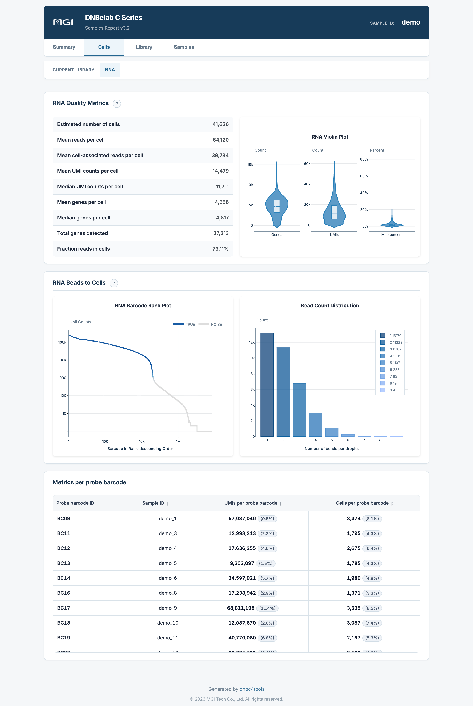
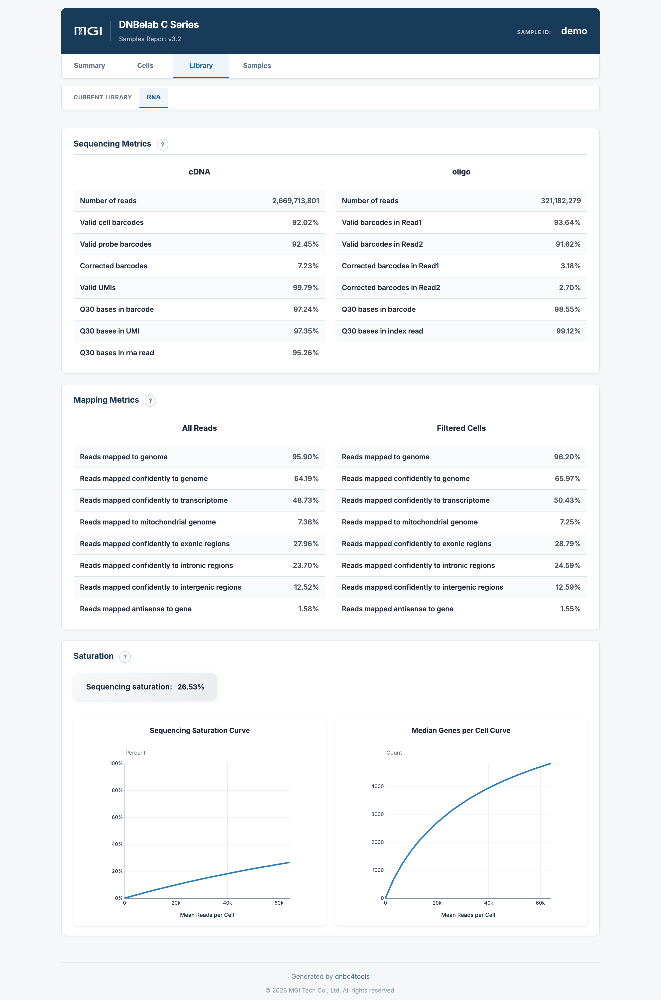
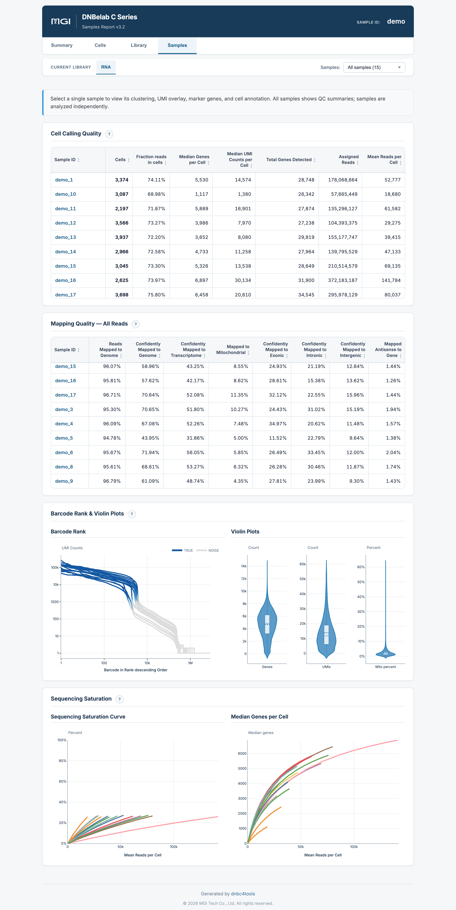
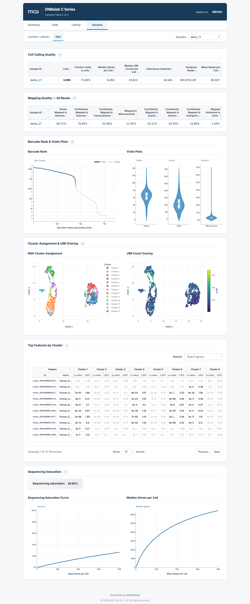

# C6 多样本分析输出说明 <a id="c6"></a> {#c6-outputs}

> **输出范围**：目录树描述常规完成运行的结果；可选文件取决于启用模块与阶段完成状态。下文质量参考区间是判读建议，不是软件内置的通过/失败规则，应以本次配置阈值和报告状态为准。

C6 多样本 RNA 分析输出分为**全局合并结果**和**各样本分析结果**。全局结果用于比较样本质控指标；各样本结果包含表达矩阵、聚类结果和报告。下游读取方法参见[结果分析](../io.md)。

### 核心交付物速览 <a id="_1"></a> {#deliverables}

下表汇总了 C6 多样本单细胞 RNA 分析的主要交付产物、文件格式、核心用途以及推荐的下游生态对接：

<div class="doc-file-table" markdown="block">

| 文件 | 格式 | 用途 |
| :--- | :--- | :--- |
| `<name>_multi_report.html` | HTML | 批次汇总与样本间比较 |
| `filtered_feature_bc_matrix.*` | MEX / H5 / H5AD | 全局有效细胞原始计数 |
| `raw_feature_bc_matrix.*` | MEX / H5 | 未过滤原始计数 |
| `singlecell.csv.gz` | CSV.GZ | 微珠/液滴明细与细胞识别标记 |
| `multi_sample/` | CSV / TSV / JSON | 样本分配及质控指标 |
| `per_sample_outs/<sample>/` | 目录 | 各样本矩阵、分析结果与报告 |
| `metrics_summary.xls` | TSV | 全局质控汇总 |
| `oligo.records.bam`、`unassigned_alignments.bam` | BAM | 共享 Oligo 与未分配读段比对 |

</div>

除批次报告位于 `outs/` 外，表中文件均相对于 `outs/rna/`；完整路径见下方目录树。

MEX 矩阵为目录，H5 和 H5AD 为同级文件。全局计数不包含跨样本联合降维和聚类。读取 `singlecell.csv.gz` 时，通过 `is_cell_barcode == 1` 筛选有效细胞，大表建议分块读取。BAM 及其索引仅在 `[rna] no_bam` 为 `false`（默认）时生成。批次与样本 HTML 报告可在桌面浏览器中本地打开。文件字段、读取方法和报告模块见下方[文件详解](#detailed-files)与[报告释义](#report-guide)。

---

全局与各样本的 `filtered_feature_bc_matrix.h5ad` 均保存下游分析前的原始计数。读取聚类或降维结果时，应使用各样本的 `analysis/QC_Cluster.h5ad`。空样本或在 `sample_failure_policy=skip` 下失败的样本可能没有分析文件或 HTML 报告；应结合报告状态与 `logs/run_manifest.json` 判读，不能将目录树视为每个样本都必有的文件清单。

## 输出目录结构 <a id="输出目录结构"></a> <a id="_2"></a> {#output-directory}

流程运行完成后，全部分析结果统一归档在 `<outdir>/<name>/outs/` 目录下。下列目录树中的 BAM 及其索引仅在 `[rna] no_bam` 为 `false`（默认）时生成；设置 `no_bam,true` 会跳过全部 BAM 输出：

```text
<outdir>/<name>/
├── outs/
│   ├── <name>_multi_report.html              # 批次多样本综合分析汇总报告 (四大交互模块)
│   └── rna/
│       ├── raw_feature_bc_matrix/            # 全局未过滤表达矩阵 (MEX 目录)
│       ├── raw_feature_bc_matrix.h5          # 全局未过滤表达矩阵 (HDF5 格式)
│       ├── filtered_feature_bc_matrix/       # 全局有效细胞表达矩阵 (MEX 目录)
│       ├── filtered_feature_bc_matrix.h5     # 全局有效细胞表达矩阵 (HDF5 格式)
│       ├── filtered_feature_bc_matrix.h5ad   # 全局有效细胞表达矩阵 (AnnData 格式，无跨样本聚类)
│       ├── singlecell.csv.gz                 # 全局液滴明细表 (含全量微珠/液滴与真实细胞识别标记)
│       ├── metrics_summary.xls               # 全局实验汇总指标 (制表符分隔 TSV)
│       ├── oligo.records.bam                 # 共享 Oligo 比对记录 (启用 BAM 时输出)
│       ├── unassigned_alignments.bam         # 未分配样本的读段比对 (启用 BAM 时输出)
│       ├── multi_sample/                     # 样本拆分与质控指标目录
│       │   ├── per_sample_metrics.csv        # 各样本核心生信指标横向对照表
│       │   ├── sample_metrics_summary.xls    # 样本级质控汇总明细表
│       │   ├── barcode_assignment_metrics.json # Sample Barcode 识别与拆分统计
│       │   └── high_occupancy_metrics.json   # 高占用液滴过滤统计
│       └── per_sample_outs/<sample>/         # 【逐样本输出目录】
│           ├── raw_feature_bc_matrix/        # 该样本未过滤表达矩阵 (MEX)
│           ├── raw_feature_bc_matrix.h5      # 该样本未过滤表达矩阵 (H5)
│           ├── filtered_feature_bc_matrix/   # 该样本有效细胞表达矩阵 (MEX)
│           ├── filtered_feature_bc_matrix.h5 # 该样本有效细胞表达矩阵 (H5)
│           ├── filtered_feature_bc_matrix.h5ad # 该样本有效细胞原始计数 (不含降维聚类)
│           ├── <sample>_scRNA_report.html    # 该样本单细胞 HTML 质控报告
│           ├── metrics_summary.xls           # 该样本质控指标表
│           ├── <sample>_alignments.bam       # 该样本比对 BAM (启用 BAM 时输出，附带 .bai / .csi)
│           └── analysis/                     # 该样本聚类分析与 Marker 基因结果
│               ├── cluster.csv               # 细胞聚类分配表与 UMAP 二维坐标
│               ├── marker.csv                # 各聚类差异 Marker 基因长表
│               ├── marker_table.csv          # 各聚类差异 Marker 基因宽表
│               ├── QC_Cluster.h5ad           # 包含降维聚类与差异基因的完整 AnnData 对象
│               ├── raw_qc.xls                # 样本单细胞质控指标原始明细表 (TSV 文本)
│               ├── raw_QCplot.png            # 过滤前质控小提琴图
│               ├── filter_QCplot.png         # 过滤后质控小提琴图
│               ├── cluster_annotation.png    # 细胞类型注释散点图 (启用注释参考库时)
│               └── cell_classification.csv   # 双物种细胞归属与多胞判定 (仅多物种时)
└── logs/
    └── run_manifest.json                      # 流程执行耗时与完成状态审计清单
```

---

## 核心交付文件详解 <a id="核心交付文件详解"></a> <a id="_3"></a> {#detailed-files}

### 1. 批次多样本汇总报告 <a id="1-outsname_multi_reporthtml"></a> {#summary-report}

路径：`outs/<name>_multi_report.html`。
* **定位**：C6 混合样本实验的质控汇总报告。
* **四大交互模块**：
  * **Summary**：批次统计卡片（细胞数、中位 UMI/基因数）、实验环境化学体系及各样本横向直方图/表格比对，附带完整的流程输入参数清单；
  * **Cells**：样本级 RNA 质控全景表、单细胞小提琴图、各样本条形码排序曲线叠加图、液滴合并分布以及探针条形码拆分统计表；
  * **Library**：共享 cDNA 与 Oligo 文库的物理测序质量（Q30、有效 Barcode/UMI）、全量与过滤细胞的双视角比对分布及测序饱和度分析；
  * **Samples**：提供全部样本质量比较（All samples 模式）以及单样本详情（Single sample 模式，包含单样本的细胞分群图、UMI 梯度投射、自动细胞类型注释及各亚群 Top Marker 基因表）。
* 报告详细指标与图表释义请参阅下方的 [批次多样本网页报告释义](#网页报告释义)。

### 2. 全局合并表达矩阵 <a id="2-filtered_feature_bc_matrix"></a> {#merged-matrix}

路径：`filtered_feature_bc_matrix.*`。
* **定位**：汇集全部样本真实细胞的高置信度联合计数矩阵，同时提供 MEX 目录、H5 与 H5AD 格式。
* **特点与设计原则**：保留原始计数，**不提供跨样本联合降维和聚类**。需要联合分析时，可根据实验设计评估批次效应，并选择相应的整合方法。
* **条形码防碰撞命名空间（Namespace Protection）**：不同样本中的微珠条形码可能相同，样本间区分严格依赖 Sample Barcode。跨样本合并分析时，**切勿随意截断细胞条形码后缀**；导入 Seurat / Scanpy 时建议添加样本名前缀（如 `add.cell.ids = c("SampleA", "SampleB")`）。

### 3. 全局微珠/液滴明细表 <a id="3-singlecellcsvgz"></a> {#droplet-metadata}

路径：`singlecell.csv.gz`。
采用流式 gzip 压缩格式存储全量微珠与液滴数据（含背景噪音液滴）。

| 列名 | 说明 |
| :--- | :--- |
| `cell` | 聚合后的细胞标识符（缺失 Sample Barcode 的背景液滴可能为空） |
| `reads` | 该微珠/液滴对应的转录组 Read 数 |
| `gene` | 检测到的基因种类数（UMI ≥ 1） |
| `umi` | 检测到的转录本分子（UMI）总数 |
| `is_cell_barcode` | **真实细胞标记**（`1` 或 `True` 表示判定为有效细胞；`0` 或 `False` 为背景；未匹配记录可为空） |
| `barcode` | 原始细胞条形码（保留 Sample Barcode 标识后缀） |

!!! warning "下游使用提示"
    - **真实细胞筛选**：在 R 或 Python 中读取该表时，**务必根据 `is_cell_barcode == 1` 筛选真实细胞**，切不可将全表直接视作细胞集合。
    - **百万级大表流式读取**：该表包含全量液滴可能达到数百万行，Python 读取推荐使用分块加载（`pd.read_csv(..., chunksize=100_000)`）或 Polars 高效筛选。

### 4. 各样本输出目录 <a id="4-per_sample_outssample"></a> {#sample-outputs}

路径：`per_sample_outs/<sample>/`。

各样本结果保存在此目录中，包含以下文件；可选文件的生成条件见相应说明：

* **样本 HTML 报告 (`<sample>_scRNA_report.html`)**：该样本的细胞质控曲线（Barcode Rank Plot）、UMAP 细胞分群图、高表达 Marker 基因列表及文库饱和度；
* **样本表达矩阵**：包含该样本独立的 MEX 目录、H5 与 AnnData 格式的 `filtered_feature_bc_matrix.h5ad`；
* **样本比对 BAM 文件 (`<sample>_alignments.bam`)**：仅在 `[rna] no_bam` 为 `false` 时生成，包含该样本真实读段的比对文件（附带 `.bai` 或 `.csi` 索引），可直接载入 IGV 查阅特定基因转录本；
* **样本分析与聚类结果目录 (`analysis/`)**：`dnbc4tools` 为每个样本独立运行的单细胞图聚类、差异基因分析与质控产物。

`marker.csv` 与普通 RNA 使用相同的正向 Marker 筛选：校正 P 值 < 0.05、log fold change > 0，每簇最多 50 个基因。`marker_table.csv` 的 `cluster{K}_pval` 列实际保存校正 P 值；额外的 `gene_symbols` 列仅在源元数据包含该字段时提供。

#### 样本分析与聚类结果明细 <a id="per_sample_outssampleanalysis"></a> {#sample-analysis}

路径：`per_sample_outs/<sample>/analysis/`。

| 文件名 | 格式 | 核心用途与字段说明 |
| :--- | :--- | :--- |
| **`cluster.csv`** | `CSV` | 单细胞聚类明细与降维坐标表。包含每个细胞条形码（行名）对应的 `nGene`、`nUMI`、`leiden`（图聚类簇编号）、`UMAP_1`、`UMAP_2` 二维散点坐标、`Cluster`（带细胞数标签），以及启用细胞注释时的 `Predict_number` 与 `Predicted cell type`。 |
| **`marker.csv`** | `CSV` | 各聚类簇差异高表达基因长表（Long-format），用于细胞亚群生物学功能富集与类型鉴定。包含 `cluster`、`gene`、`score`、`avg_log2FC`、`p_val`、`p_val_adj`（校正后显著性）、`pct.1`（簇内表达细胞比例）及 `pct.2`（簇外表达细胞比例）。 |
| **`marker_table.csv`** | `CSV` | 各聚类簇差异高表达基因宽表（Wide-format），适合报表浏览与多聚类横向对比。包含 `gene_ids`、`gene_name` 以及各聚类簇对应的 `cluster{K}_lg2fc` 与 `cluster{K}_pval`。 |
| **`QC_Cluster.h5ad`** | `H5AD` | 经过完整下游质控过滤、标准化、高变基因筛选、PCA 降维、Leiden 图聚类、UMAP 投影、`rank_genes_groups` 差异基因及细胞类型注释的完整 AnnData 核心对象。可使用 Scanpy 读取其中保存的聚类、降维坐标和 Marker 统计结果。 |
| **`raw_qc.xls`** | `TSV 文本` | 单细胞水平质控原始指标表（注意：为制表符分隔 TSV 纯文本表，非二进制 Excel）。行名为细胞 Barcode，列包含 `n_genes_by_counts`、`total_counts` 及线粒体比例等详细质控字段。 |
| **`raw_QCplot.png`** | `PNG` | 质控过滤前单细胞特征分布小提琴图（展示 UMI counts、gene counts 及线粒体比例分布）。 |
| **`filter_QCplot.png`** | `PNG` | 质控过滤后单细胞特征分布小提琴图，直观展现质控阈值裁切效果。 |
| **`cluster_annotation.png`** | `PNG` | （可选）当配置了人类（HCL）或小鼠（MCA）注释参考数据库且成功完成注释时生成，展示投射了预测细胞类型谱系的二维 UMAP 散点图。 |
| **`cell_classification.csv`** | `CSV` | （可选）仅在双物种混合分析（如 `Human_and_Mouse`）时生成，记录该样本内每个细胞的物种来源判定（Species call）及双胞/多胞（Multiplet）鉴定结果。 |

!!! note "全局分析目录交付说明"
    - **单物种 C6 运行**：全局输出不生成 `outs/rna/analysis/` 目录；各样本的聚类分析结果统一存放在各自的 `per_sample_outs/<sample>/analysis/` 目录下。
    - **双物种混合运行**：全局根目录下的 `outs/rna/analysis/` 仅交付全局全库的 `cell_classification.csv` 物种鉴定结果。
    - **表达矩阵 H5AD 位置**：作为表达计数矩阵交付物的 `filtered_feature_bc_matrix.h5ad` 放置在各样本根目录 `per_sample_outs/<sample>/` 下，与 MEX 和 H5 并列。

---

## 网页报告释义 <a id="网页报告释义"></a> <a id="outsname_multi_reporthtml"></a> {#report-guide}

路径：`outs/<name>_multi_report.html`。

**概述**：HTML 网页报告为 C6 多样本实验提供一站式交互分析仪表盘。报告采用现代两级导航架构，解耦全局文库质控与逐样本单细胞生信特征。

!!! info "C6 批次多样本质量评估原则与阅读建议"
    - **双层评估策略**：C6 实验兼具“共享文库构建”与“样本标记拆分”的双重属性。评估时应遵循**全库质控 → 样本间均一性评估 → 单样本细胞生物学复核**的三步法。
    - **文库级指标先行**：先在 `Library` 标签页核查共享 cDNA 与 Oligo 的测序通量、Q30 碱基质量、Valid Barcodes 与基因组比对率，排除共性测序实验风险。
    - **样本间均一性横向排查**：在 `Summary` 与 `Cells` 标签页，对比各样本分配读段（Assigned reads）、细胞回收数及中位基因/UMI 数，排查由于样本细胞活性差异或标记引物结合效率不均导致的产出偏倚。
    - **单样本结果核验**：在 `Samples` 标签页或各样本报告中，核验目标样本的 UMAP 分群拓扑结构、自动细胞类型注释与已知 Marker 基因表达。

### 两级导航体系架构 <a id="_4"></a> {#report-navigation}

多组学/多样本交互报告包含顶部组学导航和左侧功能导航：

* **顶部组学导航栏（一级选项卡）**：当前组学展示为 `RNA` 模块；
* **左侧功能导航栏（二级选项卡）**：
  * `Summary`：当前批次的核心概览指标卡片、多样本全景汇总及流程运行参数；
  * `Cells`：单细胞层面的质控指标表、小提琴图、条形码排序曲线、微珠合并分布及探针条形码拆分表；
  * `Library`：物理测序文库质量（Q30、有效条形码/UMI）、基因组比对构成及测序饱和度分析；
  * `Samples`：全样本质量横向对比（All samples）与单样本详情（Single sample 聚类与 Marker）。

---

### Summary 与参数 <a id="tab-1-summary-summary-parameters"></a> {#summary-and-parameters}

#### Summary 页面 (Assay overview) <a id="summary-assay-overview"></a> {#summary}

`Summary` 页面提供批次指标汇总及多样本核心表现的横向对比，帮助研究人员快速定位异常离群样本：

<div style="text-align: center; margin: 1.5rem 0;" markdown="block">

</div>

##### 1. 批次全局指标卡片 (Global Summary Cards) <a id="1-global-summary-cards"></a> {#overview-metrics}

页面顶部以高亮卡片直观呈现全批次的核心汇总数据：

| 统计卡片指标 | 算法计算与统计口径 | 判读指导与排查建议 |
| :--- | :--- | :--- |
| **Estimated number of cells**<br>*(批次估计细胞总数)* | 本次运行中所有被鉴定为有效细胞的条形码总数（各样本合并求和，下游质控过滤前）。 | 结合各样本预期上样细胞总量评估回收率；若总回收率显著低于预期，提示微流控包裹或细胞解离活性偏低。 |
| **Median UMIs per cell**<br>*(各样本中位 UMI 的中位数)* | 统计各样本的中位 UMI 分子数，并取各样本中位数的中位数（跨样本中位数，非全细胞混合中位数）。 | 反映批次整体的转录本分子捕获深度基准。 |
| **Median genes per cell**<br>*(各样本中位基因数的中位数)* | 各样本中位基因检出数的中位数（单个细胞中 UMI ≥ 1 的基因数）。 | 反映批次整体的文库丰度与基因组覆盖广度。 |
| **Mean reads per cell**<br>*(每细胞平均读段数)* | 分配给该样本的 RNA 读段对数 / 该样本识别细胞数，包含分配到该样本但不属于识别细胞的读段。 | 评估全批次平均测序深度。实际测序深度需求取决于细胞类型、文库复杂度和分析目标。 |

##### 2. 运行环境与化学体系信息 (Information) <a id="2-information"></a> {#pipeline-info}

记录流程执行的核心参数：
* **Chemistry**：建库化学试剂体系（显示为 `SCRNAC6`）；
* **Include Introns**：是否将比对至内含子区域的读段计入基因表达定量（通常推荐启用 `Yes`，将内含子读段纳入定量，常用于单核转录组 snRNA-seq）；
* **Reference**：比对所采用的参考基因组版本信息。

##### 3. 多样本横向对比与分布 (Sample overview) <a id="3-sample-overview"></a> {#sample-comparison}

提供 **Chart（直方对比图）** 与 **Table（交互式表格）** 两种切换视图：
* **Chart 视图**：以柱状图排列各样本在所选指标上的表现，并以**虚线标出跨样本中位数（Across-sample median）**；支持按样本名（`Sample ID`）或指标数值（`Value`）正逆序排列，一眼识破分配读段过少或基因数异常的离群样本。
* **Table 视图**：支持全量展示或分页滚动，包含各样本的 `Sample ID`、分配读段数及占比（`Assigned reads`）、鉴定细胞数（`Called cells`）、中位基因数（`Median genes`）及中位 UMI 数（`Median UMIs`）；点击任意一列的 `View cells →` 按钮可跳转至该样本在 `Samples` 标签页的详情页面。

---

#### 参数配置 (Configuration Parameters) <a id="configuration-parameters"></a> {#configuration}

点击报告顶部的参数信息按钮可展开本次运行的完整配置清单：

<div style="text-align: center; margin: 1.5rem 0;" markdown="block">

</div>

* **输入配置清单 (Input CSV)**：完整记录多样本运行配置文件（CSV）的内容，包括文库定义（`[libraries]`）、多样本拆分标签与预期细胞数（`[samples]`）以及 RNA 比对参数块（`[rna]`：参考基因组路径、`no_bam` 开关等）；
* **原始测序数据清单 (Input FASTQs)**：清晰记录 cDNA 与 Oligo 文库的原始 FASTQ 物理路径，为后续分析复现与实验审计提供完整凭据。

---

### Cells：细胞质控 <a id="tab-2-cells"></a> {#cell-metrics}

`Cells` 页面专注于单细胞维度的精细化质量评估，通过全景表格、小提琴图、条形码排序曲线及探针拆分表，对比各样本细胞内信号特异性与均一性：

<div style="text-align: center; margin: 1.5rem 0;" markdown="block">

</div>

#### 1. 样本级 RNA 质控全景表 (RNA Quality Metrics) <a id="1-rna-rna-quality-metrics"></a> {#rna-quality}

汇总各样本在单细胞水平的核心质控指标：

| 指标名称 (Metric) | 统计口径与算法计算 | 判读指导与排查要点 |
| :--- | :--- | :--- |
| **Estimated number of cells** | 被判定为有效真实细胞的条形码数量。 | 评估各样本独立的细胞得率是否符合实验设计预期。 |
| **Mean reads per cell** | 分配给该样本的 RNA 读段对数 / 该样本识别细胞数，包含分配到该样本但不属于识别细胞的读段。 | 评估平均物理测序深度。 |
| **Mean cell-associated reads per cell** | 关联到有效细胞条形码的 cDNA 读段总数 / 细胞总数。 | 反映有效落在真实细胞内的测序深度（排除背景液滴损耗）。 |
| **Mean UMI counts per cell** | 真实细胞内转录本分子 UMI 的平均值。 | 衡量平均分子捕获水平。 |
| **Median UMI counts per cell** | 真实细胞内转录本分子 UMI 的中位数。 | 单细胞表达定量的物理分子丰度基准。 |
| **Mean genes per cell** | 真实细胞内检出基因数（UMI ≥ 1）的平均值。 | 评估转录组检出丰富度均值。 |
| **Median genes per cell** | 真实细胞内检出基因数的中位数。 | 反映样本细胞转录活性与文库多样性核心基准。 |
| **Total genes detected** | 在至少一个细胞中检测到的所有基因总数。 | 评估样本整体转录组覆盖度，哺乳动物组织通常在 15,000–35,000 左右。 |
| **Fraction reads in cells** | 细胞内高置信度转录组 Reads 占该样本全部有效条形码 Reads 的比例。 | 用于评估细胞内读段占比；比例偏低时，结合细胞活率、条形码分配和其他质控指标排查游离 RNA 或细胞损伤。 |

#### 2. 条形码排序与微珠合并分布 (RNA Beads to Cells) <a id="2-rna-beads-to-cells"></a> {#bead-merging}

* **RNA Barcode Rank Plot（左图）**：将所有配置样本的细胞条形码排序曲线叠加在同一双对数坐标系中展示。高质量样本表现为左侧平台期长、在拐点处陡峭下折；若某条曲线明显塌陷或斜率平缓，说明该样本细胞捕获质量较差。
* **RNA Violin Plot（中图）**：展示线粒体比例分布小提琴图（Mito percent），监控细胞群体在制样与微流控包裹中的破损情况（通常建议中位数 < 10%–15%）。
* **Bead Count Distribution（右图）**：展示每个判定为真实细胞的液滴中合并的微珠条形码（Beads）数量分布直方图，绝大多数液滴应包裹 1 个微珠，反映微流控液滴反应中微珠共包裹与合并算法的稳健性。

#### 3. 探针条形码拆分统计表 (Metrics per probe barcode) <a id="3-metrics-per-probe-barcode"></a> {#barcode-metrics}

展示每个 Sample Barcode 探针的拆分效率与产出明细：
* **Probe barcode ID**：探针条形码编号（如 `BC09`、`BC11`、`BC12` 等）；
* **Sample ID**：绑定的样本名称（如 `demo_1`、`demo_3` 等）；
* **UMIs per probe barcode**：分配到该探针的 UMI 总数及在全库中的百分比；
* **Cells per probe barcode**：归属于该探针的细胞总数及在全批次中的百分比。

---

### Library：文库质控 <a id="tab-3-library"></a> {#library-metrics}

`Library` 页面展示全库共享物理文库（cDNA 与 Oligo）的测序准确性、全基因组比对质量及测序深度饱和度：

<div style="text-align: center; margin: 1.5rem 0;" markdown="block">

</div>

#### 1. 测序文库质量指标 (Sequencing Metrics) <a id="1-sequencing-metrics"></a> {#sequencing-metrics}

分别统计共建的转录组 cDNA 文库与样本标记 Oligo 文库：

| 文库类型 | 核心指标项 | 判读指导与排查要点 |
| :--- | :--- | :--- |
| **cDNA 文库** | • `Number of reads`: 输入的原始测序读段总数<br>• `Valid cell barcodes`: 细胞条形码匹配至白名单比例（推荐 ≥ 80%）<br>• `Valid probe barcodes`: 探针条形码有效匹配比例（若适用）<br>• `Corrected barcodes`: 容错 1bp 校正的条形码比例（通常 5%–10%）<br>• `Valid UMIs`: 有效无 N 且非均聚物的分子标签比例（通常 > 99%）<br>• `Q30 bases in barcode / UMI / RNA read`: 碱基测序质量（推荐 > 85%） | 评估测序仪物理运行状态与转录组建库完整性。 |
| **Oligo 文库** | • `Number of reads`: Oligo 测序读段总量<br>• `Valid barcodes in Read1 / Read2`: 双端条形码匹配白名单比例（推荐 ≥ 85%）<br>• `Corrected barcodes in Read1 / Read2`: 容错校正比例<br>• `Q30 bases in barcode / index read`: 条形码与样本标签的 Q30 质量 | 评估多样本标记引物（Sample Tag）的物理测序保真度，直接决定多样本拆分的准确性。 |

#### 2. 全基因组比对指标 (Mapping Metrics) <a id="2-mapping-metrics"></a> {#mapping-metrics}

提供 **All Reads（全量读段）** 与 **Filtered Cells（真实细胞读段）** 两种视角切换：
* **Reads mapped to genome**：成功比对至参考基因组的读段比例（推荐 ≥ 85%–90%）；
* **Reads mapped confidently to genome**：高置信度唯一比对至基因组的比例（推荐 ≥ 65%–80%）；
* **Reads mapped confidently to transcriptome**：高置信度比对至注释转录本的比例（推荐 ≥ 50%）；
* **Reads mapped to mitochondrial genome**：线粒体序列比对率；
* **Confidently mapped to Exonic / Intronic / Intergenic**：分别统计落入外显子（Exonic）、内含子（Intronic）和基因间区（Intergenic）的比例（当启用 `Include Introns` 时，外显子与内含子读段均会有效计入转录定量）；
* **Mapped antisense to gene**：反义链比对比例。

#### 3. 饱和度分析曲线 (Saturation Analysis) <a id="3-saturation-analysis"></a> {#saturation}

* **Sequencing Saturation Curve（测序饱和度曲线）**：基于抽样模拟（Downsampling）绘制测序饱和度随每细胞平均读段数的变化曲线。饱和度越高表示更多读段来源于已识别的分子；实践中达到 50%–70% 饱和度通常即可满足大部分常规转录组分群需求。
* **Median Genes per Cell Curve（基因检出饱和度曲线）**：中位检出基因数随测序深度的渐近曲线。当曲线趋于平缓平台期时，表明继续追加测序量对发现新基因的边际增益递减。

---

### Samples：样本结果 <a id="tab-4-samples"></a> {#samples}

3.2 的 C6 报告在 `Samples` 页面提供全部样本概览和单样本详情两种视图：

#### 1. 全部样本概览 (All samples 视图) <a id="1-all-samples"></a> {#all-samples}

当下拉菜单选择 `All samples (15)` 时，集中展示全部样本的横向生信指标与质控曲线：

<div style="text-align: center; margin: 1.5rem 0;" markdown="block">

</div>

* **Cell Calling Quality 全样本横向表**：汇总全部样本的 `Cells`、`Fraction reads in cells`、`Median Genes per Cell`、`Median UMI Counts per Cell`、`Mitochondrial %`、`Total Genes Detected`、`Assigned Reads` 及 `Mean Reads per Cell`；
* **Mapping Quality - All Reads 全样本横向表**：汇总全部样本的基因组比对率、置信基因组比对率、转录组比对率、外显子/内含子/基因间区分布及反义比对率；
* **全样本 Barcode Rank 曲线、Violin Plots 与饱和度曲线预览**：支持跨样本横向对比曲线形态与饱和度斜率。

---

#### 2. 单样本详情 (Single sample 视图) <a id="2-single-sample"></a> {#sample-details}

在下拉菜单中切换任意特定生物学样本（如 `demo_17`），即可查看该样本独立的生物学聚类分群与 Marker 表达：

<div style="text-align: center; margin: 1.5rem 0;" markdown="block">

</div>

##### 样本质控卡片 (Cell Calling & Mapping Quality) <a id="cell-calling-mapping-quality"></a> {#sample-qc}
切换样本后，页面顶部直接呈现该样本特异性的两组数据卡片：
* **Cell Calling Quality**：该样本的细胞数、Fraction reads in cells、中位基因/UMI 数及 Assigned Reads；
* **Mapping Quality — All Reads**：该样本的基因组比对率、转录组比对率、线粒体比例及外显子/内含子分布。

##### 独立细胞排序与小提琴图 (Barcode Rank & Violin Plots) <a id="barcode-rank-violin-plots"></a> {#barcode-rank}
* 呈现该样本独立的 Barcode Rank 曲线，清晰核查该样本自身的真实细胞拐点；
* 呈现该样本独立的单细胞 Genes、UMIs 与线粒体比例小提琴分布。

##### 独立降维聚类与 UMI 渐变投射 (Cluster Assignment & UMI Overlay) <a id="umi-cluster-assignment-umi-overlay"></a> {#clusters}
* **左图（RNA Cluster Assignment）**：基于该样本自身的表达谱进行高变基因筛选、PCA 降维与 UMAP 投影，并以无监督图聚类（Graph-based Clustering）赋予不同颜色；用于查看聚类分布（注：网页展示随机均匀抽样最多 10,000 个细胞以减少浏览器绘图负担，但实际分析及文件导出保留全量细胞）；
* **右图（UMI Count Overlay）**：在相同 UMAP 空间中以连续颜色渐变投射每个细胞的 UMI 总量，快速辅助验证聚类分群是否受到测序深度偏差的技术影响。

##### 自动细胞类型注释 (Cell Annotation) <a id="cell-annotation"></a> {#annotations}
若配置了受支持的物种参考数据库并启用了注释模块，此处将在 UMAP 散点图上展示预测的细胞类型谱系分群（如 B cells, T cells, NK cells, Monocytes 等），为研究人员提供第一手生物学细胞身份参考。

##### 差异高表达 Marker 基因列表 (Top Features by Cluster) <a id="marker-top-features-by-cluster"></a> {#markers}
提供交互式 Marker 基因数据表，将每个聚类簇（Cluster）与其对照细胞群体进行差异表达检验：
* **Cluster**：聚类簇编号；
* **Gene**：特征高表达 Marker 基因名称；
* **p_val_adj**：Scanpy `rank_genes_groups` 返回的多重检验校正 P 值；
* **avg_log2FC**：基因在该亚群中的平均表达差异对数倍数；
* **pct.1 / pct.2**：分别代表该基因在目标聚类簇内与簇外细胞中的表达比例；支持快速搜索与表格排序。

##### 样本饱和度分析 (Saturation Analysis) <a id="saturation-analysis"></a> {#sample-saturation}
展示该样本独立的测序饱和度与中位基因检出曲线。

---

## 核心指标与统计口径说明 <a id="核心指标说明"></a> <a id="_5"></a> {#metric-definitions}

为避免在多样本混合分析中产生误解，C6 的指标分母定义如下：

| 指标项 | 统计范围与口径说明 |
| :--- | :--- |
| **Assigned Reads** | 分配到该样本的实际 Read Pairs 数（以 Sample Barcode 识别为准，非全库原始 Reads）。 |
| **Mean Reads per Cell** | 样本内平均细胞读段数 = `Assigned Reads` / `Cells`（细胞数为 0 时显示为 N/A）。 |
| **Mean cell-associated reads per cell** | 关联到有效细胞条形码的 cDNA 读段总数 / 细胞总数，代表真实细胞内的有效测序深度。 |
| **Fraction Reads in Cells** | 该样本细胞内可信转录组 Reads 占该样本全部有效条形码转录组 Reads 的比例。 |
| **Mapping Quality** | 计算分母为该样本的 All Reads，绝不混入全局或非细胞读段的比例。 |
| **cDNA Valid Barcodes** | 当 Assigned Reads > 0 时稳定显示为 100%（描述已分配入该样本的集合）。 |
| **文库级指标 (Q30 / Valid UMI)** | 反映全库共享测序质量，不能解释为样本独立 QC；指标表中统一标注为 `cDNA QC scope`。 |
| **Sample Barcode 有效率** | 统计 Oligo 中成功匹配至设计 Sample Barcode 白名单的比例，由真实统计得出。 |
