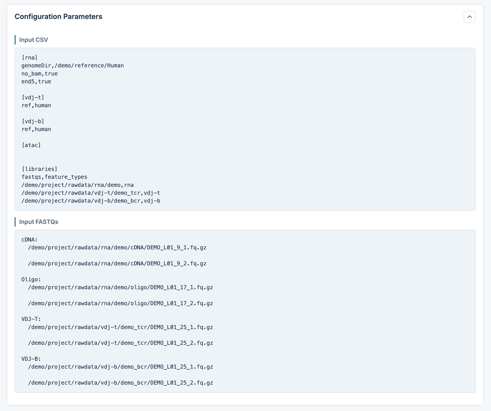
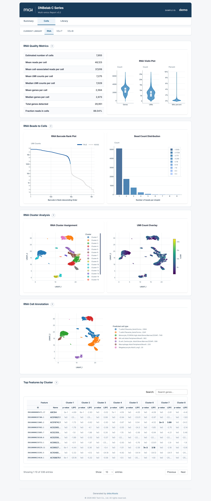
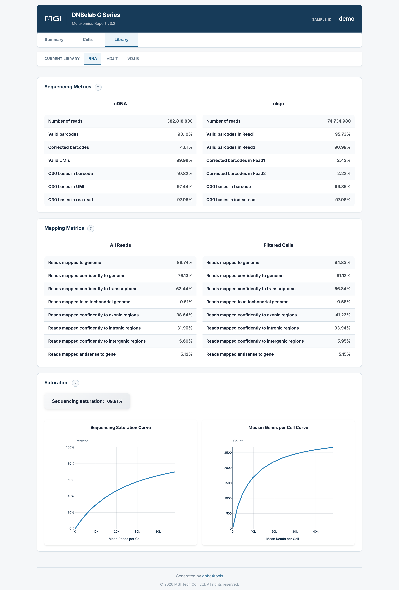
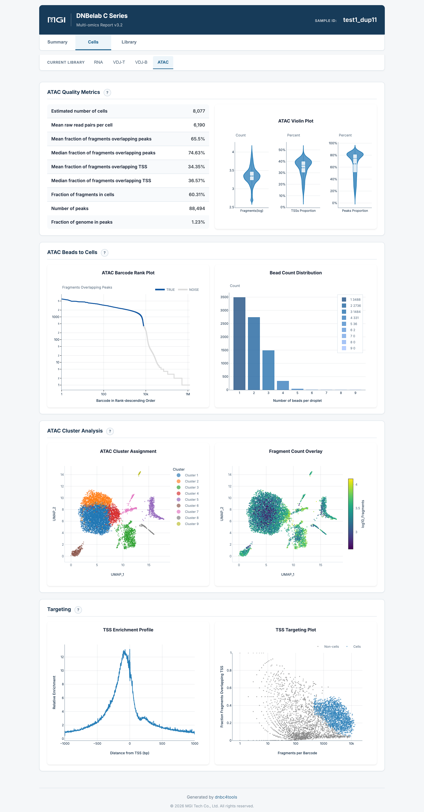
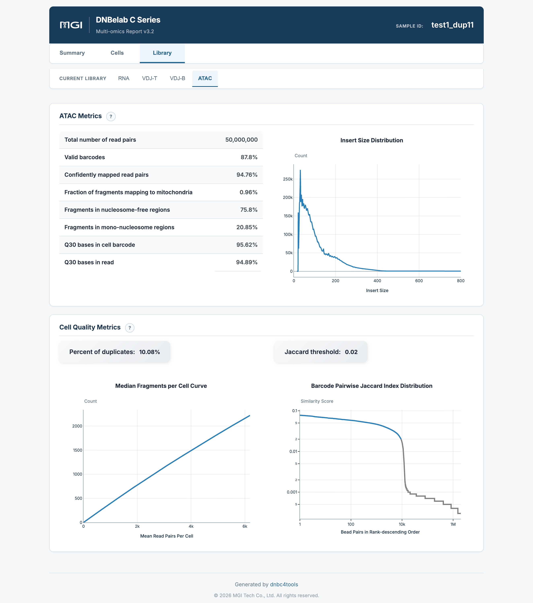
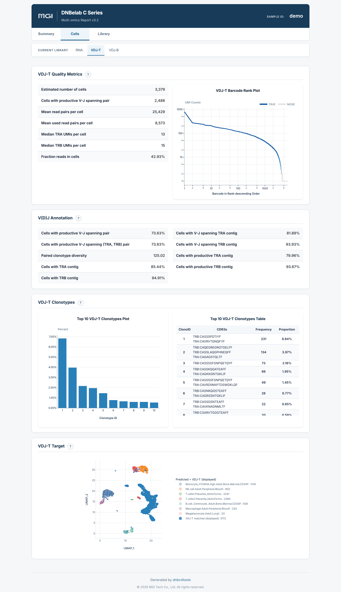
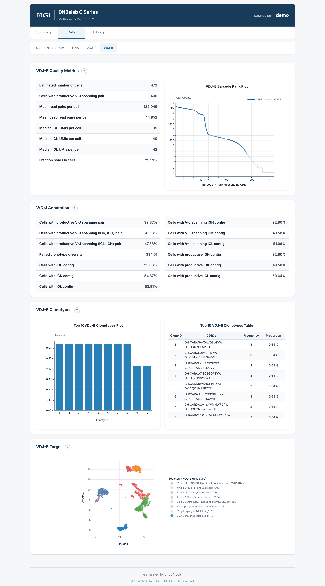
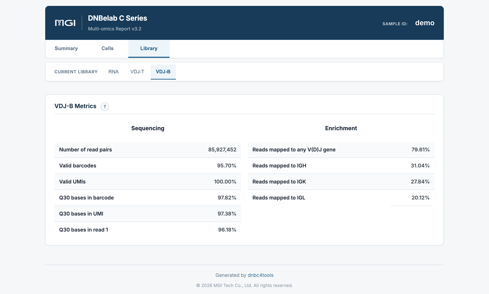

# Multi-Omics Analysis Output

> **Output scope**: Directory trees describe a typical completed run. Optional outputs depend on enabled modules and successful stages. Quality ranges below are interpretation guidance, not software pass/fail rules; use the configured thresholds and report status for this run.

Single-Cell Multi-Omics Integrated Analysis Output Guide

## Overview <a id="overview"></a>

The multi-omics workflow coordinates RNA, ATAC, and V(D)J analysis from one configuration file and organizes their outputs by modality. The combined HTML report presents QC metrics and analysis results from the enabled modalities. ATAC is analyzed independently and summarized; RNA and V(D)J support cell association analysis. A combined report does not itself perform joint dimensionality reduction or clustering across modalities.

### Deliverables at a Glance

The table below summarizes the key deliverables of multi-omics analysis, file formats, primary use cases, and recommended downstream ecosystem integrations:

| Deliverable & Core Files | Format | Description & Ecosystem Integration |
| :--- | :--- | :--- |
| **Combined Multi-Omics Report**<br>• `outs/<sample>_multi_report.html` | `HTML` | Comprehensive offline visual dashboard covering core metrics, barcode rank curves, clustering, automated cell annotations, and library alignment stats across RNA, ATAC, VDJ-T, and VDJ-B.<br>• **How to Open**: No internet required; double-click to view directly in any modern desktop browser. |
| **Single-Cell RNA Outputs**<br>• `outs/rna/` | `Directory` | Complete scRNA output directory containing filtered and raw matrices (MEX / H5 / H5AD), clustering and marker analyses (`analysis/`), single-cell metadata (`singlecell.csv`), and coordinate-sorted alignment BAM (only when `[rna] no_bam` is `false`). |
| **Chromatin Accessibility Outputs**<br>• `outs/atac/` | `Directory` | Complete scATAC output directory containing filtered and raw peak matrices (MEX / H5), high-confidence cell fragments (`filtered.fragments.tsv.gz` and Tabix index), TSS enrichment, and cell metadata. |
| **TCR Immune Repertoire Outputs**<br>• `outs/vdj-t/` | `Directory` | Complete TCR repertoire outputs containing filtered contig annotations (`filtered_contig_annotations.csv`), FASTA sequences, clonotype statistics (`clonotypes.csv`), and international AIRR annotations (`airr_annotations.tsv`). |
| **BCR Immune Repertoire Outputs**<br>• `outs/vdj-b/` | `Directory` | Complete BCR repertoire outputs containing paired heavy/light chain contig annotations, consensus sequences (`consensus.fasta`), clonotype frequencies, and AIRR standard files. |
| **Pipeline Run Manifest**<br>• `logs/run_manifest.json` | `JSON` | Audit log recording execution time and status (`success`, `success_existing` cache hit, or `failed`) per modality, facilitating automated operations and provenance tracking. |

---

## Output Directory Structure <a id="output-directory-structure"></a>

Upon completion, results are archived under `<outdir>/<sample>/outs/`:

```text
<outdir>/<sample>/
├── outs/
│   ├── <sample>_multi_report.html             # Multi-omics integrated interactive visual report
│   ├── rna/                                   # Complete RNA module output directory (if enabled)
│   │   ├── filtered_feature_bc_matrix/        # Filtered high-confidence expression matrix (MEX)
│   │   ├── filtered_feature_bc_matrix.h5      # Expression matrix (HDF5 format)
│   │   ├── filtered_feature_bc_matrix.h5ad    # Expression matrix (AnnData format)
│   │   ├── singlecell.csv                     # Single-cell QC metadata table
│   │   ├── metrics_summary.xls                # RNA metrics summary table
│   │   └── analysis/                          # Dimensionality reduction, clustering, and marker genes
│   ├── atac/                                  # Complete ATAC module output directory (if enabled)
│   │   ├── filtered.fragments.tsv.gz          # High-confidence cell fragments and Tabix index
│   │   ├── filtered_peak_bc_matrix/           # Filtered peak matrix (MEX)
│   │   ├── filtered_peak_bc_matrix.h5         # Peak matrix (HDF5 format)
│   │   ├── peak_annotation.tsv               # Optional peak annotations
│   │   ├── singlecell.csv                     # ATAC cell-level QC metadata table
│   │   └── metrics_summary.xls                # ATAC metrics summary table
│   ├── vdj-t/                                 # Complete VDJ-T module output directory (if enabled)
│   │   ├── filtered_contig_annotations.csv    # Filtered high-confidence contig annotations
│   │   ├── clonotypes.csv                     # TCR clonotype statistics table
│   │   ├── airr_annotations.tsv               # International AIRR standard annotations
│   │   └── metrics_summary.xls                # VDJ-T metrics summary table
│   └── vdj-b/                                 # Complete VDJ-B module output directory (if enabled)
│       ├── filtered_contig_annotations.csv    # Filtered high-confidence contig annotations
│       ├── clonotypes.csv                     # BCR clonotype statistics table
│       ├── airr_annotations.tsv               # International AIRR standard annotations
│       └── metrics_summary.xls                # VDJ-B metrics summary table
└── logs/
    └── run_manifest.json                      # Per-modality execution manifest and audit log
```

---

## Detailed File Description <a id="detailed-file-description"></a>

### 1. Combined Multi-Omics Report (`outs/<sample>_multi_report.html`) {#1-integrated-multi-omics-report-outssample_multi_reporthtml}

* **Content**: Centralized visual presentation of core metric cards, barcode rank curves, cluster plots, cell annotations, and sequencing/mapping quality across RNA, ATAC, VDJ-T, and VDJ-B.
* **Role**: Single offline HTML file allowing researchers to perform cross-modal QC inspection, metric cross-validation, and biological discovery in one view.

### 2. Modality-Specific Output Directories (`outs/rna`, `outs/atac`, `outs/vdj-t`, `outs/vdj-b`)

* **Content & Specification**: Each enabled modality features an independent standardized directory whose file layout, naming, and formats are completely equivalent to individual standalone runs (e.g., MEX/H5/H5AD for RNA, fragments and peak matrices for ATAC, AIRR annotations for VDJ).
* **Multi-Omics Joint Analysis**: In multi-omics experiments, cross-modal barcodes from the same cell share strict correspondence, enabling direct integration in Seurat (WNN multimodal integration), Signac, or Muon for joint clustering and gene regulatory network inference.
* **Modality Documentation Links**:
  * [scRNA Analysis Output Guide](./scRNA.md)
  * [scATAC Analysis Output Guide](./scATAC.md)
  * [scVDJ Analysis Output Guide](./scVDJ.md)

### 3. Execution Manifest & Audit Log (`logs/run_manifest.json`)

Records execution runtime and completion status per modality:
* `success`: Clean execution completed successfully;
* `success_existing`: Cache hit reusing previous checkpoint results;
* `failed`: Modality failed during execution, logging error stages for rapid troubleshooting.

<a id="c6-outputs"></a>

> [!NOTE] Note: C6 Multiplexed Outputs
> Outputs and directory structures for C6 multi-sample single-cell RNA analysis based on Sample Barcode pooling are documented separately; please refer to [C6 Multi-Sample Output Guide](c6.md).

---

## Web Report Interpretation <a id="web-report-interpretation"></a>

**Overview**: The integrated multi-omics HTML report features a two-tier navigation architecture, decoupling overall summary metrics from modality-specific cell QC and physical library statistics.

!!! info "Multi-Omics Quality Assessment Principles & Review Guide"
    - **Global Overview First**: On the report's `Summary` tab (`Assay overview`), review the core metric cards (cell counts, median UMIs/fragments, VDJ productive pairs) across all enabled modalities to verify healthy recovery in every assay.
    - **Modality-Specific Tiered Review**: Navigate through each modality tab (`RNA`, `ATAC`, `VDJ-T`, `VDJ-B`) in the top bar, using the left navigation bar to inspect `Cells` (single-cell QC) and `Library` (sequencing fidelity and mapping rates).
    - **Cross-Modal Biological Concordance**: Cross-examine RNA gene expression clusters, ATAC chromatin accessibility patterns, and V(D)J clonal expansions to ensure biological consistency across cell identities.

### Two-Tier Navigation Architecture

The interactive report decouples content via top and left navigation bars:

* **Top Modality Bar (Primary Tabs)**: Dynamically displays active modalities for this run, including `RNA`, `VDJ-T`, `VDJ-B`, and `ATAC`;
* **Left Functional Bar (Secondary Tabs)**:
  * `Summary`: Core metric cards, multi-assay summary, and run configuration parameters;
  * `Cells`: Single-cell level QC tables, violin plots, barcode rank curves, clustering, cell annotation, and marker genes;
  * `Library`: Physical sequencing library quality (Q30, valid barcodes/UMIs), genomic mapping breakdowns, and saturation analysis.

---

### 1. Summary & Parameters

#### Summary Tab (Assay overview)

The `Summary` tab provides overview metric cards for all enabled modalities in this run:

<div style="text-align: center; margin: 1.5rem 0;" markdown="block">

</div>

* **Assay Overview Cards**:
  * **RNA Overview**: Displays `Estimated number of cells`, `Median UMIs per cell`, and `Median genes per cell`;
  * **VDJ-T Overview**: Displays `Estimated number of cells`, `Cells with productive V-J spanning pair`, and chain recovery counts;
  * **VDJ-B Overview**: Displays `Estimated number of cells` and productive heavy/light chain pairing metrics;
  * **ATAC Overview** (if enabled): Displays `Estimated number of cells`, `Median fragments per cell`, and `Fraction of fragments in cells`.
* **Core Value**: Centrally presents cell recovery and signal baselines across all modalities on one screen, rapidly identifying capture balance across assays.

---

#### Configuration Parameters

Clicking the parameters button opens the configuration details modal:

<div style="text-align: center; margin: 1.5rem 0;" markdown="block">

</div>

* **Input Configuration (Input CSV)**: Fully logs configuration parameters, including modality-specific blocks (`[rna]`, `[atac]`, `[vdj-t]`, `[vdj-b]`) and reference genome paths;
* **Library FASTQ Mappings (`[libraries]`)**: Records raw FASTQ file paths and `feature_types` assignments, providing complete provenance for analysis reproducibility.

---

### 2. RNA Modality

#### RNA > Cells (Single-Cell QC & Clustering)

Presents single-cell transcriptomic quality control, unsupervised clustering, and differential marker genes:

<div style="text-align: center; margin: 1.5rem 0;" markdown="block">

</div>

* **RNA Quality Metrics**: Cell count, `Fraction reads in cells` (signal-to-noise ratio), median genes/UMIs, and mean sequencing depth;
* **RNA Beads to Cells**:
  * **RNA Barcode Rank Plot (Left)**: Log-log barcode rank curve exhibiting a steep cliff-like inflection point (Knee Point) separating real cells from ambient noise;
  * **Bead Count Distribution (Right)**: Distribution of bead barcodes merged per real cell droplet;
* **RNA Cluster Analysis**:
  * **Left Plot (RNA Cluster Assignment)**: 2D UMAP projection colored by unsupervised graph-based clusters;
  * **Right Plot (UMI Count Overlay)**: UMAP colored by total UMI counts per cell to verify that clustering is biologically driven;
* **RNA Cell Annotation**: Predicted cell type identities based on reference models;
* **Top Features by Cluster**: Interactive marker gene table with `p_val_adj`, `avg_log2FC`, and expressing percentages (`pct.1` / `pct.2`).

---

#### RNA > Library (Sequencing Fidelity, Mapping & Saturation)

Evaluates physical sequencing quality and genome alignment:

<div style="text-align: center; margin: 1.5rem 0;" markdown="block">

</div>

* **Sequencing Metrics**: Raw read pairs, valid cell barcodes, valid UMIs, and Q30 base quality percentages;
* **Mapping Metrics**: Evaluates **All Reads** vs. **Filtered Cells**, reporting genomic mapping, transcriptomic mapping, mitochondrial fraction, and exonic/intronic/intergenic proportions;
* **Saturation**:
  * **Sequencing Saturation Curve**: Saturation as a function of mean reads per cell;
  * **Median Genes per Cell Curve**: Gene discovery plateauing with depth.

---

### 3. ATAC Modality

#### ATAC > Cells (Chromatin Accessibility & Clustering)

Details chromatin accessibility signals, TSS enrichment, and epigenetic clusters:

<div style="text-align: center; margin: 1.5rem 0;" markdown="block">

</div>

* **ATAC Quality Metrics**: Estimated cells, median fragments per cell, FRIP (Fraction of fragments overlapping peaks), and TSS overlapping fractions;
* **ATAC Beads to Cells**: Fragment barcode rank plot and bead count distribution;
* **ATAC Cluster Analysis**:
  * **Left Plot (ATAC Cluster Assignment)**: Latent Semantic Indexing (LSI) reduction and UMAP projection showing chromatin subclusters;
  * **Right Plot (Fragment Count Overlay)**: Fragment count gradients projected onto UMAP;
* **Targeting**:
  * **TSS Enrichment Profile**: Normalized Tn5 insertion frequency across ±1,000 bp of annotated transcription start sites;
  * **TSS Targeting Plot**: Bivariate scatter plot of fragments vs. TSS scores separating real cells from background.

---

#### ATAC > Library (Insert Size Periodicity & Metrics)

Assesses library physical properties and chromatin structure:

<div style="text-align: center; margin: 1.5rem 0;" markdown="block">

</div>

* **ATAC Metrics**: Raw read pairs, valid barcodes, genomic mapping rates, mitochondrial ratio, and nucleosome-free / mono-nucleosome fractions;
* **Insert Size Distribution**: Fragment length periodicity displaying nucleosome-free regions (< 147 bp) and ~200 bp nucleosomal phasing;
* **Cell Quality Metrics**: Saturation curves and bead Jaccard similarity thresholds.

---

### 4. VDJ Modality (TCR & BCR Repertoires)

Presents decoupled analyses for TCR (VDJ-T) and BCR (VDJ-B) immune receptor repertoires:

#### VDJ-T / VDJ-B > Cells (Productive Pairing & Clonotypes)

<div style="text-align: center; margin: 1.5rem 0;" markdown="block">

</div>

<div style="text-align: center; margin: 1.5rem 0;" markdown="block">

</div>

* **VDJ Quality Metrics**:
  * **Estimated Cells**: High-confidence barcodes expressing target receptor transcripts;
  * **Cells with Productive V-J Spanning Pair**: Count and percentage of cells harboring full functional pairs (TRA/TRB or IGH/light chain; recommended ≥ 40%);
  * **Mean Reads per Cell**: Average reads dedicated per cell.
* **VDJ Barcode Rank Plot**: Cumulative productive UMI curves. In BCR datasets, prominent peaks correspond to antibody-secreting plasma cells.
* **V(D)J Annotation**: Detection rates and V-J spanning statistics per chain (TRA/TRB or IGH/IGK/IGL).
* **VDJ Clonotypes**:
  * **Top 10 Clonotypes Plot**: Bar chart visualizing clonal expansion;
  * **Top 10 Clonotypes Table**: Lists clonotype IDs, CDR3 amino acid and nucleotide sequences per chain, cell frequencies, and proportions.
* **VDJ Target**: Projects TCR/BCR clonally expanded cells onto RNA gene expression UMAP space, connecting clonal expansion with transcriptional phenotypes.

---

#### VDJ-T / VDJ-B > Library (Enrichment Efficiency & Sequencing)

Details targeted library quality:

<div style="text-align: center; margin: 1.5rem 0;" markdown="block">

</div>

* **Sequencing**: Read pair count, valid barcode fraction, valid UMI fraction, and Q30 base quality metrics;
* **Enrichment**:
  * **Reads mapped to any V(D)J gene**: Fraction of reads mapping to known germline V(D)J segments (recommended ≥ 50%);
  * **Chain-Specific Mapping**: Alignment proportions across specific chains (TRA/TRB or IGH/IGK/IGL) to evaluate balanced targeted capture.
