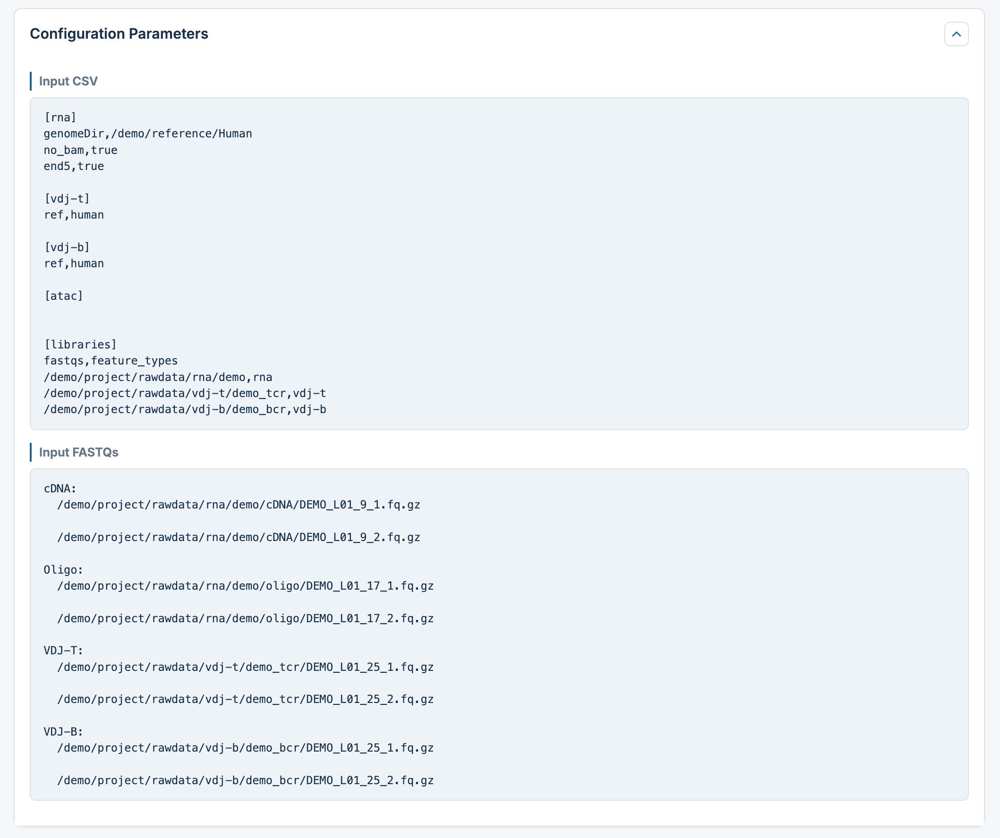
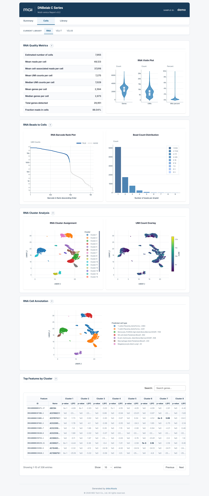
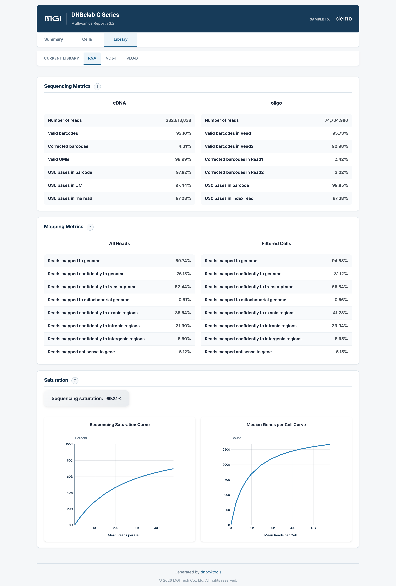
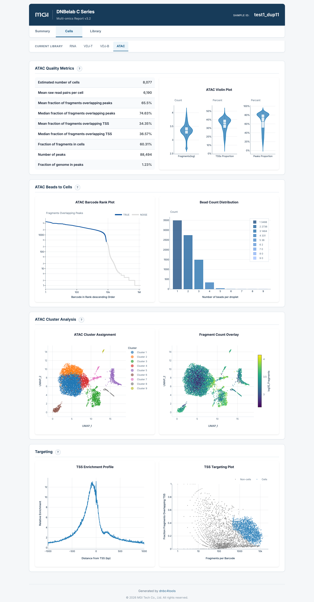
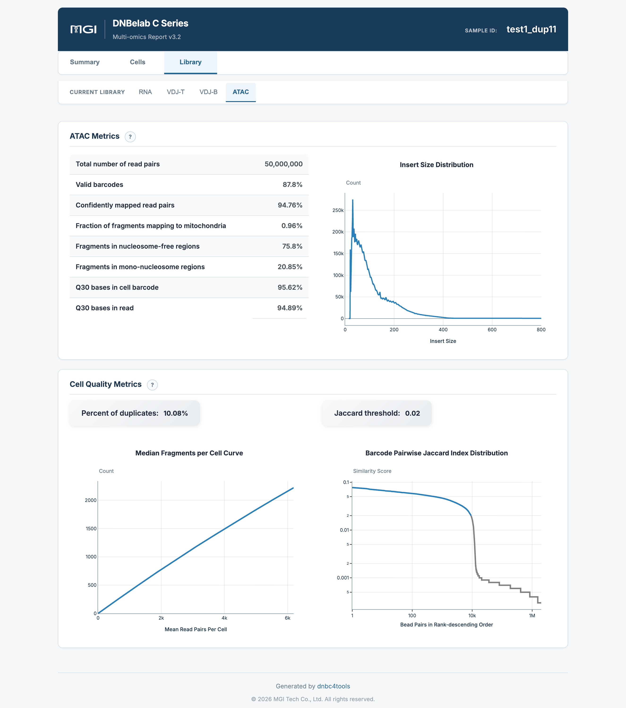
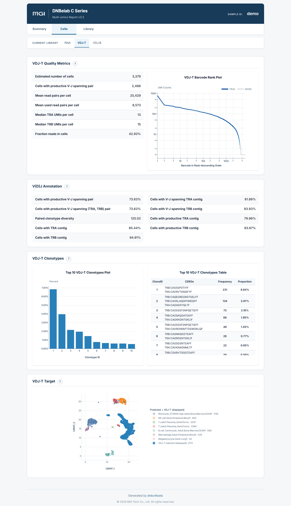
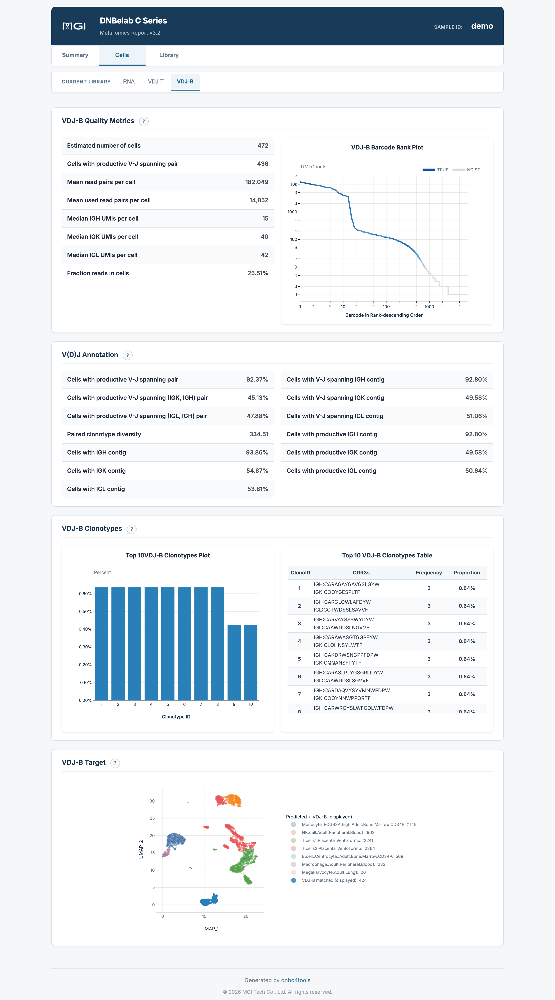
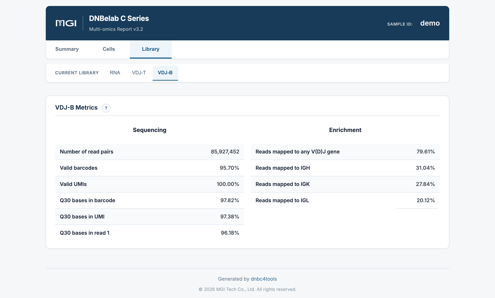

# 多组学分析输出

> **输出范围**：目录树描述常规完成运行的结果；可选文件取决于启用模块与阶段完成状态。下文质量参考区间是判读建议，不是软件内置的通过/失败规则，应以本次配置阈值和报告状态为准。

多组学整合分析输出文件说明

## 概述 <a id="概述"></a>

多组学流程通过一份配置文件调度 RNA、ATAC 和 V(D)J 分析，并按组学组织输出。组合 HTML 报告集中展示已启用组学的质控指标和分析结果。ATAC 独立分析后汇总，RNA 与 V(D)J 支持细胞关联分析；组合报告本身不执行跨组学联合降维或聚类。

### 核心交付物速览

下表汇总了多组学分析的主要交付物、文件格式、核心用途以及推荐的下游生态对接：

| 交付产物与核心文件 | 格式 | 主要用途与下游生态对接 |
| :--- | :--- | :--- |
| **多组学综合网页报告**<br>• `outs/<sample>_multi_report.html` | `HTML` | 一站式集中展示 RNA、ATAC、VDJ-T、VDJ-B 各模态的核心指标卡片、条形码排序曲线、聚类分群图、细胞注释及测序比对质量。<br>• **打开方式**: 无需网络，双击直接在任意现代桌面浏览器中打开。 |
| **单细胞转录组产物**<br>• `outs/rna/` | `目录结构` | 完整的 scRNA 输出目录，包含过滤与未过滤表达矩阵（MEX / H5 / H5AD）、降维聚类与 Marker 差异分析（`analysis/`）、单细胞质控明细表（`singlecell.csv`）及坐标排序比对 BAM 文件（仅在 `[rna] no_bam` 为 `false` 时生成）。 |
| **染色质可及性产物**<br>• `outs/atac/` | `目录结构` | 完整的 scATAC 输出目录，包含过滤与未过滤的峰定量矩阵（MEX / H5）、高质量细胞片段文件（`filtered.fragments.tsv.gz` 及 Tabix 索引）、TSS 富集统计与元数据。 |
| **T 细胞受体库产物**<br>• `outs/vdj-t/` | `目录结构` | 完整的 TCR 免疫组库输出，包含高置信度重叠群注释（`filtered_contig_annotations.csv`）、FASTA 序列、克隆型丰度统计（`clonotypes.csv`）及国际 AIRR 标准注释文件（`airr_annotations.tsv`）。 |
| **B 细胞受体库产物**<br>• `outs/vdj-b/` | `目录结构` | 完整的 BCR 免疫组库输出，包含重链/轻链配对重叠群注释、共识序列（`consensus.fasta`）、克隆型统计及 AIRR 标准格式文件。 |
| **流水线运行清单**<br>• `logs/run_manifest.json` | `JSON` | 记录各模态的执行耗时与完成状态（`success`、`success_existing` 缓存复用或 `failed`），便于自动化生产运维与审计溯源。 |

---

## 输出目录结构 <a id="输出目录结构"></a>

运行完成后，结果统一归档在 `<outdir>/<sample>/outs/` 目录下：

```text
<outdir>/<sample>/
├── outs/
│   ├── <sample>_multi_report.html             # 多组学综合交互式网页报告
│   ├── rna/                                   # RNA 模块完整输出目录 (若启用)
│   │   ├── filtered_feature_bc_matrix/        # 过滤后的高置信度表达矩阵 (MEX)
│   │   ├── filtered_feature_bc_matrix.h5      # 表达矩阵 (HDF5 格式)
│   │   ├── filtered_feature_bc_matrix.h5ad    # 表达矩阵 (AnnData 格式)
│   │   ├── singlecell.csv                     # 单细胞质控元数据表
│   │   ├── metrics_summary.xls                # RNA 实验质控指标汇总表
│   │   └── analysis/                          # 聚类降维与 Marker 基因结果
│   ├── atac/                                  # ATAC 模块完整输出目录 (若启用)
│   │   ├── filtered.fragments.tsv.gz          # 高质量细胞片段文件及索引
│   │   ├── filtered_peak_bc_matrix/           # 过滤后的峰定量矩阵 (MEX)
│   │   ├── filtered_peak_bc_matrix.h5         # 峰定量矩阵 (HDF5 格式)
│   │   ├── peak_annotation.tsv               # 峰注释（可选）
│   │   ├── singlecell.csv                     # ATAC 细胞级质控元数据表
│   │   └── metrics_summary.xls                # ATAC 实验指标汇总表
│   ├── vdj-t/                                 # VDJ-T 模块完整输出目录 (若启用)
│   │   ├── filtered_contig_annotations.csv    # 过滤后高质量重叠群注释表
│   │   ├── clonotypes.csv                     # TCR 克隆型统计分析表
│   │   ├── airr_annotations.tsv               # 国际 AIRR 标准注释文件
│   │   └── metrics_summary.xls                # VDJ-T 实验指标汇总表
│   └── vdj-b/                                 # VDJ-B 模块完整输出目录 (若启用)
│       ├── filtered_contig_annotations.csv    # 过滤后高质量重叠群注释表
│       ├── clonotypes.csv                     # BCR 克隆型统计分析表
│       ├── airr_annotations.tsv               # 国际 AIRR 标准注释文件
│       └── metrics_summary.xls                # VDJ-B 实验指标汇总表
└── logs/
    └── run_manifest.json                      # 各模态执行状态清单与审计日志
```

---

## 详细文件说明 <a id="详细文件说明"></a>

### 1. 多组学组合报告 (`outs/<sample>_multi_report.html`)

* **内容**：整合呈现 RNA、ATAC、VDJ-T、VDJ-B 各模态的核心指标卡片、条形码排序曲线、聚类分群图、细胞注释及测序比对质量。
* **用途**：单文件离线网页，可在同一个界面内完成跨模态实验质量排查、指标互验与生物学发现。

### 2. 各单组学独立输出子目录 (`outs/rna`, `outs/atac`, `outs/vdj-t`, `outs/vdj-b`)

* **内容与规范**：每个启用的组学均拥有独立的标准化输出子目录，其文件构成、命名与数据格式与独立单组学完全等价（如转录组的 MEX/H5/H5AD、ATAC 的 fragments 与 peak 矩阵、VDJ 的 AIRR 注释表等）。
* **跨组学联合分析**：在多组学实验中，同一细胞的跨模态条形码具备严格的对应与对齐关系，方便直接载入 Seurat（WNN 多模态整合分析）、Signac 或 Muon 进行多组学联合聚类与基因调控网络推断。
* **单组学详细文档链接**：
  * [scRNA 分析输出说明](./scRNA.md)
  * [scATAC 分析输出说明](./scATAC.md)
  * [scVDJ 分析输出说明](./scVDJ.md)

### 3. 运行清单审计日志 (`logs/run_manifest.json`)

记录每个组学模态的执行耗时与完成状态：
* `success`：全新分析运行顺利完成；
* `success_existing`：命中流程缓存，复用前序断点结果（断点续跑）；
* `failed`：该模态执行发生异常，记录失败节点便于快速定位排查。

<a id="c6-outputs"></a>

> [!NOTE] 提示：C6 多样本输出结果
> 基于 Sample Barcode 物理标记混合的 C6 多样本单细胞 RNA 分析输出结果与目录结构已独立成章，详情请参阅 [C6 多样本分析输出说明](c6.md)。

---

## 网页报告释义 <a id="网页报告释义"></a>

**概述**：多组学综合交互报告采用现代两级导航架构，解耦全局总览与各模态的单细胞质控及物理文库指标。

!!! info "多组学质量评估原则与阅读建议"
    - **全景总览先行**：在报告首页的 `Summary` 页面（`Assay overview`）核对各启用的组学核心卡片（细胞数、中位 UMI/片段数、VDJ 生产性配对数），确认所有模态均正常检出有效细胞。
    - **单模态逐层质控**：依次切换上方一级导航栏中的各个组学选项卡（`RNA`、`ATAC`、`VDJ-T`、`VDJ-B`），结合左侧的 `Cells`（细胞层）与 `Library`（文库层）核对各模态的基础测序保真度、条形码识别率与特征富集度。
    - **跨模态生物学一致性互验**：将 RNA 的基因表达谱聚类、ATAC 的染色质开放模式以及 V(D)J 的克隆扩增表型进行交叉比对，确认不同模态间细胞分群的生物学合理性。

### 两级导航体系架构

多组学交互报告通过顶部与左侧的两级导航栏实现清晰的内容解耦：

* **顶部组学导航栏（一级选项卡）**：动态展示本次运行中启用的组学模态，包含 `RNA`、`VDJ-T`、`VDJ-B` 及 `ATAC`；
* **左侧功能导航栏（二级选项卡）**：
  * `Summary`：当前组学的核心概览指标卡片、多模态全景汇总及流程运行参数；
  * `Cells`：单细胞层面的质控指标表、小提琴图、条形码排序曲线、降维聚类图、细胞注释及 Marker 基因；
  * `Library`：物理测序文库质量（Q30、有效条形码/UMI）、基因组比对构成及测序饱和度分析。

---

### 1. Summary 与参数配置 (Summary & Parameters)

#### Summary 页面 (Assay overview)

`Summary` 页面提供本次运行全部启用模态的核心概览指标卡片：

<div style="text-align: center; margin: 1.5rem 0;" markdown="block">

</div>

* **Assay overview 核心卡片**：
  * **RNA 概览**：展示 `Estimated number of cells`（估计细胞数）、`Median UMIs per cell`（中位 UMI 数）及 `Median genes per cell`（中位基因数）；
  * **VDJ-T 概览**：展示 `Estimated number of cells`、`Cells with productive V-J spanning pair`（具有功能性配对的细胞数）及主要链检出数；
  * **VDJ-B 概览**：展示 `Estimated number of cells` 及重轻链生产性配对统计；
  * **ATAC 概览**（若启用）：展示 `Estimated number of cells`、`Median fragments per cell`（中位片段数）及 `Fraction of fragments in cells`。
* **核心价值**：单屏集中呈现所有组学的细胞回收与信号强度基准，快速识别不同组学间细胞捕获数量的平衡度。

---

#### 参数配置 (Configuration Parameters)

点击报告顶部的参数信息按钮可展开本次运行的完整配置清单：

<div style="text-align: center; margin: 1.5rem 0;" markdown="block">

</div>

* **输入配置清单 (Input CSV)**：完整记录输入配置表的内容，包括各组学独立参数块（`[rna]`、`[atac]`、`[vdj-t]`、`[vdj-b]`）及参考基因组路径；
* **测序文库配置 (`[libraries]`)**：清晰记录各文库的原始 FASTQ 文件路径与 `feature_types` 对应关系，为后续分析复现与实验审计提供完整凭证。

---

### 2. RNA 页面 (RNA Modality)

#### RNA > Cells（单细胞质控与生物学分群）

展示单细胞转录组维度的细胞质控、无监督聚类及差异 Marker 基因：

<div style="text-align: center; margin: 1.5rem 0;" markdown="block">

</div>

* **RNA Quality Metrics**：展示细胞数、`Fraction reads in cells`（细胞内转录组读段比例，衡量信噪比）、中位基因/UMI 数及平均测序深度；
* **RNA Beads to Cells**：
  * **RNA Barcode Rank Plot（左图）**：双对数坐标系下的条形码排序曲线，呈现清晰的真实细胞拐点（Knee Point）与背景分界；
  * **Bead Count Distribution（右图）**：微流控反应中单个细胞液滴合并的微珠条形码分布；
* **RNA Cluster Analysis**：
  * **左图（RNA Cluster Assignment）**：基于表达谱的二维 UMAP 聚类图，展现不同细胞亚群的拓扑分离；
  * **右图（UMI Count Overlay）**：在相同 UMAP 空间投射 UMI 分子计数渐变，辅助排查测序深度偏倚；
* **RNA Cell Annotation**：基于参考数据库自动预测并标记的主要细胞类型；
* **Top Features by Cluster**：交互式特征 Marker 基因表，包含每个聚类簇的代表性基因、校正后 P 值（`p_val_adj`）、表达变化倍数（`avg_log2FC`）及簇内外表达比例（`pct.1` / `pct.2`）。

---

#### RNA > Library（测序质量、比对与饱和度）

展示 RNA 转录组文库的物理测序保真度与全基因组比对表现：

<div style="text-align: center; margin: 1.5rem 0;" markdown="block">

</div>

* **Sequencing Metrics**：输入读段总数、有效条形码率（`Valid cell barcodes`）、有效 UMI 率（`Valid UMIs`）及条形码/UMI/转录本读段的 Q30 质量比例；
* **Mapping Metrics**：提供 **All Reads** 与 **Filtered Cells** 两种视角，展示基因组比对率、转录组比对率、线粒体比例及外显子/内含子/基因间区分布；
* **Saturation**：
  * **Sequencing Saturation Curve**：测序饱和度随每细胞平均 cDNA reads 的渐进曲线；
  * **Median Genes per Cell Curve**：中位基因检出数随测序深度的渐近饱和曲线。

---

### 3. ATAC 页面 (ATAC Modality)

#### ATAC > Cells（染色质开放性细胞质控与聚类）

展示单细胞 ATAC 维度的细胞开放信号、TSS 富集与降维聚类：

<div style="text-align: center; margin: 1.5rem 0;" markdown="block">

</div>

* **ATAC Quality Metrics**：估计细胞数、中位片段数（`Median fragments per cell`）、峰内片段重叠比例（`Fraction overlapping peaks / FRIP`）及 TSS 区域片段重叠比例；
* **ATAC Beads to Cells**：ATAC 片段条形码排序曲线与微珠合并分布；
* **ATAC Cluster Analysis**：
  * **左图（ATAC Cluster Assignment）**：基于潜变量语义分析（LSI）降维与 UMAP 聚类，呈现表观基因组亚群结构；
  * **右图（Fragment Count Overlay）**：在 UMAP 坐标中投射每个细胞的片段深度；
* **Targeting**：
  * **TSS Enrichment Profile**：转录起始位点附近（±1,000 bp）转座酶切割信号的归一化富集曲线，中心高耸尖峰直接反映信噪比；
  * **TSS Targeting Plot**：单细胞总片段数与 TSS 富集分数的双变量散点图，直观展现高质量细胞与背景液滴的分水岭。

---

#### ATAC > Library（片段长度周期性与测序指标）

展示 ATAC 转座文库的物理特征与染色质天然构象：

<div style="text-align: center; margin: 1.5rem 0;" markdown="block">

</div>

* **ATAC Metrics**：原始读段对数、有效条形码率、基因组比对率、线粒体比例及无核小体/单核小体区域片段占比；
* **Insert Size Distribution**：插入片段长度频率分布曲线，展现由无核小体区域（< 147 bp）与约 200 bp 单核小体构成的经典梯状周期峰，验证细胞核结构的天然完整性；
* **Cell Quality Metrics**：测序饱和度分析曲线与微珠 Jaccard 相似度阈值判定分布。

---

### 4. VDJ 页面 (VDJ Modality - TCR & BCR)

多组学流程对 TCR（VDJ-T）与 BCR（VDJ-B）进行独立解耦展示，全面呈现细胞免疫受体库特征：

#### VDJ-T / VDJ-B > Cells（受体全长配对与优势克隆型）

<div style="text-align: center; margin: 1.5rem 0;" markdown="block">

</div>

<div style="text-align: center; margin: 1.5rem 0;" markdown="block">

</div>

* **VDJ Quality Metrics**：
  * **估计细胞数**：表达目标受体转录本的高置信度真实细胞数；
  * **生产性配对细胞数与比例**：具有功能性全长配对（TRA/TRB 或 IGH/轻链）的细胞绝对数及在总细胞中的占比（推荐 ≥ 40%）；
  * **平均读段数**：每个细胞平均分配的 VDJ 测序读段数。
* **VDJ Barcode Rank Plot**：各细胞条形码按生产性 UMI 降序排列的累计分布曲线。在 BCR 数据集中，常可观察到极高 UMI 计数的浆细胞特异性尖峰。
* **V(D)J Annotation**：特异性链（TRA/TRB 或 IGH/IGK/IGL）的检出比例与 V-J 跨区配对统计。
* **VDJ Clonotypes**：
  * **Top 10 Clonotypes Plot**：前 10 大优势克隆型的细胞频率柱状图，直观展现克隆扩增程度；
  * **Top 10 Clonotypes Table**：包含克隆型 ID、各链 CDR3 氨基酸与核苷酸序列、绝对细胞频数及相对占比。
* **VDJ Target**：将鉴定的 TCR/BCR 生产性受体细胞投影至单细胞转录组的 UMAP 空间，直观呈现克隆扩增亚群与功能转录状态的对应关联。

---

#### VDJ-T / VDJ-B > Library（靶向富集效率与测序质量）

展示免疫受体靶向富集文库的物理测序指标：

<div style="text-align: center; margin: 1.5rem 0;" markdown="block">

</div>

* **Sequencing**：测序读段对总数、有效条形码比例、有效 UMI 比例以及条形码/UMI/Read1 的 Q30 碱基质量；
* **Enrichment**：
  * **Reads mapped to any V(D)J gene**：成功比对至已知胚系 V(D)J 基因片段的读段占比（推荐 ≥ 50%）；
  * **链特异性映射率**：分别统计比对至各个特定链（如 TCR 的 TRA/TRB，BCR 的 IGH/IGK/IGL）的读段比例，评估各链间靶向捕获的平衡度。
