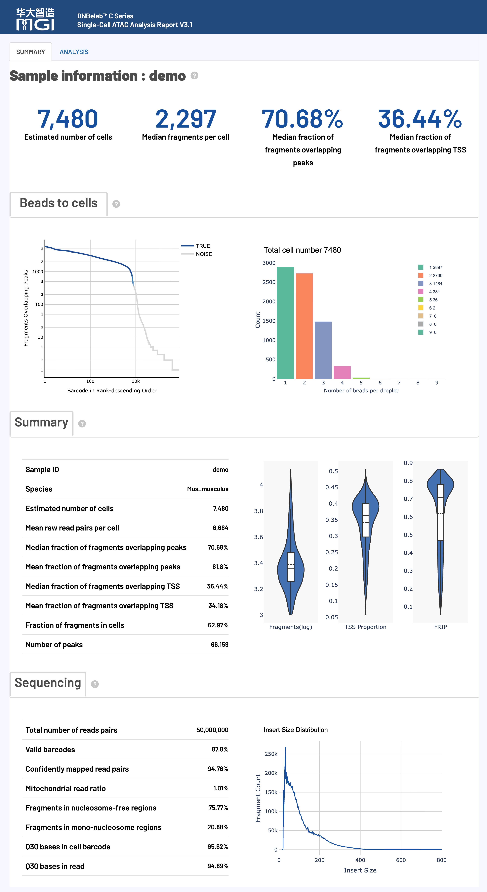
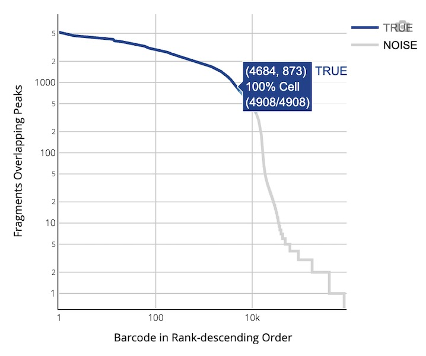
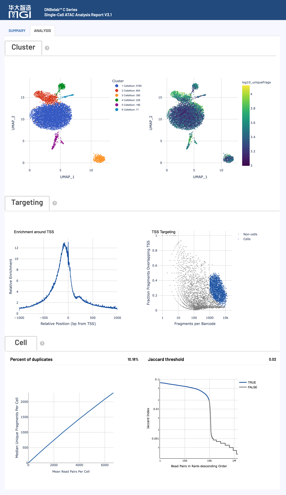

# scATAC Analysis Output

> **Output scope**: Directory trees describe a typical completed run. Optional outputs depend on enabled modules and successful stages. Quality ranges below are interpretation guidance, not software pass/fail rules; use the configured thresholds and report status for this run.

Single-Cell ATAC Sequencing Output File Guide

## Overview <a id="overview"></a>

After single-cell ATAC sequencing analysis is complete, a standardized structure of files and subdirectories is generated in the specified output directory for chromatin accessibility analysis and epigenomic research. Matrix and fragment files can be imported into tools such as Signac and ArchR using the appropriate format readers. See [Downstream Analysis](../io.md) for loading examples.

### Deliverables at a Glance

The table below summarizes the key deliverables of scATAC analysis, file formats, primary use cases, and recommended downstream ecosystem integrations:

| Deliverable & Core Files | Format | Description & Ecosystem Integration |
| :--- | :--- | :--- |
| **Filtered Cell Fragments**<br>• `filtered.fragments.tsv.gz`<br>• `filtered.fragments.tsv.gz.tbi` | `BED (TSV.GZ)`<br>`TBI Index` | QC-filtered high-confidence fragments from real cells in BED format, recommended primary input for downstream analysis.<br>• **Recommended Tools**: Signac (`CreateChromatinAssay`) / ArchR (`createArrowFiles`) |
| **All Aligned Fragments**<br>• `fragments.tsv.gz`<br>• `fragments.tsv.gz.tbi` | `BED (TSV.GZ)`<br>`TBI Index` | Contains all uniquely aligned fragments with genomic coordinates and barcode tags, used for full provenance and background assessment.<br>• **Ecosystem**: Can be directly loaded as BED tracks in IGV or UCSC Genome Browser. |
| **Chromatin Peak Matrix**<br>• `filtered_peak_bc_matrix/`<br>• `filtered_peak_bc_matrix.h5` | `MEX Sparse Matrix`<br>`HDF5 (H5)` | Filtered peak quantification count matrix.<br>• **Counting Metric**: Matrix values default to **Cutsites (transposition insertion endpoints)** for higher sensitivity; never use column sums (`colSums`) as fragment sequencing depth for filtering. |
| **Raw Peak Matrix**<br>• `raw_peak_bc_matrix/`<br>• `raw_peak_bc_matrix.h5` | `MEX Sparse Matrix`<br>`HDF5 (H5)` | Unfiltered raw peak count matrix covering all candidate beads/droplets and background noise, used for custom filtering models. |
| **Cell Metadata**<br>• `singlecell.csv` | `CSV` | Records per-cell fragments, peaks, TSS/peak region fragments, cutsite counts, and real-cell flags (`is_cell_barcode`).<br>• **Filtering**: Filter real cells where `is_cell_barcode == 1`. |
| **Metrics Summary**<br>• `metrics_summary.xls` | `TSV Text` | Global summary of sequencing quality, alignment rates, cell count, median fragments, and TSS enrichment.<br>• **Format**: Tab-delimited text; read with `read.delim()` in R or `pd.read_csv(sep='\t')` in Python. |
| **Interactive Web Report**<br>• `<sample>_scATAC_report.html` | `HTML` | Comprehensive offline visual report for reviewing barcode rank curves, TSS enrichment profiles, fragment length distribution, and UMAP clustering.<br>• **How to Open**: No internet connection required; double-click to open in any modern desktop browser. |
| **Alignment BAM**<br>• `alignment.fragments.sorted.tagged.bam`<br>• `alignment.fragments.sorted.tagged.bam.bai` | `BAM`<br>`BAI / CSI` | Coordinate-sorted BAM file with error-corrected cell barcode tags (`CB`, `CR`).<br>• **Condition**: Requires `--need_bam` flag during analysis; used for locus-level IGV inspection. |
| **Peak Annotation**<br>• `peak_annotation.tsv` | `TSV` | Filtered-peak gene associations; optional, see [annotation fields](#peak-annotation). |
| **Optional Diagnostics**<br>• `cell_classification.csv`<br>• `whitelist_contamination*.json` | `CSV` / `JSON` | Mixed-species assignments and C4 whitelist diagnostics when produced. |

## Directory Structure <a id="directory-structure"></a>

```text
outs/
├── filtered.fragments.tsv.gz                   # QC-filtered fragment file for high-quality cells (preferred for downstream analysis)
├── filtered.fragments.tsv.gz.tbi               # Tabix index for filtered fragments
├── fragments.tsv.gz                            # All aligned fragments file (BED format)
├── fragments.tsv.gz.tbi                        # Tabix index for all fragments
├── filtered_peak_bc_matrix/                    # Filtered chromatin peak quantification matrix (MEX format)
│   ├── barcodes.tsv.gz                         # High-quality real cell barcode IDs
│   ├── peaks.bed.gz                            # Identified peak genomic coordinates (BED format)
│   └── matrix.mtx.gz                           # Sparse peak count matrix (single-space delimited, cutsite counts)
├── filtered_peak_bc_matrix.h5                  # Filtered peak matrix (single-file HDF5 format)
├── raw_peak_bc_matrix/                         # Unfiltered raw peak matrix directory (MEX format)
│   ├── barcodes.tsv.gz
│   ├── peaks.bed.gz
│   └── matrix.mtx.gz
├── raw_peak_bc_matrix.h5                       # Unfiltered raw peak matrix (single-file HDF5 format)
├── peak_annotation.tsv                       # Optional filtered-peak gene annotations
├── cell_classification.csv                   # Optional mixed-species assignments
├── whitelist_contamination.json              # Optional whitelist diagnostics
├── whitelist_contamination_cells.json        # Optional cell-level whitelist diagnostics
├── singlecell.csv                              # Cell-level QC and metadata table (with is_cell_barcode)
├── metrics_summary.xls                         # Analysis quality metrics summary table (tab-delimited TSV)
├── <sample>_scATAC_report.html                 # Comprehensive interactive web QC and analysis report
├── alignment.fragments.sorted.tagged.bam       # Coordinate-sorted alignment BAM file (output when --need_bam is enabled)
└── alignment.fragments.sorted.tagged.bam.bai   # BAM index file (.csi generated for extra-long chromosomes)
```

<a id="v32-outputs"></a>

Raw and filtered peak matrices also have H5 exports. Matrix counts default to cutsites; cell calling, FRIP, and TSS fractions retain unique-fragment statistics. BAM requires `--need_bam`; indexes can be BAI or CSI.

## File Details <a id="file-details"></a>

### ATAC Fragment and Peak Files <a id="atac-fragment-and-peak-files"></a>

**Core Content**: ATAC-seq fragment information and peak identification results, containing complete chromatin accessibility data and cell barcode tags.

#### fragments.tsv.gz

`fragments.tsv.gz` is a compressed TSV file containing ATAC-seq fragment information, serving as one of the core data files for downstream analysis.

*   **Purpose**:
    *   **Chromatin Accessibility Analysis**: Precisely locate the genomic coordinates of each open chromatin region.
    *   **Data Visualization**: Can be loaded directly as a BED file into genome browsers such as IGV and UCSC.
    *   **Downstream Tool Input**: Fully compatible with mainstream single-cell analysis tools including ArchR and Signac.

*   **Content & Format**:
    *   The file is in **BED-like** format, with each row representing a unique ATAC-seq fragment.
    *   Contains the following 5 columns:

        | Field Name | Description |
        | :--- | :--- |
        | `chrom` | Reference genome chromosome name identifying the fragment location |
        | `chromStart` | 0-based adjusted start position on the chromosome, corrected for transposase insertion offset |
        | `chromEnd` | Adjusted end position on the chromosome (exclusive), corrected for transposase insertion offset |
        | `barcode` | Cell barcode ID corresponding to the `CB` tag in the BAM file, used to attribute fragments to specific cells |
        | `readSupport` | Total number of read pairs associated with this fragment (including unique and duplicate reads) |

*   **Coordinate Adjustment**:
    *   To accurately map Tn5 transposase cleavage sites, fragment coordinates are shifted: the start position is moved 4 bp forward from the leftmost alignment, and the end position is moved 5 bp backward from the rightmost alignment.

#### fragments.tsv.gz.tbi

The Tabix index file for `fragments.tsv.gz`.

*   **Core Purpose**: Enables rapid, interval-based random access queries on large fragment files without loading the entire dataset into memory.
*   **Format**: Standard binary index file generated by `tabix`.

#### filtered.fragments.tsv.gz

The QC-filtered ATAC-seq fragment file, representing a curated subset of `fragments.tsv.gz` containing only high-confidence real cells.

*   **Core Purpose**:
    *   **Primary Downstream Input**: Recommended input for cell clustering, differential accessibility, and transcription factor motif analyses.
    *   **Signal-to-Noise Enhancement**: Drastically reduces background noise by removing debris and low-quality non-cell barcodes.
*   **Content & Format**:
    *   Identical in format to `fragments.tsv.gz` (5 columns, compressed BED-like TSV).
    *   Contains only fragments assigned to barcodes that passed cell calling algorithms.

#### filtered.fragments.tsv.gz.tbi

The Tabix index file for `filtered.fragments.tsv.gz`.

*   **Core Purpose**: Ensures fast region-based access when downstream tools (such as ArchR and Signac) query the filtered fragments.
*   **Format**: Standard binary Tabix index file.

#### alignment.fragments.sorted.tagged.bam

The coordinate-sorted BAM file containing all validly barcoded and successfully aligned reads.

*   **Core Purpose**:
    *   **Visualization & Verification**: Inspect alignment coverage across specific loci in IGV.
    *   **Custom Pipeline Input**: Serves as raw aligned data for custom epigenetic processing.
*   **Key TAG Fields**:

    | TAG | Type | Description |
    | :--- | :---: | :--- |
    | `CB` | Z | Error-corrected and merged cell barcode identifier |
    | `CC` | Z | Error-corrected cell barcode sequence |
    | `CR` | Z | Raw cell barcode sequence as reported by the sequencer |

#### alignment.fragments.sorted.tagged.bam.bai

Index file for `alignment.fragments.sorted.tagged.bam`.

*   **Core Purpose**: Enables fast random access and visualization in tools like IGV and Samtools.
*   **Format**: Standard **BAI** index format (or `.csi` when reference chromosomes exceed standard BAI size limits).

### Peak Matrix Files <a id="peak-matrix-files"></a>

**Core Content**: Single-cell peak quantification matrices in raw and filtered states, formatted as standard sparse matrices.

!!! warning "Crucial Note: Matrix Counting Metric (Cutsite) vs. Cell QC Metric (Unique Fragment)"
    - **Cutsite Counting Metric**: Values in the peak matrix (`filtered_peak_bc_matrix`) represent **two-end cleavage site counts (cutsites)** after Tn5 9-bp offset adjustment, providing maximal sensitivity for local chromatin accessibility.
    - **Fragment QC Metric**: In `singlecell.csv`, metrics including `peak_region_fragments`, FRIP (Fraction of Reads in Peaks), TSS enrichment fraction, and cell calling filters are **strictly based on deduplicated unique fragments**.
    - **Usage Warning**: In R (Signac) or Python, **never use matrix column sums (`colSums(mtx)`) as cell fragment sequencing depth for QC filtering**! Theoretically, 1 fragment ≈ 2 cutsites, and their statistical distributions and biological implications differ significantly.
    - **Delimiter Specification**: Since version 3.2, `matrix.mtx.gz` uses a single space delimiter. Custom parsing scripts should use `line.split()` (matching arbitrary whitespace) or standard `Matrix::readMM`.

#### Filtered Peak Matrix (`filtered_peak_bc_matrix/`)

Contains the peak count matrix filtered for high-confidence real cells, serving as the primary quantification input for downstream analysis.

*   **Format**: Standard **Matrix Market Exchange (MEX)** format, composed of three compressed files:

    | File Name | Description |
    | :--- | :--- |
    | `barcodes.tsv.gz` | Cell barcode ID list for high-quality real cells, corresponding to matrix columns |
    | `peaks.bed.gz` | Peak position file in BED format (chromosome, start, end), corresponding to matrix rows |
    | `matrix.mtx.gz` | Sparse count matrix in Matrix Market format, recording non-zero row/column indices and cutsite values |

#### Raw Peak Matrix (`raw_peak_bc_matrix/`)

Contains the unfiltered peak count matrix for all detected barcodes (including real cells and background droplets).

*   **Core Purpose**: Used to evaluate cell calling thresholds or apply custom filtering models.
*   **Format**: Identical structure to `filtered_peak_bc_matrix/` in MEX format.

### Analysis Metrics Summary <a id="analysis-metrics-summary"></a>

**Core Content**: Comprehensive quality assessment and statistical metrics covering sequencing, alignment, and cell calling.

#### metrics_summary.xls

A structured table of key quality metrics in tab-delimited text format (TSV).

*   **Core Purpose**: Rapidly inspect data quality, alignment efficiency, cell yields, and chromatin accessibility enrichment.
*   **Metric Categories**:

    | Metric Category | Contents |
    | :--- | :--- |
    | **Sequencing Statistics** | Total raw read pairs, valid barcode fraction, Q30 base quality metrics |
    | **Cell Calling Metrics** | Estimated number of cells, median fragments per cell, FRIP, TSS fraction, number of peaks |
    | **Alignment & Structural Metrics** | Confidently mapped read pairs, mitochondrial ratio, nucleosome-free and mono-nucleosome fractions |

*   **Usage**: Tab-delimited plain text; read with `read.delim("metrics_summary.xls")` in R or `pd.read_csv("metrics_summary.xls", sep="\t")` in Python. For metric descriptions and recommended benchmarks, refer to [Web Report Interpretation](#web-report-interpretation).

#### Peak Annotation {#peak-annotation}

`peak_annotation.tsv` is a tab-delimited annotation table for filtered peaks. It is published when the filtered `peaks.bed.gz` and reference GTF are available and annotation succeeds. Annotation failures do not make this a mandatory output. A peak may have multiple gene associations, so the table is not guaranteed to have one row per matrix feature.

| Fields | Meaning |
| :--- | :--- |
| `chrom`, `start`, `end` | Peak coordinates, using 0-based start and exclusive end |
| `gene`, `gene_id` | Associated gene symbol and reference gene ID |
| `distance` | Signed distance from the associated TSS to the nearest peak base; zero for overlap, positive downstream along transcription |
| `peak_type` | Promoter/distal association or an intergenic/unannotated result |
| `genomic_region` | Genomic region classification |
| `gene_biotype`, `tss_source` | GTF gene biotype and annotation source of the selected TSS |

Additional optional files: `cell_classification.csv` at the ATAC output root for mixed-species classification; `whitelist_contamination.json` and `whitelist_contamination_cells.json` when the C4 whitelist/low-targeting policy emits diagnostics (`audit` or `apply`). `Multiplet` is a mixed-species candidate and `Unassigned` means no confident species assignment. These are not confirmed biological doublet labels.

#### singlecell.csv

Cell-level multi-dimensional QC and metadata table in CSV format.

*   **Columns**:
    `Cell,totalFrags,fragments,mt_region_fragments,chloroplast_region_fragments,TSS_region_fragments,blacklist_region_fragments,peaks_number,peak_region_fragments,peak_region_cutsites,is_cell_barcode,Cellbarcode`.
*   **Core Purpose**:
    *   **Fine-grained QC**: Extract real cells by `is_cell_barcode == 1`, or apply custom secondary filtering on fragments and TSS proportions.
    *   **Downstream Metadata**: Integrates directly as cell metadata (`adata.obs` in Scanpy or `cell_metadata` in ArchR/Signac).

`totalFrags` counts fragment-supporting read pairs including duplicate support; `fragments` counts deduplicated unique fragments. The report summary uses nuclear fragments for FRIP/TSS fractions. Targeting scatter plots instead divide by all unique `fragments`; the normalized TSS enrichment profile is a separate signal. Empty fragment gzip files may have no `.tbi` index. ATAC clustering objects remain in processing and are not published as an `outs/analysis/` bundle.

#### *_scATAC_report.html

Self-contained interactive visual analysis report in HTML format.

*   **Core Purpose**: Provides interactive charts for QC metrics, barcode rank curves, TSS profiles, fragment length periodicity, and cell clustering.
*   **Convenient Sharing**: Single offline file; opens directly in any desktop browser without an internet connection.

## File Format Specifications <a id="file-format-specifications"></a>

#### Matrix Market Format (`.mtx.gz`) <a id="market-matrix-format-mtxgz"></a>

The Matrix Market Exchange Format (MEX) is the community standard for storing sparse single-cell count matrices.

*   **File Components**:

    | File Name | Description |
    | :--- | :--- |
    | `matrix.mtx.gz` | Compressed sparse matrix. Header records dimensions and total non-zero entries; subsequent lines record row/column indices and values |
    | `barcodes.tsv.gz` | Compressed barcode file; each row corresponds to a cell ID and matrix **column** |
    | `peaks.bed.gz` | Compressed peak feature file; each row corresponds to a peak BED coordinate and matrix **row** |

## Web Report Interpretation <a id="web-report-interpretation"></a>

**Overview**: The HTML report provides visual summaries and quality metrics for single-cell ATAC sequencing, covering library quality, chromatin structure, and downstream clustering.

!!! info "Quality Assessment Principles & Guide"
    - **Holistic Assessment**: The HTML report provides a comprehensive summary of scATAC results, spanning cell calling, sequencing fidelity, fragment length periodicity, TSS enrichment, and peak distribution.
    - **Baseline Context**: Benchmark thresholds reflect standard primary tissue samples. Actual metrics vary across tissue types (e.g., solid tumors, primary neural tissue, frozen nuclei), cell states, and sequencing depth. Interpret metrics in context.
    - **Review Workflow**: We recommend inspecting base sequencing quality and alignment first, followed by mitochondrial ratio, TSS enrichment, and FRIP, before verifying the biological plausibility of UMAP clusters.

### Report Structure & Key Content

<div style="text-align: center; margin: 1.5rem 0;" markdown="block">

</div>

### Detailed Analysis Metrics

#### Cell Metrics <a id="cell-metrics"></a>

**Core Function**: Evaluates cell calling yield, library quality, and chromatin accessibility enrichment.

**Quality Reference Benchmarks:**

| Metric | Optimal | Acceptable | Suboptimal |
| :--- | :---: | :---: | :---: |
| **Median fragments per cell** | ≥ 10,000 | 2,000 – 10,000 | < 2,000 |
| **Median fraction of fragments overlapping peaks** | ≥ 30% | 15% – 30% | < 15% |
| **Median fraction of fragments overlapping TSS** | ≥ 20% | 10% – 20% | < 10% |
| **Fraction fragments in cells** | ≥ 50% | 20% – 50% | < 20% |

**Detailed Metric Definitions & Interpretation:**

| Metric | Calculation & Definition | Interpretation & Troubleshooting |
| :--- | :--- | :--- |
| **Estimated number of cells** | Total number of high-confidence real cell barcodes identified after bead merging and filtering based on fragment count and TSS enrichment. | Evaluate against targeted cell input. If substantially lower than expected, check cell viability, microfluidic encapsulation, or nuclear integrity. |
| **Species** | Reference organism and genome build used for alignment and annotation. | First checkpoint to verify that reference genome configurations match the biological specimen. |
| **Median fragments per cell** | Median number of unique ATAC-seq fragments assigned to real cells. | Core measure of per-cell sequencing depth and capture sensitivity. Optimal is ≥ 10,000 (minimum ≥ 2,000); low values reduce power in peak calling and clustering. |
| **Mean raw read pairs per cell** | Total raw read pairs / Estimated number of cells. | Evaluates overall sequencing depth. Recommended ≥ 25,000 read pairs/cell to ensure sufficient chromatin coverage. |
| **Fraction overlapping peaks** | Median across called cells of `peak_region_fragments / nuclear_fragments`, where `nuclear_fragments = fragments − mt_region_fragments − chloroplast_region_fragments`; the implementation clips the denominator to at least 1. | Gold standard for ATAC signal specificity and signal-to-noise ratio. Recommended ≥ 30%; < 15% indicates high ambient DNA background or poor transposition. |
| **Fraction overlapping TSS** | Median across called cells of `TSS_region_fragments / nuclear_fragments` for regions within ±1,000 bp of annotated TSSs. The denominator is the same as for the peak-overlap summary. | Reflects promoter accessibility signal enrichment. Recommended ≥ 20%; < 10% suggests non-specific cleavage or chromatin degradation. |
| **Fraction of fragments in cells** | Sum of `totalFrags` for called cells / sum of `totalFrags` for all rows. This counts fragment-supporting read pairs including duplicate support, not deduplicated `fragments`. | Measures real cellular signal relative to ambient background and empty droplets. Recommended ≥ 50%; low values suggest abundant cell-free chromatin debris. |
| **Number of peaks** | Total number of open chromatin peaks identified across all pooled high-quality cells. | Typically ranges from 50,000 to 150,000, depending on cell heterogeneity, cell count, and sequencing depth. |

#### Sequencing Metrics <a id="sequencing-metrics"></a>

**Core Function**: Assesses primary sequencing quality, barcode validity, and alignment fidelity.

**Quality Reference Benchmarks:**

| Metric | Optimal | Acceptable | Suboptimal |
| :--- | :---: | :---: | :---: |
| **Valid barcodes** | ≥ 80% | 70% – 80% | < 70% |
| **Q30 bases in barcode** | > 85% | 75% – 85% | < 75% |
| **Q30 bases in read** | > 85% | 75% – 85% | < 75% |
| **Confidently mapped read pairs** | > 80% | 50% – 80% | < 50% |

**Detailed Metric Definitions & Interpretation:**

| Metric | Calculation & Definition | Interpretation & Troubleshooting |
| :--- | :--- | :--- |
| **Total number of reads pairs** | Total raw paired-end reads generated for the sample. | Direct measure of total raw sequencing volume and baseline for sequencing depth. |
| **Valid barcodes** | Fraction of reads whose cell barcodes match the pre-defined whitelist (with error correction). | Recommended ≥ 80%. Low fractions indicate barcode sequencing errors, primer abnormalities, or index drift. |
| **Confidently mapped read pairs** | Fraction of read pairs uniquely aligned to the reference genome. | Recommended ≥ 80%. Values < 50% warrant checking for sample contamination, incorrect reference build, or excess repeat multi-mapping. |
| **Mitochondria reads ratio** | Percentage of aligned reads mapping to the mitochondrial genome. | Core indicator of nuclear isolation purity. Unprotected mtDNA is hyper-accessible to Tn5; recommended < 10%, > 20% indicates nuclear envelope rupture. |
| **Nucleosome-free regions** | Percentage of transposition fragments shorter than 147 bp. | Reflects active accessible chromatin at promoters and enhancers. Recommended > 40%; low values indicate under-transposition or chromatin compaction. |
| **Mono-nucleosome regions** | Percentage of fragments between 147 bp and 294 bp (spanning a single nucleosome). | Complements nucleosome-free fragments to verify nucleosomal phase periodicity. |
| **Q30 bases in barcode** | Percentage of bases in barcode reads with Phred quality score ≥ 30 (error rate < 0.1%). | Evaluates primary sequencing quality for cell identity assignment. Recommended > 85%. |
| **Q30 bases in read** | Percentage of genomic insert read bases with quality score ≥ 30. | Determines alignment fidelity and peak boundary resolution. |

### Interactive Visualization Charts

<a id="visualization-charts-1"></a>

The HTML report includes multi-dimensional interactive charts covering cell QC, chromatin periodicity, and clustering.

#### 1. Barcode Rank Plot

**Chart Function**: Displays cumulative fragments across all cell barcodes ranked in descending order to separate real cells from background noise.

<div style="text-align: center; margin: 1.2rem 0;" markdown="block">

</div>

**How to Interpret**:

*   **Axes**:
    *   **X-axis (Barcode Rank)**: All barcodes ranked by peak fragment count in descending order (log scale).
    *   **Y-axis (Fragment Counts)**: Fragment count per barcode (log scale).
*   **Knee Point Characteristics**:
    *   High-quality libraries exhibit a steep cliff-like inflection (knee point).
    *   **Blue region**: High-confidence real cells identified by the calling algorithm.
    *   **Gray region**: Background ambient fragments and empty droplets.
*   **Interactive Features**: Hover to inspect individual barcode rankings; blue color gradient reflects local cell density.

---

#### 2. Droplet Beads Distribution

**Chart Function**: Displays the distribution of bead counts captured per real cell droplet.

**How to Interpret**:

*   **Theoretical Model**: Microfluidic co-encapsulation follows a **Poisson distribution**, reflecting random capture mechanics.
*   **Practical Context**: Deviations reflect microfluidic droplet uniformity, cell suspension concentration, or sequencing saturation.

---

#### 3. Cell Data Distribution

**Chart Function**: Displays violin plots for real cells across three core metrics: **Fragments**, **TSS Proportion**, and **Peak Proportion**.

**How to Interpret**:

*   **Violin Shape**: Width represents cell density; wider bodies indicate consistent cell properties. Internal box plots show medians and quartiles.
*   **Quality Guidance**: Higher centers for Fragments and TSS/Peak proportions indicate robust signal and low noise.

---

#### 4. Fragment Length Distribution

**Chart Function**: Plots the frequency distribution of deduplicated fragment insert sizes, serving as a structural "fingerprint" of chromatin integrity.

**How to Interpret**:

*   **Periodicity Peaks**:
    *   **< 147 bp (First peak)**: **Nucleosome-Free Regions (NFR)**, enriched in promoters and active enhancers.
    *   **~200 bp (Second peak)**: **Mono-nucleosomal** fragments.
    *   **~400 bp / ~600 bp (Subsequent peaks)**: Di-nucleosomal and multi-nucleosomal fragments.
*   **QC Interpretation**: High-quality libraries exhibit prominent NFR peaks and distinct ~200 bp periodicity; flat curves indicate over-lysis or chromatin degradation.

---

<a id="additional-key-metrics"></a>
<a id="visualization-charts-2"></a>

#### 5. Cluster Analysis

**Chart Function**: Visualizes cell chromatin accessibility patterns in 2D space using Latent Semantic Indexing (LSI) dimensionality reduction and UMAP projection.

<div style="text-align: center; margin: 1.5rem 0;" markdown="block">

</div>

**How to Interpret**:

*   **Left Plot (Cell Clusters)**: Each dot represents a cell colored by cluster identity. Distinct separation reflects successful capture of epigenetic heterogeneity.
*   **Right Plot (Fragment Depth)**: Colors cells by fragment count to check whether clusters are driven by sequencing depth artifacts.

---

#### 6. TSS Enrichment Profile

**Chart Function**: Aggregates Tn5 cleavage frequencies across ±1,000 bp of all annotated TSS sites to quantify chromatin signal-to-noise ratio.

**How to Interpret**:

*   **Axes**: X-axis is distance from TSS (0 = TSS center); Y-axis is normalized insertion signal.
*   **Peak Shape**: High-quality samples show a sharp, symmetrical peak at TSS center with rapid decay to baseline.
*   **Enrichment Score**: Higher scores (> 4–6) indicate excellent signal-to-noise; flat profiles suggest sample degradation or poor transposition.

---

#### 7. Single Cell Targeting Plot

**Chart Function**: Bivariate scatter plot of total fragments (X-axis, log scale) vs. TSS enrichment score (Y-axis).

**How to Interpret**: Real cells cluster in the top-right quadrant (high fragments + high TSS enrichment); background noise clusters in the bottom-left. Ideal datasets show a clear bimodal separation.

---

#### 8. Saturation Curve

**Chart Function**: Evaluates sequencing depth sufficiency and library complexity yield.

**How to Interpret**:
*   **Axes**: X-axis is mean read pairs per cell; Y-axis is median unique fragments per cell.
*   **Curve Behavior**: A steep linear phase indicates high discovery of new unique fragments; a flattening plateau indicates library saturation (20%–50% duplication rate is a typical cost-effective target).

---

#### 9. Bead Similarity Ranking

**Chart Function**: Ranks bead pairs by Jaccard similarity to merge barcodes originating from the same multi-bead droplet.

**How to Interpret**:
*   **Blue region**: Bead pairs with similarity above the Otsu threshold are merged as single-cell origins.
*   **Gray region**: Pairs below threshold are retained as distinct cells.

---

#### 10. Additional Algorithmic Metrics

| Metric | Definition & Computation | Interpretation & Guidance |
| :--- | :--- | :--- |
| **Percent duplicates** | Fraction of aligned fragments flagged as PCR duplicates. | Reflects library complexity and depth saturation. Typically 20%–50%; > 50% indicates near saturation with diminishing returns for further sequencing; < 15% suggests potential benefit from deeper sequencing. |
| **Jaccard threshold** | Similarity threshold used to determine whether two beads originated from the same droplet. | In multi-bead droplet platforms, calculated adaptively via Otsu's method (floored at 0.02) to merge split barcodes and prevent artificial doublets. |
