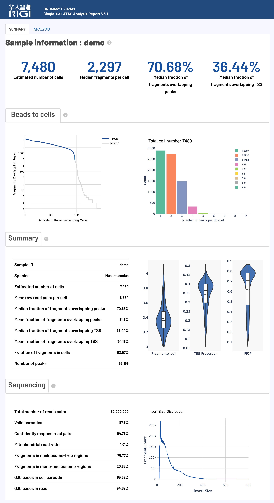
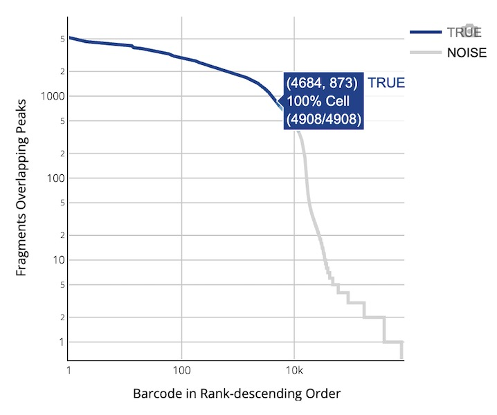
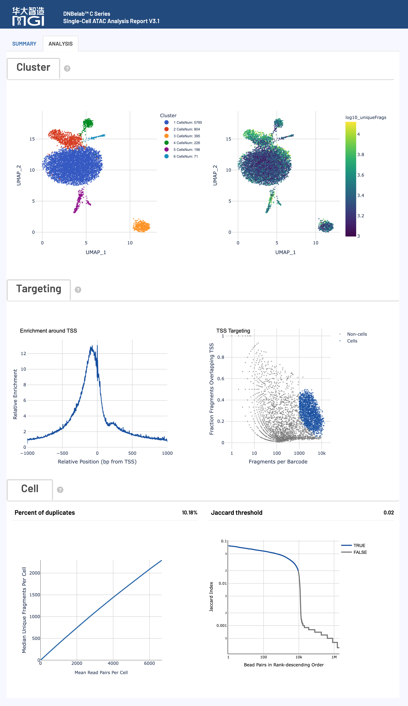

# scATAC 分析输出

> **输出范围**：目录树描述常规完成运行的结果；可选文件取决于启用模块与阶段完成状态。下文质量参考区间是判读建议，不是软件内置的通过/失败规则，应以本次配置阈值和报告状态为准。

单细胞 ATAC 测序分析输出文件说明

## 概述 <a id="概述"></a>

单细胞 ATAC 测序分析完成后，会在指定的输出目录中生成标准化的文件和子目录结构，用于染色质可及性分析和表观基因组学研究。矩阵与片段文件可按相应格式导入 Signac、ArchR 等工具；读取示例参见[结果分析](../io.md)。

### 核心交付物速览

下表汇总了 scATAC 分析的主要产物、文件格式、核心用途以及推荐的下游生态对接：

| 交付产物与核心文件 | 格式 | 主要用途与下游生态对接 |
| :--- | :--- | :--- |
| **真实细胞片段文件**<br>• `filtered.fragments.tsv.gz`<br>• `filtered.fragments.tsv.gz.tbi` | `BED (TSV.GZ)`<br>`TBI 索引` | 经过细胞质控过滤后的高质量片段 BED 格式文件，下游分析的核心首选输入。<br>• **推荐工具**: Signac (`CreateChromatinAssay`) / ArchR (`createArrowFiles`) |
| **全量比对片段文件**<br>• `fragments.tsv.gz`<br>• `fragments.tsv.gz.tbi` | `BED (TSV.GZ)`<br>`TBI 索引` | 包含所有比对到基因组的唯一片段坐标与细胞归属，用于全量回溯与背景评估。<br>• **生态对接**: 支持 IGV、UCSC 等基因组浏览器直接作为 BED 轨迹加载。 |
| **染色质峰定量矩阵**<br>• `filtered_peak_bc_matrix/`<br>• `filtered_peak_bc_matrix.h5` | `MEX 稀疏矩阵`<br>`HDF5 (H5)` | 过滤后的细胞染色质开放峰（Peak）定量计数矩阵。<br>• **注意口径**: 矩阵数值默认统计 **Cutsite（两端切割位点）**，灵敏度更高；切勿使用列和（`colSums`）充当 Fragment 测序深度过滤。 |
| **未过滤原始峰矩阵**<br>• `raw_peak_bc_matrix/`<br>• `raw_peak_bc_matrix.h5` | `MEX 稀疏矩阵`<br>`HDF5 (H5)` | 包含所有候选微珠/液滴与背景噪音的原始峰计数矩阵，用于自定义过滤与质控复核。 |
| **细胞元数据明细**<br>• `singlecell.csv` | `CSV` | 记录每个细胞条形码的片段数、峰数、TSS/Peak 区域片段数、Cutsite 计数及真实细胞识别。<br>• **质控筛选**: 统一根据 `is_cell_barcode == 1` 筛选真实细胞。 |
| **实验指标汇总**<br>• `metrics_summary.xls` | `TSV 文本` | 实验整体测序质量、比对率、细胞数、中位片段数、TSS 富集等全局统计指标。<br>• **读取规范**: 制表符文本，R 用 `read.delim()`，Python 用 `pd.read_csv(sep='\t')`。 |
| **交互式网页报告**<br>• `<sample>_scATAC_report.html` | `HTML` | 一站式可视化质控与分析报告，交互式查看细胞排序曲线、TSS 富集模式、片段长度分布及细胞聚类等。<br>• **打开方式**: 无需网络，双击在任意现代桌面浏览器中直接打开。 |
| **基因组比对记录**<br>• `alignment.fragments.sorted.tagged.bam`<br>• `alignment.fragments.sorted.tagged.bam.bai` | `BAM`<br>`BAI / CSI` | 携带纠错细胞标签（`CB`, `CR`）的基因组坐标排序比对文件。<br>• **生成条件**: 分析需添加 `--need_bam` 参数；支持 IGV 基因座比对复核。 |
| **峰注释**<br>• `peak_annotation.tsv` | `TSV` | 过滤后 peaks 的基因关联（可选），详见[注释字段](#peak-annotation)。 |
| **可选诊断**<br>• `cell_classification.csv`<br>• `whitelist_contamination*.json` | `CSV` / `JSON` | 双物种分类及 C4 白名单诊断，生成时交付。 |

## 输出目录结构 <a id="输出目录结构"></a>

```text
outs/
├── filtered.fragments.tsv.gz                   # 质控过滤后的高质量细胞片段文件 (下游分析首选)
├── filtered.fragments.tsv.gz.tbi               # 过滤后片段文件的 Tabix 索引
├── fragments.tsv.gz                            # 全量比对片段文件 (BED 格式)
├── fragments.tsv.gz.tbi                        # 全量片段文件的 Tabix 索引
├── filtered_peak_bc_matrix/                    # 过滤后的染色质峰定量矩阵目录 (MEX 格式)
│   ├── barcodes.tsv.gz                         # 高质量真实细胞 ID 列表
│   ├── peaks.bed.gz                            # 识别峰的基因组坐标 (BED 格式)
│   └── matrix.mtx.gz                           # 稀疏峰计数矩阵 (单空格分隔，Cutsite 计数)
├── filtered_peak_bc_matrix.h5                  # 过滤后的峰定量矩阵 (单文件 HDF5 格式)
├── raw_peak_bc_matrix/                         # 未过滤的原始峰定量矩阵目录 (MEX 格式)
│   ├── barcodes.tsv.gz
│   ├── peaks.bed.gz
│   └── matrix.mtx.gz
├── raw_peak_bc_matrix.h5                       # 未过滤的原始峰定量矩阵 (单文件 HDF5 格式)
├── peak_annotation.tsv                       # 过滤后峰的基因注释（可选）
├── cell_classification.csv                   # 双物种分类（可选，位于输出根目录）
├── whitelist_contamination.json              # 白名单诊断（可选）
├── whitelist_contamination_cells.json        # 细胞级白名单诊断（可选）
├── singlecell.csv                              # 细胞级别质控与元数据汇总表 (含 is_cell_barcode)
├── metrics_summary.xls                         # 实验质控与分析质量指标汇总表 (制表符分隔 TSV)
├── <sample>_scATAC_report.html                 # 交互式综合网页质控与分析报告
├── alignment.fragments.sorted.tagged.bam       # 坐标排序的比对 BAM 文件 (启用 --need_bam 时输出)
└── alignment.fragments.sorted.tagged.bam.bai   # 比对索引文件 (超长染色体可为 .csi)
```

<a id="v32-outputs"></a>

raw/filtered peak 矩阵同时提供 H5。矩阵默认统计 cutsite；cell calling、FRIP 和 TSS 比例仍按唯一 fragment 统计。BAM 需启用 `--need_bam`，索引可为 BAI 或 CSI。

## 文件详细说明 <a id="详细文件说明"></a>

### ATAC片段和峰文件 <a id="atac片段和峰文件"></a>

**核心内容**: ATAC-seq 片段信息和峰识别结果，包含完整的染色质可及性数据和细胞条形码标记。

#### fragments.tsv.gz

`fragments.tsv.gz` 是一个包含 ATAC-seq 片段信息的压缩 TSV 文件，是进行下游分析的核心数据之一。

*   **用途**:
    *   **染色质可及性分析**: 精确定位每个开放染色质区域的基因组坐标。
    *   **数据可视化**: 可直接在 IGV、UCSC 等基因组浏览器中作为 BED 文件加载。
    *   **下游工具输入**: 兼容 ArchR、Signac 等主流单细胞分析工具。

*   **内容与格式**:
    *   文件为 **BED-like** 格式，每行代表一个唯一的 ATAC-seq 片段。
    *   包含以下 5 列信息：

        | 字段名 | 详细描述 |
        | :--- | :--- |
        | `chrom` | 参考基因组染色体名称，标识片段所在的染色体位置 |
        | `chromStart` | 片段在染色体上的调整起始位置（0-based 坐标系统），经过转座酶切割位点修正 |
        | `chromEnd` | 片段在染色体上的调整结束位置（不包含该位置），经过转座酶切割位点修正 |
        | `barcode` | 细胞 ID 标识符，对应 BAM 文件中的 `CB` 标签，用于将片段归属到特定细胞 |
        | `readSupport` | 与该片段相关的总读段对数（包括唯一和重复读段） |

*   **坐标调整**:
    *   为精确定位转座酶切位点，片段区间经过调整：起始位置从最左端比对位置向前移动 4 bp，结束位置从最右端比对位置向后移动 5 bp。

#### fragments.tsv.gz.tbi

`fragments.tsv.gz` 文件的 Tabix 索引。

*   **核心用途**:
    *   **快速数据访问**: 允许对大型 `fragments.tsv.gz` 文件进行快速的、基于基因组区间的查询，而无需读取整个文件。
    *   **工具性能优化**: 被 ArchR、Signac、IGV 等工具用于快速加载和检索特定染色体区域的数据。
*   **格式**: 由 `tabix` 工具生成的标准二进制索引文件。

#### filtered.fragments.tsv.gz

这是经过细胞质量控制和过滤后的 ATAC-seq 片段文件，是 `fragments.tsv.gz` 的子集，仅包含高质量细胞的片段。

*   **核心用途**:
    *   **核心下游分析**: 这是进行细胞聚类、差异可及性分析等下游分析的**推荐输入文件**。
    *   **信噪比提升**: 由于去除了低质量细胞和背景噪音，使用此文件可提高分析结果的准确性和信噪比。
*   **内容与格式**:
    *   文件格式与 `fragments.tsv.gz` 完全相同（压缩的 BED-like TSV），包含相同的 5 列信息。
    *   仅包含通过细胞过滤算法（基于 TSS 富集和峰区域覆盖的片段数）被判定为真实细胞的片段。

#### filtered.fragments.tsv.gz.tbi

`filtered.fragments.tsv.gz` 文件的 Tabix 索引。

*   **核心用途**: 确保在使用过滤后的片段文件时，下游工具（如 ArchR、Signac）能够快速访问特定基因组区域的数据。
*   **格式**: 标准二进制 Tabix 索引文件。

#### alignment.fragments.sorted.tagged.bam

这是包含所有具有有效条形码（valid barcode）并且成功比对的片段的 ATAC-seq 比对结果文件。

*   **核心用途**:
    *   **比对结果查看与可视化**: 可用于 IGV 等基因组浏览器进行结果可视化，检查特定基因座的比对情况。
    *   **自定义分析**: 为需要直接操作比对级别数据的用户提供原始输入。
*   **内容与格式**:
    *   采用国际标准的 **BAM (Binary Alignment Map)** 格式。
    *   文件已按**基因组坐标排序**，并建立了索引（`.bai` 文件），便于快速随机访问。
    *   关键 TAG 字段说明：

        | 标签 (TAG) | 类型 | 描述 |
        | :--- | :---: | :--- |
        | `CB` | Z | 经过错误校正和细胞合并处理后的细胞条形码标识符 |
        | `CC` | Z | 经过错误校正的细胞条形码序列 |
        | `CR` | Z | 测序仪报告的原始细胞条形码序列 |

#### alignment.fragments.sorted.tagged.bam.bai

`alignment.fragments.sorted.tagged.bam` 文件的索引。

*   **核心用途**: 允许 IGV、Samtools 等工具在无需完整加载 BAM 文件的情况下，快速跳转和读取任意基因组区域的比对数据。
*   **格式**: 标准 **BAI (BAM Index)** 格式（超长染色体参考基因组时生成 `.csi`）。

### 峰矩阵文件 <a id="峰矩阵文件"></a>

**核心内容**: 单细胞峰信号计数矩阵，分为原始数据和质控过滤后数据，采用标准稀疏矩阵格式。

!!! warning "核心注意：矩阵计数口径（Cutsite）与细胞质控指标（Unique Fragment）"
    - **Cutsite 计数口径**：峰矩阵（`filtered_peak_bc_matrix`）中的数值为经过 Tn5 转座酶插入 9-bp 偏移修正后的**两端切割位点计数（cutsite）**，能够以最高灵敏度反映局部染色质开放信号。
    - **Fragment 质控口径**：`singlecell.csv` 中的 `peak_region_fragments`、FRIP（Fraction of Reads in Peaks）、TSS 富集比例以及 Cell Calling 过滤，**严格基于去重后的唯一片段（unique fragments）**。
    - **避坑警示**：在 R（Signac）或 Python 中，**切勿使用矩阵列求和（如 `colSums(mtx)`）作为细胞的 fragment 测序深度进行质控过滤**！理论上 1 fragment ≈ 2 cutsites，且两者的统计口径和生物学定义截然不同。
    - **分隔符规范**：3.2 版本起，`matrix.mtx.gz` 采用单空格（Single Space）分隔，自写解析脚本请使用 `line.split()`（匹配任意空白字符）或标准 `Matrix::readMM`。

#### 过滤后的峰矩阵 (`filtered_peak_bc_matrix/`)

包含经过高质量细胞过滤后的峰计数矩阵，是进行下游定量分析的核心数据。

*   **核心用途**:
    *   **下游定量分析**: 作为细胞聚类、差异可及性分析、转录因子结合预测等分析的主要输入。
    *   **高质量数据**: 只包含被鉴定为真实细胞的条形码，确保分析结果的准确性。
*   **内容与格式**:
    *   采用标准的 **Matrix Market Exchange (MEX)** 格式，由以下三个压缩文件组成：

        | 文件名 | 内容描述 |
        | :--- | :--- |
        | `barcodes.tsv.gz` | 细胞 ID 列表，标识通过质控筛选的高质量真实细胞，每行对应矩阵的一列 |
        | `peaks.bed.gz` | 峰区域位置信息文件，BED 格式存储（染色体、起始位置、结束位置），对应矩阵的行 |
        | `matrix.mtx.gz` | 峰区域计数矩阵，采用 Matrix Market 稀疏格式，记录非零元素的行、列索引及 Cutsite 数值 |

*   **格式优势**:
    *   **空间高效**: 稀疏矩阵格式（`.mtx`）仅存储非零元素，极大节省了存储空间。
    *   **高度兼容**: MEX 格式是单细胞社区的标准，兼容 Signac、ArchR、Scanpy 等主流分析工具。

#### 原始峰矩阵 (`raw_peak_bc_matrix/`)

包含所有检测到的细胞条形码（未经过滤）的原始峰计数矩阵。

*   **核心用途**: 用于评估细胞过滤算法的效果，或根据研究人员的自定义标准进行定制化质控与过滤。
*   **内容与格式**: 采用标准的 MEX 格式，文件组成与 `filtered_peak_bc_matrix/` 目录相同，包含所有检测到的条形码（含真实细胞与背景液滴）。

### 分析指标汇总 <a id="分析指标汇总"></a>

**核心内容**: 实验质量评估和统计指标汇总，提供完整的数据质量控制信息。

#### metrics_summary.xls

采用制表符分隔（TSV）格式的关键分析指标汇总表，提供了对实验整体质量的结构化评估。

*   **核心用途**: 快速评估测序数据质量、比对效率、细胞鉴定结果等核心指标。
*   **内容分类**:
    | 指标类别 | 包含内容 |
    | :--- | :--- |
    | **基础测序统计** | 原始测序读段对数、有效条形码比例、Q30 碱基质量等基础测序指标 |
    | **细胞鉴定指标** | 估计细胞数量、每细胞中位片段数、峰区域片段占比、TSS 区域片段占比、识别峰数量等 |
    | **比对与特征指标** | 基因组比对率、线粒体比例、无核小体区域比例、单核小体区域比例等 |

*   **读取方式**: 文本格式文件，推荐在 R 中使用 `read.delim("metrics_summary.xls")`，在 Python 中使用 `pd.read_csv("metrics_summary.xls", sep="	")`。详细指标释义与推荐质量基准请参见 [网页报告释义](#网页报告释义)。

#### 峰注释 {#peak-annotation}

`peak_annotation.tsv` 为过滤后 peaks 的制表符注释表。仅在过滤矩阵的 `peaks.bed.gz`、参考 GTF 可用且注释成功时发布；注释失败不将其视为必需输出。一个 peak 可关联多个基因，因此行数不保证与矩阵特征数相等。

| 字段 | 含义 |
| :--- | :--- |
| `chrom`、`start`、`end` | Peak 坐标，起点从 0 开始，终点不包含在区间内 |
| `gene`、`gene_id` | 关联基因的名称与参考注释 ID |
| `distance` | 关联 TSS 到 peak 最近碱基的有符号距离；重叠为 0，转录方向下游为正 |
| `peak_type` | 启动子/远端关联，或基因间区/未注释结果 |
| `genomic_region` | 基因组区域分类 |
| `gene_biotype`、`tss_source` | GTF 基因类型与所选 TSS 的注释来源 |

其他可选文件：双物种分类结果 `cell_classification.csv` 位于 ATAC 输出根目录；C4 白名单/低靶向策略（`audit` 或 `apply`）产生诊断时，交付 `whitelist_contamination.json` 和 `whitelist_contamination_cells.json`。物种分类中的 `Multiplet` 表示跨物种混合候选，`Unassigned` 表示未确定归属，不应视为已证实的生物学双胞标签。

#### singlecell.csv

单细胞级别的多维度质控信息表，采用 CSV 格式存储。

*   **包含字段**:
    `Cell,totalFrags,fragments,mt_region_fragments,chloroplast_region_fragments,TSS_region_fragments,blacklist_region_fragments,peaks_number,peak_region_fragments,peak_region_cutsites,is_cell_barcode,Cellbarcode`。
*   **核心用途**:
    *   **精细化质控**: 支持研究人员基于 `is_cell_barcode` 提取真实细胞，或根据自定义片段数、TSS 富集比例等指标进行二次质控。
    *   **下游元数据对接**: 可直接作为 Signac、ArchR 或 Scanpy 对象的细胞元数据（Cell Metadata / `adata.obs`）。
*   **说明**: `peak_region_fragments` 与 `peak_region_cutsites` 分别记录片段数与切割端点计数；仅配套工具输出该端点统计时才有值，缺失不应视作 0。

`totalFrags` 为包含重复支持的片段读段对数，`fragments` 为去重后的唯一片段数。报告汇总 FRIP/TSS 比例以核内片段为分母；Targeting 散点图则以全部唯一 `fragments` 为分母，归一化 TSS 富集曲线是另一种信号。空片段 gzip 文件可能没有 `.tbi` 索引。ATAC 聚类对象位于处理中间目录，不作为 `outs/analysis/` 文件包发布。

#### *_scATAC_report.html

采用 HTML 网页格式的交互式综合分析报告。

*   **核心用途**:
    *   **结果可视化**: 以交互式图表展示质控结果、细胞聚类、TSS 富集等关键分析结果。
    *   **便捷分享**: 单个离线 HTML 文件，无需依赖网络，双击即可在任意桌面浏览器中打开。
*   **报告模块**:
    | 报告模块 | 内容描述 |
    | :--- | :--- |
    | **交互式图表** | 质控指标、细胞条形码排序、TSS 富集曲线、片段长度分布、细胞聚类等交互式可视化图表 |
    | **统计汇总** | 关键性能指标的数值汇总与状态评估（推荐 / 可接受 / 需优化） |
    | **详细解读** | 各项质控指标的计算口径、生物学意义及异常排查建议 |

## 文件格式说明 <a id="文件格式说明"></a>

**技术规范**: 输出文件采用的标准格式详细说明。

#### Matrix Market 格式 (`.mtx.gz`) <a id="market-matrix-format-mtxgz"></a>

Market Exchange Format (MEX) 是单细胞分析中用于存储稀疏计数矩阵的标准格式，具有空间高效和高度兼容的优点。

*   **核心优势**:
    *   **空间高效**: 稀疏矩阵仅存储非零元素，对于通常超过 95% 为零值的单细胞 ATAC 数据，可极大节省磁盘与内存开销。
    *   **高度兼容**: 作为国际标准格式，可被 Signac、ArchR、Scanpy 等主流分析工具直接解析。
*   **文件组成**:

    | 文件名 | 格式描述 |
    | :--- | :--- |
    | `matrix.mtx.gz` | 压缩的稀疏矩阵文件。文件头包含矩阵维度与非零项总数，后续每行记录一个非零元素的位置（行/列索引）和数值 |
    | `barcodes.tsv.gz` | 压缩的细胞条形码文件。每行对应一个细胞 ID，行号对应矩阵的**列** |
    | `peaks.bed.gz` | 压缩的特征（峰）文件。每行对应一个峰的 BED 坐标，行号对应矩阵的**行** |

## 网页报告释义 <a id="网页报告释义"></a>

**概述**：HTML 网页报告提供单细胞 ATAC 测序结果的可视化摘要和指标说明，覆盖实验质量与下游分析相关的关键指标。

!!! info "质量评估原则与阅读建议"
    - **整体评估**：HTML 网页报告提供单细胞 ATAC 测序结果的可视化摘要与质控分析，覆盖细胞识别、测序质量、片段长度分布、TSS 富集、Peak 区域分布及细胞聚类等核心环节。
    - **基准参考**：下述质量参考标准基于常规组织样本拟定。不同组织类型（如实体肿瘤、原代神经组织、冻存样本）、细胞状态与测序深度存在天然异质性，实际评估时请结合实验背景综合判断。
    - **阅读路径**：建议按照报告展示顺序依次核对测序质量、比对与线粒体比例、TSS 富集曲线及 Peak 内片段占比，最后结合降维聚类效果评估染色质开放信号的生物学合理性。

### 报告主要内容与结构

<div style="text-align: center; margin: 1.5rem 0;" markdown="block">

</div>

### 核心分析指标详解

#### 细胞指标 (Cell Metrics) <a id="细胞指标"></a>

**核心功能**: 细胞识别、质量评估和染色质可及性统计，提供实验整体效果的关键指标。

**质量参考标准：**

| 指标名称 (Metric) | 推荐标准 (Optimal) | 可接受区间 (Acceptable) | 需关注/优化 (Suboptimal) |
| :--- | :---: | :---: | :---: |
| **Median fragments per cell** | ≥ 10,000 | 2,000 – 10,000 | < 2,000 |
| **Median fraction of fragments overlapping peaks** | ≥ 30% | 15% – 30% | < 15% |
| **Median fraction of fragments overlapping TSS** | ≥ 20% | 10% – 20% | < 10% |
| **Fraction fragments in cells** | ≥ 50% | 20% – 50% | < 20% |

**详细指标解释与算法：**

| 指标名称 (Metric) | 统计口径与算法计算 | 判读指导与排查要点 |
| :--- | :--- | :--- |
| **Estimated number of cells**<br>*(估计细胞数量)* | 从测序数据中鉴定出的有效真实细胞条形码总数。通过合并同液滴条形码并基于片段数及 TSS 富集进行细胞识别过滤。 | 综合上样细胞数与细胞产出率判断。若显著低于预期，建议检查上样细胞活率、微流控包裹稳定性或文库转化效率。 |
| **Species**<br>*(物种信息)* | 分析所采用的物种名称及参考基因组版本信息。 | 用于核验样本物种与参考基因组配置的一致性，是溯源比对异常的第一核对项。 |
| **Median fragments per cell**<br>*(每细胞中位片段数)* | 真实高质量细胞中包含的唯一有效 ATAC 片段数中位数。 | 衡量单细胞测序深度与捕获灵敏度的核心指标。推荐 ≥ 10,000（最低 ≥ 2,000）；数值过低会直接影响 peak calling、分群及差异可及性分析的灵敏度。 |
| **Mean raw read pairs per cell**<br>*(每细胞平均原始读段对数)* | 原始测序读段对总数 / 估计细胞数量。 | 评估文库测序深度的宏观指标。建议 ≥ 25,000 read pairs/cell，以保证染色质开放区域具备充分的测序覆盖。 |
| **Fraction overlapping peaks**<br>*(片段重叠峰区域比例 / FRIP)* | 对识别细胞分别计算 `peak_region_fragments / 核内唯一片段数` 后取中位数。核内片段数为 `fragments − mt_region_fragments − chloroplast_region_fragments`，计算时分母至少取 1。 | 评估 ATAC 信号特异性与信噪比的金标准。推荐 ≥ 30%；< 15% 提示背景游离 DNA 污染严重、细胞核破损或转座反应特异性欠佳。 |
| **Fraction overlapping TSS**<br>*(TSS 区域片段重叠比例)* | 对识别细胞分别计算 TSS ±1,000 bp 区域的 `TSS_region_fragments / 核内唯一片段数` 后取中位数；分母与峰重叠比例汇总一致。 | 反映启动子可及性信号的富集强度。推荐 ≥ 20%；< 10% 提示文库非特异性背景过高或染色质片段化过度。 |
| **Fraction of fragments in cells**<br>*(细胞内片段比例)* | 识别细胞的 `totalFrags` 之和 / 全表 `totalFrags` 之和；统计支持片段的读段对（含重复支持），不是去重后的 `fragments`。 | 衡量真实细胞信号与背景空滴/游离 DNA 信号的比率。推荐 ≥ 50%；过低说明反应液中存在大量游离染色质碎片污染。 |
| **Number of peaks**<br>*(识别峰数量)* | 聚合所有高质量细胞信号后，在全基因组范围内鉴定出的开放染色质峰（Peaks）总数。 | 典型范围在 50,000 – 150,000 之间。峰数量直接受细胞类型异质性、细胞总数及测序深度影响。 |

#### 测序指标 (Sequencing Metrics) <a id="测序指标"></a>

**核心功能**: 测序数据的基础质量评估，包括条形码识别率、比对质量和测序准确性。

**质量参考标准：**

| 指标名称 (Metric) | 推荐标准 (Optimal) | 可接受区间 (Acceptable) | 需关注/优化 (Suboptimal) |
| :--- | :---: | :---: | :---: |
| **Valid barcodes** | ≥ 80% | 70% – 80% | < 70% |
| **Q30 bases in barcode** | > 85% | 75% – 85% | < 75% |
| **Q30 bases in read** | > 85% | 75% – 85% | < 75% |
| **Confidently mapped read pairs** | > 80% | 50% – 80% | < 50% |

**详细指标解释与算法：**

| 指标名称 (Metric) | 统计口径与算法计算 | 判读指导与排查要点 |
| :--- | :--- | :--- |
| **Total number of reads pairs**<br>*(测序读段对总数)* | 样本测序产生的双端原始读段对（Read Pairs）总量。 | 实验原始数据量的直接体现，是评估测序深度和实验通量的基准。 |
| **Valid barcodes**<br>*(有效条形码比例)* | 条形码序列可精准匹配至预设白名单（含容错校正）的读段占总测序读段的比例。 | 推荐 ≥ 80%。过低通常提示条形码区域测序质量欠佳、文库构建引物异常或测序周期偏离。 |
| **Confidently mapped read pairs**<br>*(基因组比对率)* | 成功唯一比对到参考基因组上的读段对占总读段的比例。 | 推荐 ≥ 80%。低于 50% 时需优先排查：样本外源污染、物种参考基因组选择错误，或高重复序列导致的比对异常。 |
| **Mitochondria reads ratio**<br>*(线粒体 reads 比例)* | 比对至线粒体基因组的读段占总比对读段的百分比。 | 评估细胞核制备纯度与核膜完整性的核心指标。线粒体 DNA 缺乏核小体保护极易被 Tn5 切割；通常推荐 < 10%，> 20% 提示细胞破损裂解严重。 |
| **Nucleosome-free regions**<br>*(无核小体区域比例)* | 长度 < 147 bp 的转座插入片段占总片段的百分比。 | 直接反映启动子与顺式调控元件等开放染色质区域的有效信号。推荐 > 40%；过低说明转座酶消化不足或染色质凝集。 |
| **Mono-nucleosome regions**<br>*(单核小体区域比例)* | 长度介于 147 – 294 bp 之间（缠绕单个核小体）的片段占比。 | 与无核小体片段比例互补，共同反映核小体相位结构的完整性。 |
| **Q30 bases in barcode**<br>*(条形码 Q30 碱基比例)* | 细胞条形码序列中测序质量值 ≥ 30（错误率 < 0.1%）的碱基占比。 | 评估单细胞标签识别的物理测序质量，通常应 > 85%。 |
| **Q30 bases in read**<br>*(读段 Q30 碱基比例)* | 基因组插入片段测序读段中质量值 ≥ 30 的碱基占比。 | 评估染色质片段测序本身的保真度，直接关系到基因组精准比对和 Peak 定位。 |

### 交互式可视化图表解读

<a id="可视化图表1"></a>

网页报告内置了多维度交互式可视化图表，全面覆盖细胞识别质控、染色质构象特征及聚类分群分析。

#### 1. 细胞条形码排序图 (Barcode Rank Plot)

**图表功能**：展示所有细胞条形码按峰区域片段数降序排列的累计分布曲线，用于直观区分高质量真实细胞与背景噪音。

<div style="text-align: center; margin: 1.2rem 0;" markdown="block">

</div>

**如何解读**：

*   **坐标轴定义**:
    *   **X 轴 (Barcode Rank)**: 所有细胞条形码按片段数降序排列（对数刻度）。左侧为高片段数条形码，右侧为低片段数背景。
    *   **Y 轴 (Fragment Counts)**: 各条形码对应的峰区域片段总数（对数刻度）。
*   **拐点（Knee Point）判定**:
    *   图中曲线通常会出现陡峭的下折拐点。
    *   拐点左侧的 **蓝色区域** 代表被算法判定为高质量真实细胞的条形码。
    *   拐点右侧的 **灰色区域** 代表背景游离片段与空液滴。
*   **交互特征**: 鼠标悬停可查看条形码位次与具体片段数值；蓝色渐变区域代表真实细胞在不同局部的密度分布。

---

#### 2. 液滴微珠分布图 (Droplet Beads Distribution) {#2-droplet-beads-distribution}

**图表功能**：展示真实细胞反应液滴中捕获微珠（Beads）的数量分布情况。

**如何解读**：

*   **理论分布**: 微流控液滴包裹过程中，液滴内微珠数量理论上遵循**泊松分布**，反映微流控反应体系的随机捕获特征。
*   **实验关联**: 实际分布受测序饱和度、液滴生成均一性及细胞悬液浓度等实验因素影响。

---

#### 3. 细胞数据分布图 (Cell Data Distribution)

**图表功能**：通过三个独立的小提琴图（Violin Plots），分别展示高质量细胞在 **片段数 (Fragments)**、**TSS 富集比例 (TSS Proportion)** 和 **Peak 区域片段比例 (Peak Proportion)** 上的分布形态。

**如何解读**：

*   **小提琴图形态**: 图表宽度代表该数值区间的细胞密度，腹部越饱满表示细胞聚集度越高；内部箱线图展示中位数与四分位范围。
*   **指标解读**:
    *   **片段数 (Fragments)**: 评估细胞文库测序深度与捕获丰度，中心位置越高说明细胞质量越优。
    *   **TSS 富集比例 (TSS Proportion)**: 反映转录调控区域的信号特异性，中心分布越高说明启动子开放信号越强。
    *   **Peak 区域片段比例 (Peak Proportion)**: 反映染色质开放峰的整体富集度，中心分布越高说明信噪比越好。

---

#### 4. 片段长度分布图 (Fragment Length Distribution)

**图表功能**：展示去重后 ATAC-seq 片段的插入长度（Insert Size）频率分布曲线，是评估细胞核完整性与染色质天然构象的“金标准”。

**如何解读**：

*   **周期性峰特征**:
    *   **< 147 bp（第一高峰）**: 代表**无核小体区域 (Nucleosome-free regions, NFR)** 片段，直接富集启动子与活跃顺式调控元件。
    *   **~200 bp 左右（第二峰）**: 代表缠绕**单核小体**的片段。
    *   **~400 bp / ~600 bp（后续周期峰）**: 代表跨越**双核小体**及多核小体的片段。
*   **质控判读**:
    *   **优质样本**: 呈现清晰的 ~200 bp 阶梯状周期性波动，且 NFR 尖峰突出。表明细胞核结构完整，染色质构象保存良好。
    *   **质量异常**: 曲线平滑无周期性起伏，通常提示细胞核破裂严重、过度裂解或发生 DNA 非特异性降解。

---

<a id="其他核心指标"></a>
<a id="可视化图表2"></a>

#### 5. 细胞聚类分析图 (Cluster Analysis)

**图表功能**：通过潜变量语义分析（LSI）降维与 UMAP 投影，将染色质可及性模式相似的细胞投射在二维空间中，以揭示潜在表观亚群。

<div style="text-align: center; margin: 1.5rem 0;" markdown="block">

</div>

**如何解读**：

*   **左图（细胞亚群分群）**: 每个散点代表一个细胞，不同颜色对应不同的表观聚类（Cluster），空间距离越近代表染色质开放特征越相似。
*   **右图（片段深度分布）**: 在相同 UMAP 空间以颜色渐变展示细胞片段数深度，用于复核聚类结果是否受到测序深度偏差的技术干扰。

---

#### 6. 转录起始位点富集图 (TSS Enrichment Profile)

**图表功能**：聚合所有基因转录起始位点（TSS）附近 ±1,000 bp 的 ATAC 片段切割频率，量化开放染色质信号的信噪比。

**如何解读**：

*   **坐标轴**: X 轴为相对于 TSS 的基因组距离（0 为 TSS 中心）；Y 轴为归一化切割信号强度。
*   **信号形态**: 高质量样本在 TSS 中心（0 点）呈现对称的高耸尖峰，两侧信号快速降至背景水平。
*   **量化指标**: **TSS Enrichment Score** 越高（推荐 > 4–6）表明文库信噪比越好；若曲线扁平无峰，高度提示染色质制备失败或文库非特异性背景过高。

---

#### 7. 单细胞靶向图 (Single Cell Targeting Plot)

**图表功能**：以双变量散点图展示各细胞条形码的总片段数（X 轴，对数刻度）与 TSS 富集分数（Y 轴），用于评估细胞识别过滤的区分度。

**如何解读**：

*   **右上角区域**: 高片段数 + 高 TSS 富集分数，代表高质量真实细胞群体。
*   **左下角区域**: 低片段数 + 低 TSS 富集分数，代表背景游离噪音与空液滴。
*   **判读建议**: 理想样本中两组条形码群体应具有清晰的双峰分界。

---

#### 8. 测序饱和度曲线图 (Saturation Curve)

**图表功能**：评估当前测序深度是否充分及文库复杂度释放情况。

**如何解读**：

*   **坐标轴**: X 轴为每细胞平均测序读段对数，Y 轴为每细胞中位唯一片段数。
*   **趋势判读**:
    *   **线性上升期**: 曲线坡度陡峭，增加测序量能显著获取更多新的唯一片段。
    *   **饱和平台期**: 曲线逐渐走平，表示文库复杂度基本完全释放，继续加深测序的边际增益递减。通常 20%–50% 的重复率是测序深度与经济成本的良好平衡点。

---

#### 9. 微珠相似性排序图 (Bead Similarity Ranking) {#9-bead-similarity-ranking}

**图表功能**：在多微珠反应体系中，通过微珠间共享片段的 Jaccard 相似度来合并归属于同一液滴的微珠条形码。

**如何解读**：

*   **坐标轴**: X 轴为所有微珠对按相似度降序排列的位次，Y 轴为 Jaccard 相似度（对数刻度）。
*   **判定区域**:
    *   **蓝色区域**: 相似度高于 Otsu 算法计算阈值的微珠对，判定为来源于同一细胞反应液滴，分析中自动合并。
    *   **灰色区域**: 相似度低于阈值，判定为不同细胞来源，保持独立。

---

#### 10. 衍生算法指标释义 (Additional Algorithmic Metrics)

| 指标名称 (Metric) | 算法定义与生信统计 | 判读指导与质控建议 |
| :--- | :--- | :--- |
| **Percent duplicates**<br>*(重复序列百分比)* | 被判定为 PCR 重复的片段占总比对片段的比例。 | 反映文库复杂度与测序深度饱和度。通常推荐在 20%–50% 之间；> 50% 表示测序已接近饱和，继续加深测序增益较低；< 15% 表示测序不足，可考虑增加测序量以捕获更多唯一片段。 |
| **Jaccard threshold**<br>*(Jaccard 相似度阈值)* | 用于判断两个微珠（Beads）是否来自同一细胞反应液滴的片段重叠度判定阈值。 | 在多微珠反应液滴体系中，由 Otsu 算法自适应计算确定；若计算值低于 0.02 则自动设为 0.02，用于精准合并同一液滴内的条形码，有效避免假双胞。 |
