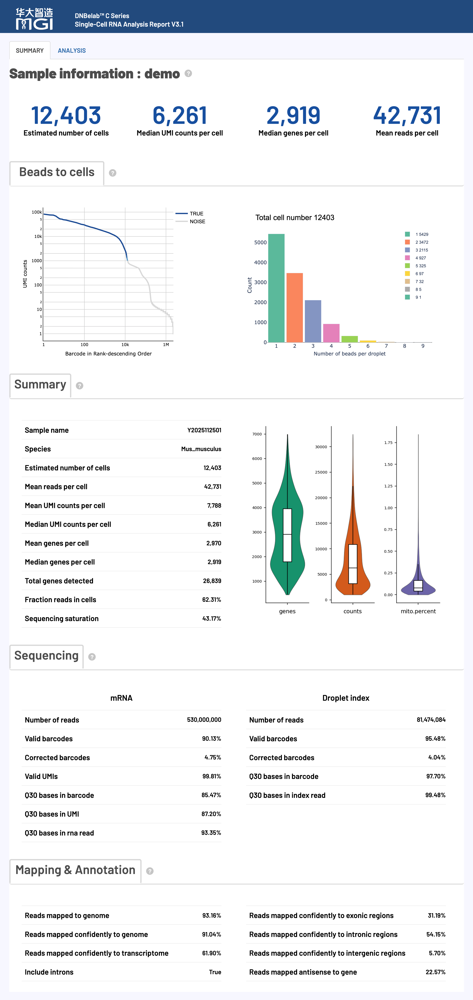
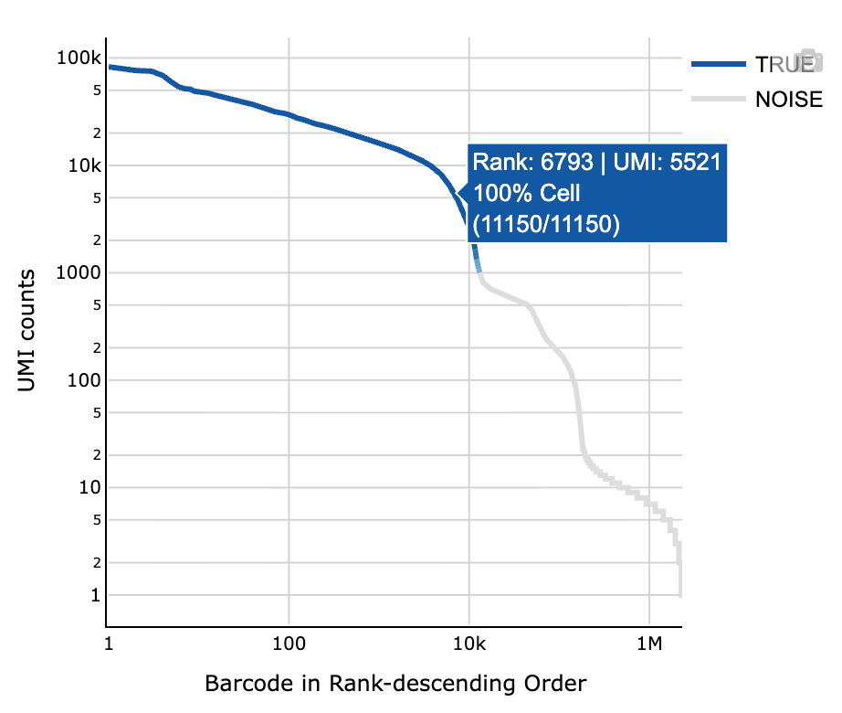
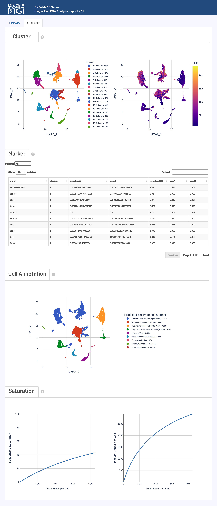
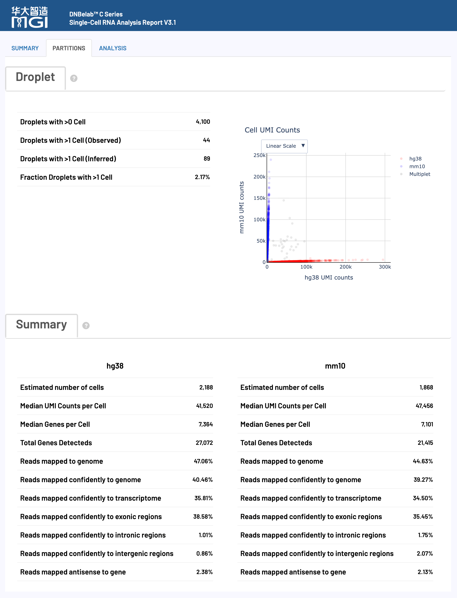

# scRNA Analysis Output

> **Output scope**: Directory trees describe a typical completed run. Optional outputs depend on enabled modules and successful stages. Quality ranges below are interpretation guidance, not software pass/fail rules; use the configured thresholds and report status for this run.

Single-Cell RNA Sequencing Output File Guide

## Overview <a id="overview"></a>

After the single-cell RNA analysis is complete, a standardized file and subdirectory structure is generated in the specified output directory for gene expression profiling, clustering, and cell type identification. Matrix and annotation files can be imported into tools such as Scanpy and Seurat using the appropriate format readers. See [Downstream Analysis](../io.md) for loading examples.

### Core Deliverables At-a-Glance

The table below summarizes the core deliverables, file formats, primary purposes, and recommended downstream ecosystem integrations for scRNA analysis:

| Deliverable & Core Files | Format | Primary Purpose & Downstream Ecosystem Integration |
| :--- | :--- | :--- |
| **Gene Expression Matrices**<br>• `filtered_feature_bc_matrix/`<br>• `filtered_feature_bc_matrix.h5`<br>• `filtered_feature_bc_matrix.h5ad` | `MEX`<br>`H5`<br>`H5AD` | High-confidence expression quantification for true cells; primary input for downstream analysis.<br>• **R (Seurat)**: `Read10X()` / `Read10X_h5()`<br>• **Python (Scanpy)**: `read_h5ad()` / `read_10x_h5()` / `read_10x_mtx()` |
| **Raw Unfiltered Matrices**<br>• `raw_feature_bc_matrix/`<br>• `raw_feature_bc_matrix.h5` | `MEX`<br>`H5` | Complete expression counts across all candidate droplets and background; for custom EmptyDrops cell calling and QC auditing. |
| **Clustering & Cell Phenotyping**<br>• `analysis/QC_Cluster.h5ad`<br>• `analysis/cluster.csv`<br>• `analysis/marker.csv` | `H5AD`<br>`CSV` | Contains dimensionality reduction coordinates (UMAP/t-SNE), graph clustering clusters, and marker gene lists.<br>• **Recommended**: Scanpy / statistical visualization |
| **Single-Cell Metadata Table**<br>• `singlecell.csv` | `CSV` | Detailed metrics per bead/droplet (sequencing reads, genes, UMIs, and called cell flag).<br>• **Analysis Note**: Filter via `is_cell_barcode`; primary input for V(D)J linkage. |
| **Experiment Metrics Summary**<br>• `metrics_summary.xls` | `TSV Text` | Global sequencing, alignment, cell count, and median UMI quality metrics.<br>• **Loading Guide**: Tab-delimited text; use `read.delim()` in R, `pd.read_csv(sep='\t')` in Python. |
| **Interactive HTML Report**<br>• `<sample>_scRNA_report.html` | `HTML` | Standalone interactive web report displaying barcode rank plots, UMAP clusters, and sequencing metrics.<br>• **Viewing**: Offline-ready; open directly in any modern desktop web browser. |
| **Genomic Alignment BAM**<br>• `anno_decon_sorted.bam`<br>• `anno_decon_sorted.bam.bai` (or `.csi`) | `BAM`<br>`BAI / CSI` | Coordinate-sorted BAM file with error-corrected single-cell tags (`CB`, `UB`, `GN`).<br>• **Ecosystem Integration**: Supports IGV browsing, samtools queries, and RNA velocity (Velocyto). |
| **Mixed-Species Classification**<br>• `analysis/cell_classification.csv` | `CSV` | Classifies cell species origins and multiplet rates in mixed-species experiments (e.g. human-mouse).<br>• **Generation**: Created only when analyzing mixed-species reference genomes. |

## Output Directory Structure <a id="output-directory-structure"></a>

```text
outs/
├── filtered_feature_bc_matrix/              # High-confidence filtered gene expression matrix directory (MEX)
│   ├── barcodes.tsv.gz                      # High-confidence called cell IDs
│   ├── features.tsv.gz                      # Gene IDs, names, and feature types
│   └── matrix.mtx.gz                        # Sparse expression count matrix
├── filtered_feature_bc_matrix.h5            # Filtered expression matrix (Single HDF5 file, preferred for Seurat)
├── filtered_feature_bc_matrix.h5ad          # Filtered expression matrix (AnnData format, preferred for Scanpy)
├── raw_feature_bc_matrix/                   # Unfiltered raw gene expression matrix directory (MEX, all droplets)
│   ├── barcodes.tsv.gz
│   ├── features.tsv.gz
│   └── matrix.mtx.gz
├── raw_feature_bc_matrix.h5                 # Unfiltered raw gene expression matrix (Single HDF5 file)
├── analysis/                                # Downstream clustering and marker gene results
│   ├── QC_Cluster.h5ad                      # Complete AnnData object with QC, reduction, clustering, and markers
│   ├── cluster.csv                          # Cell cluster assignments and 2D UMAP coordinates
│   ├── marker.csv                           # Differentially expressed marker gene table per cluster
│   └── cell_classification.csv              # Species assignment and multiplet calls (mixed-species runs only)
├── singlecell.csv                           # Comprehensive single-cell metadata and droplet metrics
├── metrics_summary.xls                      # Experiment-level QC and sequencing metrics summary (TSV)
├── <sample>_scRNA_report.html               # Interactive HTML quality and clustering report
├── anno_decon_sorted.bam                    # Coordinate-sorted alignment BAM file (when BAM enabled)
├── anno_decon_sorted.bam.bai                # BAM index file (automatically switches to .csi for large chromosomes)
└── oligo.records.bam                        # Oligo alignment records (when BAM enabled with an oligo library)
```

<a id="v32-outputs"></a>

!!! note "Version Delivery Notes"
    `filtered_feature_bc_matrix.h5ad` contains filtered count data. BAM indexes automatically generate as BAI or CSI based on chromosome lengths. Passing `--no_bam` skips both cDNA and oligo BAM generation to save ~70% disk space. For Sample Barcode multiplexed C6 outputs, see [C6 Outputs](c6.md).

---

## Detailed File Description <a id="detailed-file-description"></a>

### 1. Feature & Expression Matrix Files <a id="feature-matrix-files"></a>

**Core Content**: Single-cell gene expression count matrices, available as filtered high-quality cell datasets and unfiltered raw candidate datasets across MEX, H5, and H5AD standard formats.

!!! tip "Bead Merging & Cell Identifiers"
    In the DNBelab C system, droplets containing multiple beads are merged and designated as `CELL<number>_N<bead_count>` (e.g., `CELL1118_N3`; single beads are `_N1`). The `CB` tag in delivered BAM files and the cell names in `barcodes.tsv.gz` use these merged Cell IDs, while `singlecell.csv` retains the semicolon-separated raw bead barcodes.

#### Filtered Gene Expression Matrix (`filtered_feature_bc_matrix/`) <a id="market-matrix-format-mtxgz"></a>

Contains gene expression counts for cells identified by EmptyDrops quality filtering, serving as the **primary input** for downstream clustering, differential expression, and cell type annotation.

Delivered in the standard **Matrix Market Exchange (MEX)** sparse format, consisting of three compressed files:

| File Name | Format | Content Description & Mapping |
| :--- | :--- | :--- |
| `matrix.mtx.gz` | MatrixMarket text (gzip compressed) | Sparse expression matrix. Header specifies rows, columns, and non-zero counts; subsequent lines record non-zero coordinates and counts (`row col value`). Only non-zero values are stored. |
| `barcodes.tsv.gz` | Single-column plain text (gzip compressed) | High-quality called cell IDs (e.g. `CELL1_N2`), where each line corresponds to the **column index** of the matrix. |
| `features.tsv.gz` | Three-column tab-delimited text (gzip compressed) | Feature (gene) annotations including `Gene ID`, `Gene Name`, and `Feature Type (Gene Expression)`, corresponding to the **row index** of the matrix. |

- **Quick Loading Example**:
  - **R (Seurat)**:
    ```r
    library(Seurat)
    counts <- Read10X(data.dir = "filtered_feature_bc_matrix")
    seu <- CreateSeuratObject(counts = counts)
    ```
  - **Python (Scanpy)**:
    ```python
    import scanpy as sc
    adata = sc.read_10x_mtx("filtered_feature_bc_matrix", var_names="gene_symbols")
    ```

#### Single-File HDF5 Expression Matrix (`filtered_feature_bc_matrix.h5`)

Encapsulates the sparse count matrix, cell barcodes, and gene features into a single compressed HDF5 binary file.
- **Recommended Usage**: Fast cross-platform single-file loading in both R (Seurat) and Python (Scanpy).
- **Quick Loading Example**:
  - **R (Seurat)**:
    ```r
    library(Seurat)
    counts <- Read10X_h5("filtered_feature_bc_matrix.h5")
    seu <- CreateSeuratObject(counts = counts)
    ```
  - **Python (Scanpy)**:
    ```python
    import scanpy as sc
    adata = sc.read_10x_h5("filtered_feature_bc_matrix.h5")
    ```

#### AnnData Expression Matrix (`filtered_feature_bc_matrix.h5ad`) <a id="anndata-format-h5ad"></a>

Dedicated binary format for Python single-cell ecosystems, packaging the count matrix `X`, cellular metadata `obs`, and gene annotations `var`.
- **Recommended Usage**: The preferred format for Python (Scanpy / scvi-tools) workflows.
- **Quick Loading Example**:
  ```python
  import scanpy as sc
  adata = sc.read_h5ad("filtered_feature_bc_matrix.h5ad")
  ```

AnnData internal slots are organized as follows:

| Component | Saved Content |
| :--- | :--- |
| `X` | Cell-by-gene raw counts (`n_cells × n_genes`) exported before downstream QC and normalization |
| `obs` | Cell/barcode identifiers; this export does not guarantee downstream QC or annotation fields |
| `var` | Gene metadata available from the input matrix, such as `gene_ids` and `feature_types` |

`filtered_feature_bc_matrix.h5ad` is a count-matrix export, not the clustering object. PCA/UMAP embeddings, cluster labels, and marker statistics belong to `analysis/QC_Cluster.h5ad` when those analysis steps complete. Spliced/unspliced layers are not generated by this workflow.

#### Raw Unfiltered Expression Matrix (`raw_feature_bc_matrix/` & `.h5`)

Contains the complete expression count matrix for all detected barcodes without quality filtering.
- **Core Purpose**: Preserves data from authentic cells, damaged cells, and background ambient droplets; ideal for evaluating barcode rank plots, testing custom empty-droplet calling algorithms, or setting customized filtering cutoffs.

---

### 2. Analysis Results Directory (`analysis/`) <a id="analysis-results-directory-analysis"></a>

**Core Content**: Automated downstream analysis outputs, including PCA/UMAP embeddings, graph-based clustering, differential marker genes, and mixed-species cell assignments.

#### QC_Cluster.h5ad

A fully analyzed AnnData object containing normalized counts, highly variable genes, PCA, neighborhood graphs, Leiden/Louvain clusters, and UMAP projections.
- **Core Purpose**: Integrates the expression matrix with all downstream analysis results. Directly loadable in Python to replicate report plots and downstream exploration without re-running time-consuming clustering pipelines.
- **Key Components**:
  - `adata.obs['leiden']`: Cluster assignment per cell;
  - `adata.obsm['X_umap']`: 2D UMAP scatter coordinates;
  - `adata.uns['rank_genes_groups']`: Statistical marker gene tables per cluster.

Only analysis steps that complete contribute fields to `QC_Cluster.h5ad`; small or empty datasets may have empty marker tables or reduced analysis results. The count export at the output root remains distinct from this processed analysis object.

#### cluster.csv

Cell clustering results table exported in CSV format.
- **Column Descriptions**:
  - First CSV column (row index): Cell identifier; the column is not guaranteed to be named `Barcode`;
  - `leiden`: Cluster ID; `Cluster`: display label including the cluster cell count;
  - `UMAP_1`, `UMAP_2`: 2D coordinates from UMAP projection;
  - `nGene`, `nUMI`: Number of detected genes and total UMIs for the cell.

#### marker.csv

Differentially expressed marker genes identified for each cell cluster (CSV format), used for cell type annotation and functional enrichment.
- **Column Descriptions**:
  - `cluster`: Target cluster identifier;
  - `gene`: Gene symbol;
  - `avg_log2FC`: Average log2 fold change compared to all other clusters;
  - `p_val_adj`: Adjusted p-values returned by Scanpy `rank_genes_groups`;
  - `pct.1`: Percentage of cells expressing the gene in the target cluster;
  - `pct.2`: Percentage of cells expressing the gene across other clusters.

`marker.csv` contains positive markers with non-null log fold changes and `p_val_adj < 0.05`, sorted by log fold change, with at most 50 genes retained per cluster. An empty table does not by itself indicate a missing export.

#### cell_classification.csv (Mixed-Species Runs Only)

Generated when aligning against dual-species references (e.g., human-mouse `hg38 + mm10`), classifying the species identity of each barcode.
- **Column Descriptions**:
  - `barcode`: Cell barcode identifier;
  - `<species1>` (e.g., `hg38`): UMI count aligned to the first species;
  - `<species2>` (e.g., `mm10`): UMI count aligned to the second species;
  - `call`: Final species call (`hg38`, `mm10`, `Multiplet`, or `Unassigned`). `Multiplet` denotes a cross-species mixed candidate, not a confirmed biological doublet.

**Data Example:**

```csv
barcode,hg38,mm10,call
CELL1_N2,17098,821,hg38
CELL2_N8,56978,1939,hg38
CELL5_N2,868,4216,mm10
CELL8_N2,2371,71601,mm10
CELL27_N3,64247,90800,Multiplet
```

---

### 3. Analysis Metrics Summary & Single-Cell Table <a id="analysis-metrics-summary"></a>

**Core Content**: Overall experiment-level quality evaluation summaries, single-cell level QC metrics, and the interactive HTML report.

#### *_scRNA_report.html

All-in-one interactive web report.
- **Core Purpose**: Standalone HTML viewable in any desktop browser offline, visualizing barcode rank plots, UMAP clusters, top marker heatmaps, and sequencing/alignment quality metrics. For chart interpretations, see [Web Report Interpretation](#web-report-interpretation) below.

#### metrics_summary.xls

Key sequencing and analysis quality summary table. Despite the `.xls` file extension, **the underlying format is standard tab-separated text (TSV)**.
- **Core Purpose**: Summarizes overall experiment statistics including sequencing quality, mapping rates, cell count, mean reads per cell, and median genes/UMIs.
- **Loading Guideline**: Use `read.delim("metrics_summary.xls", check.names = FALSE)` in R, and `pd.read_csv("metrics_summary.xls", sep="\t")` in Python.

#### singlecell.csv

Comprehensive single-cell level quality control metrics table in CSV format.
- **Core Purpose**: Contains detailed metrics across every detected droplet and bead, allowing customized secondary filtering and serving as the cell whitelist input for V(D)J immune repertoire analysis (via `--beadstrans`).
- **Key Fields**:
  - `cell`: Aggregated cell identifier (e.g. `CELL1_N2`);
  - `barcode`: Raw bead barcode sequence(s) (multiple beads separated by `;`);
  - `reads`: Total transcriptomic reads assigned to the droplet;
  - `gene`: Number of distinct genes detected;
  - `umi`: Total transcript molecules (UMIs) detected;
  - `is_cell_barcode`: **Authentic cell flag** (`1` or `True` indicates a called cell; `0` or `False` indicates background; unmatched groups may have blank cell IDs and flags).

---

### 4. Genomic Alignment and Annotation Files <a id="alignment-and-annotation-files"></a>

**Core Content**: Coordinate-sorted BAM alignment files with index, enriched with single-cell and genomic annotation tags.

#### anno_decon_sorted.bam

Coordinate-sorted alignment file in Binary Alignment Map (BAM) format.
- **Core Purpose**: Inspect alignment coverage and splicing patterns in genome browsers such as IGV; provides raw inputs for variant calling, alternative splicing, and RNA velocity (Velocyto).
- **Skipping BAM Generation**: BAM files require substantial storage; if only gene expression matrices are needed, pass `--no_bam` at run time to save ~70% disk space.

**Key TAG Field Descriptions:**

The BAM file stores single-cell metadata and gene annotations using standard SAM tags:

| Tag | Type | Description and Function |
| :--- | :--- | :--- |
| **`CB`** | String | **Error-corrected unified Cell ID** (final cell ID after bead merging, e.g. `CELL1_N2`, matching matrix column names) |
| **`CC`** | String | Error-corrected cellular barcode sequence |
| **`CR`** | String | Raw cellular barcode sequence reported by the sequencer |
| **`CY`** | String | Phred sequencing quality score for cellular barcode |
| **`UB`** | String | **Processed UMI sequence**; its presence does not mean that BAM records have been reduced to one record per molecule |
| **`UR`** | String | Raw UMI sequence reported by the sequencer |
| **`UY`** | String | Phred sequencing quality score for UMI |
| **`GX`** | String | Gene ID from the reference annotation (not necessarily an Ensembl ID) |
| **`GN`** | String | Gene symbol / name |
| **`TX`** | String | Mapped transcript identifier (Transcript ID) |
| **`AN`** | String | Antisense transcript flag (used to assess strand specificity) |
| **`RE`** | Character (`A`) | Genomic alignment region: exonic (`E`), intronic (`N`), or intergenic (`I`) |

#### anno_decon_sorted.bam.bai (or .csi)

Index file for `anno_decon_sorted.bam`, enabling fast random access to genomic intervals.
- **Adaptive Indexing**:
  - Standard `.bai` index is generated when the maximum reference chromosome length is ≤ `2^29` bases (536,870,912 bp);
  - Automatically switches to `.csi` indexing for large chromosomes or artificial contigs (> `2^29` bp).

Header-only zero-result RNA BAMs may be published without a coordinate index.

#### oligo.records.bam

Generated when an oligo capture library is sequenced and `--no_bam` is not specified, recording oligo alignment and barcode matching details.

---

## Web Report Interpretation <a id="web-report-interpretation"></a>

The interactive HTML web report (`report.html`) generated by `dnbc4tools` provides a comprehensive visual entry point for reviewing experimental quality and downstream analysis performance. The report presents end-to-end quality metrics and interactive charts spanning sequencing quality, genomic alignment, cell identification, clustering, and biological annotation.

!!! info "Quality Assessment Principles & Review Guide"
    - **Macro to Micro**: It is recommended to review overall summary metrics (cell count, sequencing throughput, mapping rates) first, followed by in-depth examination of violin plots, barcode knee curves, and UMAP clustering.
    - **Contextual Evaluation**: Reference thresholds are based on standard mammalian cell preparation experience. Quality assessment should account for tissue type (e.g., solid tumor vs. peripheral blood), cell viability, and experimental goals.
    - **Metric Denominators**: Read-pair counts, valid-barcode transcriptomic reads, called-cell molecule-supporting reads, and per-region base counts are different denominators. Use each metric definition; percentages must not all be normalized to raw input reads.

### Report Overview & Major Modules



---

### Detailed Explanation of Core Analysis Metrics

#### Cell Metrics <a id="cell-metrics"></a>

Cell metrics evaluate single-cell capture efficiency, cell calling sensitivity, and per-cell transcript detection levels.

**Quality Control Reference Standards**:

| Metric | Recommended | Acceptable | Needs Investigation | Key Focus |
| :--- | :---: | :---: | :---: | :--- |
| **Mean reads per cell** | ≥ 30,000 | 15,000 – 30,000 | < 15,000 | Whether sequencing depth is sufficient for stable subpopulation clustering |
| **Median genes per cell** | ≥ 1,000 | 500 – 1,000 | < 500 | Single-cell transcriptome complexity and informational content |
| **Fraction reads in cells** | ≥ 60% | 30% – 60% | < 30% | Ambient RNA contamination level and cell membrane integrity |
| **Sequencing saturation** | ≥ 40% | 20% – 40% | < 20% | Library coverage depth and marginal returns of additional sequencing |

**Detailed Metric Definitions & Technical Guidelines**:

| Metric | Calculation & Statistical Definition | Interpretation Guide & Troubleshooting |
| :--- | :--- | :--- |
| **Estimated number of cells** | Total number of valid, high-confidence real cells identified from sequencing data. Determined using barcode UMI rank curves combined with the EmptyDrops model to distinguish true cells from background noise. | Evaluate in conjunction with cell input quantity and viability. If substantially lower than expected, inspect for microfluidic clogging, excessive cell lysis, or insufficient sequencing depth. |
| **Species** | Reference genome species identifier designated for the pipeline (e.g., Human GRCh38 or Mouse GRCm38). | Verify that the reference genome matches the actual biological sample, which is fundamental to all quantification and QC metrics. |
| **Mean reads per cell** | Number of reads / Estimated number of cells. | Recommended ≥ 30,000. Low values reduce sensitivity for low-abundance transcripts and degrade subpopulation clustering stability. |
| **Median/Mean UMI per cell** | Median and mean unique transcript molecule (UMI) counts captured per identified true cell. | Directly reflects single-cell transcript molecular yield. Substantially influenced by cell size and lineage (e.g., plasma cells or tumor cells are typically much higher than resting lymphocytes). |
| **Median/Mean genes per cell** | Median and mean number of distinct genes detected (UMI ≥ 1) per cell. | Assesses transcriptome complexity per cell. Naturally lower in small or quiescent cells (e.g., PBMCs) and higher in metabolically active tissue cells. |
| **Total genes detected** | Total number of genes with at least 1 valid UMI count across the entire cell population. | Measures overall transcriptome breadth and sample heterogeneity. Unusually low numbers indicate under-sequencing or homogeneous cell composition. |
| **Fraction reads in cells** | Called-cell confidently mapped transcriptomic reads / all confidently mapped transcriptomic reads with valid barcodes; use the report metric rather than summing raw `singlecell.csv` reads. | Recommended ≥ 60%. Lower fractions indicate elevated ambient RNA background from cell lysis, or a high proportion of cell-free beads. |
| **Sequencing saturation** | 1 − distinct molecules / supporting reads within called cells. Molecules are distinguished by cell barcode, gene, and corrected UMI. | Recommended 40%–85%. Reflects library sequencing completeness. Below 40% indicates strong potential for additional gene discovery; above 85% suggests near-complete library saturation. |

#### Sequencing Metrics <a id="sequencing-metrics"></a>

Sequencing metrics evaluate the raw instrument output quality, including barcode validity, UMI integrity, and base accuracy.

**Quality Control Reference Standards**:

| Metric | Recommended | Acceptable | Needs Investigation | Key Focus |
| :--- | :---: | :---: | :---: | :--- |
| **Valid barcodes** | ≥ 80% | 70% – 80% | < 70% | Barcode matching rate; < 70% indicates library or run issues |
| **Valid UMIs** | ≥ 80% | 70% – 80% | < 70% | Molecular barcode synthesis quality and sequencing fidelity |
| **Q30 Base Quality** | ≥ 85% | 75% – 85% | < 75% | Phred quality score, governing alignment and error correction |

**Detailed Metric Definitions & Technical Guidelines**:

| Metric | Calculation & Statistical Definition | Interpretation Guide & Troubleshooting |
| :--- | :--- | :--- |
| **Number of reads** | Total paired-end sequencing read pairs allocated to this sample. | Measures input cDNA sequencing volume and is used for raw mean reads per cell; other rates have metric-specific denominators. |
| **Valid barcodes** | Percentage of reads whose cell barcodes match the preset whitelist directly or within 1-bp mismatch tolerance. | Recommended ≥ 80%. Low rates typically indicate barcode sequencing errors, adaptor contamination, primer synthesis defects, or library anomalies. |
| **Valid UMIs** | Percentage of reads whose UMI sequences contain no uncertain `N` bases and are not single-base homopolymers (e.g., `AAAAAA`). | Ensures molecular tags can reliably deduplicate PCR artifacts. Unusually low values warrant inspection of UMI read cycle quality. |
| **Q30 bases in barcode / UMI / read** | Percentage of bases with Phred quality scores ≥ 30 (error rate < 0.1%) in barcode, UMI, and cDNA read segments. | Recommended ≥ 85%. Low Read Q30 decreases alignment confidence; low Barcode/UMI Q30 compromises error correction accuracy. |

#### Mapping Metrics <a id="mapping-metrics"></a>

Mapping metrics assess alignment performance against the reference genome, including overall alignment rate, transcriptome confidence, and structural genomic distributions.

**Quality Control Reference Standards**:

| Metric | Recommended | Acceptable | Needs Investigation | Key Focus |
| :--- | :---: | :---: | :---: | :--- |
| **Reads mapped to genome** | ≥ 80% | 50% – 80% | < 50% | Overall alignment rate; low rate implies reference mismatch, contamination, or excessive rRNA multi-mapping |
| **Reads mapped confidently to transcriptome** | ≥ 50% | 30% – 50% | < 30% | Core informative reads eligible for gene expression quantification |
| **Reads mapped antisense to gene** | < 10% | 10% – 30% | > 30% | Antisense rate; high values suggest compromised strand specificity |

**Detailed Metric Definitions & Technical Guidelines**:

| Metric | Calculation & Statistical Definition | Interpretation Guide & Troubleshooting |
| :--- | :--- | :--- |
| **Reads mapped to genome** | Fraction of reads successfully aligned to the reference genome (including both unique and multi-mapped reads). | Recommended ≥ 80%. If < 50%, check for foreign contamination (e.g., mycoplasma/bacteria), incorrect species reference, or multi-mapping dropouts (too many loci) from high rRNA contamination. |
| **Reads mapped confidently to genome** | Fraction of reads uniquely aligned with high quality (STAR MAPQ = 255) to a single genomic locus. | Measures high-confidence unique genomic output. Multi-mapping reads are rescued only if one locus is exonic while all others are non-exonic. |
| **Reads mapped confidently to transcriptome** | Fraction of reads uniquely and confidently mapped to a single distinct gene model (spanning both exonic and intronic regions). | Represents reads directly usable for gene expression quantification. Reads falling into overlapping multi-gene regions are filtered out to prevent ambiguity. |
| **Reads mapped confidently to exonic regions** | Fraction of confidently genome-mapped reads where at least 50% of bases intersect annotated exons. | Represents mature spliced mRNA in standard whole-cell scRNA-seq; interpret alongside intronic rates when values appear low. |
| **Reads mapped confidently to intronic regions** | Fraction of confidently genome-mapped reads intersecting introns that do not meet the exonic threshold. | Captures unspliced pre-mRNA. In single-nucleus RNA-seq (snRNA-seq), this fraction naturally reaches 30%–60%, which is expected biology. |
| **Reads mapped confidently to intergenic regions** | Fraction of confidently genome-mapped reads that do not intersect any annotated genes (neither exons nor introns). | Recommended < 10%. High percentages indicate genomic DNA contamination, non-specific PCR amplification, or incomplete gene annotations. |
| **Reads mapped antisense to gene** | Fraction of reads aligning to gene loci on the opposite strand of annotated transcription. | Recommended < 10%. Higher values indicate natural antisense transcripts, non-specific primer annealing, or library strand-inversion artifacts. |
| **Include introns** | Gene quantification mode toggle: `True` (default, counts intronic reads) / `False` (exonic reads only). | Enabled by default to capture nascent transcripts and boost detection sensitivity (especially for snRNA-seq); can be disabled for strictly mature mRNA studies. |

---

### Interactive Visualization Chart Interpretation <a id="interactive-visualization-chart-interpretation"></a>

#### Visualization Chart Group One: Cell Quality Control Analysis <a id="visualization-chart-group-one"></a>

#### Barcode Rank Plot (Knee Plot)

Ranks all cell barcodes in descending order of UMI counts to visually delineate high-quality authentic cells from background noise.



- **Visual Encoding**: Deep blue curve represents identified valid cells; grey curve represents background noise or empty droplets; the blue gradient band marks the EmptyDrops transition boundary.
- **Axes & Interactivity**: X-axis is Barcode Rank (descending UMI order, log scale); Y-axis is UMI Counts (log scale). Hovering displays rank position, UMI counts, and local cell fraction.
- **Quality Interpretation**:
    - **Ideal Pattern**: Displays a sharp, distinct "knee point" where the curve drops steeply from a high plateau into a gentle background slope, indicating clean separation between cells and ambient RNA.
    - **Troubleshooting**: A flat curve without a clear inflection point indicates excessive ambient RNA, severe cell breakage, or inadequate cell input.

---

#### Droplet Beads Distribution

Displays the frequency distribution of captured bead barcodes per real cell droplet.

- **Theoretical Distribution**: Microfluidic bead capture follows a **Poisson distribution**.
- **Key Takeaways**: Single-bead droplets should comprise the vast majority. Abnormally high multiple-bead fractions indicate excessive bead loading concentrations, insufficient mixing, or bead clumping.

---

#### Cell Data Distribution (Violin Plots)

Presents three side-by-side violin plots (displayed at the bottom-right of the web report Summary page) displaying the distribution of **Gene counts (nGenes)**, **UMI counts (nUMI)**, and **Mitochondrial percentage (percent.mt)** in filtered true cells.

- **Gene & UMI Counts (nGenes / nUMI)**: A higher violin peak indicates superior capture efficiency and library complexity. Bimodal distributions typically indicate distinct subpopulation sizes or presence of doublets.
- **Mitochondrial Percentage (percent.mt)**: High-quality cells should predominantly exhibit low mitochondrial percentages (typically < 10%–20%). Elevated levels indicate stressed, dying, or ruptured cells where cytoplasmic mRNA was partially lost.

---

### Visualization Chart Group Two: Downstream Biological Analysis <a id="visualization-chart-group-two"></a>

The **Analysis page** of the web report concentrates downstream results including UMAP dimensionality reduction, marker gene tables/heatmaps, cell type annotation, and sequencing saturation curves.



#### Cell Clustering Analysis (UMAP)

Projects cells onto a 2D UMAP space based on highly variable gene selection, PCA dimensionality reduction, and Louvain/Leiden graph clustering.

- **Left Panel (Cluster Subpopulations)**: Each dot represents a single cell; distinct colors indicate different cell clusters. Spatial proximity reflects transcriptomic similarity.
- **Right Panel (UMI Depth Distribution)**: Overlays total UMI counts onto the identical UMAP coordinates using color gradients. Helps identify spurious clusters driven purely by sequencing depth disparities or low-quality cells.

---

#### Marker Gene Analysis

Provides a differential expression table and heatmap highlighting characteristic marker genes for each subpopulation cluster.

- **Core Metric Definitions**:
    - `p_val` & `p_val_adj`: Raw test P-value and the adjusted P-value returned by Scanpy `rank_genes_groups`; marker export uses `p_val_adj < 0.05`.
    - `avg_log2FC`: Average log2 fold change, quantifying marker enrichment relative to all other clusters.
    - `pct.1` / `pct.2`: Fraction of cells expressing the gene in the target cluster versus all other clusters (`pct.1` near 1 and `pct.2` near 0 represents an ideal specific marker).
- **Interactive Features**: Filter table by cluster dropdown and search for specific genes of interest in real time.

---

#### Automated Cell Type Annotation

Assigns predicted cell identities to each cluster based on reference databases (e.g., human scHCL, mouse scMCA).

- **Species Scope**: Currently supports Human and Mouse; other species do not generate automated annotation labels.
- **Interpretation Advice**: Automatic predictions serve as initial references; always validate using canonical marker genes and biological domain literature.

---

#### Sequencing Saturation Curve

Evaluates whether sequencing depth is approaching saturation, guiding decisions on whether additional sequencing is beneficial.

- **Coordinate System**: X-axis shows Mean Reads per Cell; Y-axis shows sequencing saturation or median genes detected.
- **Trend Interpretation**:
    - **Plateau Phase**: A flattening curve indicates diminishing marginal returns from additional sequencing.
    - **Steep Ascent**: An ascending curve suggests that substantial undiscovered transcript diversity remains and further sequencing will yield meaningful gains.

---

### Dual-Species Assignment Page (Dual-Species Mode Only)

When utilizing a joint reference genome (e.g., `hg38 + mm10`), the web report activates a specialized species assignment panel to evaluate microfluidic multiplet rates and cross-species separation.



- **Droplet Overview (Top-Left)**:
    - `Droplets with >0 Cell`: Total droplets containing at least one captured cell.
    - `Droplets with >1 Cell (Observed / Inferred)`: Observed and statistically inferred doublet/multiplet droplet counts.
    - `Fraction Droplets with >1 Cell`: Inferred multiplet percentage; elevated values point to cell overloading or incomplete single-cell dissociation.
- **Cell UMI Counts Scatter (Top-Right)**:
    - X-axis shows Species A (e.g., hg38) UMI counts; Y-axis shows Species B (e.g., mm10) UMI counts.
    - Points along either axis represent pure single cells; points along the diagonal represent cross-species multiplets.
- **Summary Panel (Bottom)**:
    - Reports cell counts, median UMI/gene statistics, and alignment metrics separately for Species A and Species B. Severe divergence between species flags uneven loading or differential viability.
- **Downstream Recommendations**:
    - Exclude `call == "Multiplet"` cells prior to downstream clustering.
    - Combine with `analysis/cell_classification.csv` for fine-grained custom filtering.
