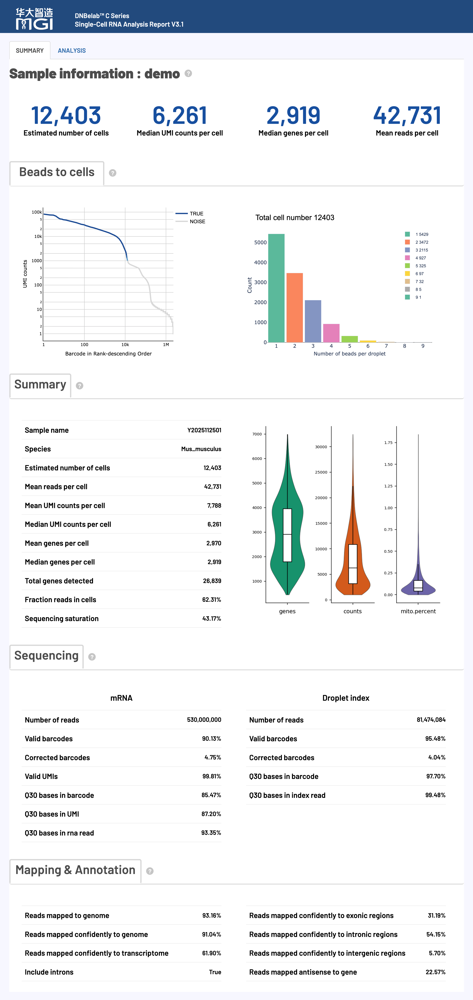
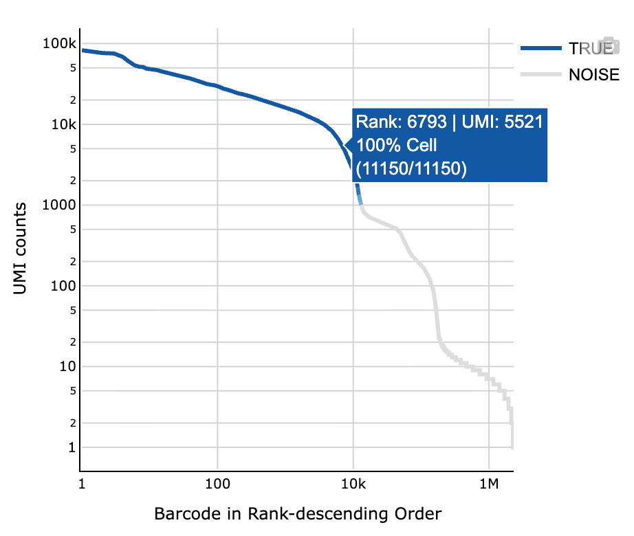
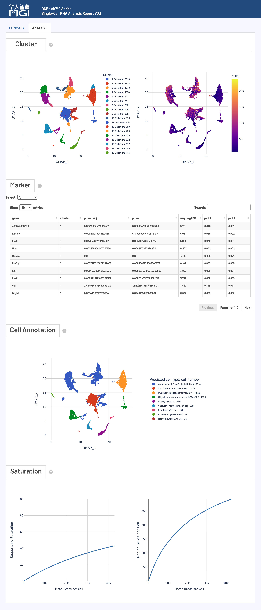
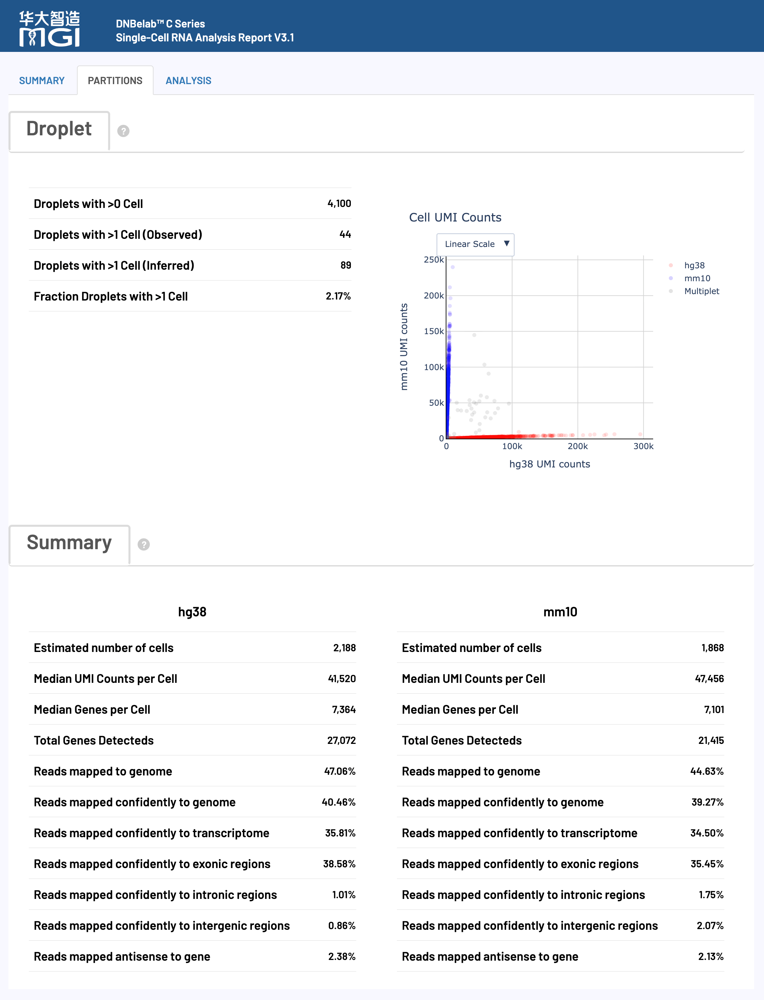

# scRNA 分析输出

> **输出范围**：目录树描述常规完成运行的结果；可选文件取决于启用模块与阶段完成状态。下文质量参考区间是判读建议，不是软件内置的通过/失败规则，应以本次配置阈值和报告状态为准。

单细胞 RNA 测序分析输出文件说明

## 概述 <a id="概述"></a>

单细胞 RNA 分析完成后，会在指定的输出目录中生成标准化的文件和子目录结构，用于基因表达谱定量、细胞分群与细胞类型鉴定。矩阵与注释文件可按相应格式导入 Scanpy、Seurat 等工具；读取示例参见[结果分析](../io.md)。

### 核心交付物速览

下表汇总了 scRNA 分析的主要产物、文件格式、核心用途以及推荐的下游生态对接：

| 交付产物与核心文件 | 格式 | 主要用途与下游生态对接 |
| :--- | :--- | :--- |
| **基因表达定量矩阵**<br>• `filtered_feature_bc_matrix/`<br>• `filtered_feature_bc_matrix.h5`<br>• `filtered_feature_bc_matrix.h5ad` | `MEX`<br>`H5`<br>`H5AD` | 真实单细胞的高置信度基因表达矩阵，下游分析的核心输入。<br>• **R (Seurat)**: `Read10X()` / `Read10X_h5()`<br>• **Python (Scanpy)**: `read_h5ad()` / `read_10x_h5()` / `read_10x_mtx()` |
| **未过滤原始矩阵**<br>• `raw_feature_bc_matrix/`<br>• `raw_feature_bc_matrix.h5` | `MEX`<br>`H5` | 包含全量候选微珠/液滴与背景噪音的原始计数矩阵，用于自定义空滴模型（EmptyDrops）与质控复核。 |
| **聚类与分群分析**<br>• `analysis/QC_Cluster.h5ad`<br>• `analysis/cluster.csv`<br>• `analysis/marker.csv` | `H5AD`<br>`CSV` | 封装降维坐标（UMAP/t-SNE）、图聚类分群标签及各群差异表达 Marker 基因列表。<br>• **推荐工具**: Scanpy / 统计分析与可视化绘图 |
| **细胞元数据明细**<br>• `singlecell.csv` | `CSV` | 记录每个液滴/微珠的测序读段数、基因数、UMI 分子数及真实细胞识别标记。<br>• **分析注意**: 统一按 `is_cell_barcode` 筛选真细胞；作为 VDJ 联动白名单输入。 |
| **实验指标汇总**<br>• `metrics_summary.xls` | `TSV 文本` | 测序质量、比对率、细胞数及 UMI 中位数等全局生信统计指标。<br>• **读取规范**: 制表符文本，R 用 `read.delim()`，Python 用 `pd.read_csv(sep='\t')`。 |
| **交互式网页报告**<br>• `<sample>_scRNA_report.html` | `HTML` | 一站式可视化质控与分析报告，交互式查看细胞鉴定曲线、数据质控指标与聚类分群图。<br>• **打开方式**: 无需网络，双击在任意现代桌面浏览器中直接打开。 |
| **基因组比对记录**<br>• `anno_decon_sorted.bam`<br>• `anno_decon_sorted.bam.bai` (或 `.csi`) | `BAM`<br>`BAI / CSI` | 携带纠错单细胞标签（`CB`, `UB`, `GN`）的基因组坐标排序比对文件。<br>• **生态对接**: 支持 IGV 可视化、samtools 检索、RNA 速率（Velocyto）分析。 |
| **双物种归属（可选）**<br>• `analysis/cell_classification.csv` | `CSV` | 区分人鼠等双物种混合样本的细胞物种归属与多胞率（Multiplet）。<br>• **生成条件**: 仅在多物种混合参考基因组分析时生成。 |

## 输出目录结构 <a id="输出目录结构"></a>

```text
outs/
├── filtered_feature_bc_matrix/              # 过滤后的高置信度基因表达矩阵目录 (MEX 格式)
│   ├── barcodes.tsv.gz                      # 真实细胞 ID 列表
│   ├── features.tsv.gz                      # 基因 ID、名称与类型
│   └── matrix.mtx.gz                        # 稀疏表达计数矩阵
├── filtered_feature_bc_matrix.h5            # 过滤后的基因表达矩阵 (单文件 HDF5 格式，Seurat 首选)
├── filtered_feature_bc_matrix.h5ad          # 过滤后的基因表达矩阵 (AnnData 格式，Scanpy 首选)
├── raw_feature_bc_matrix/                   # 未过滤的原始基因表达矩阵目录 (MEX 格式，含全量液滴)
│   ├── barcodes.tsv.gz
│   ├── features.tsv.gz
│   └── matrix.mtx.gz
├── raw_feature_bc_matrix.h5                 # 未过滤的原始基因表达矩阵 (单文件 HDF5 格式)
├── analysis/                                # 下游聚类分析与 Marker 基因结果
│   ├── QC_Cluster.h5ad                      # 封装了质控、降维、聚类与 Marker 的完整 AnnData 对象
│   ├── cluster.csv                          # 各细胞所属聚类及 UMAP 坐标
│   ├── marker.csv                           # 各聚类差异高表达 Marker 基因列表
│   └── cell_classification.csv              # 双物种细胞归属与多胞判定（仅双物种分析时生成）
├── singlecell.csv                           # 细胞与液滴级别质控明细表（含真实细胞识别标记）
├── metrics_summary.xls                      # 实验质控与分析质量指标汇总表（制表符分隔 TSV）
├── <sample>_scRNA_report.html               # 交互式综合网页质控与分析报告
├── anno_decon_sorted.bam                    # 坐标排序的比对 BAM 文件（启用 BAM 时输出）
├── anno_decon_sorted.bam.bai                # 比对索引文件（超长染色体自动生成 .csi）
└── oligo.records.bam                        # Oligo 文库比对记录（启用 BAM 且含有 Oligo 文库时输出）
```

<a id="v32-outputs"></a>

!!! note "版本交付说明"
    `filtered_feature_bc_matrix.h5ad` 保存过滤计数矩阵。BAM 索引可根据染色体长度自动选择 BAI 或 CSI；使用 `--no_bam` 时会同时跳过 cDNA 和 oligo BAM 生成以减少 BAM 文件占用的磁盘空间。基于 Sample Barcode 物理混合的 C6 多样本输出结构请参阅 [C6 多样本输出](c6.md)。

---

## 详细文件说明 <a id="详细文件说明"></a>

### 1. 特征与表达矩阵文件 <a id="特征矩阵文件"></a>

**核心内容**: 单细胞基因表达计数矩阵，分为过滤后的高质量细胞数据和原始全量液滴数据，同步提供 MEX、H5 与 H5AD 三种主流格式。

!!! tip "微珠合并与细胞标识追溯"
    DNBelab C 系列一个物理液滴可能包含多个微珠。算法自动合并共有微珠并命名为 `CELL<number>_N<bead_count>`（如 `CELL1118_N3`，单微珠为 `_N1`）。交付的 BAM 中 `CB` 标签与表达矩阵的 `barcodes.tsv.gz` 均为合并后的最终细胞 ID；`singlecell.csv` 中保留分号分隔的原始微珠序列。

#### 过滤后的基因表达矩阵 (`filtered_feature_bc_matrix/`) <a id="market-matrix-format-mtxgz"></a>

包含通过细胞质控与 EmptyDrops 模型鉴定的真实单细胞表达计数矩阵，是进行下游聚类分群、差异表达和细胞类型注释的**主要核心输入**。

采用标准的 **Matrix Market Exchange (MEX)** 稀疏格式存储，包含以下三个配套文件：

| 文件名 | 格式 | 内容描述与对应关系 |
| :--- | :--- | :--- |
| `matrix.mtx.gz` | MatrixMarket 文本（gzip 压缩） | 稀疏表达矩阵。包含矩阵行数、列数、非零元总数，后续每行记录一个非零元素的位置与计数值（`行号 列号 表达量数值`）。仅存储非零元素，大幅节约存储。 |
| `barcodes.tsv.gz` | 单列纯文本（gzip 压缩） | 通过质控筛选的高质量真实细胞 ID 列表（格式如 `CELL1_N2`），行号严格对应矩阵的**列索引**。 |
| `features.tsv.gz` | 三列制表符文本（gzip 压缩） | 特征（基因）注释表，包含 `基因ID`、`基因名称` 和 `特征类型（Gene Expression）`，行号严格对应矩阵的**行索引**。 |

- **快速加载示例**：
  - **R (Seurat)**:
    ```r
    library(Seurat)
    counts <- Read10X(data.dir = "filtered_feature_bc_matrix")
    seu <- CreateSeuratObject(counts = counts)
    ```
  - **Python (Scanpy)**:
    ```python
    import scanpy as sc
    adata = sc.read_10x_mtx("filtered_feature_bc_matrix", var_names="gene_symbols")
    ```

#### 单文件 HDF5 表达矩阵 (`filtered_feature_bc_matrix.h5`)

将上述稀疏矩阵、细胞条形码和特征基因整合封装于单一 HDF5 二进制文件中。
- **推荐场景**：R（Seurat）与 Python（Scanpy）跨平台快速单文件加载。
- **快速加载示例**：
  - **R (Seurat)**:
    ```r
    library(Seurat)
    counts <- Read10X_h5("filtered_feature_bc_matrix.h5")
    seu <- CreateSeuratObject(counts = counts)
    ```
  - **Python (Scanpy)**:
    ```python
    import scanpy as sc
    adata = sc.read_10x_h5("filtered_feature_bc_matrix.h5")
    ```

#### AnnData 表达矩阵 (`filtered_feature_bc_matrix.h5ad`) <a id="anndata-format-h5ad"></a>

专为 Python 单细胞生态定制的 AnnData 二进制格式，完整存储稀疏矩阵 `X`、细胞元数据 `obs` 与基因元数据 `var`。
- **推荐场景**：Python（Scanpy / scvi-tools）生态的首选格式。
- **快速加载示例**：
  ```python
  import scanpy as sc
  adata = sc.read_h5ad("filtered_feature_bc_matrix.h5ad")
  ```

AnnData 内部核心插槽（Slots）结构如下：

| 组件 | 实际保存内容 |
| :--- | :--- |
| `X` | 下游质控与归一化前的细胞×基因原始计数（`n_cells × n_genes`） |
| `obs` | 细胞/条形码标识；此计数导出不保证包含下游质控或注释字段 |
| `var` | 输入矩阵提供的基因信息，如 `gene_ids`、`feature_types` |

`filtered_feature_bc_matrix.h5ad` 是计数矩阵，不是聚类对象。PCA/UMAP 坐标、聚类标签和 Marker 统计保存在 `analysis/QC_Cluster.h5ad` 中，具体内容取决于相应分析阶段是否完成。本流程不生成剪接/未剪接计数层。

#### 未过滤原始表达矩阵 (`raw_feature_bc_matrix/` 与 `.h5`)

包含测序检测到的全量条形码（未经过滤）的原始基因表达计数矩阵。
- **核心用途**：保留包含真实细胞、低质量受损细胞以及背景游离液滴在内的全量数据；适用于用户需要复核细胞鉴定曲线（Barcode Rank Plot）、运行自定义过滤模型或手动设置阈值的场景。

---

### 2. 分析与聚类结果目录 (`analysis/`) <a id="分析结果目录-analysis"></a>

**核心内容**: 流程自动化执行的降维（PCA/UMAP）、图聚类、差异高表达 Marker 基因以及双物种判定结果。

#### QC_Cluster.h5ad

经过完整标准化、高变基因筛选、PCA 降维、邻近图构建、Leiden/Louvain 聚类及 UMAP 投影的完整单细胞数据对象。
- **核心用途**：整合了上游表达矩阵与全部下游生信分析结果。直接在 Python 中加载即可复现分析报告中的全部聚类分群图与 Marker 分析，无需重新运行耗时的降维和聚类流程。
- **包含组件**：
  - `adata.obs['leiden']`: 细胞的聚类簇编号；
  - `adata.obsm['X_umap']`: UMAP 二维投影坐标；
  - `adata.uns['rank_genes_groups']`: 各聚类的差异表达基因统计结果。

`QC_Cluster.h5ad` 的字段取决于已完成的分析步骤；小样本或空结果可能只有空 Marker 表或简化分析结果。输出根目录的计数矩阵与此经过下游处理的分析对象不同。

#### cluster.csv

以表格形式导出的细胞聚类分析明细表（CSV 格式）。
- **字段说明**：
  - CSV 首列（行索引）：细胞 ID，列名不保证为 `Barcode`；
  - `leiden`：聚类簇编号；`Cluster`：包含簇内细胞数的展示标签；
  - `UMAP_1`, `UMAP_2`: UMAP 降维的二维散点坐标；
  - `nGene`, `nUMI`: 每个细胞检测到的基因数和 UMI 总数。

#### marker.csv

各细胞聚类的差异高表达基因（Marker 基因）列表（CSV 格式），用于指导细胞类型鉴定和功能富集分析。
- **字段说明**：
  - `cluster`: 目标聚类簇编号；
  - `gene`: 基因符号（Gene Symbol）；
  - `avg_log2FC`: 该基因在目标聚类相比其他聚类的平均对数倍数变化（Fold Change）；
  - `p_val_adj`: Scanpy `rank_genes_groups` 返回的多重检验校正 p 值；
  - `pct.1`: 该基因在目标聚类细胞中的表达比例；
  - `pct.2`: 该基因在其余所有聚类细胞中的表达比例。

`marker.csv` 保留 log fold change 非空、`avg_log2FC > 0` 且 `p_val_adj < 0.05` 的基因，按 log fold change 排序，每簇最多保留 50 个。空表不一定表示文件导出失败。

#### cell_classification.csv（仅双物种分析时生成）

在执行双物种（如人-鼠混合 `hg38 + mm10`）分析时生成，记录每个细胞的物种归属判定。
- **字段说明**：
  - `barcode`: 细胞 ID；
  - `<species1>`（如 `hg38`）: 比对到第一物种基因组的 UMI 计数；
  - `<species2>`（如 `mm10`）: 比对到第二物种基因组的 UMI 计数；
  - `call`: 物种归属判定结果（`hg38`、`mm10` 、混合候选 `Multiplet` 或未确定归属 `Unassigned`）。`Multiplet` 是跨物种混合候选，不等于已证实的生物学双胞。

**数据示例：**

```csv
barcode,hg38,mm10,call
CELL1_N2,17098,821,hg38
CELL2_N8,56978,1939,hg38
CELL5_N2,868,4216,mm10
CELL8_N2,2371,71601,mm10
CELL27_N3,64247,90800,Multiplet
```

---

### 3. 分析指标与细胞明细汇总 <a id="分析指标汇总"></a>

**核心内容**: 实验整体质量评估汇总、单细胞级别质控明细以及交互式 HTML 综合报告。

#### *_scRNA_report.html

一站式交互式综合网页报告。
- **核心用途**：可在任意标准浏览器中直接离线打开，直观查看细胞鉴定曲线（Barcode Rank Plot）、聚类 UMAP 图、高表达 Marker 热图及各项测序与比对生信指标。详细图表判读请参阅下文 [网页报告释义](#网页报告释义)。

#### metrics_summary.xls

实验关键分析质量指标汇总表。虽然扩展名为 `.xls`，**其实质为标准的制表符分隔纯文本（TSV）**。
- **核心用途**：汇总测序质量、比对率、细胞数、每细胞平均 Reads 数及中位基因/UMI 表达量等全局生信统计指标。
- **加载规范**：R 中使用 `read.delim("metrics_summary.xls", check.names = FALSE)`；Python 中使用 `pd.read_csv("metrics_summary.xls", sep="\t")`。

#### singlecell.csv

单细胞级别的全量质量控制信息表（CSV 格式）。
- **核心用途**：记录测序下机检测到的每个微珠/液滴的详细指标，支持用户进行自定义深度过滤，并作为 V(D)J 免疫组库分析的核心输入白名单（通过 `--beadstrans` 传入）。
- **关键字段**：
  - `cell`: 聚合后的细胞 ID（如 `CELL1_N2`）；
  - `barcode`: 原始测序微珠条形码（若由多微珠合并，各条形码以分号 `;` 分隔）；
  - `reads`: 该微珠/液滴对应的转录组 Read 数；
  - `gene`: 检测到的基因种类数；
  - `umi`: 检测到的转录本 UMI 总分子数；
  - `is_cell_barcode`: **真实细胞识别标记**（`1` 或 `True` 表示判定为有效细胞；`0` 或 `False` 为背景；未匹配到合并细胞的记录可有空的 `cell` 和标记）。

---

### 4. 基因组比对与注释文件 <a id="比对与注释文件"></a>

**核心内容**: 测序读段比对到参考基因组的坐标排序 BAM 文件及索引，携带丰富的单细胞与基因注释 TAG 标签。

#### anno_decon_sorted.bam

经过坐标排序的比对结果文件（Binary Alignment Map 格式）。
- **核心用途**：载入 IGV 等基因组浏览器查看目标基因座位的比对深度与剪接模式；作为单细胞变异检测、可变剪接和 RNA 速率（Velocyto）等高阶分析的输入文件。
- **跳过生成**：BAM 文件体积较大，若仅需表达矩阵进行常规单细胞分群，可在运行命令中添加 `--no_bam` 跳过生成，可节约约 70% 的磁盘空间。

**关键 TAG 字段说明：**

BAM 文件通过标准 TAG 记录了单细胞核心元数据与注释：

| 标签 | 类型 | 含义与功能 |
| :--- | :--- | :--- |
| **`CB`** | String | **细胞条形码合并后的统一细胞 ID**（经过纠错与微珠合并的最终 ID，如 `CELL1_N2`，与表达矩阵列名一致） |
| **`CC`** | String | 经过错误校正的原始细胞条形码序列 |
| **`CR`** | String | 测序仪下机报告的原始测序细胞条形码序列 |
| **`CY`** | String | 细胞条形码的 Phred 测序质量得分 |
| **`UB`** | String | **处理后的 UMI 序列**；存在该标签不表示 BAM 中每个分子仅保留一条记录 |
| **`UR`** | String | 测序仪下机报告的原始测序 UMI 序列 |
| **`UY`** | String | UMI 的 Phred 测序质量得分 |
| **`GX`** | String | 参考注释中的基因 ID（不限于 Ensembl ID） |
| **`GN`** | String | 基因符号（Gene Name / Symbol） |
| **`TX`** | String | 比对到的转录本标识符（Transcript ID） |
| **`AN`** | String | 反义转录本标记（用于评估文库链特异性） |
| **`RE`** | Character (`A`) | 比对区域类型：外显子（`E`）、内含子（`N`）或基因间区（`I`） |

#### anno_decon_sorted.bam.bai (或 .csi)

BAM 文件的索引文件，支持基因组区间的毫秒级快速随机访问。
- **自适应索引规则**：
  - 参考序列最大染色体长度 ≤ `2^29` bp（536,870,912 bp） 时生成标准的 `.bai` 索引；
  - 当参考基因组包含超大染色体或人工重叠群（> `2^29` bp）时，SAMtools 会自动切换生成 `.csi` 索引。

仅含表头的零结果 RNA BAM 可不生成坐标索引。

#### oligo.records.bam

当实验启用了包含 Oligo 捕获序列的建库策略且未添加 `--no_bam` 时生成，记录 Oligo 读段的比对与条形码识别明细。

---

## 网页报告释义 <a id="网页报告释义"></a>

`dnbc4tools` 产出的交互式 HTML 网页报告（`report.html`）是评估实验质量和下游分析效果的核心交互入口。报告直观呈现从测序质量、比对分布、细胞识别到下游聚类与细胞注释的全流程质控指标与可视化图表。

!!! info "质量评估原则与阅读建议"
    - **整体到局部**：建议先核对概览统计（细胞数、测序量、比对率），再深入检查小提琴图、细胞鉴定拐点曲线与聚类分布。
    - **相对性判断**：文中所列阈值基于常规组织与标准建库经验总结，实际质控应紧密结合组织类型（如实体瘤 vs 外周血）、细胞活性与实验设计进行综合评估。
    - **指标分母**：原始读段对数、有效条形码的转录组置信比对 reads、识别细胞内的分子支持 reads、各区段碱基数属于不同统计集合，应按具体指标定义读取，不能统一除以原始 reads 总数。

### 报告概览与主要模块



---

### 核心分析指标详解

#### 细胞指标 (Cell Metrics) <a id="细胞指标"></a>

细胞指标反映细胞识别效率、整体转录本捕获深度及单细胞基因表达水平。

**质量控制参考标准**：

| 指标项 (Metric) | 推荐理想值 | 可接受范围 | 需排查优化 | 核心关注点 |
| :--- | :---: | :---: | :---: | :--- |
| **Mean reads per cell** | ≥ 30,000 | 15,000 – 30,000 | < 15,000 | 单细胞测序深度是否充足 |
| **Median genes per cell** | ≥ 1,000 | 500 – 1,000 | < 500 | 单细胞转录组复杂度与有效信息量 |
| **Fraction reads in cells** | ≥ 60% | 30% – 60% | < 30% | 背景游离环境 RNA 污染与细胞完整性 |
| **Sequencing saturation** | ≥ 40% | 20% – 40% | < 20% | 文库测序覆盖度与加深测序收益评估 |

**详细指标释义与技术要求**：

| 指标名称 (Metric) | 统计口径与算法计算 | 判读指导与排查要点 |
| :--- | :--- | :--- |
| **Estimated number of cells**<br>_估计细胞数量_ | 从测序数据中鉴定出的有效真实细胞总数。基于细胞条形码的 UMI 降序分布，结合 EmptyDrops 空滴算法模型智能区分细胞与背景噪音。 | 结合实际上样量与细胞活率评估。若显著低于预期，建议优先排查微流控结团/堵塞、破胞情况或测序深度不足。 |
| **Species**<br>_物种信息_ | 分析流程所采用的参考基因组物种标识（如 Human GRCh38 或 Mouse GRCm38）。 | 确认分析参考库与实验样本物种完全一致，是所有定量与质控判读的前提基准。 |
| **Mean reads per cell**<br>_每细胞平均 Reads 数_ | 原始测序读段总数 / 估计细胞数量（`Number of reads / Estimated number of cells`） | 建议 ≥ 30,000。偏低可能导致低表达特征基因检出不足，影响稀有亚群聚类和差异基因鉴定的灵敏度。 |
| **Median/Mean UMI per cell**<br>_细胞中位/平均 UMI 数_ | 判定为真实细胞的条形码内捕获到的唯一转录本分子（UMI）计数的中位数与均值。 | 反映单细胞转录本分子的绝对捕获量。受细胞体积和类型影响显著（如浆细胞、肿瘤细胞通常高于静息淋巴细胞）。 |
| **Median/Mean genes per cell**<br>_细胞中位/平均基因数_ | 单个真实细胞内检出基因（UMI ≥ 1）数量的中位数与均值。 | 评估单个细胞转录组的复杂度。外周血淋巴细胞等微小细胞该值通常偏低，组织原代细胞该值偏高。 |
| **Total genes detected**<br>_检测到的总基因数_ | 在全样本所有细胞中至少检测到 1 个有效 UMI 计数的基因总和。 | 反映样本整体转录组覆盖度与细胞群体异质性。过低可能提示测序深度不足或组织类型极度单一。 |
| **Fraction reads in cells**<br>_细胞内 Reads 比例_ | 有效条形码且置信比对至转录组的 reads 中，归属于识别细胞的比例；不能用 `singlecell.csv` 的原始 `reads` 直接代替该分母。 | 推荐 ≥ 60%。偏低提示细胞裂解导致游离环境 RNA（Ambient RNA）过量释放，或存在大量未包进细胞的空微珠。 |
| **Sequencing saturation**<br>_测序饱和度_ | 在识别细胞内，1 − 不同分子数 / 支持这些分子的 reads 数；分子按细胞条形码、基因和纠错后 UMI 区分。 | 推荐 40%–85%。反映文库测序充分性。若 < 40%，继续加测能显著增加新基因与 UMI；若 > 85%，加测收益极低。 |

#### 测序指标 (Sequencing Metrics) <a id="测序指标"></a>

测序指标反映测序仪下机数据的物理质量，包括条形码识别率、UMI 完整度及碱基测序准确性。

**质量控制参考标准**：

| 指标项 (Metric) | 推荐理想值 | 可接受范围 | 需排查优化 | 核心关注点 |
| :--- | :---: | :---: | :---: | :--- |
| **Valid barcodes** | ≥ 80% | 70% – 80% | < 70% | 细胞条形码匹配度，低于 70% 提示文库或测序异常 |
| **Valid UMIs** | ≥ 80% | 70% – 80% | < 70% | 分子标签合成质量与测序准确性 |
| **Q30 Base Quality** | ≥ 85% | 75% – 85% | < 75% | 测序质量值，直接影响比对与纠错置信度 |

**详细指标释义与技术要求**：

| 指标名称 (Metric) | 统计口径与算法计算 | 判读指导与排查要点 |
| :--- | :--- | :--- |
| **Number of reads**<br>_测序读段总数_ | 分配给该样本的双端原始测序读段（Read Pairs）总数。 | 衡量输入 cDNA 测序量，用于原始平均测序深度；其他比例指标使用各自定义的分母。 |
| **Valid barcodes**<br>_有效条形码比例_ | 细胞条形码（Cell Barcode）能精确匹配预设白名单或经 1-bp 容错纠错校正成功的读段比例。 | 推荐 ≥ 80%。过低通常提示条形码测序质量差、接头污染、引物合成缺陷或建库批次异常。 |
| **Valid UMIs**<br>_有效 UMI 比例_ | UMI 序列不包含不确定碱基 `N` 且非单碱基同聚物（如 `AAAAAA`）的读段比例。 | 评估 UMI 分子标签能否用于可靠去重定量。若异常偏低，需检查测序第二端（或 UMI 区段）的测序质量。 |
| **Q30 bases in barcode / UMI / read**<br>_各区段 Q30 碱基比例_ | 条形码区、UMI 区以及 cDNA 测序读段中，Phred 质量得分 ≥ 30（错误率 < 0.1%）的碱基占比。 | 推荐 ≥ 85%。若 Read 端 Q30 偏低，可能导致转录本比对率降低；若 Barcode/UMI 端 Q30 偏低，影响细胞与分子纠错。 |

#### 比对指标 (Mapping Metrics) <a id="比对指标"></a>

比对指标评估测序 Reads 与参考基因组的比对质量，包括整体比对率、转录组置信比对率及基因组结构区域分布。

**质量控制参考标准**：

| 指标项 (Metric) | 推荐理想值 | 可接受范围 | 需排查优化 | 核心关注点 |
| :--- | :---: | :---: | :---: | :--- |
| **Reads mapped to genome** | ≥ 80% | 50% – 80% | < 50% | 整体比对率；过低提示参考库错误、污染或 rRNA 多重比对过多 |
| **Reads mapped confidently to transcriptome** | ≥ 50% | 30% – 50% | < 30% | 能够参与基因定量的核心有效读段比例 |
| **Reads mapped antisense to gene** | < 10% | 10% – 30% | > 30% | 反义转录本比例；过高提示建库链特异性异常 |

**详细指标释义与技术要求**：

| 指标名称 (Metric) | 统计口径与算法计算 | 判读指导与排查要点 |
| :--- | :--- | :--- |
| **Reads mapped to genome**<br>_基因组比对率_ | 成功比对至参考基因组的 Reads 占总 Reads 的比例（包含唯一比对与多重比对）。 | 推荐 ≥ 80%。低于 50% 时需优先排查：样本外源污染（如支原体/细菌）、物种选择错误、参考版本陈旧，或 rRNA 等高重复序列导致的多位点超限比对（Too many loci）。 |
| **Reads mapped confidently to genome**<br>_基因组置信比对率_ | 以高质量（STAR MAPQ = 255）唯一比对至参考基因组单一位置的读段比例。 | 反映唯一比对产出率。若多重比对落入外显子且其他位置非外显子，亦被校正保留；偏低通常与重复序列多或读长短有关。 |
| **Reads mapped confidently to transcriptome**<br>_转录组置信比对率_ | 高置信度唯一比对到单个明确基因（包含外显子与内含子区域）的有效读段比例。 | 直接代表可用于表达量定量的有效 Reads。若落入多个重叠基因区域则判定为歧义并剔除，以确保定量准确性。 |
| **Reads mapped confidently to exonic regions**<br>_外显子区域比对率_ | 在置信比对到基因组的读段中，至少 50% 碱基落在已注释外显子区域的读段比例。 | 在常规全细胞测序中代表成熟 mRNA 的有效捕获；偏低时需结合内含子比例综合评估。 |
| **Reads mapped confidently to intronic regions**<br>_内含子区域比对率_ | 在置信比对到基因组的读段中，不满足外显子判定但与注释内含子相交的读段比例。 | 代表捕获到的前体 pre-mRNA 丰度。单细胞核测序（snRNA-seq）中该值可高达 30%–60%，属正常生理现象。 |
| **Reads mapped confidently to intergenic regions**<br>_基因间区比对率_ | 在置信比对到基因组的读段中，未落在任何已知注释基因（外显子与内含子外）的读段比例。 | 推荐 < 10%。偏高可能提示存在基因组 DNA 残留污染、非特异性扩增产物，或基因注释文件版本不完整。 |
| **Reads mapped antisense to gene**<br>_反义转录比对率_ | 成功比对至基因区域但链转录方向与基因注释方向相反的读段比例。 | 推荐 < 10%。过高可能提示非编码反义 RNA 表达水平高、逆转录引物非特异性退火或建库链特异性异常。 |
| **Include introns**<br>_包含内含子计数开关_ | 表达定量控制开关：`True`（默认，计入内含子 reads）/ `False`（仅外显子 reads）。 | 默认开启以全面捕获基因活性并提升灵敏度（特别是核测序与微量样本）；如仅研究成熟 mRNA 定量可关闭。 |

---

### 交互式可视化图表解读 <a id="交互式可视化图表解读"></a>

#### 可视化图表组一：细胞质量控制分析 <a id="可视化图表组一"></a>

#### 细胞鉴定曲线图 (Barcode Rank Plot)

该图通过将所有细胞条形码按捕获的 UMI 降序排列，直观展示高质量真实细胞与背景噪音的区分边界。



- **视觉编码**：深蓝线代表识别出的有效细胞；灰线代表背景环境噪音或空液滴；过渡渐变区域代表 EmptyDrops 算法判定边界。
- **坐标与交互**：X 轴为 Barcode Rank（按 UMI 降序排列，对数刻度）；Y 轴为 UMI Counts（对数刻度）。鼠标悬停可查看条形码排序位次、UMI 计数及局部细胞比例。
- **质量判读指南**：
    - **理想状态**：曲线存在极其清晰陡峭的“拐点（Knee Point）”，真实细胞区高平坦后急剧转折，背景区平缓下降，表明真实细胞与背景游离 RNA 分离良好。
    - **异常排查**：若曲线缺乏明显拐点或整体呈平缓直线下降，提示样本游离环境 RNA 偏高、细胞破裂严重或上样浓度不足。

---

#### 液滴微珠分布图 (Droplet Beads Distribution) {#droplet-beads-distribution}

展示真实细胞液滴中捕获到的微珠条形码（Beads）数量分布情况。

- **理论分布**：液滴中微珠的捕获过程在统计学上服从**泊松分布（Poisson Distribution）**。
- **判读要点**：单微珠液滴应占绝大多数。若多微珠（Multiple Beads）液滴比例异常偏高，提示微珠浓度过高、未充分混匀或存在微珠粘连。

---

#### 细胞数据分布图 (Cell Data Distribution)

通过三组并列的小提琴图（Violin Plot，展示于网页报告 Summary 页面右下方），呈现高质量细胞在 **基因数 (nGenes)**、**UMI 数 (nUMI)** 和 **线粒体基因比例 (percent.mt)** 三项核心指标上的密度分布。

- **基因数与 UMI 数 (nGenes / nUMI)**：小提琴最宽处（密度峰值）越高，表明细胞的单细胞捕获效率与转录组复杂度越高。双峰分布通常提示样本中包含细胞体积差异显著的多种亚群，或存在部分双细胞。
- **线粒体基因比例 (percent.mt)**：绝大多数高质量细胞的线粒体比例应集中在低水平（通常 < 10%–20%）。若大量细胞聚集在高比例区，通常代表细胞活性受损、处于凋亡状态或解离时细胞破损造成胞质 mRNA 丢失。

---

### 可视化图表组二：下游生物学分析 <a id="可视化图表组二"></a>

网页报告的 **Analysis 页面** 集中展示下游单细胞降维聚类、差异 Marker 基因、细胞类型注释与测序饱和度分析结果。



#### 细胞聚类分析图 (Cluster Analysis)

基于高变基因特征选择、PCA 降维与 Louvain/Leiden 社区发现算法，在二维 UMAP 空间中将基因表达谱相似的细胞聚类呈现。

- **左图（细胞聚类亚群）**：每个点代表一个细胞，颜色区分不同的细胞聚类（Cluster）。空间距离越近，代表细胞间的转录组相似度越高。
- **右图（UMI 深度分布）**：在同一 UMAP 坐标系中用颜色深浅投影每个细胞的总 UMI 数。用于快速核验各 Cluster 是否存在因测序深度偏差或批次效应导致的异常聚类（如低 UMI 伪 Cluster）。

---

#### 标记基因分析 (Marker Genes)

展示每个细胞聚类显著高表达的特征标记基因列表与热图，为细胞类型鉴别提供定量证据。

- **核心指标释义**：
    - `p_val` 与 `p_val_adj`：原始检验 P 值与 Scanpy `rank_genes_groups` 返回的校正 P 值；Marker 导出筛选 `p_val_adj < 0.05`。
    - `avg_log2FC`：平均表达量 log2 倍数变化，量化目标聚类相较于其余所有细胞的富集程度。
    - `pct.1` / `pct.2`：目标聚类中表达该基因的细胞比例 / 其余聚类中表达该基因的细胞比例（`pct.1` 接近 1 且 `pct.2` 接近 0 代表理想特异性 Marker）。
- **交互功能**：支持通过下拉菜单切换不同 Cluster 查看前排 Marker，并可在搜索框中输入特定感兴趣基因快速定位。

---

#### 细胞类型自动注释 (Cell Type Annotation)

在 UMAP 图上基于参考数据库（如人类 scHCL、小鼠 scMCA）对各聚类进行自动化细胞身份推断。

- **物种支持**：目前内置支持 Human（人）与 Mouse（小鼠）；其余物种暂不输出自动注释结果。
- **判读建议**：自动注释结果受参考图谱背景与样本特异性影响，仅供快速初筛参考；最终结论建议紧密结合 Marker 基因表达谱与相关文献进行人工复核。

---

#### 测序饱和度曲线 (Sequencing Saturation Curve)

评估当前测序深度是否已充分释放文库的转录本多样性，指导是否需要继续追加测序。

- **坐标轴体系**：X 轴为每细胞平均测序读段数（Mean reads per cell），Y 轴为测序饱和度或单细胞中位基因数。
- **曲线趋势判读**：
    - **渐近平台期**：曲线趋于平缓水平，说明当前测序已接近饱和，追加测序对检出新基因或新分子的收益边际递减。
    - **陡峭上升期**：曲线仍呈明显上升走势，说明文库仍有丰富未测出的转录本分子，追加测序能显著提升灵敏度。

---

### 双物种细胞归属页面（仅双物种分析）

当分析采用双物种联合参考基因组（如 `hg38 + mm10`）时，网页报告自动增加专属的“细胞物种归属（Species Assignment）”页面，用于精准评估微流控多细胞率与物种交叉污染。



- **Droplet 概览区（左上）**：
    - `Droplets with >0 Cell`：至少包含 1 个细胞的液滴总数。
    - `Droplets with >1 Cell (Observed / Inferred)`：实际观测到及基于二项分布推断的双细胞/多细胞液滴数。
    - `Fraction Droplets with >1 Cell`：推断的多细胞液滴比例；该比例偏高提示实际上样细胞浓度过高或解离不完全。
- **Cell UMI Counts 散点图（右上）**：
    - X 轴为物种 A（如 hg38）UMI 计数，Y 轴为物种 B（如 mm10）UMI 计数。
    - 紧贴 X 轴分布的点判定为纯物种 A 细胞；紧贴 Y 轴分布的点判定为纯物种 B 细胞；双高对角线区域的点判定为混合多细胞（Multiplet）。
- **Summary 统计区（下方）**：
    - 分别报告物种 A 与物种 B 各自的细胞总数、每细胞中位 UMI/基因数及比对质量指标。若两物种间数据量或指标严重失衡，提示上样比例不均或两物种细胞活率存在显著差异。
- **分析建议**：
    - 下游单细胞聚类前建议将 `call == "Multiplet"` 细胞标记或剔除，避免双细胞干扰分群准确性。
    - 建议结合交付文件 `analysis/cell_classification.csv` 进行定制化下游质控筛选。
