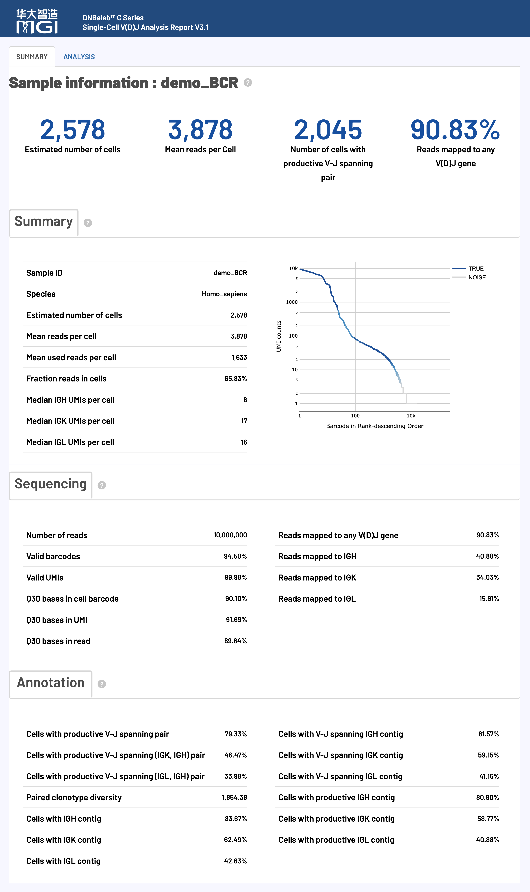
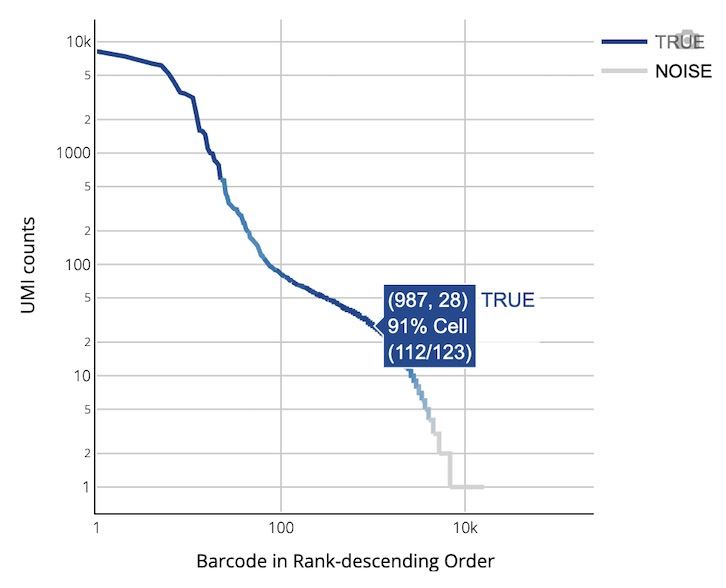
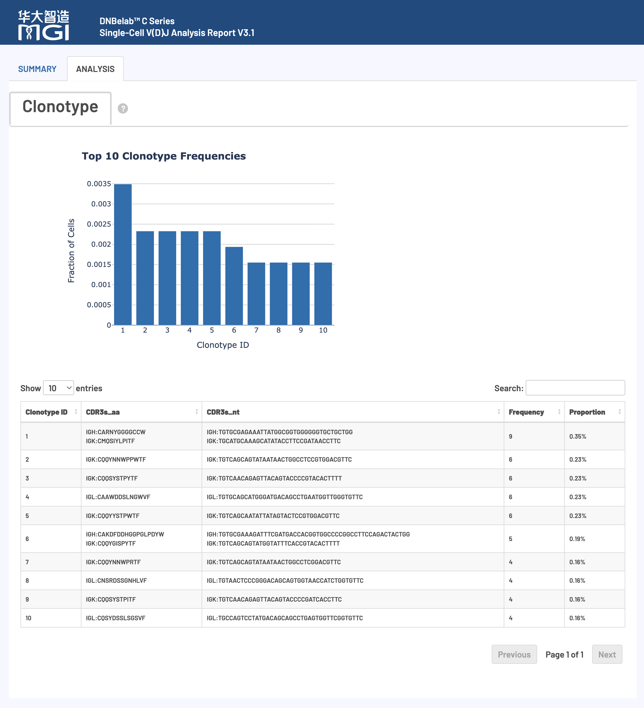

# scVDJ Analysis Output

> **Output scope**: Directory trees describe a typical completed run. Optional outputs depend on enabled modules and successful stages. Quality ranges below are interpretation guidance, not software pass/fail rules; use the configured thresholds and report status for this run.

Single-Cell V(D)J Sequencing Output File Guide

## Overview <a id="overview"></a>

After single-cell V(D)J analysis is complete, a standardized set of files and subdirectories is generated in the specified output directory for immune receptor repertoire analysis. All output files adhere to international AIRR Community standards and are fully compatible with mainstream single-cell immunoinformatics tools (such as `scRepertoire`, `immunarch`, and `scirpy`).

> **Tip**: Two modes are supported: provide `--beadstrans` to use an RNA cell table for bead mapping and RNA-based cell filtering; or omit it to run VDJ without an RNA cell table. When omitted, `keep_all_cells` is enabled automatically, so assembled barcodes are not filtered by RNA cell calls and must not be treated as an RNA-confirmed cell set.

### Deliverables at a Glance

The table below summarizes the key deliverables of scVDJ analysis, file formats, primary use cases, and recommended downstream ecosystem integrations:

| Deliverable & Core Files | Format | Description & Ecosystem Integration |
| :--- | :--- | :--- |
| **Filtered Contig Annotations**<br>• `filtered_contig_annotations.csv` | `CSV` | High-confidence contig annotations from real cells; primary entry point for downstream clonotype and receptor analyses.<br>• **Ecosystem**: Directly compatible with R (`scRepertoire`) and Python (`scirpy`). |
| **Filtered Contig Sequences**<br>• `filtered_contig.fasta`<br>• `filtered_contig.fasta.fai` | `FASTA`<br>`FAI Index` | Nucleotide sequences and index for high-confidence real cell contigs, used for BLAST searches or synthesis validation. |
| **AIRR Standard Annotations**<br>• `airr_annotations.tsv` | `TSV Text` | Immune receptor repertoire annotations adhering strictly to international AIRR Community standards.<br>• **Ecosystem**: Directly supported by Immcantation, Change-O, immunarch, and downstream pipelines. |
| **Clonotype Statistics**<br>• `clonotypes.csv` | `CSV` | Summary of identified clonotypes, recording cell frequencies, proportions, and paired CDR3 sequences. |
| **Consensus Sequences & Annotations**<br>• `consensus_annotations.csv`<br>• `consensus.fasta` (and `.fai`) | `CSV`<br>`FASTA` | Detailed annotations and representative nucleotide sequences for each consensus clonotype. |
| **All Assembled Contigs (Unfiltered)**<br>• `all_contig_annotations.csv`<br>• `all_contig.fasta` (and `.fai`) | `CSV`<br>`FASTA` | Unfiltered contigs (including low-confidence, non-productive, and background droplets) for quality audit and algorithmic traceback. |
| **Analysis Metrics Summary**<br>• `metrics_summary.xls` | `TSV Text` | Global summary of sequencing quality, cell yield, V(D)J mapping rates, and productive pairing percentages.<br>• **Format**: Tab-delimited text; read with `read.delim()` in R or `pd.read_csv(sep='\t')` in Python. |
| **Interactive Web Report**<br>• `<sample>_scVDJ_TR(IG)_report.html` | `HTML` | Comprehensive offline visual report for reviewing barcode rank curves, V(D)J enrichment, and top 10 dominant clonotypes.<br>• **How to Open**: No internet connection required; double-click to open in any desktop browser. |

## Output Directory Structure <a id="output-directory-structure"></a>

FASTA indexes (`*.fasta.fai`) are copied only when produced and are not required outputs. Zero-contig results may contain empty FASTAs and header-only CSV/TSV files with a reduced column set. Contig CSV booleans are `true`/`false`; AIRR booleans are `T`/`F`. The report filename is `<sample>_scVDJ_TR_report.html` for TCR or `<sample>_scVDJ_IG_report.html` for BCR; `TR(IG)` below is shorthand, not a literal filename.

```text
outs/
├── filtered_contig_annotations.csv         # QC-filtered contig annotations from real cells (preferred downstream input)
├── filtered_contig.fasta                   # QC-filtered contig nucleotide sequences (FASTA format)
├── filtered_contig.fasta.fai               # Index file for filtered contigs (optional)
├── airr_annotations.tsv                    # AIRR Community standard annotation file (TSV format)
├── clonotypes.csv                          # Clonotype statistics and paired CDR3 sequences
├── consensus_annotations.csv               # Detailed annotations for consensus sequences
├── consensus.fasta                         # Consensus contig sequences for each clonotype (FASTA format)
├── consensus.fasta.fai                     # Consensus sequence index file (optional)
├── all_contig_annotations.csv              # Annotation table for all assembled contigs (including background)
├── all_contig.fasta                        # Nucleotide sequences for all contigs (FASTA format)
├── all_contig.fasta.fai                    # Index file for all contigs (optional)
├── metrics_summary.xls                     # Analysis quality and performance metrics summary (tab-delimited TSV)
└── <sample>_scVDJ_TR(IG)_report.html       # Comprehensive interactive web QC and clonotype report
```

## Detailed File Description <a id="detailed-file-description"></a>

### V(D)J Assembly and Annotation Files <a id="vdj-assembly-and-annotation-files"></a>

**Core Content**: Assembled V(D)J contig sequences, precise structural annotations, and quality evaluations covering TCR and BCR rearrangements.

#### V(D)J Transcript Structure and Composition

**Diagram of a Typical V(D)J Transcript Structure:**

<div style="text-align: center; margin: 1.5rem 0;" markdown="block">

</div>

**Key Structural Elements:**

| Region | Abbreviation | Biological Function |
| :--- | :--- | :--- |
| **Untranslated Region** | UTR | Regulates mRNA stability and translation efficiency; non-protein coding |
| **Framework Region** | FWR (FWR1–4) | Conserved structural scaffolds that maintain the 3D folding of immunoglobulins or TCRs |
| **Complementarity Determining Region** | CDR (CDR1–3) | Hypervariable loops directly contacting antigen epitopes (CDR3 exhibits the highest diversity) |

> **Technical Note**: The pipeline annotates full amino acid and nucleotide sequences for both FWR and CDR regions. Output annotations are exported in multiple standardized formats.

#### Key Annotation Criteria

##### Full-Length Contig Criteria

A contig is declared **Full Length** when it meets both conditions:

- Fully spans the annotated 5' start of the V gene.
- Fully extends through the 3' end of the J gene.

##### Productive Contig Criteria

Use the `productive` flag emitted by V(D)J annotation. It is distinct from `full_length` and is not recomputed from chain count or FASTA length when publishing outputs. Filtered contigs require `productive`, `is_cell`, and `high_confidence` to all be true.

##### High Confidence & Receptor Configuration

The assembly and clonotype stages produce `high_confidence`. A fixed “one chain of each type” rule does not define this output flag. The filtered annotation writer applies `productive && is_cell && high_confidence`; a cell may still have multiple contig rows. Interpret chain pairing alongside the reported flags and clonotype assignments.

#### airr_annotations.tsv

Rearrangement annotations formatted strictly according to the international AIRR Community standards.

*   **Primary Uses**: Standardized exchange with immunoinformatics ecosystems such as `scRepertoire`, `immunarch`, and `Change-O`.
*   **Key Fields**:

| Field Name | Description |
| :--- | :--- |
| `cell_id` | Unique cell identifier associating the contig with single-cell transcriptomic data |
| `clone_id` | Clonotype identifier grouping cells belonging to the same clonal lineage |
| `sequence_id` | Unique contig identifier |
| `sequence` | Full nucleotide sequence of the rearranged V(D)J transcript |
| `sequence_aa` | Translated amino acid sequence representing the functional protein product |
| `productive` | Boolean flag indicating whether the rearrangement is productive (in-frame, no stop codons) |
| `rev_comp` | Reverse-complement flag, serialized as AIRR `T`/`F` |
| `v_call` / `d_call` / `j_call` / `c_call` | Identified germline V, D, J, and C gene segment alleles |
| `v_cigar` / `d_cigar` / `j_cigar` / `c_cigar` | CIGAR alignment strings detailing matches, insertions, and deletions |
| `sequence_alignment` | Query nucleotide alignment against reference germline sequences |
| `germline_alignment` | Inferred germline sequence alignment used for somatic hypermutation (SHM) analysis |
| `junction` / `junction_aa` | Nucleotide and amino acid sequences of the CDR3 junction region |
| `junction_length` / `junction_aa_length` | CDR3 length in nucleotides and amino acids |
| `v_sequence_start` / `v_sequence_end` | 1-based start and end coordinates of the V segment |
| `d_sequence_start` / `d_sequence_end` | 1-based start and end coordinates of the D segment |
| `j_sequence_start` / `j_sequence_end` | 1-based start and end coordinates of the J segment |
| `c_sequence_start` / `c_sequence_end` | 1-based start and end coordinates of the C segment |
| `consensus_count` | Total raw reads supporting this assembled contig |
| `duplicate_count` | Number of unique UMI molecules supporting this rearrangement |
| `is_cell` | Flag indicating whether the barcode is assigned to a real cell |

#### all_contig_annotations.csv

Comprehensive annotation table for all assembled contigs, spanning real cells and background droplets.

*   **Core Purpose**: Algorithmic auditing, full provenance inspection, and technical troubleshooting.
*   **Key Fields**:

| Field Name | Description |
| :--- | :--- |
| `sample` | Sample identifier for the VDJ library |
| `barcode` | Associated cell barcode ID |
| `is_cell` | Boolean flag indicating cell calling status (`true` / `false`) |
| `contig_id` | Unique contig identifier |
| `high_confidence` | High-confidence status flag (excluding amplicons with chimeric or artifactual characteristics) |
| `length` | Contig length in nucleotides (bp) |
| `chain` | Receptor chain locus: TRA, TRB, IGK, IGL, or IGH |
| `v_gene` / `d_gene` / `j_gene` / `c_gene` | Top-scoring V, D, J, and C gene calls |
| `full_length` | Boolean flag indicating whether full-length criteria are met |
| `productive` | Boolean flag indicating productive open reading frame status |
| `fwr1`–`fwr4` / `fwr1_nt`–`fwr4_nt` | Predicted amino acid and nucleotide sequences for FWR1 through FWR4 |
| `cdr1`–`cdr3` / `cdr1_nt`–`cdr3_nt` | Predicted amino acid and nucleotide sequences for CDR1 through CDR3 |
| `reads` | Number of reads aligned to this contig |
| `umis` | Number of unique UMI molecules supporting this contig |
| `raw_clonotype_id` | Assigned clonotype identifier |
| `raw_consensus_id` | Assigned consensus sequence identifier |
| `exact_subclonotype_id` | Exact subclonotype identifier, when assigned |

#### all_contig.fasta

FASTA file containing nucleotide sequences for all assembled contigs across cells and background.

#### filtered_contig_annotations.csv

Curated subset of `all_contig_annotations.csv` containing only high-confidence, productive contigs originating from real cells.

!!! tip "Downstream File Selection & Multi-Modal Integration"
    - **Preferred Downstream Input**: `filtered_contig_annotations.csv` strictly excludes non-productive, low-support, and ambient contigs, making it the primary entry point for clonotype diversity and V/D/J gene usage profiling.
    - **AIRR Standard Compatibility**: The companion `airr_annotations.tsv` adheres to AIRR specifications for seamless loading into R (`scRepertoire`, `immunarch`) or Python (`scirpy`).
    - **5' scRNA Barcode Harmonization**: When `--beadstrans outs/singlecell.csv` is supplied, VDJ barcodes are harmonized to match RNA cell IDs (e.g., `CELL1118_N3`), use this as the join key for RNA metadata. Contig annotations have one row per contig, so a cell can appear multiple times; aggregate by cell before a one-row-per-cell join.

#### filtered_contig.fasta

FASTA file containing high-confidence, real cell contig sequences.

### Clonotype Analysis Files <a id="clonotype-analysis-files"></a>

**Core Content**: Precise clonal lineage identification, clonal frequency calculation, and CDR3 sequence diversity.

#### clonotypes.csv

Statistical summary table for each unique clonotype identified across the dataset.

*   **Key Fields**:

| Field Name | Description |
| :--- | :--- |
| `clonotype_id` | Unique clonotype identifier (e.g., `clonotype1`) |
| `frequency` | Absolute number of cells assigned to this clonotype |
| `proportion` | Fraction of total analyzed cells represented by this clonotype |
| `cdr3s_aa` | Semicolon-delimited chain:sequence list (e.g., `TRA:CAVR...;TRB:CASS...`) |
| `cdr3s_nt` | Semicolon-delimited chain:sequence list with nucleotide sequences |

#### consensus_annotations.csv

Detailed annotation table for the consensus sequence of each clonotype.

*   **Key Fields**: `clonotype_id`, `consensus_id`, `sample`, `length`, `chain`, `v_gene`, `d_gene`, `j_gene`, `c_gene`, `full_length`, `productive`, `cdr3`, `cdr3_nt`, `reads`, `umis`.

#### consensus.fasta

FASTA file containing representative consensus sequences for all clonotypes.

### Analysis Metrics Summary <a id="analysis-metrics-summary"></a>

**Core Content**: Structured evaluation of sequencing quality, cell recovery, V(D)J mapping, and assembly performance.

#### metrics_summary.xls

A structured table of key quality metrics in tab-delimited text format (TSV).

*   **Metric Categories**:
    | Category | Contents |
    | :--- | :--- |
    | **Basic Sequencing** | Total reads, valid barcode fraction, valid UMI fraction, Q30 base quality |
    | **Cell Calling** | Estimated number of cells, fraction of reads in cells, mean reads per cell |
    | **Gene Enrichment** | Reads mapped to any V(D)J gene, chain-specific mapping rates |
    | **Assembly Quality** | Full-length contig fraction, productive contig fraction, CDR3 recovery |
    | **Clonotype Analysis** | Paired clonotype diversity, dominant clonotype frequencies |

*   **Reading Instructions**: Read with `read.delim("metrics_summary.xls")` in R or `pd.read_csv("metrics_summary.xls", sep="\t")` in Python. Detailed descriptions and benchmarks are provided in [Web Report Interpretation](#web-report-interpretation).

#### *_scVDJ_TR(IG)_report.html

Self-contained visual report in HTML format.

*   **Core Purpose**: Provides interactive charts for barcode ranking, receptor recombination, and clonotype abundance.
*   **Convenient Sharing**: Single offline file; opens in any desktop browser without an internet connection.

## Web Report Interpretation <a id="web-report-interpretation"></a>

**Overview**: The HTML report provides visual summaries and quality metrics for single-cell V(D)J sequencing, evaluating library quality, assembly efficiency, and immune repertoire diversity.

!!! info "Quality Assessment Principles & Guide"
    - **Holistic Assessment**: The HTML report provides an end-to-end overview of scVDJ analysis, covering cell calling, sequencing quality, V(D)J targeted gene mapping, productive chain assembly, and clonal expansion.
    - **Baseline Context**: Benchmarks reflect typical targeted enrichment protocols. Metrics depend on cell type (e.g., PBMC, tumor-infiltrating lymphocytes, sorted B/T cells), target cell purity, and sequencing depth.
    - **Review Workflow**: We recommend inspecting base sequencing quality and valid barcode fractions first, followed by V(D)J mapping rate and productive V-J pairing fractions, before analyzing clonotype expansion profiles.

### Report Structure & Key Content

<div style="text-align: center; margin: 1.5rem 0;" markdown="block">

</div>

### Detailed Analysis Metrics

#### V(D)J Analysis Metrics <a id="vdj-analysis-metrics"></a>

**Core Function**: Assesses cell recovery, UMI capture depth, and immune receptor assembly efficiency.

**Quality Reference Benchmarks:**

| Metric | Optimal | Acceptable | Suboptimal |
| :--- | :---: | :---: | :---: |
| **Mean reads per cell** | ≥ 10,000 | 5,000 – 10,000 | < 5,000 |
| **Fraction of Reads in Cells** | ≥ 50% | 20% – 50% | < 20% |

**Detailed Metric Definitions & Interpretation:**

| Metric | Calculation & Definition | Interpretation & Troubleshooting |
| :--- | :--- | :--- |
| **Estimated number of cells** | Estimated number of high-confidence cell barcodes expressing target V(D)J transcripts. | Evaluate against cell loading and target lymphocyte frequency. Low recovery indicates low cell purity, poor viability, or inefficient targeted PCR. |
| **Mean reads per cell** | Total input reads / Estimated number of cells. | Evaluates library sequencing depth. Paired-end sequencing recommends ≥ 5,000–10,000 read pairs/cell to ensure complete full-length assembly. |
| **Fraction of Reads in Cells** | Percentage of valid barcode reads successfully assigned to real cells. | Measures targeted signal against ambient mRNA. Recommended ≥ 50%; low values indicate cell damage or elevated cell-free RNA background. |
| **Median TRA/TRB or IGH/IGK/IGL UMIs per cell** | Median number of unique UMI molecules per cell assigned to the specific receptor locus. | Reflects per-cell transcript abundance and cDNA capture efficiency. |
| **Number of cells with TRA/TRB or IGH/IGK/IGL contig** | Number of cells with at least one contig assembled for the specified chain. | Basic detection threshold without requiring full-length or productive rearrangement. |
| **Cells with V-J spanning TRA/TRB or IGH/IGK/IGL contig** | Number of cells with contigs spanning from the V segment through the J segment. | Verifies physical assembly continuity across the recombination junction. |
| **Cells with productive TRA/TRB or IGH/IGK/IGL contig** | Number of cells with an in-frame, full-length, stop-codon-free contig and complete CDR3. | Measures functionally competent receptor recovery, providing the basis for clonotype definition. |
| **Paired clonotype diversity** | Inverse Simpson Index calculated from paired clonotype frequencies. | A value of 1 indicates total dominance by a single clone; values approaching cell count indicate a diverse polyclonal repertoire. |

#### Sequencing Metrics <a id="sequencing-metrics"></a>

**Core Function**: Assesses primary sequencing quality, barcode validity, and UMI integrity.

**Quality Reference Benchmarks:**

| Metric | Optimal | Acceptable | Suboptimal |
| :--- | :---: | :---: | :---: |
| **Valid barcodes** | ≥ 80% | 70% – 80% | < 70% |
| **Valid UMIs** | ≥ 80% | 70% – 80% | < 70% |
| **Q30 Base Quality** | ≥ 85% | 75% – 85% | < 75% |

**Detailed Metric Definitions & Interpretation:**

| Metric | Calculation & Definition | Interpretation & Troubleshooting |
| :--- | :--- | :--- |
| **Valid barcodes** | Percentage of reads whose cell barcodes match the pre-defined whitelist (with error correction). | Recommended ≥ 80%. Low fractions indicate sequencing degradation, adapter contamination, or primer issues. |
| **Valid UMIs** | Percentage of reads whose UMI sequence contains no `N` bases and is not a homopolymer. | Ensures reliable molecular deduplication and accurate transcript quantification. Recommended ≥ 80%. |
| **Q30 Base Quality** | Percentage of bases in barcode, UMI, and RNA reads with quality score ≥ 30 (error rate < 0.1%). | Primary sequencing fidelity metric ensuring robust contig assembly and accurate somatic hypermutation calling. |

#### Gene Enrichment Metrics <a id="gene-enrichment-metrics"></a>

**Core Function**: Evaluates targeted V(D)J amplification specificity and capture efficiency.

**Quality Reference Benchmarks:**

| Metric | Optimal | Acceptable | Suboptimal |
| :--- | :---: | :---: | :---: |
| **Reads mapped to any V(D)J gene** | ≥ 50% | 30% – 50% | < 30% |

**Detailed Metric Definitions & Interpretation:**

| Metric | Calculation & Definition | Interpretation & Troubleshooting |
| :--- | :--- | :--- |
| **Reads mapped to any V(D)J gene** | Percentage of valid barcode reads aligning partially or fully to known germline V(D)J gene segments. | Recommended ≥ 50%. Values < 30% suggest low lymphocyte purity, non-specific PCR amplification, or reference segment mismatches. |
| **Reads mapped to TRA/TRB/IGH/IGK/IGL** | Fraction of reads aligning to specific receptor chains (TRA, TRB, IGH, IGK, IGL). | Confirms whether individual chain abundances align with biological expectations (e.g., balanced heavy/light chain capture). |

#### V(D)J Annotation Analysis <a id="vdj-annotation-analysis"></a>

**Core Function**: Assesses productive receptor pairing and functional chain recovery.

**Quality Reference Benchmarks:**

| Metric | Optimal | Acceptable | Suboptimal |
| :--- | :---: | :---: | :---: |
| **Cells with productive V-J spanning pair** | ≥ 40% | 20% – 40% | < 20% |

**Detailed Metric Definitions & Interpretation:**

| Metric | Calculation & Definition | Interpretation & Troubleshooting |
| :--- | :--- | :--- |
| **Number of Cells with Productive V-J Spanning Pair** | Total cells harboring at least one productive receptor pair (TRA/TRB or IGH/light chain). | Yield of cells eligible for functional paired TCR/BCR repertoire investigations. |
| **Cells with productive V-J spanning pair** | Percentage of estimated cells harboring a full productive receptor pair. | Recommended ≥ 40%. Values < 20% suggest PCR amplification bias, unbalanced chain capture, or low viability. |
| **Cells with productive V-J spanning (IGK, IGH) pair** | Percentage of cells with functional IGK/IGH immunoglobulin pairing. | BCR-specific metric measuring pairing efficiency for κ light chain B cells. |
| **Cells with productive V-J spanning (IGL, IGH) pair** | Percentage of cells with functional IGL/IGH immunoglobulin pairing. | BCR-specific metric measuring pairing efficiency for λ light chain B cells. |
| **Cells with productive V-J spanning (TRA, TRB) pair** | Percentage of cells with functional TRA/TRB T cell receptor pairing. | TCR-specific metric; high percentages confirm successful α/β heterodimer recovery. |

### Interactive Visualization Charts

<a id="visualization-charts-1"></a>

The HTML report includes interactive visualizations for UMI barcode ranking and clonotype abundance analysis.

#### 1. V(D)J Barcode Rank Plot

**Chart Function**: Displays cumulative productive UMI counts across cell barcodes ranked in descending order to assess target enrichment and separation from background noise.

<div style="text-align: center; margin: 1.2rem 0;" markdown="block">

</div>

**How to Interpret**:

*   **Axes**:
    *   **X-axis (Barcode Rank)**: Cell barcodes ranked by productive contig UMI count in descending order (log scale).
    *   **Y-axis (UMI Counts)**: Total UMI count per barcode (log scale).
*   **Visual Elements**:
    *   **Blue curve**: Identified real cells.
    *   **Gray curve**: Background ambient molecules and empty droplets.
    *   **Blue gradient zone**: Transition boundary separating cells from background.
*   **Quality Guidance**: High-quality libraries display a sharp drop-off between real cells and noise. In BCR datasets, distinct peaks with exceptionally high UMI counts typically correspond to antibody-secreting plasma cells.

---

<a id="visualization-charts-2"></a>

#### 2. Clonotype Abundance & Diversity

**Chart Function**: Illustrates the relative frequency distribution and sequence features of dominant clonotypes to evaluate clonal expansion.

<div style="text-align: center; margin: 1.5rem 0;" markdown="block">

</div>

**How to Interpret**:

*   **Top Bar Chart (Top 10 Clonotypes)**: Displays the percentage of analyzed cells represented by the 10 most frequent clonotypes. High concentration indicates significant clonal expansion (e.g., in immune responses or tumor infiltrates).
*   **Bottom Table (Detailed Clonotype Table)**: Lists key molecular features for the top 10 clonotypes, including `Clonotype ID`, CDR3 amino acid and nucleotide sequences per chain, cell count (`Frequency`), and relative percentage (`Proportion`).
