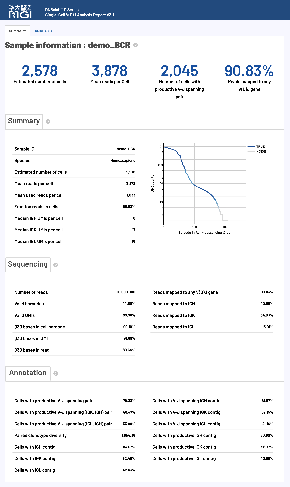
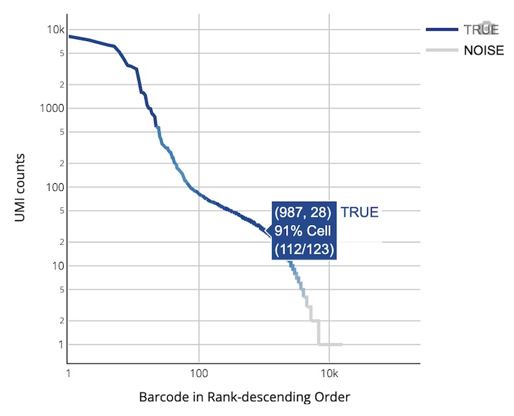
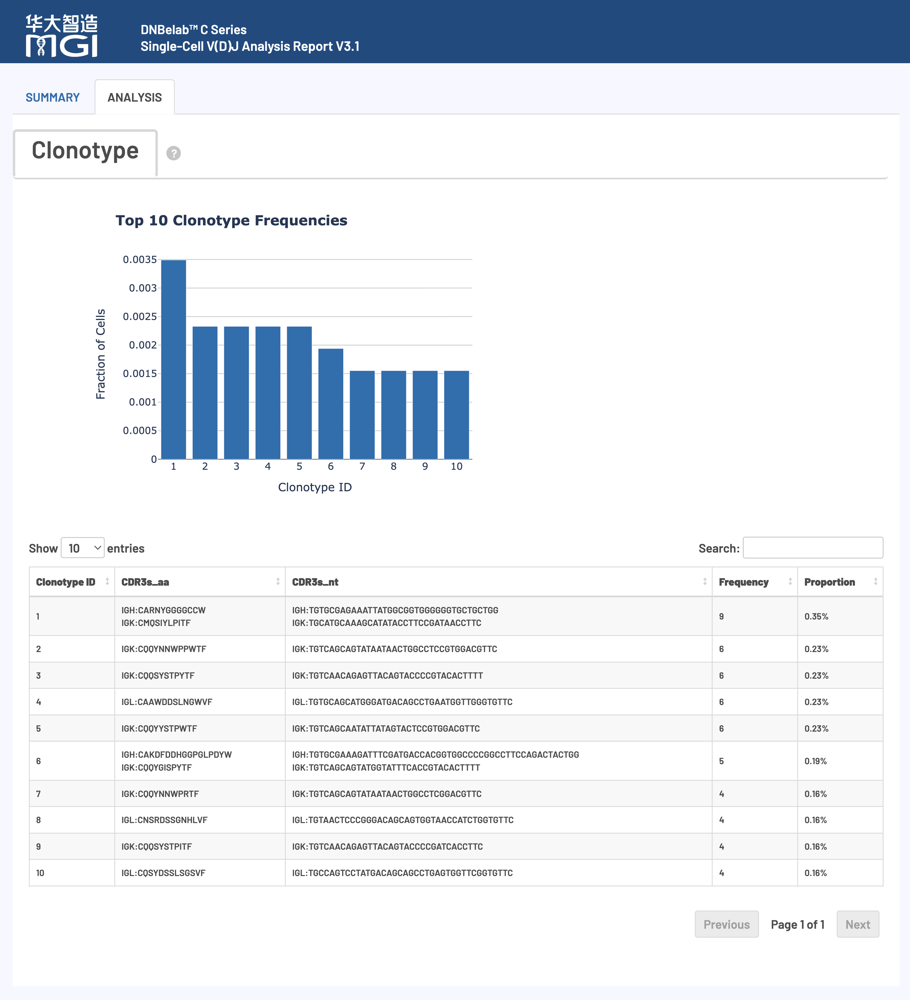

# scVDJ 分析输出

> **输出范围**：目录树描述常规完成运行的结果；可选文件取决于启用模块与阶段完成状态。下文质量参考区间是判读建议，不是软件内置的通过/失败规则，应以本次配置阈值和报告状态为准。

单细胞 V(D)J 测序分析输出文件说明

## 概述 <a id="概述"></a>

单细胞 V(D)J 分析完成后，会在指定的输出目录中生成标准化的文件和子目录结构，用于免疫受体库谱分析。所有输出文件遵循国际 AIRR 社区规范，全面兼容主流单细胞免疫组学分析生态（如 `scRepertoire`、`immunarch`、`scirpy` 等）。

> **提示**：支持两种模式：提供 `--beadstrans` 时，使用 RNA 细胞表进行微珠映射及基于 RNA 的细胞过滤；省略时，可在没有 RNA 细胞表的情况下运行 VDJ。省略该参数会自动启用 `keep_all_cells`，不按 RNA 细胞识别结果过滤组装条形码，因此不能将这些条形码视为 RNA 已确认的细胞集合。

### 核心交付物速览

下表汇总了 scVDJ 分析的主要产物、文件格式、核心用途以及推荐的下游生态对接：

| 交付产物与核心文件 | 格式 | 主要用途与下游生态对接 |
| :--- | :--- | :--- |
| **过滤后高质量重叠群注释**<br>• `filtered_contig_annotations.csv` | `CSV` | 过滤后的高质量真实细胞重叠群注释表，下游克隆型与受体分析的核心入口。<br>• **生态对接**: 可直接对接 R (`scRepertoire`) 或 Python (`scirpy`)。 |
| **过滤后高质量重叠群序列**<br>• `filtered_contig.fasta`<br>• `filtered_contig.fasta.fai` | `FASTA`<br>`FAI 索引` | 真实细胞高置信度重叠群的核苷酸序列文件及索引，用于下游 BLAST 比对或合成验证。 |
| **国际 AIRR 标准注释**<br>• `airr_annotations.tsv` | `TSV 文本` | 遵循国际 AIRR Community 标准的免疫受体库重排注释文件。<br>• **生态对接**: 原生兼容 Immcantation、Change-O、immunarch 等国际免疫组学生态。 |
| **克隆型统计分析**<br>• `clonotypes.csv` | `CSV` | 样本内克隆型（Clonotype）谱系汇总表，记录各克隆型的细胞频数、比例及配对 CDR3 序列。 |
| **共识序列与注释**<br>• `consensus_annotations.csv`<br>• `consensus.fasta` (及 `.fai`) | `CSV`<br>`FASTA` | 各克隆型一致性共识序列的详细注释表与代表性核苷酸序列。 |
| **全量未过滤组装结果**<br>• `all_contig_annotations.csv`<br>• `all_contig.fasta` (及 `.fai`) | `CSV`<br>`FASTA` | 包含所有候选重叠群（含低质量、非生产性及背景液滴）的原始注释与序列，用于全量回溯。 |
| **实验指标汇总**<br>• `metrics_summary.xls` | `TSV 文本` | 实验测序质量、细胞识别、V(D)J 基因映射率、生产性配对率等全局生信统计指标。<br>• **读取规范**: 制表符文本，R 用 `read.delim()`，Python 用 `pd.read_csv(sep='\t')`。 |
| **交互式网页报告**<br>• `<sample>_scVDJ_TR(IG)_report.html` | `HTML` | 一站式可视化质控与分析报告，交互式查看细胞条形码排序曲线、前 10 大优势克隆型丰度等。<br>• **打开方式**: 无需网络，双击在任意现代桌面浏览器中直接打开。 |

## 输出目录结构 <a id="输出目录结构"></a>

FASTA 索引（`*.fasta.fai`）仅在生成时复制，不是必需输出。无重叠群结果可包含空 FASTA 和仅表头的 CSV/TSV，表头字段也可能为精简集合。Contig CSV 布尔值为 `true`/`false`，AIRR 布尔值为 `T`/`F`。TCR 报告名为 `<sample>_scVDJ_TR_report.html`，BCR 为 `<sample>_scVDJ_IG_report.html`；下文 `TR(IG)` 仅为两种命名的简写。

```text
outs/
├── filtered_contig_annotations.csv         # 过滤后的高质量真实细胞重叠群注释表 (下游分析首选输入)
├── filtered_contig.fasta                   # 过滤后的高质量重叠群核苷酸序列 (FASTA 格式)
├── filtered_contig.fasta.fai               # 过滤后重叠群序列索引文件（可选）
├── airr_annotations.tsv                    # 国际 AIRR 社区标准格式的重排注释文件 (TSV 格式)
├── clonotypes.csv                          # 克隆型统计分析结果表 (含细胞频数与配对 CDR3)
├── consensus_annotations.csv               # 各克隆型代表性共识序列详细注释表
├── consensus.fasta                         # 各克隆型一致性共识序列 (FASTA 格式)
├── consensus.fasta.fai                     # 共识序列索引文件（可选）
├── all_contig_annotations.csv              # 全量组装重叠群注释信息 (含背景与未过滤条形码)
├── all_contig.fasta                        # 全量组装重叠群序列 (FASTA 格式)
├── all_contig.fasta.fai                    # 全量重叠群序列索引文件（可选）
├── metrics_summary.xls                     # 分析质量与性能指标汇总表 (制表符分隔 TSV)
└── <sample>_scVDJ_TR(IG)_report.html       # 交互式综合网页质控与克隆型分析报告
```

## 文件详细说明 <a id="详细文件说明"></a>

### V(D)J 组装和注释文件 <a id="vdj组装和注释文件"></a>

**核心内容**: V(D)J 重叠群序列组装、精确注释和质量评估结果，涵盖 TCR 和 BCR 重排序列的完整信息。

#### V(D)J 转录本结构与组成

**典型 V(D)J 转录本结构示意：**

<div style="text-align: center; margin: 1.5rem 0;" markdown="block">

</div>

**重要术语解释：**

| 组成区域 | 英文缩写 | 生物学功能 |
| :--- | :--- | :--- |
| **非翻译区** | UTR (Untranslated Region) | 调控 mRNA 稳定性和翻译效率，不编码蛋白质 |
| **框架区** | FWR (Framework Region) | 维持免疫球蛋白或 TCR 折叠的保守性结构框架（FWR1 – FWR4） |
| **互补决定区** | CDR (Complementarity Determining Region) | 直接与抗原表位接触，决定结合特异性的关键超变区域（CDR1 – CDR3，其中 CDR3 多样性最高） |

> **技术优势**: V(D)J 分析流程可精确识别并提供框架区（FWR）和互补决定区（CDR）的氨基酸与核苷酸序列。所有组装重叠群和克隆型共识序列的 V(D)J 注释信息均以多种标准格式输出。

#### 重要注释标准说明

##### 全长序列判定标准 (Full Length)

重叠群序列被认定为 **全长序列** 须同时满足以下条件：

- 重叠群序列完全匹配已注释 V 基因的 5' 起始区域
- 重叠群序列完整延伸至 J 基因的 3' 末端区域

##### 生产性序列判定标准 (Productive)

以 V(D)J 注释生成的 `productive` 标记为准。它与 `full_length` 是不同字段，输出发布阶段不会根据链数量或 FASTA 长度重新判定生产性。过滤后重叠群要求 `productive`、`is_cell`、`high_confidence` 同时为真。

##### 高置信度序列判定 (High Confidence)

`high_confidence` 由组装与克隆型阶段生成，不能仅用“每种链各一条”的固定规则代替。过滤注释表按 `productive && is_cell && high_confidence` 输出；同一细胞仍可对应多条重叠群记录。链配对应结合输出标记与克隆型归属解释。

#### airr_annotations.tsv

包含 V(D)J 重排的注释序列和共识序列，严格遵循国际 AIRR Community 格式规范。

*   **用途**:
    *   **标准化数据交换**: 作为国际公认的标准交换格式，可无缝对接 `scRepertoire`、`immunarch`、`Change-O` 等免疫组库工具。
    *   **深度注释**: 提供精细的 V、D、J、C 基因分型调用、CIGAR 比对串、种系基因比对结果及 CDR3 区域核苷酸与氨基酸序列。

*   **包含的核心字段**：

| 字段名 | 详细描述 |
| :--- | :--- |
| `cell_id` | 该重排序列所属细胞的唯一标识符，用于关联单细胞转录组数据 |
| `clone_id` | 克隆型编号，标识该重排序列归属的特定克隆群体 |
| `sequence_id` | 重叠群的唯一名称或标识符 |
| `sequence` | V(D)J 重排的完整核苷酸序列，包含可变区、多样性区和连接区 |
| `sequence_aa` | 重排区域翻译获得的氨基酸序列，反映功能性蛋白产物 |
| `productive` | 标记该重排是否为生产性（具有生物学功能，满足框内翻译且无终止密码子） |
| `rev_comp` | 指示序列是否为反向互补序列，按 AIRR 使用 `T`/`F` |
| `v_call` / `d_call` / `j_call` / `c_call` | 识别的 V、D、J、C 基因片段名称（D 基因仅适用于重链和 β 链） |
| `v_cigar` / `d_cigar` / `j_cigar` / `c_cigar` | 各基因片段比对的 CIGAR 字符串，记录匹配、插入、删除等比对细节 |
| `sequence_alignment` | V(D)J 重排区域与参考种系序列的比对结果，显示体细胞高频突变 |
| `germline_alignment` | 推断的种系参考序列比对结果，用于体细胞超突变（SHM）分析 |
| `junction` / `junction_aa` | CDR3 重排连接区的核苷酸序列与氨基酸序列，决定抗原结合特异性 |
| `junction_length` / `junction_aa_length` | CDR3 区域核苷酸长度（bp）与氨基酸长度（aa） |
| `v_sequence_start` / `v_sequence_end` | V 区域在重排序列中的起止位置（1-based 坐标系统） |
| `d_sequence_start` / `d_sequence_end` | D 区域在重排序列中的起止位置（1-based 坐标系统） |
| `j_sequence_start` / `j_sequence_end` | J 区域在重排序列中的起止位置（1-based 坐标系统） |
| `c_sequence_start` / `c_sequence_end` | C 区域在重排序列中的起止位置（1-based 坐标系统） |
| `consensus_count` | 支持该重排序列的总 reads 数量，反映测序深度与可信度 |
| `duplicate_count` | 支持该重排序列的独特 UMI 分子数量，用于定量分子去重分析 |
| `is_cell` | 标记该重排是否来源于真实细胞（TRUE 为细胞，FALSE 为背景噪音） |

#### all_contig_annotations.csv

包含全量组装重叠群序列（涵盖细胞与背景条形码）的详细注释信息。

*   **用途**: 用于深入质控分析与算法回溯，包含组装出的所有重叠群、低支持度序列及背景信号。
*   **包含的核心字段**：

| 字段名 | 描述 |
| :--- | :--- |
| `sample` | VDJ 文库的样本名称 |
| `barcode` | 该重叠群对应的细胞 ID 或原始条形码 |
| `is_cell` | 布尔值，指示该条形码是否被判定为真实细胞（`true` / `false`） |
| `contig_id` | 该重叠群的唯一标识符 |
| `high_confidence` | 布尔值，指示该重叠群是否为高置信度序列（排除嵌合与伪影） |
| `length` | 重叠群序列的核苷酸长度（bp） |
| `chain` | 链类型：TRA、TRB、IGK、IGL 或 IGH |
| `v_gene` / `d_gene` / `j_gene` / `c_gene` | 得分最高的 V、D、J、C 基因片段分型结果 |
| `full_length` | 布尔值，指示该重叠群是否达到全长判定标准 |
| `productive` | 布尔值，指示该重叠群是否具备生产性功能序列特征 |
| `fwr1`–`fwr4` / `fwr1_nt`–`fwr4_nt` | 预测的 FWR1 至 FWR4 区域氨基酸及核苷酸序列 |
| `cdr1`–`cdr3` / `cdr1_nt`–`cdr3_nt` | 预测的 CDR1 至 CDR3 区域氨基酸及核苷酸序列 |
| `reads` | 比对到该重叠群的 reads 数量 |
| `umis` | 支持该重叠群的独特 UMI 分子数量 |
| `raw_clonotype_id` | 分配给该重叠群的克隆型 ID |
| `raw_consensus_id` | 分配给该重叠群的共识序列 ID |
| `exact_subclonotype_id` | 精确子克隆型标识，未分配时可为空 |

#### all_contig.fasta

包含所有组装重叠群核苷酸序列的 FASTA 文件。

*   **用途**: 作为全量重叠群序列库，支持自定义 IgBLAST 比对、多序列比对及组装完整性审计。

#### filtered_contig_annotations.csv

`all_contig_annotations.csv` 的高质量子集，仅保留通过质控过滤的高置信度、且来源于真实细胞的重叠群注释结果。

!!! tip "下游分析文件选择与跨模态对齐要点"
    - **首选用作下游输入**：`filtered_contig_annotations.csv` 严格剔除了非生产性（non-productive）、低分子支持度及游离背景重叠群，是下游克隆型丰度分析、V/D/J 基因偏好性研究的核心入口。
    - **AIRR 国际标准兼容**：同级目录生成的 `airr_annotations.tsv` 严格遵循 AIRR Community 规范，可直接载入 R 的 `scRepertoire`、`immunarch` 或 Python 的 `scirpy`。
    - **5' scRNA 跨模态条形码对齐**：当使用 `--beadstrans outs/singlecell.csv` 联动分析时，VDJ 中的细胞条形码已映射为与 RNA 相同的统一 Cell ID（如 `CELL1118_N3`），可作为关联 RNA 元数据的键。Contig 注释表每行是一条重叠群，同一细胞可出现多次；需要一细胞一行时，应先按细胞汇总再关联。

*   **格式**: 与 `all_contig_annotations.csv` 完全一致。

#### filtered_contig.fasta

`all_contig.fasta` 的高质量子集，仅包含通过过滤和真实细胞识别的高质量重叠群序列。

*   **用途**: 提供高可信度的重排受体序列集合，用于抗体结构建模、亲和力成熟分析或分子克隆实验验证。

### 克隆型谱系分析文件 <a id="克隆型分析文件"></a>

**核心内容**: TCR 和 BCR 克隆型谱系的精确识别、频率统计和 CDR3 序列多样性分析。

#### clonotypes.csv

克隆型统计分析汇总表，提供每个独特克隆型的详细特征描述。

*   **用途**:
    *   **克隆型丰度分析**: 统计每个克隆型的细胞数（frequency）和细胞占比（proportion），评估克隆扩增程度。
    *   **免疫多样性评估**: 结合克隆型分布评估免疫受体库的整体多样性。
    *   **CDR3 序列分析**: 提供每个克隆型高保真的 CDR3 氨基酸与核苷酸序列。
*   **字段说明**:

| 字段名 | 详细描述 |
| :--- | :--- |
| `clonotype_id` | 分配给该共识序列的克隆型唯一标识符（如 `clonotype1`），用于追踪关联细胞 |
| `frequency` | 具有该克隆型的细胞绝对数量，反映克隆扩增程度和免疫应答强度 |
| `proportion` | 该克隆型细胞占总细胞群体的相对比例，用于评估优势克隆的占比 |
| `cdr3s_aa` | 分号分隔的链:序列列表（格式为 `链名:CDR3氨基酸序列`），用于抗原结合特异性分析 |
| `cdr3s_nt` | 分号分隔的链:序列列表（格式为 `链名:CDR3核苷酸序列`），用于体细胞高频突变与谱系树构建 |

#### consensus_annotations.csv

提供每个克隆型一致性共识序列的详细注释信息。

*   **用途**: 为每个克隆型提供代表性共识序列的完整 V(D)J 基因及 CDR/FWR 区域注释。
*   **字段说明**:

| 字段名 | 描述 |
| :--- | :--- |
| `clonotype_id` | 分配给该共识序列的克隆型 ID，对应 `clonotypes.csv` |
| `consensus_id` | 该一致性共识序列的唯一标识符，对应 `consensus.fasta` |
| `sample` | VDJ 文库的样本名称 |
| `length` | 共识序列的核苷酸长度（bp） |
| `chain` | 链类型：TRA、TRB、IGK、IGL 或 IGH |
| `v_gene` / `d_gene` / `j_gene` / `c_gene` | 得分最高的 V、D、J、C 基因片段分型结果 |
| `full_length` / `productive` | 是否为全长序列 / 生产性序列标记 |
| `cdr3` / `cdr3_nt` | 预测的 CDR3 氨基酸与核苷酸序列 |
| `reads` / `umis` | 支持该共识序列的 reads 数量与 UMI 分子数量 |

#### consensus.fasta

包含每个克隆型一致性共识序列的 FASTA 文件。

*   **用途**: 提供各克隆型的代表性序列，理想状态下为从 5' UTR 起始到 C 基因引物结合位点结束的全长受体序列。

### 分析指标汇总 <a id="分析指标汇总"></a>

**核心内容**: V(D)J 组装质量的结构化评估和统计指标汇总，提供完整的数据质量控制信息。

#### metrics_summary.xls

采用制表符分隔（TSV）格式的关键分析指标汇总表，提供了对实验整体质量的结构化评估。

*   **核心用途**: 快速评估测序质量、细胞识别、基因映射、组装效果等核心生信指标。
*   **指标类别划分**:

| 指标类别 | 包含内容 |
| :--- | :--- |
| **基础测序统计** | 总读段数、有效条形码比例、UMI 质量、Q30 碱基质量等基础测序指标 |
| **细胞识别结果** | 估计细胞数量、细胞内读段比例、每细胞平均读段数等细胞识别结果 |
| **基因映射特征** | V(D)J 基因映射比例、链特异性映射统计、基因利用度分析 |
| **序列组装质量** | 全长序列比例、生产性序列比例、CDR3 识别成功率等组装效果评估 |
| **克隆型分析指标** | 克隆型多样性、配对成功率、主要克隆型频率等免疫组库特征 |

*   **读取方式**: 推荐在 R 中使用 `read.delim("metrics_summary.xls")`，在 Python 中使用 `pd.read_csv("metrics_summary.xls", sep="\t")`。详细指标释义与推荐质量基准请参见 [网页报告释义](#网页报告释义)。

#### *_scVDJ_TR(IG)_report.html

采用 HTML 网页格式的交互式综合分析报告。

*   **核心用途**: 以交互式图表展示质控结果、免疫受体链重组分析、克隆型丰度与谱系分布等关键分析结果。
*   **便捷分享**: 单个离线 HTML 文件，无需网络，双击即可在任意桌面浏览器中打开。

## 网页报告释义 <a id="网页报告释义"></a>

**概述**：HTML 网页报告提供单细胞 V(D)J 测序结果的可视化摘要和指标说明，覆盖实验质量与免疫受体分析相关的关键指标。

!!! info "质量评估原则与阅读建议"
    - **整体评估**：HTML 网页报告提供单细胞 V(D)J 测序结果的可视化摘要与质控分析，覆盖细胞识别、测序质量、V(D)J 基因富集映射、生产性链组装及克隆型丰度等核心环节。
    - **基准参考**：下述质量参考标准基于常规富集样本拟定。不同样本类型（如外周血 PBMC、肿瘤浸润淋巴细胞 TIL、组织分离细胞）、目标淋巴细胞纯度与测序深度存在差异，实际评估时请结合实验背景综合判断。
    - **阅读路径**：建议按照报告展示顺序依次核对测序质量、细胞识别与细胞内读段比例、V(D)J 基因富集率，再核查生产性 V-J 跨越配对比例，最后结合 Top 10 克隆型丰度评估克隆扩增状态。

### 报告主要内容与结构

<div style="text-align: center; margin: 1.5rem 0;" markdown="block">

</div>

### 核心分析指标详解

#### V(D)J 分析指标 (V(D)J Analysis Metrics) <a id="vdj分析指标"></a>

**核心功能**: 细胞识别、质量评估和免疫受体组装统计，提供实验整体效果的关键指标。

**质量参考标准：**

| 指标名称 (Metric) | 推荐标准 (Optimal) | 可接受区间 (Acceptable) | 需关注/优化 (Suboptimal) |
| :--- | :---: | :---: | :---: |
| **Mean reads per cell** | ≥ 10,000 | 5,000 – 10,000 | < 5,000 |
| **Fraction of Reads in Cells** | ≥ 50% | 20% – 50% | < 20% |

**详细指标解释与算法：**

| 指标名称 (Metric) | 统计口径与算法计算 | 判读指导与排查要点 |
| :--- | :--- | :--- |
| **Estimated number of cells**<br>*(估计细胞数量)* | 表达目标 V(D)J 转录本的高置信度真实细胞条形码估计数量。 | 综合上样细胞数与样本中 T/B 细胞比例判断。若明显偏低，建议优先检查目的细胞分选纯度、样本活性及 V(D)J 扩增效率。 |
| **Mean reads per cell**<br>*(平均每细胞读段数)* | 输入测序读段总数 / 估计细胞数量。 | 评估 V(D)J 文库测序深度。双端测序推荐 ≥ 5,000–10,000 read pairs/cell；深度不足会导致全长组装失败和克隆型漏检。 |
| **Fraction of Reads in Cells**<br>*(细胞内读段占比)* | 归属于真实细胞条形码的读段数占全部有效条形码读段总量的百分比。 | 衡量受体转录本在细胞与游离环境中的分配比。推荐 ≥ 50%；过低提示细胞破损导致游离 RNA 污染严重或空液滴背景偏高。 |
| **Median TRA/TRB or IGH/IGK/IGL UMIs per cell**<br>*(每细胞特异性链 UMI 中位数)* | 真实细胞中分配给目标特异性免疫受体链的 UMI 分子数中位数。 | 评估单个细胞中 TCR/BCR 转录本的捕获丰度与表达强度，反映反转录与富集扩增效率。 |
| **Number of cells with TRA/TRB or IGH/IGK/IGL contig**<br>*(含有特异性链重叠群的细胞数)* | 检测到至少一条目标链（TRA/TRB 或 IGH/IGK/IGL）重叠群序列的细胞总数。 | 只要求存在相应重叠群，不要求达到全长或生产性，作为受体检出的基础基准。 |
| **Cells with V-J spanning TRA/TRB or IGH/IGK/IGL contig**<br>*(含 V-J 跨区重叠群的细胞数)* | 组装重叠群序列完整跨越 V 基因和 J 基因重组连接区的细胞数量。 | 排除片段化短重叠群，是评估受体序列组装物理完整性的关键指标。 |
| **Cells with productive TRA/TRB or IGH/IGK/IGL contig**<br>*(含功能性重叠群的细胞数)* | 重叠群同时满足 V-J 跨区、无移码突变、无提前终止密码子且具完整 CDR3 的细胞数。 | 评估具有潜在生物学功能的受体检出规模，是下游克隆型分析的分子基础。 |
| **Paired clonotype diversity**<br>*(配对克隆型多样性)* | 基于配对克隆型频率计算的逆辛普森指数（Inverse Simpson Index）。 | 值为 1 表示整个样本由单一优势克隆完全主导；数值越接近细胞总数，表明克隆型分布越均匀多样。用于评估免疫应答的克隆扩增程度。 |

#### 测序指标 (Sequencing Metrics) <a id="测序指标"></a>

**核心功能**: 测序数据的基础质量评估，包括条形码识别率、比对质量和测序准确性。

**质量参考标准：**

| 指标名称 (Metric) | 推荐标准 (Optimal) | 可接受区间 (Acceptable) | 需关注/优化 (Suboptimal) |
| :--- | :---: | :---: | :---: |
| **Valid barcodes** | ≥ 80% | 70% – 80% | < 70% |
| **Valid UMIs** | ≥ 80% | 70% – 80% | < 70% |
| **Q30 Base Quality** | ≥ 85% | 75% – 85% | < 75% |

**详细指标解释与算法：**

| 指标名称 (Metric) | 统计口径与算法计算 | 判读指导与排查要点 |
| :--- | :--- | :--- |
| **Valid barcodes**<br>*(有效条形码比例)* | 细胞条形码可精准匹配到白名单（经容错校正）的读段占总测序读段的比例。 | 推荐 ≥ 80%。过低通常提示条形码测序质量欠佳、接头污染或文库结构偏差。 |
| **Valid UMIs**<br>*(有效 UMI 比例)* | UMI 序列不包含未识别碱基 `N` 且非简单均聚物（如 `AAAAAA`）的读段占比。 | 评估分子标签质量，保障分子去重与转录本计数的可靠性。推荐 ≥ 80%。 |
| **Q30 Base Quality**<br>*(Q30 碱基比例)* | 条形码、UMI 及 RNA 测序读段中质量值 ≥ 30（错误率 < 0.1%）的碱基比例。 | 测序平台物理信号质量的基础指标，保障条形码识别与全长重叠群组装的保真度。 |

#### 基因富集性能指标 (Enrichment Metrics) <a id="基因富集性能指标"></a>

**核心功能**: V(D)J 基因特异性富集效率评估，反映靶向扩增捕获效果。

**质量参考标准：**

| 指标名称 (Metric) | 推荐标准 (Optimal) | 可接受区间 (Acceptable) | 需关注/优化 (Suboptimal) |
| :--- | :---: | :---: | :---: |
| **Reads mapped to any V(D)J gene** | ≥ 50% | 30% – 50% | < 30% |

**详细指标解释与算法：**

| 指标名称 (Metric) | 统计口径与算法计算 | 判读指导与排查要点 |
| :--- | :--- | :--- |
| **Reads mapped to any V(D)J gene**<br>*(任意 V(D)J 基因映射比例)* | 有效条形码读段中，部分或完全比对到已知胚系 V(D)J 基因片段的读段占比。 | 推荐 ≥ 50%；< 30% 时需优先排查：样本中目标淋巴细胞纯度不足、靶向富集 PCR 特异性欠佳或参考基因库缺失。 |
| **Reads mapped to TRA/TRB/IGH/IGK/IGL**<br>*(特异性免疫受体链映射比例)* | 比对至特定受体链（如 TCR 的 TRA/TRB，BCR 的 IGH/IGK/IGL）的读段占总有效读段的比例。 | 用于核对各链相对丰度是否符合生物学预期（如 TRB 通常高于 TRA，BCR 重轻链配对平衡）。 |

#### V(D)J 注释分析 (V(D)J Annotation) <a id="vdj注释分析"></a>

**核心功能**: 生产性重排配对分析，评估免疫受体的功能性表达水平。

**质量参考标准：**

| 指标名称 (Metric) | 推荐标准 (Optimal) | 可接受区间 (Acceptable) | 需关注/优化 (Suboptimal) |
| :--- | :---: | :---: | :---: |
| **Cells with productive V-J spanning pair** | ≥ 40% | 20% – 40% | < 20% |

**详细指标解释与算法：**

| 指标名称 (Metric) | 统计口径与算法计算 | 判读指导与排查要点 |
| :--- | :--- | :--- |
| **Number of Cells with Productive V-J Spanning Pair**<br>*(生产性配对细胞绝对数量)* | 至少具有一对完整且具功能性的受体配对（TRA/TRB 或 IGH/轻链）的细胞总数。 | 评估样本中能够直接进入功能性 TCR/BCR 配对研究的有效细胞规模。 |
| **Cells with productive V-J spanning pair**<br>*(生产性配对细胞比例)* | 具备生产性全长配对的细胞占所有估计细胞条形码的百分比。 | 推荐 ≥ 40%。低于 20% 提示扩增偏好性严重、双链捕获不平衡或细胞受损。 |
| **Cells with productive V-J spanning (IGK, IGH) pair**<br>*(IGK/IGH 生产性配对比例)* | 成功检测到（IGK, IGH）功能性重轻链配对的细胞占比。 | BCR 数据集专属指标，反映 κ 轻链 B 细胞亚群的捕获配对情况。 |
| **Cells with productive V-J spanning (IGL, IGH) pair**<br>*(IGL/IGH 生产性配对比例)* | 成功检测到（IGL, IGH）功能性重轻链配对的细胞占比。 | 与 IGK 配对互补，联合反映 B 细胞免疫球蛋白轻链的使用偏好。 |
| **Cells with productive V-J spanning (TRA, TRB) pair**<br>*(TRA/TRB 生产性配对比例)* | 成功检测到（TRA, TRB）功能性 α/β 链配对的细胞占比。 | TCR 数据集专属指标，高比例表明样本中大部分 T 细胞均捕获到完整的 αβ 异源二聚体。 |

### 交互式可视化图表解读

<a id="可视化图表1"></a>

网页报告内置了多维度交互式可视化图表，全面覆盖受体链 UMI 排序质控与优势克隆型丰度分析。

#### 1. V(D)J 细胞条形码排序图 (V(D)J Barcode Rank Plot)

**图表功能**：展示各细胞条形码的生产性 UMI 数量降序排列分布，用于直观评估受体富集效果与背景区分度。

<div style="text-align: center; margin: 1.2rem 0;" markdown="block">

</div>

**如何解读**：

*   **坐标轴定义**:
    *   **X 轴 (Barcode Rank)**: 所有细胞条形码按生产性重叠群 UMI 总数降序排列（对数刻度）。
    *   **Y 轴 (UMI Counts)**: 各条形码对应的总 UMI 数量（对数刻度）。
*   **视觉编码**:
    *   **蓝色实线**: 算法识别出的有效真实细胞群体。
    *   **灰色实线**: 背景游离分子与空液滴噪音。
    *   **蓝色渐变过渡带**: 真实细胞与背景的交界分水岭。
*   **质控与生物学特征**:
    *   高质量样本在细胞区域与背景区域之间具有清晰陡峭的断崖式跌落。
    *   在 BCR 数据集中，常可观察到极高 UMI 计数的突出峰（通常对应免疫球蛋白转录活性极高的浆细胞或浆母细胞）。

---

<a id="可视化图表2"></a>

#### 2. 克隆型丰度与多样性分析 (Clonotype Abundance & Diversity)

**图表功能**：展示样本中优势克隆型的相对丰度分布与序列特征，用于直观评估免疫应答是否存在寡克隆扩增。

<div style="text-align: center; margin: 1.5rem 0;" markdown="block">

</div>

**如何解读**：

*   **上图柱状图 (Top 10 Clonotypes)**: 展示样本中细胞频数最高的前 10 个克隆型所占总细胞群体的百分比。柱形越高、占比越集中，表明样本呈现出更强烈的克隆扩增状态（常见于抗原刺激或肿瘤浸润淋巴细胞）。
*   **下表详细信息 (Detailed Clonotype Table)**: 提供前 10 大克隆型的详细特征，包括克隆型编号（`Clonotype ID`）、各链 CDR3 氨基酸与核苷酸序列、绝对细胞频数（`Frequency`）以及相对占比（`Proportion`），便于直接溯源优势克隆的生物学功能。
