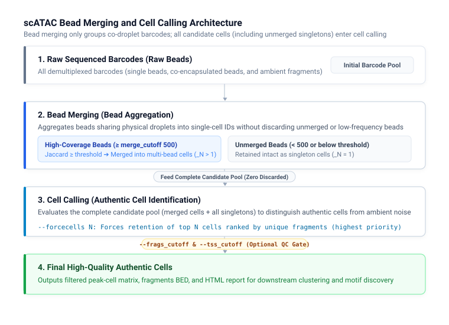

# scATAC Parameters

DNBelab C Series HT scATAC Parameter Configuration Guide

## Overview <a id="概述"></a>

This document describes the parameters, default behaviors, and usage patterns for `dnbc4tools atac` subcommands, including single-sample analysis (`run`), reference database construction (`mkref`), and batch script generation (`multi`).

> **Tip:** Parameter specifications are based on current command-line help outputs. Examples can be used directly as templates.

## Main Analysis Workflow (run) <a id="主分析流程-run"></a>

### Usage <a id="usage"></a>

```bash
dnbc4tools atac run \
  --name sample1 \
  --fastqs /data/atac \
  --genomeDir /reference/atac \
  --threads 20
```

### Full Command-Line Help

```shell
$ dnbc4tools atac run --help
dnbc4tools 3.2

Process a single-cell ATAC-seq sample.

Usage: dnbc4tools atac run [OPTIONS]

options:
  --help                     show this help message and exit

Input Files:
  Choose one input method: either `--fastqs` (directory input) or individual FASTQ files (`--fastq1` and
  `--fastq2`).

  --fastqs <DIR>             Input directory path containing paired-end FASTQ files. Read 1 and Read 2 files are
  detected from the directory (e.g., `./fastq_dir`).
  --fastq1 <FILE>            Read 1 FASTQ file path(s) for the ATAC library. Wildcards and comma-separated lists are
  supported (e.g., `sample1_L01_R1.fastq.gz,sample1_L02_R1.fastq.gz`).
  --fastq2 <FILE>            Read 2 FASTQ file path(s) for the ATAC library. Must match the order provided to
  `--fastq1` (e.g., `sample1_L01_R2.fastq.gz,sample1_L02_R2.fastq.gz`).

Basic Settings:
  --name <STR>               Unique identifier for the sample. Used for naming output files and reports (e.g.,
  `sample1`).
  --genomeDir <DIR>          Reference genome directory path. Must contain required index and annotation resources
  (e.g., `./genome_index`).
  --outdir <DIR>             Output directory path for results and reports [default: current directory] (e.g.,
  `./output`).
  --threads <INT>            Number of CPU threads for parallel processing [default: all available cores].

Library Settings:
  --darkreaction <STR>       Dark cycle setting for ATAC library. Supported values: `R1R2`, `R1`, `R2`, `unset` (e.g.,
  `R1R2`).
  --customize <STR>          Custom read structure string. Format: `<type>,<read>:<start>-<end>` joined by `;`. (e.g.,
  `"cb,R1:7-16;cb,R1:23-32;R1,R1:66-115;R2,R2:20-69"`).

Filtering Settings:
  --forcecells <INT>         Force pipeline to use exactly this number of cells (e.g., `5000`).
  --frags_cutoff <INT>       Additional minimum total unique fragments for called cells [default: 0, disabled]. Cell
  calling and other configured QC filters still apply.
  --tss_cutoff <FLOAT>       Minimum TSS proportion threshold to retain a cell [default: 0.0] (e.g., `0.2`).
  --jaccard_cutoff <FLOAT>   Jaccard similarity threshold in [0,1] for bead merging (e.g., `0.02`).
  --merge_cutoff <INT>       Minimum unique fragments per bead for initial bead-merge candidates [default: 500].
  Lowering it admits weaker evidence and can change merging and the filtered peak-calling
  input.

Analysis Settings:
  --need_bam                 Enable generation of BAM files containing aligned reads.
  --sample_read_pairs <INT>  Subsample the specified number of read pairs from input FASTQ file(s) (e.g., `1000000`).
```

### Parameter Reference Tables

#### Required & Basic Settings

| Option | Type | Default | Description |
| :--- | :--- | :--- | :--- |
| `--name` | String | **Required** | Unique sample identifier; used as output file prefix and report title (e.g., `sample_001`) |
| `--genomeDir` | Directory | **Required** | Reference genome directory path containing index and annotation resources built by `atac mkref` |
| `--outdir` | Directory | `./` | Root output directory for analysis results and HTML reports |
| `--threads` | Integer | All cores | Number of CPU threads allocated for parallel processing |

#### Input Files Options

Choose one input mode: directory-based (`--fastqs`) or explicit files (`--fastq1` and `--fastq2`).

| Option | Type | Default | Description |
| :--- | :--- | :--- | :--- |
| `--fastqs` | Directory | None | Directory containing paired-end FASTQ files (files reside directly in this directory; paired files detected automatically) |
| `--fastq1` | File path | None | Read 1 FASTQ file list (supports wildcards `*` or comma-separated paths) |
| `--fastq2` | File path | None | Read 2 FASTQ file list (order must strictly match `--fastq1`) |

> **Tip: Sequencing Consistency & Batch Handling**
> All FASTQ inputs in a single run must originate from the same library batch with identical sequencing modes and dark reaction settings; data from different libraries cannot be mixed.
> If different sequencing batches of the same library batch exhibit differing dark reaction cycles or read lengths, use the FASTQ trimming tool [`fqsubC4`](tools.md#fastq-切割-fqsubc4) to trim reads to match the standard library structure (see [Library Structure](../library_structure.md#scatac)).

#### Cell Calling & Bead Merging Settings

| Option | Type | Default | Description |
| :--- | :--- | :--- | :--- |
| `--forcecells` | Integer | None | Forces the pipeline to retain exactly this number of cells (highest priority, overrides automatic calling). Barcodes are ranked in descending order of unique fragments, and the top N barcodes are selected |
| `--frags_cutoff` | Integer | `0` (disabled) | Additional minimum total unique fragments for called cells; `0` disables this extra filter while still running cell calling |
| `--tss_cutoff` | Float | `0.0` (disabled) | Minimum TSS proportion threshold to retain a cell; `0` disables this filter (e.g., `0.2`) |
| `--jaccard_cutoff` | Float \| `auto` | `auto` | Jaccard similarity threshold for bead merging (`auto` estimated via OTSU algorithm, clamped at 0.02 if estimated below 0.02; or manual 0–1 float value) |
| `--merge_cutoff` | Integer | `500` | Minimum unique fragments per bead for initial bead-merge candidates |

#### Library Chemistry & Read Structure

| Option | Type | Default | Description |
| :--- | :--- | :--- | :--- |
| `--darkreaction` | Choice | `auto` | Dark cycle settings: `auto`, `R1R2`, `R1`, `R2`, `unset` |
| `--customize` | String | None | Custom read structure string overriding darkreaction (wrapped in quotes, delimited by semicolons) |

#### Analysis Settings & Tuning

| Option | Type | Default | Description |
| :--- | :--- | :--- | :--- |
| `--need_bam` | Flag | Disabled | Enables generation of aligned BAM files (increases runtime and disk usage by 30%–50%). Note: Due to slight discrepancies in how Chromap produces BED versus BAM outputs, enabling `--need_bam` may introduce minor differences in downstream analysis results |
| `--sample_read_pairs` | Integer | None | Subsample a specified number of read pairs for rapid benchmarking |

---

### Key Parameter Deep Dives

#### 1. FASTQ Directory Structure & Input Rules

Unlike the RNA workflow (which requires `cDNA/` and `oligo/` subfolders), the ATAC `--fastqs` option points to a **flat directory** containing paired-end files directly:

```text
fastq_directory/
├── sample_ATAC_L01_R1.fastq.gz
├── sample_ATAC_L01_R2.fastq.gz
├── sample_ATAC_L02_R1.fastq.gz
└── sample_ATAC_L02_R2.fastq.gz
```

- **Naming detection**: Supports standard read patterns `_R1_`, `_R1`, `_1`, `_read1` paired with `_R2_`, `_R2`, `_2`, `_read2`; file extensions support `.fastq.gz`, `.fq.gz`, `.fastq`, `.fq`.
- **Individual inputs**: If not using `--fastqs`, supply paired files via `--fastq1` and `--fastq2` with comma-separated file lists.

#### 2. Bead Merging & Multi-stage Quality Control

Single-cell ATAC-seq exhibits droplet bead co-encapsulation. The pipeline applies a two-stage merging and filtering strategy:

<div style="text-align: center; margin: 20px 0;" markdown="block">
  
</div>

- **`--merge_cutoff`**: Minimum unique fragments per bead required to participate in Jaccard similarity calculation (default: 500). This parameter **only controls bead merging**; beads with fewer than 500 fragments or beads without overlapping partners are retained intact as singleton cells and advance to downstream steps without being discarded. In low-depth libraries, this can be lowered (e.g. 200) to allow more beads to be evaluated for merging.
- **`--jaccard_cutoff`**: Jaccard similarity cutoff measuring genomic accessibility overlap between beads. Defaults to `auto` (OTSU bimodal distribution estimation with a safety floor of 0.02 to prevent over-merging), or a float between 0–1. Beads with $\ge 500$ fragments that do not meet this cutoff are likewise preserved as singletons.
- **`--forcecells`**: Forces retention of a specified number of authentic cells when automatic calling does not meet expectations. Cell calling evaluates the complete candidate pool (both merged multi-bead cells and all singleton beads), sorts candidates by unique fragments in descending order, and directly selects the top N cells.
- **`--frags_cutoff` & `--tss_cutoff`**: Downstream supplementary QC filters. Setting them to `0` leaves filtering to the cell calling algorithm. If damaged nuclei debris remains in the report, activate manual cutoffs (e.g., `--frags_cutoff 1000 --tss_cutoff 0.1`).
- **`--need_bam` & Alignment Differences Note**: Chromap's direct BED export differs slightly from its SAM/BAM generation and subsequent fragment extraction pipeline in terms of fragment shifting (Tn5 shift) and deduplication boundaries. Consequently, enabling `--need_bam` may produce minor variations in downstream metrics (such as fragment counts and cell statistics), which is expected behavior.

#### 3. Dark Reaction & Custom Read Structure <a id="darkreaction"></a>

> **Library Structure Reference**: For complete ATAC library adapter architecture, extension sequences, and dark reaction schematics, see [Library Structure](../library_structure.md#scatac).

- **`--darkreaction`**: Select based on MGI sequencer chemistry:
  - `auto`: Automatically detected from base compositions
  - `R1R2`: Dark cycles on both Read 1 and Read 2
  - `R1`: Dark cycles only on Read 1
  - `R2`: Dark cycles only on Read 2
  - `unset`: No dark reactions (standard sequencing mode)
- **`--customize`**: Defines exact 1-based intervals for barcodes and reads (overrides darkreaction):
  ```bash
  # Structure: CB1(7-16bp), CB2(23-32bp), R1(66-115bp), R2(20-69bp)
  --customize "cb,R1:7-16;cb,R1:23-32;R1,R1:66-115;R2,R2:20-69"
  ```

---

## Reference Database Construction (mkref) <a id="参考数据库构建-mkref"></a>

`dnbc4tools atac mkref` builds Chromap genome indices, chromosome tables, and TSS annotation BED files.

### Usage

```bash
dnbc4tools atac mkref \
  --fasta genome.fa --ingtf genes.gtf \
  --species human --genomeDir /reference/atac
```

### Full Command-Line Help

```shell
$ dnbc4tools atac mkref --help
dnbc4tools 3.2

Build an ATAC reference database.

Usage: dnbc4tools atac mkref [OPTIONS]

options:
  --help               show this help message and exit

Input Files:
  Input genome FASTA files and gene-annotation GTF files. For mixed-species analysis, separate multiple files with
  commas.

  --fasta <FILE>       Reference-genome FASTA file path(s). Separate multiple files with commas (e.g., `genome.fa`).
  --ingtf <FILE>       Gene-annotation GTF file path(s). Separate multiple files with commas (e.g., `anno.gtf`).

Basic Settings:
  --genomeDir <DIR>    Output directory path for generated reference files [default: current directory] (e.g.,
                       `./ref`).
  --species <STR>      Species identifier(s) [default: undefined]. For mixed-species references, provide
                       comma-separated names in the same order as --fasta and --ingtf (e.g., `human,mouse`).

Advanced Settings:
  --tag <STR>          Feature type used to generate the BED file [default: transcript] (e.g., `exon`).
  --chrM <STR>         Mitochondrial chromosome name [default: auto-detect common names]. For mixed-species
                       references, provide comma-separated names in --species order (e.g., `MT,chrM`).
  --chloroplast <STR>  Chloroplast chromosome name, primarily for plant references [default: disabled] (e.g., `Pt`).
  --prefix <STR>       Filter chromosomes by prefix or full name. This option is not supported for mixed-species
                       references [default: no filtering] (e.g., `chr`).
  --kmer <INT>         k-mer length for Chromap index generation [default: Chromap built-in] (e.g., `20`).
  --window <INT>       Window size for Chromap index generation [default: Chromap built-in] (e.g., `10`).
  --noindex            Generate reference files without building the Chromap genome index.
```

### Parameter Reference Tables

#### Required & Basic Settings

| Option | Type | Default | Description |
| :--- | :--- | :--- | :--- |
| `--fasta` | File path | **Required** | Reference FASTA path(s) (comma-separated for mixed species, e.g., `human.fa,mouse.fa`) |
| `--ingtf` | File path | **Required** | Gene annotation GTF path(s) (comma-separated for mixed species, e.g., `human.gtf,mouse.gtf`) |
| `--genomeDir` | Directory | `./` | Output directory path for generated reference files |
| `--species` | String | `undefined` | Species identifier(s), comma-separated for mixed species (e.g., `human,mouse`) |

#### Advanced Settings

| Option | Type | Default | Description |
| :--- | :--- | :--- | :--- |
| `--tag` | String | `transcript` | Feature type in GTF used to generate the TSS BED file (e.g., `transcript`, `exon`) |
| `--chrM` | String | Auto-detect | Mitochondrial chromosome name(s) in species order (e.g., `MT,chrM`) |
| `--chloroplast` | String | Disabled | Chloroplast chromosome name, primarily for plant references (e.g., `Pt`) |
| `--prefix` | String | None | Filter chromosomes by prefix or name (not supported for mixed species, e.g., `chr`) |
| `--kmer` | Integer | Chromap default | k-mer length for Chromap index generation |
| `--window` | Integer | Chromap default | Window size for Chromap index generation |
| `--noindex` | Flag | Disabled | Generates configuration and TSS files without building Chromap index |

---

### Reference Architecture & Key Configurations

#### 1. TSS Extraction & Mixed-Species Reference

- **TSS BED Generation**: The tool automatically extracts Transcription Start Sites (TSS) from GTF based on `--tag`, used for single-cell ATAC TSS enrichment and proportion calculations.
- **Mixed-Species Reference**:
  - Provide matching comma-separated arguments:
    ```bash
    dnbc4tools atac mkref \
      --fasta human.fa,mouse.fa \
      --ingtf human.gtf,mouse.gtf \
      --species human,mouse \
      --genomeDir /ref/human_and_mouse
    ```

#### 2. Directory Layout & `ref.json` Metadata

```text
genomeDir/
├── fasta/
│   ├── genome.fa          # Unified FASTA sequence
│   ├── genome.chrom.sizes # Chromosome lengths
│   └── genome.index       # Chromap index
├── genes/
│   ├── genes.gtf          # Standardized GTF annotation
│   └── tss.bed            # TSS annotation BED file
└── ref.json               # Reference metadata and validation
```

**Dual-Species `ref.json` Example:**

```json
{
  "chrmt": "human_chrM,mouse_chrM",
  "chloroplast": null,
  "genome": "/database/scATAC/human_and_mouse/fasta/genome.fa",
  "genomeDir": "/database/scATAC/human_and_mouse",
  "gtf": "/database/scATAC/human_and_mouse/genes/genes.gtf",
  "species": "human_and_mouse",
  "version": "3.2"
}
```

---

## Multi-Sample Workflow (multi) <a id="多样本操作-multi"></a>

`dnbc4tools atac multi` generates standalone executable shell scripts for each sample defined in a tab-separated list file. It does not launch analyses automatically.

### Usage

```bash
dnbc4tools atac multi --list samples.tsv --genomeDir /reference/atac --threads 20
```

### Full Command-Line Help

```shell
$ dnbc4tools atac multi --help
dnbc4tools 3.2

Process multiple ATAC-seq samples.

Usage: dnbc4tools atac multi [OPTIONS]

options:
  --help             show this help message and exit

Input Files:
  --list <FILE>      Tab-separated sample list: sample name <TAB> FASTQ R1;R2. Multiple FASTQ files within one
                     end are comma-separated. Generates one shell script per sample in the current working directory;
                     run the generated scripts to start analysis.

Basic Settings:
  --genomeDir <DIR>  Reference genome directory path containing required reference files.
  --outdir <DIR>     Analysis output directory written into each generated script [default: current directory] (e.g.,
                     `./output`). Scripts are written to the current working directory.
  --threads <INT>    Number of CPU threads written into each generated analysis script. If omitted, each analysis
                     detects available cores when it runs.
```

### Parameter Reference Tables

| Option | Type | Default | Description |
| :--- | :--- | :--- | :--- |
| `--list` | File path | **Required** | Tab-separated sample list file |
| `--genomeDir` | Directory | **Required** | Reference genome directory path |
| `--outdir` | Directory | `./` | Output root directory written into each script (scripts are generated in current working directory) |
| `--threads` | Integer | Auto-detect | Thread count configured inside each generated script |

---

### Sample List Rules & Execution Workflow

#### 1. `--list` File Specification

The sample list must be a tab-separated (`\t`) text file with 2 columns:
1. **Sample Name** (`sample_name`)
2. **ATAC FASTQ Paths** (paired R1 and R2 separated by semicolon `;`, multiple lane files comma-separated `,`)

```tsv
Sample1	/data/S1_L01_R1.fq.gz,/data/S1_L02_R1.fq.gz;/data/S1_L01_R2.fq.gz,/data/S1_L02_R2.fq.gz
Sample2	/data/S2_L01_R1.fq.gz;/data/S2_L01_R2.fq.gz
```

#### 2. Execution & Cluster Dispatch

- Running `dnbc4tools atac multi` creates per-sample shell scripts (e.g., `Sample1.sh`, `Sample2.sh`) in the current directory.
- Each script contains the complete parameterized `dnbc4tools atac run` command.
- Users can run scripts directly via `bash Sample1.sh` or submit them to batch workload managers (e.g., Slurm, SGE).
