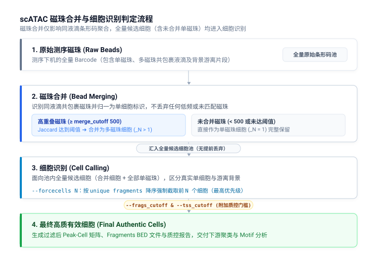

# scATAC 分析参数

DNBelab C Series HT scATAC 参数配置说明

## 概述 <a id="概述"></a>

本文档说明 `dnbc4tools atac` 各子命令的参数含义、默认行为和常见使用方式，覆盖单样本分析 (`run`)、参考库构建 (`mkref`) 与多样本任务生成 (`multi`)。

> **提示：** 参数说明以当前命令行帮助信息为基础，示例可直接作为模板调整后使用。

## 主分析流程 (run) <a id="主分析流程-run"></a>

### 用法 <a id="usage"></a>

```bash
dnbc4tools atac run \
  --name sample1 \
  --fastqs /data/atac \
  --genomeDir /reference/atac \
  --threads 20
```

### 完整命令行帮助

```shell
$ dnbc4tools atac run --help
dnbc4tools 3.2

Process a single-cell ATAC-seq sample.

Usage: dnbc4tools atac run [OPTIONS]

options:
  --help                     show this help message and exit

Input Files:
  Choose one input method: either `--fastqs` (directory input) or individual FASTQ files (`--fastq1` and
  `--fastq2`).

  --fastqs <DIR>             Input directory path containing paired-end FASTQ files. Read 1 and Read 2 files are
  detected from the directory (e.g., `./fastq_dir`).
  --fastq1 <FILE>            Read 1 FASTQ file path(s) for the ATAC library. Wildcards and comma-separated lists are
  supported (e.g., `sample1_L01_R1.fastq.gz,sample1_L02_R1.fastq.gz`).
  --fastq2 <FILE>            Read 2 FASTQ file path(s) for the ATAC library. Must match the order provided to
  `--fastq1` (e.g., `sample1_L01_R2.fastq.gz,sample1_L02_R2.fastq.gz`).

Basic Settings:
  --name <STR>               Unique identifier for the sample. Used for naming output files and reports (e.g.,
  `sample1`).
  --genomeDir <DIR>          Reference genome directory path. Must contain required index and annotation resources
  (e.g., `./genome_index`).
  --outdir <DIR>             Output directory path for results and reports [default: current directory] (e.g.,
  `./output`).
  --threads <INT>            Number of CPU threads for parallel processing [default: all available cores].

Library Settings:
  --darkreaction <STR>       Dark cycle setting for ATAC library. Supported values: `R1R2`, `R1`, `R2`, `unset` (e.g.,
  `R1R2`).
  --customize <STR>          Custom read structure string. Format: `<type>,<read>:<start>-<end>` joined by `;`. (e.g.,
  `"cb,R1:7-16;cb,R1:23-32;R1,R1:66-115;R2,R2:20-69"`).

Filtering Settings:
  --forcecells <INT>         Force pipeline to use exactly this number of cells (e.g., `5000`).
  --frags_cutoff <INT>       Additional minimum total unique fragments for called cells [default: 0, disabled]. Cell
  calling and other configured QC filters still apply.
  --tss_cutoff <FLOAT>       Minimum TSS proportion threshold to retain a cell [default: 0.0] (e.g., `0.2`).
  --jaccard_cutoff <FLOAT>   Jaccard similarity threshold in [0,1] for bead merging (e.g., `0.02`).
  --merge_cutoff <INT>       Minimum unique fragments per bead for initial bead-merge candidates [default: 500].
  Lowering it admits weaker evidence and can change merging and the filtered peak-calling
  input.

Analysis Settings:
  --need_bam                 Enable generation of BAM files containing aligned reads.
  --sample_read_pairs <INT>  Subsample the specified number of read pairs from input FASTQ file(s) (e.g., `1000000`).
```

### 参数速查表

#### 必需与基本设置

| 参数 | 类型 | 默认值 | 说明 |
| :--- | :--- | :--- | :--- |
| `--name` | 字符串 | **必需** | 样本唯一标识符，用作所有输出文件的前缀和报告标题（如 `sample_001`） |
| `--genomeDir` | 目录路径 | **必需** | 参考基因组目录路径，必须包含由 `atac mkref` 构建的索引与注释文件 |
| `--outdir` | 目录路径 | `./` | 分析结果和报告的输出根目录 |
| `--threads` | 整数 | 全部可用核心 | 分析过程中使用的 CPU 线程数 |

#### 输入文件参数

输入方式二选一：使用 `--fastqs` 指定统一目录，或显式分别指定 `--fastq1` 与 `--fastq2`。

| 参数 | 类型 | 默认值 | 说明 |
| :--- | :--- | :--- | :--- |
| `--fastqs` | 目录路径 | 无 | 包含配对 FASTQ 文件的目录路径（直接放置当前 ATAC 文库的 R1/R2 文件，自动配对） |
| `--fastq1` | 文件路径 | 无 | Read 1 FASTQ 文件路径（支持通配符 `*` 或逗号分隔多个文件） |
| `--fastq2` | 文件路径 | 无 | Read 2 FASTQ 文件路径（与 `--fastq1` 顺序必须严格一致） |

> **提示：测序文件一致性与批次处理**
> 同一分析中的所有测序文件必须来自同一文库批次，测序模式与暗反应设置须保持一致；不同文库的数据不能混合输入。
> 如果同一文库批次的不同测序批次存在暗反应模式或者测序长度不一致的情况，则需要使用 FASTQ 裁剪工具 [`fqsubC4`](tools.md#fastq-切割-fqsubc4) 对 reads 进行裁剪，具体裁剪位置请参考[文库结构识别](../library_structure.md#scatac)。

#### 细胞识别与微珠合并参数 {#_7}

| 参数 | 类型 | 默认值 | 说明 |
| :--- | :--- | :--- | :--- |
| `--forcecells` | 整数 | 无 | 强制流程保留确切的细胞数量，优先级最高（覆盖自动识别结果）。截取时按候选细胞条形码的唯一片段数（Unique Fragments）降序截取前 N 个细胞 |
| `--frags_cutoff` | 整数 | `0` (关闭) | 附加的最终总唯一 fragment 数量阈值；`0` 表示关闭此附加过滤，仍执行常规 cell calling |
| `--tss_cutoff` | 浮点数 | `0.0` (关闭) | 最低 TSS 区域片段比例过滤阈值；`0` 表示关闭此过滤（如 `0.2`） |
| `--jaccard_cutoff` | 浮点数 \| `auto` | `auto` | 微珠（beads）合并的 Jaccard 相似度阈值（`auto` 基于 OTSU 算法估计，自动计算低于 0.02 时按 0.02 截断过滤；或手动输入 0–1 浮点数） |
| `--merge_cutoff` | 整数 | `500` | 参与 Jaccard 合并的微珠所需最低唯一 fragments 数量门槛 |

#### 文库化学与测序结构参数

| 参数 | 类型 | 默认值 | 说明 |
| :--- | :--- | :--- | :--- |
| `--darkreaction` | 选项 | `auto` | 暗循环设置：`auto`、`R1R2`、`R1`、`R2`、`unset` |
| `--customize` | 格式字符串 | 无 | 自定义条形码与读段提取结构，覆盖暗反应设置（引号包裹，分号分隔） |

#### 分析设置与调优参数

| 参数 | 类型 | 默认值 | 说明 |
| :--- | :--- | :--- | :--- |
| `--need_bam` | 标志开关 | 关闭 | 启用比对 BAM 文件的生成（耗时和磁盘空间预计增加 30%–50%）。注意：由于 Chromap 软件直接生成 BED 与通过 BAM 提取 fragment 时底层存在微小差异，启用 `--need_bam` 会导致最终分析结果存在微小差异 |
| `--sample_read_pairs` | 整数 | 无 | 从 FASTQ 中抽取的读段对数量（用于快速降采样测试） |

---

### 关键参数深度解析

#### 1. FASTQ 输入方式与目录结构

与 RNA 流程（需要 `cDNA/` 和 `oligo/` 子目录）不同，ATAC 流程的 `--fastqs` 指向一个**平级目录**，内部直接放置该文库的配对 FASTQ 文件：

```text
fastq_directory/
├── sample_ATAC_L01_R1.fastq.gz
├── sample_ATAC_L01_R2.fastq.gz
├── sample_ATAC_L02_R1.fastq.gz
└── sample_ATAC_L02_R2.fastq.gz
```

- **命名识别规则**：自动检测依赖文件名中的 R1/R2 标识，支持 `_R1_`、`_R1`、`_1`、`_read1` 与对应的 `_R2_`、`_R2`、`_2`、`_read2`；扩展名支持 `.fastq.gz`、`.fq.gz`、`.fastq`、`.fq`。
- **独立输入模式**：如果不使用 `--fastqs`，可使用 `--fastq1` 和 `--fastq2` 分别传入逗号分隔的文件列表。

#### 2. 微珠合并与多级质控机制 {#2}

单细胞 ATAC 测序数据存在液滴中多微珠共包裹（bead multiplexing）的生物学特征，流程采用两阶段过滤与合并策略：

<div style="text-align: center; margin: 20px 0;" markdown="block">
  
</div>

- **`--merge_cutoff`**：设定参与 Jaccard 相似度计算的微珠片段数门槛（默认 500）。该参数**仅影响微珠合并环节**，低于 500 片段的微珠或未找到可信重叠的微珠，均直接作为单微珠（Singleton）完整保留并汇入下游候选池，绝不会在此环节被提前过滤丢弃。低深度样本可适当下调（如 200）以纳入更多微珠参与重叠计算。
- **`--jaccard_cutoff`**：两个微珠在基因组开放位点的重叠相似度阈值。默认 `auto` 即可通过 OTSU 算法自动拟合双峰分布找到截断点；若自动计算得到的阈值低于 0.02，系统将按照 0.02 进行下限截断过滤以防止过度合并；亦可手动指定 0–1 的浮点数值。大于等于 500 片段的微珠若 Jaccard 未达阈值，同样作为单微珠完整保留。
- **`--forcecells`**：当自动识别算法未能达到预期时，可传入整数强制保留指定数量的细胞。此时细胞识别（Cell Calling）将面向全量候选细胞池（包含合并后的多微珠细胞与全量单微珠细胞），按照每个候选细胞的唯一片段数（Unique Fragments）从大到小降序排列，直接截取前 N 个细胞输出。
- **`--frags_cutoff` 与 `--tss_cutoff`**：属于下游的附加质控过滤器。默认设为 `0` 关闭，代表仅依赖算法识别；若报告中发现低质量核碎屑残留，可手动开启（如 `--frags_cutoff 1000 --tss_cutoff 0.1`）。
- **`--need_bam` 与比对差异说明**：Chromap 直接写出 BED 片段与生成 SAM/BAM 并由辅助模块转换 fragments 时，底层的片段移位（Tn5 shift）与重复序列过滤判定存在细微差异。因此开启 `--need_bam` 后下游分析指标（如特定片段统计与细胞结果）可能出现微小浮动，属软件正常行为。

#### 3. 暗反应配置与文库自定义 <a id="darkreaction"></a>

> **文库结构参考**：完整的 ATAC 文库接头结构、延伸序列与暗反应图解请参阅 [文库结构识别](../library_structure.md#scatac)。

- **`--darkreaction`**：根据 MGI 测序仪的暗循环配置选择：
  - `auto`：默认自动根据碱基组成推断
  - `R1R2`：双端暗循环
  - `R1`：仅 Read 1 包含暗循环
  - `R2`：仅 Read 2 包含暗循环
  - `unset`：无暗反应（标准测序模式）
- **`--customize`**：精确自定义序列结构（覆盖 darkreaction）：
  ```bash
  # 结构: CB1(7-16bp), CB2(23-32bp), R1(66-115bp), R2(20-69bp)
  --customize "cb,R1:7-16;cb,R1:23-32;R1,R1:66-115;R2,R2:20-69"
  ```

---

## 参考数据库构建 (mkref) <a id="参考数据库构建-mkref"></a>

`dnbc4tools atac mkref` 构建 ATAC 分析所需的染色体索引、TSS 注释和 Chromap 比对索引。

### 用法

```bash
dnbc4tools atac mkref \
  --fasta genome.fa --ingtf genes.gtf \
  --species human --genomeDir /reference/atac
```

### 完整命令行帮助

```shell
$ dnbc4tools atac mkref --help
dnbc4tools 3.2

Build an ATAC reference database.

Usage: dnbc4tools atac mkref [OPTIONS]

options:
  --help               show this help message and exit

Input Files:
  Input genome FASTA files and gene-annotation GTF files. For mixed-species analysis, separate multiple files with
  commas.

  --fasta <FILE>       Reference-genome FASTA file path(s). Separate multiple files with commas (e.g., `genome.fa`).
  --ingtf <FILE>       Gene-annotation GTF file path(s). Separate multiple files with commas (e.g., `anno.gtf`).

Basic Settings:
  --genomeDir <DIR>    Output directory path for generated reference files [default: current directory] (e.g.,
                       `./ref`).
  --species <STR>      Species identifier(s) [default: undefined]. For mixed-species references, provide
                       comma-separated names in the same order as --fasta and --ingtf (e.g., `human,mouse`).

Advanced Settings:
  --tag <STR>          Feature type used to generate the BED file [default: transcript] (e.g., `exon`).
  --chrM <STR>         Mitochondrial chromosome name [default: auto-detect common names]. For mixed-species
                       references, provide comma-separated names in --species order (e.g., `MT,chrM`).
  --chloroplast <STR>  Chloroplast chromosome name, primarily for plant references [default: disabled] (e.g., `Pt`).
  --prefix <STR>       Filter chromosomes by prefix or full name. This option is not supported for mixed-species
                       references [default: no filtering] (e.g., `chr`).
  --kmer <INT>         k-mer length for Chromap index generation [default: Chromap built-in] (e.g., `20`).
  --window <INT>       Window size for Chromap index generation [default: Chromap built-in] (e.g., `10`).
  --noindex            Generate reference files without building the Chromap genome index.
```

### 参数速查表

#### 必需与输入文件参数

| 参数 | 类型 | 默认值 | 说明 |
| :--- | :--- | :--- | :--- |
| `--fasta` | 文件路径 | **必需** | 参考基因组 FASTA 文件路径（双物种时用逗号分隔，如 `human.fa,mouse.fa`） |
| `--ingtf` | 文件路径 | **必需** | 基因结构注释 GTF 文件路径（双物种时用逗号分隔，如 `human.gtf,mouse.gtf`） |
| `--genomeDir` | 目录路径 | `./` | 参考数据库输出目录 |
| `--species` | 字符串 | `undefined` | 物种标识符，双物种时用逗号分隔（如 `human,mouse`） |

#### 高级设置参数

| 参数 | 类型 | 默认值 | 说明 |
| :--- | :--- | :--- | :--- |
| `--tag` | 字符串 | `transcript` | 用于提取 TSS BED 文件的 GTF feature 类型（如 `transcript` 或 `exon`） |
| `--chrM` | 字符串 | 自动识别 | 线粒体染色体名称（双物种按 species 顺序用逗号分隔，如 `MT,chrM`） |
| `--chloroplast` | 字符串 | 关闭 | 叶绿体染色体名称，主要用于植物参考数据库（如 `Pt`） |
| `--prefix` | 字符串 | 无过滤 | 按前缀或完整名称过滤染色体（不支持双物种，如 `chr`） |
| `--kmer` | 整数 | Chromap 内置 | Chromap 基因组索引的 k-mer 长度 |
| `--window` | 整数 | Chromap 内置 | Chromap 基因组索引的窗口大小 (window size) |
| `--noindex` | 标志开关 | 关闭 | 仅生成配置文件和 TSS 等注释，跳过 Chromap 基因组索引构建 |

---

### 关键配置与数据库解析

#### 1. GTF 提取与双物种配置

- **TSS BED 提取**：软件根据 `--tag` 自动从 GTF 中解析转录起始位点 (TSS)，用于后续单细胞 ATAC 的 TSS 富集度与比例计算。
- **双物种参考库构建**：
  - `--fasta`、`--ingtf` 与 `--species` 支持逗号分隔传入两个物种的文件与名称。
  - 三者的物种顺序必须严格保持一一对应：
    ```bash
    dnbc4tools atac mkref \
      --fasta human.fa,mouse.fa \
      --ingtf human.gtf,mouse.gtf \
      --species human,mouse \
      --genomeDir /ref/human_and_mouse
    ```

#### 2. 参考数据库目录结构与元信息

构建完成后，在 `--genomeDir` 目录下生成以下结构：

```text
genomeDir/
├── fasta/
│   ├── genome.fa          # 处理整合后的基因组序列
│   ├── genome.chrom.sizes # 染色体长度表
│   └── genome.index       # Chromap 索引文件
├── genes/
│   ├── genes.gtf          # 标准化提取后的基因注释
│   └── tss.bed            # TSS 位点注释 BED 文件
└── ref.json               # 数据库元信息与校验配置
```

**双物种 `ref.json` 示例：**

```json
{
  "chrmt": "human_chrM,mouse_chrM",
  "chloroplast": null,
  "genome": "/database/scATAC/human_and_mouse/fasta/genome.fa",
  "genomeDir": "/database/scATAC/human_and_mouse",
  "gtf": "/database/scATAC/human_and_mouse/genes/genes.gtf",
  "species": "human_and_mouse",
  "version": "3.2"
}
```

---

## 多样本操作 (multi) <a id="多样本操作-multi"></a>

`dnbc4tools atac multi` 依据制表符分隔的样本列表文件，为每个样本自动生成独立的执行 Shell 脚本。该命令仅生成分析脚本，不会自动启动分析。

### 用法

```bash
dnbc4tools atac multi --list samples.tsv --genomeDir /reference/atac --threads 20
```

### 完整命令行帮助

```shell
$ dnbc4tools atac multi --help
dnbc4tools 3.2

Process multiple ATAC-seq samples.

Usage: dnbc4tools atac multi [OPTIONS]

options:
  --help             show this help message and exit

Input Files:
  --list <FILE>      Tab-separated sample list: sample name <TAB> FASTQ R1;R2. Multiple FASTQ files within one
                     end are comma-separated. Generates one shell script per sample in the current working directory;
                     run the generated scripts to start analysis.

Basic Settings:
  --genomeDir <DIR>  Reference genome directory path containing required reference files.
  --outdir <DIR>     Analysis output directory written into each generated script [default: current directory] (e.g.,
                     `./output`). Scripts are written to the current working directory.
  --threads <INT>    Number of CPU threads written into each generated analysis script. If omitted, each analysis
                     detects available cores when it runs.
```

### 参数速查表

| 参数 | 类型 | 默认值 | 说明 |
| :--- | :--- | :--- | :--- |
| `--list` | 文件路径 | **必需** | 制表符分隔的多样本清单文件 |
| `--genomeDir` | 目录路径 | **必需** | 参考基因组数据库目录路径 |
| `--outdir` | 目录路径 | `./` | 写入各样本脚本中的输出根目录（脚本本身保存在当前工作目录） |
| `--threads` | 整数 | 自动识别 | 写入各样本脚本中的 CPU 线程数 |

---

### 清单文件规范与执行机制

#### 1. `--list` 列表文件格式

列表文件必须使用制表符 (`\t`) 分隔，包含两列内容：
1. **样本标识** (`sample_name`)
2. **ATAC 数据路径**（配对 R1 与 R2 之间用分号 `;` 分隔，同端多文件用逗号 `,` 连接）

```tsv
Sample1	/data/S1_L01_R1.fq.gz,/data/S1_L02_R1.fq.gz;/data/S1_L01_R2.fq.gz,/data/S1_L02_R2.fq.gz
Sample2	/data/S2_L01_R1.fq.gz;/data/S2_L01_R2.fq.gz
```

#### 2. 执行机制与脚本管理

- 运行 `dnbc4tools atac multi` 后，将在当前工作目录下为清单中的每个样本生成独立的 Shell 脚本（如 `Sample1.sh`、`Sample2.sh`）。
- 脚本内已自动填装 `dnbc4tools atac run` 的各项参数配置。
- 用户可直接通过 `bash Sample1.sh` 运行，或批量提交至 HPC 集群调度系统并行执行。
