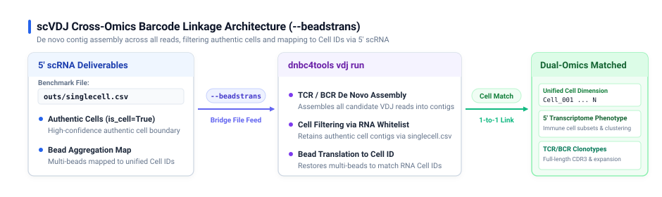

# scVDJ Parameters

DNBelab C Series HT scVDJ Parameter Configuration Guide

## Overview <a id="概述"></a>

This document explains the parameter definitions, default behaviors, and standard usage patterns for `dnbc4tools vdj`, covering single-cell TCR / BCR immune repertoire full-length assembly and clonotype identification.

> **Tip:** Parameter specifications are based on current command-line help outputs. Examples can be used directly as operational templates.

## Main Analysis Workflow (run) <a id="主分析流程-run"></a>

### Usage <a id="usage"></a>

```bash
dnbc4tools vdj run \
  --name sample1 --fastqs /data/tcr \
  --ref human --chain TR \
  --beadstrans /results/rna/outs/singlecell.csv \
  --threads 20
```

### Full Command-Line Help

```shell
$ dnbc4tools vdj run --help
dnbc4tools 3.2

Process a single-cell V(D)J sample.

Usage: dnbc4tools vdj run [OPTIONS]

options:
  --help                       show this help message and exit

Input Files:
  Choose one input method: either `--fastqs` (directory input) or individual FASTQ files (`--fastq1` and
  `--fastq2`).

  --fastqs <DIR>               Input directory path containing paired-end FASTQ files (e.g., `./fastq_dir`).
  --fastq1 <FILE>              Read 1 FASTQ file path(s). Wildcards and comma-separated lists are supported (e.g.,
                               `sample1_L01_R1.fastq.gz,sample1_L02_R1.fastq.gz`).
  --fastq2 <FILE>              Read 2 FASTQ file path(s). Must match the order provided to `--fastq1` (e.g.,
                               `sample1_L01_R2.fastq.gz,sample1_L02_R2.fastq.gz`).

Basic Settings:
  --name <STR>                 Unique identifier for the sample. Used for naming output files and reports (e.g.,
                               `sample1`).
  --ref <STR>                  Reference database: `human`/`mouse`, or a custom reference directory path containing
                               `reference.json` (e.g., `human` or `./custom_vdj_ref`).
  --chain <STR>                VDJ receptor type: `IG` (BCR) or `TR` (TCR) (e.g., `TR`).
  --outdir <DIR>               Output directory path for results and reports [default: current directory] (e.g.,
                               `./output`).
  --threads <INT>              Number of CPU threads for parallel processing [default: all available cores].
  --beadstrans <FILE>          RNA-analysis `singlecell.csv` file path for cell filtering and bead merging info (e.g.,
                               `./singlecell.csv`).

Library Settings:
  --darkreaction <STR>         Dark cycle setting for VDJ library. Supported values: `R1`, `unset` (e.g., `R1`).
  --customize <STR>            Custom read structure string. Format: `<type>,<read>:<start>-<end>` joined by `;`.
                               (e.g., `"cb,R1:7-16;cb,R1:23-32;umi,R1:38-47;R1,R1:61-150;R2,R2:1-150"`).
  --enrichment_primers <FILE>  Custom inner enrichment primers file path (one primer sequence per line) (e.g.,
                               `./inner_primers.txt`).

Analysis Settings:
  --keep_all_cells             Retain all cells in analysis without RNA-based filtering.
  --r2_only                    Use only Read 2 sequences for VDJ assembly.
  --sample_read_pairs <INT>    Subsample the specified number of read pairs from input FASTQ file(s) (e.g.,
                               `1000000`).
```

### Parameter Reference Tables

#### Required & Basic Settings

| Option | Type | Default | Description |
| :--- | :--- | :--- | :--- |
| `--name` | String | **Required** | Unique sample identifier; used as output prefix and report title (e.g., `sample_VDJ_001`) |
| `--ref` | String / Path | **Required** | VDJ reference: built-in `human` or `mouse`, or a custom directory path containing `reference.json` |
| `--chain` | Choice | **Required** | Immune receptor type: `TR` (T-cell Receptor) or `IG` (B-cell Immunoglobulin) |
| `--beadstrans` | File path | None | Optional RNA cell table for bead mapping and cell filtering; omitting it automatically enables `keep_all_cells` |
| `--outdir` | Directory | `./` | Root output directory for analysis results and HTML reports |
| `--threads` | Integer | All cores | Number of CPU threads allocated for parallel processing |

#### Input Files Options

Choose one input mode: directory-based (`--fastqs`) or explicit files (`--fastq1` and `--fastq2`).

| Option | Type | Default | Description |
| :--- | :--- | :--- | :--- |
| `--fastqs` | Directory | None | Directory containing paired-end FASTQ files (files reside directly in this directory; paired files auto-detected) |
| `--fastq1` | File path | None | Read 1 FASTQ file list (supports wildcards `*` or comma-separated paths) |
| `--fastq2` | File path | None | Read 2 FASTQ file list (order must strictly match `--fastq1`) |

> **Tip: Sequencing Consistency & Batch Handling**
> All FASTQ inputs in a single run must originate from the same library batch with identical sequencing modes and dark reaction settings; data from different libraries cannot be mixed.
> If different sequencing batches of the same library batch exhibit differing dark reaction cycles or read lengths, use the FASTQ trimming tool [`fqsubC4`](tools.md#fastq-切割-fqsubc4) to trim reads to match the standard library structure (see [Library Structure](../library_structure.md#scvdj)).

#### Library Chemistry & Read Structure

| Option | Type | Default | Description |
| :--- | :--- | :--- | :--- |
| `--darkreaction` | Choice | `auto` | Dark cycle setting: `auto`, `R1`, `unset` (Note: VDJ does not support `R1R2`) |
| `--customize` | String | None | Custom barcode, UMI, and read structure string overriding dark reaction settings |
| `--enrichment_primers` | File path | None | Path to custom inner enrichment primers file (one primer per line) |

#### Analysis Settings & Tuning

| Option | Type | Default | Description |
| :--- | :--- | :--- | :--- |
| `--keep_all_cells` | Flag | Disabled | Retain all assembled barcodes without RNA-based cell filtering (auto-enabled when omitting `--beadstrans`) |
| `--r2_only` | Flag | Disabled | Use only Read 2 sequences for VDJ assembly (for libraries where Read 1 carries only barcode/UMI) |
| `--sample_read_pairs` | Integer | None | Subsample a specified number of read pairs for rapid benchmarking |

---

### Key Parameter Deep Dives

#### 1. FASTQ Directory Structure & Input Rules

The VDJ `--fastqs` option points to a **flat directory** containing paired-end files directly:

```text
VDJ_fastq_dir/
├── sample_VDJ_L01_R1.fastq.gz
├── sample_VDJ_L01_R2.fastq.gz
├── sample_VDJ_L02_R1.fastq.gz
└── sample_VDJ_L02_R2.fastq.gz
```

- **Naming detection**: Supports standard read patterns `_R1_`, `_R1`, `_1`, `_read1` paired with `_R2_`, `_R2`, `_2`, `_read2`; file extensions support `.fastq.gz`, `.fq.gz`, `.fastq`, `.fq`.
- **Individual inputs**: If not using `--fastqs`, supply paired files via `--fastq1` and `--fastq2` with comma-separated file lists.

#### 2. Cross-Omics Cell Linkage via `--beadstrans`

`--beadstrans` is a pivotal parameter for multi-omics integration, linking V(D)J clonotypic assemblies directly to 5' scRNA expression profiles:

<div style="text-align: center; margin: 20px 0;" markdown="block">
  
</div>

- **Input source**: Provide the `outs/singlecell.csv` file generated from the corresponding 5' scRNA analysis (supports `.csv.gz` from C6 multi-sample pipelines).
- **Core Mechanism**: The pipeline performs comprehensive de novo assembly across all candidate VDJ reads. Subsequently, during the cell filtering and barcode translation stage, the pipeline applies the authentic cell whitelist from `singlecell.csv` to retain genuine cell contigs and translate bead barcodes into unified Cell IDs, outputting `filtered_contig_annotations.csv` matched with 5' scRNA.
- **Behavior when omitted**: If `--beadstrans` is omitted, bead merging and cell filtering are skipped, and `--keep_all_cells` automatically engages to retain all assembled barcodes.
- **Recommendation**: In paired 5' RNA + VDJ experiments, **always provide `--beadstrans`** to ensure clean clonotype-to-cell mapping and filter technical ambient noise.

#### 3. Reference Databases (`--ref`) & Receptor Chains (`--chain`)

- **Reference Database (`--ref`)**:
  - Built-in options: `human` or `mouse` (loads bundled V/D/J/C reference sequences).
  - Custom database: For other species, specify a custom directory path containing `reference.json`, V/D/J/C sequences, and primer configurations (compatible with Cell Ranger VDJ reference databases).
- **Receptor Type (`--chain`)**:
  - `TR`: T-cell Receptor (TRA, TRB, TRG, TRD chains).
  - `IG`: Immunoglobulin (IGH, IGK, IGL chains).

#### 4. Dark Reaction & Custom Read Structure <a id="darkreaction"></a>

> **Library Structure Reference**: For complete VDJ library linker sequences, TSO regions, and dark reaction schematics, see [Library Structure](../library_structure.md#scvdj).

- **Dark Reaction (`--darkreaction`)**: VDJ libraries support only Read 1 dark cycles or unset:
  - `auto`: Automatically inferred
  - `R1`: Read 1 contains dark cycles
  - `unset`: No dark reactions
  - *Note: `R1R2` is invalid for VDJ.*
- **Custom Read Structure (`--customize`)**:
  ```bash
  # Standard VDJ structure example: Barcode 1 (1-10bp) + Barcode 2 (11-20bp) + UMI (21-30bp) in R1
  --customize "cb,R1:1-10;cb,R1:11-20;umi,R1:21-30;R1,R1:31-120;R2,R2:1-150"
  ```

#### 5. Custom Inner Enrichment Primers (`--enrichment_primers`)

For non-human/non-mouse custom species or modified library protocols, provide an inner enrichment primer file (plain text, one primer sequence per line):

```text
GTCCTCGGTGGCCTCCACGTG
AGCACCTGGGGCCTCGGCCAC
CCTGGACTCCTGGGCCCCAG
```
