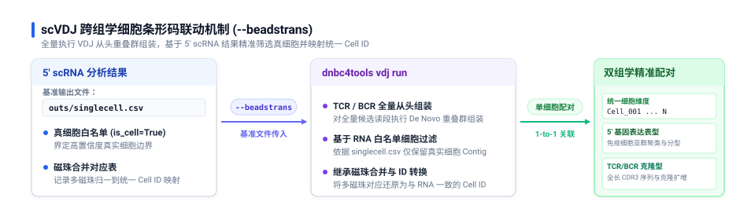

# scVDJ 分析参数

DNBelab C Series HT scVDJ 参数配置说明

## 概述 <a id="概述"></a>

本文档说明 `dnbc4tools vdj` 的参数含义、默认行为和常见使用方式，覆盖单细胞 TCR / BCR 免疫组库全长重组装与细胞克隆型分析。

> **提示：** 参数说明以当前命令行帮助信息为基础，示例可直接作为模板调整后使用。

## 主分析流程 (run) <a id="主分析流程-run"></a>

### 用法 <a id="usage"></a>

```bash
dnbc4tools vdj run \
  --name sample1 --fastqs /data/tcr \
  --ref human --chain TR \
  --beadstrans /results/rna/outs/singlecell.csv \
  --threads 20
```

### 完整命令行帮助

```shell
$ dnbc4tools vdj run --help
dnbc4tools 3.2

Process a single-cell V(D)J sample.

Usage: dnbc4tools vdj run [OPTIONS]

options:
  --help                       show this help message and exit

Input Files:
  Choose one input method: either `--fastqs` (directory input) or individual FASTQ files (`--fastq1` and
  `--fastq2`).

  --fastqs <DIR>               Input directory path containing paired-end FASTQ files (e.g., `./fastq_dir`).
  --fastq1 <FILE>              Read 1 FASTQ file path(s). Wildcards and comma-separated lists are supported (e.g.,
                               `sample1_L01_R1.fastq.gz,sample1_L02_R1.fastq.gz`).
  --fastq2 <FILE>              Read 2 FASTQ file path(s). Must match the order provided to `--fastq1` (e.g.,
                               `sample1_L01_R2.fastq.gz,sample1_L02_R2.fastq.gz`).

Basic Settings:
  --name <STR>                 Unique identifier for the sample. Used for naming output files and reports (e.g.,
                               `sample1`).
  --ref <STR>                  Reference database: `human`/`mouse`, or a custom reference directory path containing
                               `reference.json` (e.g., `human` or `./custom_vdj_ref`).
  --chain <STR>                VDJ receptor type: `IG` (BCR) or `TR` (TCR) (e.g., `TR`).
  --outdir <DIR>               Output directory path for results and reports [default: current directory] (e.g.,
                               `./output`).
  --threads <INT>              Number of CPU threads for parallel processing [default: all available cores].
  --beadstrans <FILE>          RNA-analysis `singlecell.csv` file path for cell filtering and bead merging info (e.g.,
                               `./singlecell.csv`).

Library Settings:
  --darkreaction <STR>         Dark cycle setting for VDJ library. Supported values: `R1`, `unset` (e.g., `R1`).
  --customize <STR>            Custom read structure string. Format: `<type>,<read>:<start>-<end>` joined by `;`.
                               (e.g., `"cb,R1:7-16;cb,R1:23-32;umi,R1:38-47;R1,R1:61-150;R2,R2:1-150"`).
  --enrichment_primers <FILE>  Custom inner enrichment primers file path (one primer sequence per line) (e.g.,
                               `./inner_primers.txt`).

Analysis Settings:
  --keep_all_cells             Retain all cells in analysis without RNA-based filtering.
  --r2_only                    Use only Read 2 sequences for VDJ assembly.
  --sample_read_pairs <INT>    Subsample the specified number of read pairs from input FASTQ file(s) (e.g.,
                               `1000000`).
```

### 参数速查表

#### 必需与基本设置

| 参数 | 类型 | 默认值 | 说明 |
| :--- | :--- | :--- | :--- |
| `--name` | 字符串 | **必需** | 样本唯一标识符，用作所有输出文件的前缀和报告标题（如 `sample_VDJ_001`） |
| `--ref` | 字符串 / 路径 | **必需** | VDJ 参考数据库：内置 `human`、`mouse`，或包含 `reference.json` 的自定义目录路径 |
| `--chain` | 选项 | **必需** | 免疫受体类型：`TR` (T 细胞受体 TCR) 或 `IG` (B 细胞免疫球蛋白 BCR) |
| `--beadstrans` | 文件路径 | 无 | 可选 RNA 细胞表，用于微珠映射与细胞过滤；省略时自动启用 `keep_all_cells` |
| `--outdir` | 目录路径 | `./` | 分析结果和报告的输出根目录 |
| `--threads` | 整数 | 全部可用核心 | 分析过程中使用的 CPU 线程数 |

#### 输入文件参数

输入方式二选一：使用 `--fastqs` 指定统一目录，或显式分别指定 `--fastq1` 与 `--fastq2`。

| 参数 | 类型 | 默认值 | 说明 |
| :--- | :--- | :--- | :--- |
| `--fastqs` | 目录路径 | 无 | 包含配对 FASTQ 文件的目录路径（直接放置当前 VDJ 文库的 R1/R2 文件，自动配对） |
| `--fastq1` | 文件路径 | 无 | Read 1 FASTQ 文件路径（支持通配符 `*` 或逗号分隔多个文件） |
| `--fastq2` | 文件路径 | 无 | Read 2 FASTQ 文件路径（与 `--fastq1` 顺序必须严格一致） |

> **提示：测序文件一致性与批次处理**
> 同一分析中的所有测序文件必须来自同一文库批次，测序模式与暗反应设置须保持一致；不同文库的数据不能混合输入。
> 如果同一文库批次的不同测序批次存在暗反应模式或者测序长度不一致的情况，则需要使用 FASTQ 裁剪工具 [`fqsubC4`](tools.md#fastq-切割-fqsubc4) 对 reads 进行裁剪，具体裁剪位置请参考[文库结构识别](../library_structure.md#scvdj)。

#### 文库化学与测序结构参数

| 参数 | 类型 | 默认值 | 说明 |
| :--- | :--- | :--- | :--- |
| `--darkreaction` | 选项 | `auto` | 暗循环设置：`auto`、`R1`、`unset`（注意：VDJ 不支持 `R1R2`） |
| `--customize` | 格式字符串 | 无 | 自定义条形码、UMI 与有效读段结构（覆盖暗反应设置） |
| `--enrichment_primers` | 文件路径 | 无 | 自定义内侧特异性富集引物文件路径（每行一条引物序列） |

#### 分析设置与调优参数

| 参数 | 类型 | 默认值 | 说明 |
| :--- | :--- | :--- | :--- |
| `--keep_all_cells` | 标志开关 | 关闭 | 保留所有组装出的条形码，不进行基于 RNA 数据的细胞过滤（省略 `--beadstrans` 时自动生效） |
| `--r2_only` | 标志开关 | 关闭 | 仅使用 Read 2 序列进行重组装（适用于 Read 1 仅含条形码/UMI 的特殊建库） |
| `--sample_read_pairs` | 整数 | 无 | 从 FASTQ 中抽取的读段对数量（用于快速降采样测试） |

---

### 关键参数深度解析

#### 1. FASTQ 输入方式与目录结构

VDJ 流程的 `--fastqs` 指向一个**平级目录**，内部直接放置当前 VDJ 文库的配对测序文件：

```text
VDJ_fastq_dir/
├── sample_VDJ_L01_R1.fastq.gz
├── sample_VDJ_L01_R2.fastq.gz
├── sample_VDJ_L02_R1.fastq.gz
└── sample_VDJ_L02_R2.fastq.gz
```

- **命名识别规则**：自动检测依赖文件名中的 R1/R2 标识，支持 `_R1_`、`_R1`、`_1`、`_read1` 与对应的 `_R2_`、`_R2`、`_2`、`_read2`；扩展名支持 `.fastq.gz`、`.fq.gz`、`.fastq`、`.fq`。
- **独立输入模式**：如果不使用 `--fastqs`，可使用 `--fastq1` 和 `--fastq2` 分别传入逗号分隔的文件列表。

#### 2. `--beadstrans` 细胞条形码联动机制

`--beadstrans` 是单细胞免疫组库分析的核心参数，用于实现 V(D)J 重组信息与单细胞基因表达的细胞级精确绑定：

<div style="text-align: center; margin: 20px 0;" markdown="block">
  
</div>

- **数据来源**：提供同一样本 5' scRNA 分析输出的 `outs/singlecell.csv`（C6 多样本模式支持 `.csv.gz`）。
- **核心机制说明**：流程对全部 VDJ reads 正常进行全量从头组装（De Novo Assembly）；随后的细胞过滤与标识转换阶段，依据 `--beadstrans` 传入的 `singlecell.csv` 白名单仅筛选保留真实细胞的组装 Contig，并将测序微珠自动转换还原为统一 Cell ID，最终输出与 5' RNA 精确对齐的 `filtered_contig_annotations.csv`。
- **未提供时的行为**：若未指定 `--beadstrans`，流程将跳过微珠合并与白名单过滤，并自动激活 `--keep_all_cells` 保留所有检测到的组装条形码。
- **应用场景**：常规配对 5' RNA + VDJ 分析中**强烈建议提供**该参数；仅在独立的纯 VDJ 建库或预实验中才省略。

#### 3. `--ref` 参考数据库与受体类型 (`--chain`)

- **参考库选择 (`--ref`)**：
  - 内置支持：直接填写 `human` 或 `mouse`，软件自动加载预装的标准 IG/TR 参考注释。
  - 自定义支持：针对其他物种，指定包含 `reference.json`、V/D/J/C 基因序列及引物配置的自定义目录路径，兼容 Cell Ranger VDJ 数据库。
- **受体类型 (`--chain`)**：
  - `TR`：T-cell Receptor（包含 TRA、TRB、TRG、TRD 链），用于 T 细胞受体分析。
  - `IG`：Immunoglobulin（包含 IGH、IGK、IGL 链），用于 B 细胞受体分析。

#### 4. 暗反应与自定义读长结构 <a id="darkreaction"></a>

> **文库结构参考**：完整的 VDJ 文库接头序列、TSO 区域与暗反应图解请参阅 [文库结构识别](../library_structure.md#scvdj)。

- **暗反应 (`--darkreaction`)**：VDJ 文库仅支持单端 Read 1 暗循环或无暗循环：
  - `auto`（默认）：自动推断
  - `R1`：Read 1 包含暗循环碱基
  - `unset`：无暗反应
  - *注意：不支持 `R1R2`*
- **自定义序列结构 (`--customize`)**：
  ```bash
  # 标准 VDJ 结构示例: Barcode 1 (1-10bp) + Barcode 2 (11-20bp) + UMI (21-30bp) in R1
  --customize "cb,R1:1-10;cb,R1:11-20;umi,R1:21-30;R1,R1:31-120;R2,R2:1-150"
  ```

#### 5. 特异性内侧富集引物 (`--enrichment_primers`)

当使用非人/非鼠自定义物种，或对标准建库引物进行过修饰时，通过此参数指定内部特异性富集引物文件（纯文本，每行一条引物序列）：

```text
GTCCTCGGTGGCCTCCACGTG
AGCACCTGGGGCCTCGGCCAC
CCTGGACTCCTGGGCCCCAG
```
