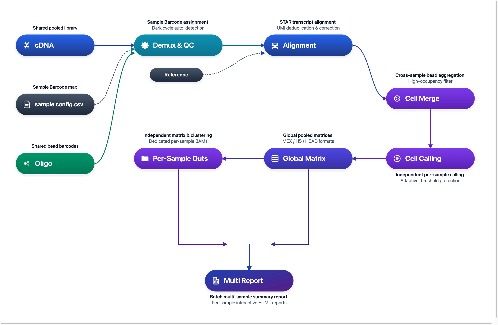

# DNBelab C Series HT C6 Analysis Pipeline

Multiplexed Single-Cell RNA Analysis & Sample Deconvolution Guide

## Overview <a id="overview"></a>

C6 is a high-throughput multiplexed single-cell RNA-seq solution based on Sample Barcode multiplexing. Multiple biological samples are labeled with distinct Sample Barcodes during library construction and pooled for sequencing. In the bioinformatics stage, `dnbc4tools` automatically demultiplexes samples, aggregates beads, independently calls cells per sample, and generates full expression quantifications and interactive quality reports.

**Workflow**: Data Input → Barcode Demultiplexing → Alignment → Bead Aggregation → Per-Sample Cell Calling → Unified & Per-Sample Deliverables

<div align="center" style="margin: 1.5em 0;" markdown="block">
  
</div>

> **Usage Note**: `$dnbc4tools` represents the executable path and should be replaced with your actual installation path. The C6 workflow is orchestrated via the `multi run` command to automate sample demultiplexing and per-sample deliverables.

---

## Core Steps <a id="core-steps"></a>

The C6 pooled multiplexing workflow encompasses 5 essential stages from shared raw libraries to per-sample outputs:

| Step | Stage | Core Mechanism | Key Inputs & Deliverables |
| :---: | :--- | :--- | :--- |
| **01** | **Input Preparation & Validation** | Shared dual libraries; automated dark cycle detection; sectioned CSV validation | Shared FASTQs, Config CSV ➔ Validated Parameters |
| **02** | **Sample Barcode Demultiplexing** | Extracts barcodes from Oligo reads with whitelist error correction | Oligo Reads ➔ Droplet Assignment, Unassigned Tracking |
| **03** | **Alignment & Bead Aggregation** | STAR alignment & annotation; similarity-based bead pooling; global high-occupancy filtering | cDNA Reads ➔ Alignment BAM, Bead-to-Cell Merging |
| **04** | **Independent Cell Calling** | Completely isolated per-sample EmptyDrops calling; adaptive noise safeguards | Assigned Droplets ➔ Per-Sample Authentic Cells |
| **05** | **Archiving & Output** | Per-sample matrices/reports/BAMs; pooled combined matrix & batch summary report | `per_sample_outs/` Deliverables + Combined Report |

<div class="c6-stepper" markdown="block">

<div class="c6-step-item" markdown="block">

### Step 1: Input Preparation & Configuration <a id="step-1"></a>

- **Sequencing Libraries**: A shared pooled pair of cDNA and Oligo FASTQ libraries.
- **Pipeline Configuration**: A sectioned CSV file (e.g., `sample.config.csv`) declaring sample identifiers and their corresponding Sample Barcodes in the `[samples]` section.
- **Dark Reaction Auto-Detection**: Version 3.2 automatically detects dark reaction cycles (Dark Cycles) in cDNA and Oligo reads without manual intervention.

<div class="c6-step-meta" markdown="block">
  <span class="c6-step-meta-label">Key Pillars</span>
  <span class="c6-step-pill">Shared Paired Libraries</span>
  <span class="c6-step-pill">Dark Cycle Detection</span>
  <span class="c6-step-pill">Sectioned CSV Mapping</span>
</div>

</div>

<div class="c6-step-item" markdown="block">

### Step 2: Sample Barcode Identification & Demultiplexing <a id="step-2"></a>

- **Barcode Matching**: Extracts Sample Barcodes from Oligo reads and matches them against the built-in whitelist with error-correction.
- **Flexible Mapping**: Assigns beads and droplets to their respective biological samples; supports single barcodes (e.g., `BC01`) or multi-barcode assignments per sample (e.g., `BC02;BC03`).
- **Unassigned Tracking**: Reads that cannot be confidently matched to a known barcode are tracked under the Unassigned category, for reviewing unassigned read counts.

<div class="c6-step-meta" markdown="block">
  <span class="c6-step-meta-label">Key Pillars</span>
  <span class="c6-step-pill">Whitelist Error-Correction</span>
  <span class="c6-step-pill">Multi-Barcode Pooling</span>
  <span class="c6-step-pill">Unassigned Tracking</span>
</div>

</div>

<div class="c6-step-item" markdown="block">

### Step 3: Transcript Alignment & Bead Aggregation <a id="step-3"></a>

- **High-Quality Alignment**: Aligns cDNA reads against the reference genome using an optimized STAR workflow with functional region annotation.
- **Cross-Sample Bead Aggregation**: Uses a robust bead similarity scoring algorithm to merge beads originating from the same physical droplet while retaining Sample Barcode suffixes.
- **Experiment-Wide High-Occupancy Filtering**: `high_occupancy_filter=true` is enabled by default to remove multiplexed droplet artifacts across the entire experiment.

<div class="c6-step-meta" markdown="block">
  <span class="c6-step-meta-label">Key Pillars</span>
  <span class="c6-step-pill">STAR Alignment</span>
  <span class="c6-step-pill">Bead Aggregation</span>
  <span class="c6-step-pill">High-Occupancy Filtering</span>
</div>

</div>

<div class="c6-step-item" markdown="block">

### Step 4: Independent Cell Calling per Sample <a id="step-4"></a>

- **Isolated Calling**: Droplets assigned to each sample undergo **independent cell calling** (EmptyDrops), so that the called-cell set is determined separately for each sample.
- **Adaptive Bounds Protection**: 3.2 introduces upper and lower bounds on the automatically estimated cell count.
- **Intra-Cell UMI Conflict Resolution**: Resolves ambiguous UMIs mapped to multiple genes within the same cell using read counts; UMIs without a unique gene assignment are excluded from expression counts.

<div class="c6-step-meta" markdown="block">
  <span class="c6-step-meta-label">Key Pillars</span>
  <span class="c6-step-pill">Per-Sample Calling</span>
  <span class="c6-step-pill">EmptyDrops Safeguard</span>
  <span class="c6-step-pill">UMI De-noising</span>
</div>

</div>

<div class="c6-step-item" markdown="block">

### Step 5: Result Archiving & Output <a id="step-5"></a> {#step-5-deliverable-generation-dedicated-delivery}

- **Per-Sample Deliverables**: Each sample receives its own subdirectory under `per_sample_outs/<sample>/` with raw/filtered expression matrices (MEX, H5, and H5AD formats), dimensionality reduction, clustering (PCA, UMAP, marker genes), and an interactive HTML report.
- **Per-Sample BAM Output**: When BAM generation is enabled, alignments are partitioned into sample-specific BAM files (`<sample>_alignments.bam`), alongside unassigned alignments and a shared oligo BAM.
- **Root Combined Matrices**: A unified matrix containing all called cells across all samples is provided in the root directory (MEX, H5, H5AD) with raw counts for downstream batch correction (e.g., Harmony).
- **Batch Multi-Sample Report**: A root `<run>_multi_report.html` summarizes cell counts, sequencing saturation, library QC, and cross-sample comparison charts.

<div class="c6-step-meta" markdown="block">
  <span class="c6-step-meta-label">Key Pillars</span>
  <span class="c6-step-pill">Per-Sample MEX/H5/H5AD</span>
  <span class="c6-step-pill">Per-Sample BAM</span>
  <span class="c6-step-pill">Global Pooled Matrix</span>
  <span class="c6-step-pill">Two-Tier HTML Reports</span>
</div>

</div>

</div>

---

## Input Configuration <a id="input-configuration"></a>

C6 analysis uses a sectioned CSV configuration file (commonly named `sample.config.csv`), consisting of three core sections:

| Section | Purpose | Key Parameters |
| :--- | :--- | :--- |
| `[rna]` | Global transcriptome and run settings | `genomeDir`, `chemistry,scRNAC6`, `darkreaction,auto`, `no_bam` |
| `[libraries]` | Shared sequencing library path declaration | `fastqs` (pointing to the directory containing `cDNA/` and `oligo/`), `feature_types,rna` |
| `[samples]` | Sample and Sample Barcode mapping table | `sample_id`, `probe_barcode_ids`, `expectcells` (optional) |

### Minimal Configuration Example

```csv
[rna]
genomeDir,/database/scRNA/Homo_sapiens
chemistry,scRNAC6
darkreaction,auto

[libraries]
fastqs,feature_types
/rawdata/c6_pooled_run,rna

[samples]
sample_id,probe_barcode_ids
Sample_1,BC01
Sample_2,BC02;BC03
```

> **Optional BAM output setting**: This example uses the default `[rna] no_bam,false`, generating per-sample BAMs, unassigned BAM, and oligo BAM with their applicable indexes. To save disk space, add `no_bam,true` to `[rna]`; BAM files and their indexes will then be omitted.

> **Tip**: If multiple barcodes are assigned to the same sample, separate them with semicolons `;` (e.g., `BC02;BC03`). For complete configuration specifications, refer to [C6 Parameters](../parameter/c6.md).

---

## Main Analysis Pipeline <a id="main-pipeline"></a>

### Execution Command

```bash
$dnbc4tools multi run \
  --name c6_demo \
  --csv sample.config.csv \
  --outdir ./results \
  --threads 16
```

### Pre-Run Checklist

<div class="doc-checklist" markdown="block">

<div class="doc-checklist-title" markdown="block">C6 Pre-Run Verification Checklist</div>

- **Chemistry Type Declaration**: Ensure `chemistry,scRNAC6` is configured in the `[rna]` section of the CSV.
- **Shared Data Paths**: Ensure `fastqs` in `[libraries]` points to a valid path containing paired `cDNA/` and `oligo/` subdirectories and FASTQ files.
- **Sample Barcode Mapping**: Verify `sample_id` values in `[samples]` are unique, and `probe_barcode_ids` correspond to experimental barcodes (e.g. `BC01` or `BC02;BC03`).
- **STAR Reference Index**: Verify `genomeDir` points to a complete and valid STAR reference directory.

</div>

### Execution Process

After auto-detecting dark reaction cycles and validating barcodes, the software executes demultiplexing and per-sample analyses:

```shell
====================================================================================================
Running [samples] C6 RNA pipeline — 2026-11-02 18:11:02
====================================================================================================

====================================================================================================
Parsed FASTQ Inputs - 2026-11-02 18:11:02
====================================================================================================
Type         | Path                                                                                 
-------------+--------------------------------------------------------------------------------------
cDNA Read1   | /rawdata/c6_pooled_run/cDNA/sample_cDNA_R1.fastq.gz                                  
cDNA Read2   | /rawdata/c6_pooled_run/cDNA/sample_cDNA_R2.fastq.gz                                  
oligo Read1  | /rawdata/c6_pooled_run/oligo/sample_oligo_R1.fastq.gz                                 
oligo Read2  | /rawdata/c6_pooled_run/oligo/sample_oligo_R2.fastq.gz                                 
====================================================================================================


2026-11-02 18:12:21 Starting oligo library filtering...
...done

2026-11-02 18:13:26 Starting cDNA library filtering...
...done

2026-11-02 18:25:31 Correcting RNA barcodes and preparing alignment inputs...
...done

2026-11-02 18:27:22 Performing read alignment and UMI counting...
...done

2026-11-02 18:54:34 Calculating multi sample bead similarity and barcode translation...
...done

2026-11-02 18:54:56 Generating raw gene expression matrix...
...done

2026-11-02 18:57:42 Generating cell-filtered gene expression matrix...
...done

2026-11-02 18:58:02 Calculating sequencing saturation metrics...
...done

2026-11-02 18:58:34 Generating per-sample RNA matrices, saturation, and expression metrics...
...done

2026-11-02 18:59:23 Generating per-sample position-sorted BAM files...
...done

2026-11-02 19:04:24 Performing per-sample dimensionality reduction and clustering analysis...
...done

2026-11-02 19:05:12 Performing mixed-species classification for "mouselars2_and_macaca"...
...done

2026-11-02 19:05:13 Generating multi sample assignment outputs...
...done
✔ Prepared RNA summary metrics

====================================================================================================
Running combined report generation — 2026-11-02 19:05:14
====================================================================================================
Combined report sections:
✔ rna: success
✔ samples: success
✔ Outputs organized in ./results/c6_demo/outs

Analysis finished successfully!
```

When the message `Analysis finished successfully!` appears, the analysis is complete.

---

## Results Interpretation <a id="results-interpretation"></a>

### Output Directory Structure

Upon completion, results are archived under `<outdir>/<name>/outs/`:

```text
<outdir>/<name>/outs/
├── <name>_multi_report.html              # Batch multi-sample summary report
└── rna/
    ├── raw_feature_bc_matrix/            # Global unfiltered matrix (MEX)
    ├── filtered_feature_bc_matrix/       # Global filtered cell matrix (MEX)
    ├── filtered_feature_bc_matrix.h5ad   # Global filtered matrix (H5AD, no cross-sample clustering)
    ├── singlecell.csv.gz                 # Global droplet detail table (with bead merges and sample tags)
    ├── metrics_summary.xls               # Global experiment metrics summary
    ├── multi_sample/                     # Demultiplexing and sample QC metrics
    │   ├── per_sample_metrics.csv        # Per-sample metric comparison table
    │   └── barcode_assignment_metrics.json # Sample Barcode assignment statistics
    └── per_sample_outs/<sample>/         # [Per-sample output directory]
        ├── filtered_feature_bc_matrix/   # Sample-specific filtered matrix
        ├── <sample>_scRNA_report.html    # Sample-specific interactive HTML report
        ├── metrics_summary.xls           # Sample-specific metrics summary
        └── analysis/                     # Sample-specific clustering, dimensionality reduction & markers
```

### Key Deliverable Files

| File/Directory | Description |
| :--- | :--- |
| `<name>_multi_report.html` | Batch multi-sample summary report comparing cell counts, saturation, and demultiplexing quality |
| `rna/per_sample_outs/<sample>/` | Per-sample output containing independent matrices, clustering plots, and sample report |
| `rna/filtered_feature_bc_matrix.*` | Global combined matrix combining all called cells, ready for downstream batch correction |
| `rna/singlecell.csv.gz` | Global droplet detail table recording bead-to-cell mapping, cell calling status, and sample assignment |

> **Detailed Output Guide**: Please refer to [C6 Output Interpretation](../outs/c6.md) for a comprehensive explanation of deliverables and metrics.
