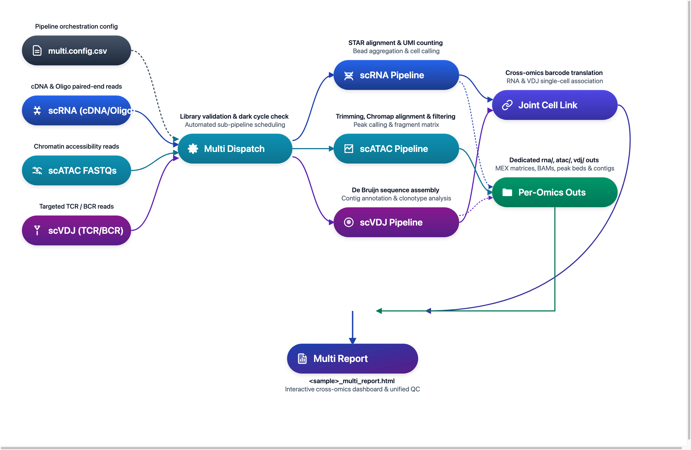

# DNBelab C Series HT Multi-omics Analysis Pipeline

Single-Cell Multi-omics Integrated Analysis Guide

## Overview <a id="overview"></a>

The Multi-omics workflow unifies orchestration and generates combined reports; ATAC is analyzed independently and summarized, while RNA and VDJ support cell association analysis. A single configuration file coordinates all sub-pipelines and generates combined reports for cross-omics inspection.

**Workflow**: Configuration → Module Dispatch → Parallel Analysis → Status Aggregation → Combined Report

<div align="center" style="margin: 1.5em 0;" markdown="block">
  
</div>

> **Usage Note**: `$dnbc4tools` represents the executable path and should be replaced with your actual installation path. The backslash `\` is used to split commands across multiple lines for readability; commands can also be executed on a single line.

**Key Features**:

| Feature | Description |
| :--- | :--- |
| **Unified Orchestration** | One entry command dispatches multiple omics modules (RNA / ATAC / VDJ) |
| **Status Tracking** | Module-level status management (success / failed / skipped / reused) |
| **Combined Report** | Generates combined HTML report supporting cross-omics browsing and comparison |
| **Flexible Configuration** | Supports arbitrary module combinations (single / dual / all modules) |

## Input Configuration <a id="input-configuration"></a>

### Configuration File Structure

`multi run` uses a CSV configuration file to define module parameters and input data. Typical sections include:

| Section | Purpose | Key Parameters |
| :--- | :--- | :--- |
| `[rna]` | RNA analysis module configuration | `genomeDir`, `expectcells`, `no_bam`... |
| `[atac]` | ATAC analysis module configuration | `genomeDir`, `frags_cutoff`, `need_bam`... |
| `[vdj-t]` | T-cell VDJ analysis configuration | `ref`, `beadstrans`... |
| `[vdj-b]` | B-cell VDJ analysis configuration | `ref`, `beadstrans`... |
| `[libraries]` | Input data mapping (required) | `fastqs`, `feature_types` |

> **Detailed Configuration**: Please refer to the [Multi Parameter Documentation](../parameter/multi.md) for complete CSV configuration specifications and parameter mappings.

> **`[libraries]` Input Directory Guidelines**:
>
> - **`rna`**: `fastqs` points to the RNA FASTQ root directory, which must contain `cDNA/` and `oligo/` subdirectories.
> - **`atac`**: `fastqs` points to the FASTQ directory for the ATAC library, with paired R1/R2 files placed directly under it.
> - **`vdj-t` / `vdj-b`**: `fastqs` points to the TCR or BCR FASTQ library directory. TCR and BCR data must be configured separately.
> - **File Pairing**: The pipeline automatically pairs files based on `_R1`/`_R2` or `_R1_`/`_R2_` naming patterns.

### Configuration Examples

**Scenario 1: RNA + VDJ (TCR / BCR) Joint Analysis (Recommended)**

```csv
[rna]
genomeDir,/database/scRNA/Homo_sapiens
end5,true
no_bam,true

[vdj-t]
ref,human

[libraries]
fastqs,feature_types
/rawdata/multi_sample/rna,rna
/rawdata/multi_sample/tcr,vdj-t
```

**Scenario 2: Full Multi-Omics (RNA + ATAC + VDJ) Analysis**

```csv
[rna]
genomeDir,/database/scRNA/Homo_sapiens
end5,true
no_bam,true

[atac]
genomeDir,/database/scATAC/Homo_sapiens

[vdj-t]
ref,human

[vdj-b]
ref,human

[libraries]
fastqs,feature_types
/rawdata/multi_sample/rna,rna
/rawdata/multi_sample/atac,atac
/rawdata/multi_sample/tcr,vdj-t
/rawdata/multi_sample/bcr,vdj-b
```

### Running Command

```shell
$dnbc4tools multi run \
  --csv sample.csv \
  --name demo \
  --outdir /data/result \
  --threads 20
```

**Parameter Description**:

| Parameter | Required | Description |
| :--- | :---: | :--- |
| `--csv` | **Yes** | Path to CSV configuration file |
| `--name` | **Yes** | Sample name for output directory naming |
| `--outdir` | No | Output directory, defaults to current directory `./` |
| `--threads` | No | Number of CPU threads, uses software default if not specified |

### Pre-Run Checklist

<div class="doc-checklist" markdown="block">

<div class="doc-checklist-title" markdown="block">Multi-Omics Pre-Run Verification Checklist</div>

- **Core Flags**: Both `--csv` configuration file path and `--name` sample identifier are supplied, and `--outdir` is writable.
- **Enabled Sections**: The CSV file contains at least one active omics section (e.g. `[rna]`, `[vdj-t]`, `[atac]`).
- **Data Path Mapping**: Input paths in `[libraries]` physically exist and accurately correspond to `feature_types` (`rna`/`atac`/`vdj-t`/`vdj-b`).
- **Reference Readiness**: Database paths (e.g. `genomeDir`, `ref`) for all active modules are valid and version-compatible.

</div>

## Main Pipeline <a id="main-pipeline"></a>

### Execution Flow

| Stage | Stage Name | Core Responsibility | Deliverable |
| :---: | :--- | :--- | :--- |
| `01` | **Config Parsing & QC** | Parses CSV sections, verifies library paths, and detects dark reactions | Validated configuration |
| `02` | **Task Queue Building** | Constructs the execution flow based on enabled modules and checks reuse flags | Scheduled task queue |
| `03` | **Sub-Pipeline Runs** | Sequentially executes core alignments, bead merging, and cell calling (RNA/VDJ/ATAC) | Module output folders |
| `04` | **Status Aggregation** | Captures exit codes, runtimes, and skip/reuse status across all modules | `run_manifest.json` |
| `05` | **Combined Reporting** | Integrates cross-omics barcode translation (e.g. RNA-VDJ) into an interactive report | `<sample>_multi_report.html` |

### Execution Highlights

!!! note "Core Principles"
    - Multi handles "**orchestration and aggregation**"; module algorithms remain in each single-omics sub-pipeline.
    - A module failure **will not** invalidate other completed modules but will be reflected in the final status summary.

### Typical Runtime Log

```shell
====================================================================================================
Running checking libraries — 2026-11-02 16:43:37
====================================================================================================
✔ RNA Library check complete
✔ VDJ-T Library check complete
✔ VDJ-B Library check complete
✔ ATAC Library check complete

====================================================================================================
Running RNA pipeline — 2026-11-02 16:43:56
====================================================================================================

====================================================================================================
Parsed FASTQ Inputs - 2026-11-02 16:43:57
====================================================================================================
Type         | Path                                                                                 
-------------+--------------------------------------------------------------------------------------
cDNA Read1   | /rawdata/multi_sample/rna/sample_cDNA_R1.fastq.gz                                    
cDNA Read2   | /rawdata/multi_sample/rna/sample_cDNA_R2.fastq.gz                                    
oligo Read1  | /rawdata/multi_sample/rna/sample_oligo_R1.fastq.gz                                   
oligo Read2  | /rawdata/multi_sample/rna/sample_oligo_R2.fastq.gz                                   
====================================================================================================


====================================================================================================
Chemistry Configuration - 2026-11-02 16:43:57
====================================================================================================
Type         | Result                                                                               
-------------+--------------------------------------------------------------------------------------
oligo        | custom sequence structure                                                            
====================================================================================================


====================================================================================================
Chemistry Configuration - 2026-11-02 16:43:57
====================================================================================================
Type         | Result                                                                               
-------------+--------------------------------------------------------------------------------------
cDNA         | custom sequence structure                                                            
====================================================================================================


2026-11-02 16:43:57 Validating RNA reference...
...done

2026-11-02 16:45:31 Starting oligo library filtering...
...done

2026-11-02 16:48:22 Starting cDNA library filtering...
...done

2026-11-02 16:53:07 Correcting RNA barcodes and preparing alignment inputs...
...done

2026-11-02 16:53:18 Performing read alignment and UMI counting...
...done

2026-11-02 16:58:42 Calculating bead similarity and merging beads within droplets...
...done

2026-11-02 16:58:49 Generating raw gene expression matrix...
...done

2026-11-02 16:59:12 Calling cells and generating filtered cell barcodes...
...done

2026-11-02 17:00:07 Generating cell-filtered gene expression matrix...
...done

2026-11-02 17:00:21 Calculating sequencing saturation metrics...
...done

2026-11-02 17:00:29 Generating per-barcode alignment and expression metrics...
...done

2026-11-02 17:00:40 Generating position-sorted BAM file...
...done

2026-11-02 17:01:58 Performing dimensionality reduction and clustering analysis...
...done

2026-11-02 17:02:23 Analysis Finished. Elapsed Time: 0:18:26
✔ Generated RNA intermediate report

====================================================================================================
Running ATAC pipeline — 2026-11-02 17:02:34
====================================================================================================

====================================================================================================
Parsed FASTQ Inputs - 2026-11-02 17:02:35
====================================================================================================
Type         | Path                                                                                 
-------------+--------------------------------------------------------------------------------------
Read1        | /rawdata/multi_sample/atac/sample_atac_R1.fastq.gz                                   
Read2        | /rawdata/multi_sample/atac/sample_atac_R2.fastq.gz                                   
====================================================================================================


====================================================================================================
Chemistry Configuration - 2026-11-02 17:02:35
====================================================================================================
Type         | Result                                                                               
-------------+--------------------------------------------------------------------------------------
ATAC         | custom sequence structure                                                            
====================================================================================================


2026-11-02 17:02:35 Validating ATAC reference...
...done

2026-11-02 17:02:41 Performing raw data quality control and alignment...
...done

2026-11-02 17:11:32 Calculating bead similarity and merging beads within droplets...
...done

2026-11-02 17:14:39 Processing fragments for peak calling...
...done

2026-11-02 17:22:30 Generating raw peak count matrix...
...done

2026-11-02 17:24:06 Calling cells for ATAC data...
...done

2026-11-02 17:25:27 Generating cell-filtered peak count matrix...
...done

2026-11-02 17:25:45 Generating filtered fragments and TSS enrichment...
...done

2026-11-02 17:26:17 Calculating sequencing saturation metrics...
...done

2026-11-02 17:27:16 Performing dimensionality reduction and clustering...
...done

2026-11-02 17:28:48 Analysis Finished. Elapsed Time: 0:26:13
✔ Generated ATAC intermediate report

====================================================================================================
Running VDJ-T pipeline — 2026-11-02 17:29:11
====================================================================================================

====================================================================================================
Parsed FASTQ Inputs - 2026-11-02 17:29:12
====================================================================================================
Type         | Path                                                                                 
-------------+--------------------------------------------------------------------------------------
Read1        | /rawdata/multi_sample/tcr/sample_tcr_R1.fastq.gz                                     
Read2        | /rawdata/multi_sample/tcr/sample_tcr_R2.fastq.gz                                     
====================================================================================================


====================================================================================================
Chemistry Configuration - 2026-11-02 17:29:12
====================================================================================================
Type         | Result                                                                               
-------------+--------------------------------------------------------------------------------------
VDJ          | custom sequence structure                                                            
====================================================================================================


2026-11-02 17:29:12 Validating VDJ reference...
...done

2026-11-02 17:29:13 Starting VDJ library filtering...
...done

2026-11-02 17:33:57 Correcting VDJ barcodes and translating bead identities...
...done

2026-11-02 17:34:14 Preparing input data for VDJ assembly...
...done

2026-11-02 17:38:09 Performing VDJ sequence assembly and gene segment annotation...
...done

2026-11-02 17:58:52 Performing cell calling for VDJ data...
...done

2026-11-02 17:59:38 Generating VDJ clonotype analysis...
...done

2026-11-02 18:00:09 Converting VDJ results from cellbarcode to cell ID...
...done

2026-11-02 18:00:10 Analysis Finished. Elapsed Time: 0:30:57
✔ Generated VDJ-T intermediate report

====================================================================================================
Running VDJ-B pipeline — 2026-11-02 18:00:13
====================================================================================================

====================================================================================================
Parsed FASTQ Inputs - 2026-11-02 18:00:13
====================================================================================================
Type         | Path                                                                                 
-------------+--------------------------------------------------------------------------------------
Read1        | /rawdata/multi_sample/bcr/sample_bcr_R1.fastq.gz                                     
Read2        | /rawdata/multi_sample/bcr/sample_bcr_R2.fastq.gz                                     
====================================================================================================


====================================================================================================
Chemistry Configuration - 2026-11-02 18:00:14
====================================================================================================
Type         | Result                                                                               
-------------+--------------------------------------------------------------------------------------
VDJ          | custom sequence structure                                                            
====================================================================================================


2026-11-02 18:00:14 Validating VDJ reference...
...done

2026-11-02 18:00:14 Starting VDJ library filtering...
...done

2026-11-02 18:03:46 Correcting VDJ barcodes and translating bead identities...
...done

2026-11-02 18:04:06 Preparing input data for VDJ assembly...
...done

2026-11-02 18:07:16 Performing VDJ sequence assembly and gene segment annotation...
...done

2026-11-02 18:26:09 Performing cell calling for VDJ data...
...done

2026-11-02 18:27:36 Generating VDJ clonotype analysis...
...done

2026-11-02 18:28:30 Converting VDJ results from cellbarcode to cell ID...
...done

2026-11-02 18:28:31 Analysis Finished. Elapsed Time: 0:28:17
✔ Generated VDJ-B intermediate report

====================================================================================================
Running combined report generation — 2026-11-02 18:28:34
====================================================================================================
Combined report sections:
✔ rna: success
✔ atac: success
✔ vdj-t: success
✔ vdj-b: success
✔ Outputs organized in /data/result/demo/outs

Analysis finished successfully!
```

<a id="c6-workflow"></a>

> **Note: C6 Multiplexed RNA Pipeline**
>
> The C6 multiplexed single-cell RNA analysis pipeline has been moved to its own dedicated chapter. Please refer to the [C6 Pipeline Guide](c6.md).

## Results <a id="results"></a>

### Output Directory Structure

After completion, results are organized under `<outdir>/<name>/`:

```text
<outdir>/<name>/
├── outs/                                    # Organized output results
│   ├── <sample>_multi_report.html           # Multi-omics combined report
│   ├── rna/                                 # RNA results (if enabled)
│   ├── atac/                                # ATAC results (if enabled)
│   ├── vdj-t/                               # VDJ-T results (if enabled)
│   └── vdj-b/                               # VDJ-B results (if enabled)
├── logs/                                    # Logs and runtime status
│   ├── run_manifest.json                    # Module runtime status summary
│   └── *.log                                # Module runtime logs
├── RNA_ANALYSIS_WORKFLOW_PROCESSING/        # Module workflow directories (if enabled)
├── ATAC_ANALYSIS_WORKFLOW_PROCESSING/
├── VDJ-T_ANALYSIS_WORKFLOW_PROCESSING/
└── VDJ-B_ANALYSIS_WORKFLOW_PROCESSING/
```

### Key Output Files

| File/Directory | Description |
| :--- | :--- |
| `outs/<sample>_multi_report.html` | Multi-omics combined report displaying core QC and analysis charts from all modules |
| `outs/rna/` | RNA module standard outputs (matrix, statistics, module report, etc.) |
| `outs/atac/` | ATAC module standard outputs (fragment files, peaks, module report, etc.) |
| `outs/vdj-t/` / `outs/vdj-b/` | VDJ module standard outputs (clonotypes, annotations, module report, etc.) |
| `logs/run_manifest.json` | Module runtime status summary including return codes, runtime, and reuse status |

> **Detailed Output Description**: Please refer to the [Multi Output Documentation](../outs/multi.md) for detailed interpretation of the combined report.
