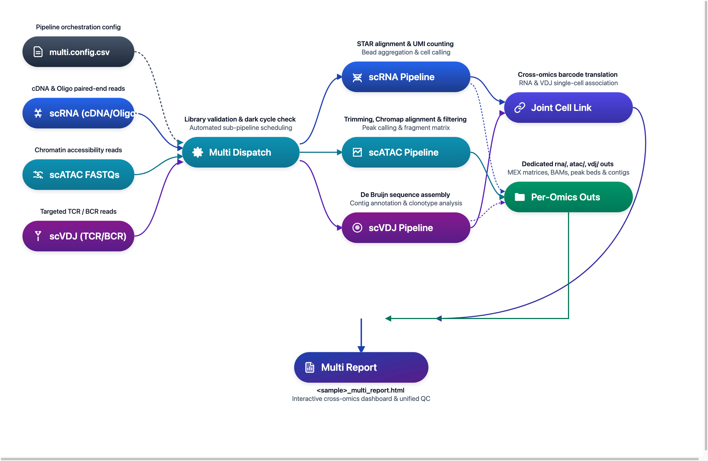

# DNBelab C Series HT 多组学分析流程

单细胞多组学整合分析说明

## 概述 <a id="概述"></a>

多组学流程用于统一调度并生成组合报告；ATAC 独立分析后汇总，RNA 与 VDJ 支持细胞关联分析。通过一份配置文件完成各组学子流程调度，并生成组合报告用于跨组学联看。

**工作流程**：配置准备 → 模块调度 → 并行分析 → 状态汇总 → 组合报告

<div align="center" style="margin: 1.5em 0;" markdown="block">
  
</div>

> **使用说明**：`$dnbc4tools` 代表可执行程序路径，需替换为您的实际安装路径。本文示例使用换行符 `\` 分隔命令以提高可读性，实际分析时可写为单行。

**核心特点**：

| 特性 | 说明 |
| :--- | :--- |
| **统一编排** | 一个入口命令统一调度 RNA / ATAC / VDJ 多个组学模块 |
| **状态跟踪** | 模块级状态管理（成功 / 失败 / 跳过 / 复用） |
| **组合报告** | 生成组合 HTML 报告，支持跨组学浏览和对比 |
| **灵活配置** | 支持任意模块组合（单模块 / 双模块 / 全模块） |

## 输入配置 <a id="输入配置"></a>

### 配置文件结构

`multi run` 使用 CSV 配置文件定义各模块参数和输入数据，通常包含以下分段：

| 分段名 | 用途 | 关键参数 |
| :--- | :--- | :--- |
| `[rna]` | RNA 分析模块配置 | `genomeDir`, `expectcells`, `no_bam`... |
| `[atac]` | ATAC 分析模块配置 | `genomeDir`, `frags_cutoff`, `need_bam`... |
| `[vdj-t]` | T 细胞 VDJ 分析配置 | `ref`, `beadstrans`... |
| `[vdj-b]` | B 细胞 VDJ 分析配置 | `ref`, `beadstrans`... |
| `[libraries]` | 输入数据映射（必填） | `fastqs`, `feature_types` |

> **详细配置说明**：请参考 [多组学参数文档](../parameter/multi.md) 了解完整的 CSV 配置规范和参数映射关系。

> **`[libraries]` 数据目录输入规范**：
>
> - **`rna`**：`fastqs` 指向 RNA 测序根目录，该目录下需包含 `cDNA/` 与 `oligo/` 两个子目录。
> - **`atac`**：`fastqs` 指向 ATAC 文库目录，成对的 R1/R2 FASTQ 文件直接存放于该目录下。
> - **`vdj-t` / `vdj-b`**：`fastqs` 分别指向对应的 TCR 或 BCR 文库目录，TCR 与 BCR 须分别独立配置。
> - **文件识别**：软件依赖文件名中的 R1/R2 标识自动配对，推荐遵循标准命名（如 `_R1`/`_R2` 或 `_R1_`/`_R2_`）。

### 常见配置示例

**方案一：RNA + VDJ（TCR / BCR）联合分析配置（推荐）**

```csv
[rna]
genomeDir,/database/scRNA/Homo_sapiens
end5,true
no_bam,true

[vdj-t]
ref,human

[libraries]
fastqs,feature_types
/rawdata/multi_sample/rna,rna
/rawdata/multi_sample/tcr,vdj-t
```

**方案二：RNA + ATAC + VDJ 全多组学联合分析配置**

```csv
[rna]
genomeDir,/database/scRNA/Homo_sapiens
end5,true
no_bam,true

[atac]
genomeDir,/database/scATAC/Homo_sapiens

[vdj-t]
ref,human

[vdj-b]
ref,human

[libraries]
fastqs,feature_types
/rawdata/multi_sample/rna,rna
/rawdata/multi_sample/atac,atac
/rawdata/multi_sample/tcr,vdj-t
/rawdata/multi_sample/bcr,vdj-b
```

### 运行命令

```shell
$dnbc4tools multi run \
  --csv sample.csv \
  --name demo \
  --outdir /data/result \
  --threads 20
```

**参数说明**：

| 参数 | 必需 | 说明 |
| :--- | :---: | :--- |
| `--csv` | **是** | CSV 配置文件路径 |
| `--name` | **是** | 样本名称，用于输出目录命名 |
| `--outdir` | 否 | 输出目录，默认为当前目录 `./` |
| `--threads` | 否 | CPU 线程数，默认使用软件默认策略 |

### 运行前检查清单

<div class="doc-checklist" markdown="block">

<div class="doc-checklist-title" markdown="block">多组学运行前核对清单</div>

- **核心启动参数**：已提供 `--csv` 配置文件路径与 `--name` 样本标识，且输出目录 `--outdir` 具有写权限。
- **模块启用完整性**：CSV 配置文件中至少声明了一个有效组学分段（如 `[rna]`、`[vdj-t]`、`[atac]`）。
- **文库路径映射**：`[libraries]` 中指定的 `fastqs` 路径真实存在，且与 `feature_types`（`rna`/`atac`/`vdj-t`/`vdj-b`）严格匹配。
- **参考资源就绪**：各启用模块对应的参考库路径（如 `genomeDir`、`ref`）正确且版本一致。

</div>

## 主流程分析 <a id="主流程分析"></a>

### 执行流程

| 阶段 | 阶段名称 | 核心职责 | 产出物 |
| :---: | :--- | :--- | :--- |
| `01` | **配置解析与校验** | 解析 CSV 分段配置，检查文库路径合法性及暗反应状态 | 校验清单 |
| `02` | **子任务队列构建** | 依照启用的组学模块构建执行拓扑，预判复用或跳过状态 | 执行任务流 |
| `03` | **各组学流程执行** | 串行执行各组学核心比对、聚合及细胞识别（RNA / VDJ / ATAC） | 各模块独立结果 |
| `04` | **多组学状态汇总** | 统一捕获各模块退出码与耗时，输出完整执行报告 | `run_manifest.json` |
| `05` | **组合报告生成** | 关联跨组学条形码（如 RNA-VDJ 细胞关联），生成多组学组合报告 | `<sample>_multi_report.html` |

### 执行要点

!!! note "核心原则"
    - Multi 负责“**编排和汇总**”，模块算法仍由各单组学子流程执行。
    - 某模块失败**不会**改变其他模块已完成结果，但会反映到最终状态汇总。

### 典型运行日志

```shell
====================================================================================================
Running checking libraries — 2026-11-02 16:43:37
====================================================================================================
✔ RNA Library check complete
✔ VDJ-T Library check complete
✔ VDJ-B Library check complete
✔ ATAC Library check complete

====================================================================================================
Running RNA pipeline — 2026-11-02 16:43:56
====================================================================================================

====================================================================================================
Parsed FASTQ Inputs - 2026-11-02 16:43:57
====================================================================================================
Type         | Path                                                                                 
-------------+--------------------------------------------------------------------------------------
cDNA Read1   | /rawdata/multi_sample/rna/sample_cDNA_R1.fastq.gz                                    
cDNA Read2   | /rawdata/multi_sample/rna/sample_cDNA_R2.fastq.gz                                    
oligo Read1  | /rawdata/multi_sample/rna/sample_oligo_R1.fastq.gz                                   
oligo Read2  | /rawdata/multi_sample/rna/sample_oligo_R2.fastq.gz                                   
====================================================================================================


====================================================================================================
Chemistry Configuration - 2026-11-02 16:43:57
====================================================================================================
Type         | Result                                                                               
-------------+--------------------------------------------------------------------------------------
oligo        | custom sequence structure                                                            
====================================================================================================


====================================================================================================
Chemistry Configuration - 2026-11-02 16:43:57
====================================================================================================
Type         | Result                                                                               
-------------+--------------------------------------------------------------------------------------
cDNA         | custom sequence structure                                                            
====================================================================================================


2026-11-02 16:43:57 Validating RNA reference...
...done

2026-11-02 16:45:31 Starting oligo library filtering...
...done

2026-11-02 16:48:22 Starting cDNA library filtering...
...done

2026-11-02 16:53:07 Correcting RNA barcodes and preparing alignment inputs...
...done

2026-11-02 16:53:18 Performing read alignment and UMI counting...
...done

2026-11-02 16:58:42 Calculating bead similarity and merging beads within droplets...
...done

2026-11-02 16:58:49 Generating raw gene expression matrix...
...done

2026-11-02 16:59:12 Calling cells and generating filtered cell barcodes...
...done

2026-11-02 17:00:07 Generating cell-filtered gene expression matrix...
...done

2026-11-02 17:00:21 Calculating sequencing saturation metrics...
...done

2026-11-02 17:00:29 Generating per-barcode alignment and expression metrics...
...done

2026-11-02 17:00:40 Generating position-sorted BAM file...
...done

2026-11-02 17:01:58 Performing dimensionality reduction and clustering analysis...
...done

2026-11-02 17:02:23 Analysis Finished. Elapsed Time: 0:18:26
✔ Generated RNA intermediate report

====================================================================================================
Running ATAC pipeline — 2026-11-02 17:02:34
====================================================================================================

====================================================================================================
Parsed FASTQ Inputs - 2026-11-02 17:02:35
====================================================================================================
Type         | Path                                                                                 
-------------+--------------------------------------------------------------------------------------
Read1        | /rawdata/multi_sample/atac/sample_atac_R1.fastq.gz                                   
Read2        | /rawdata/multi_sample/atac/sample_atac_R2.fastq.gz                                   
====================================================================================================


====================================================================================================
Chemistry Configuration - 2026-11-02 17:02:35
====================================================================================================
Type         | Result                                                                               
-------------+--------------------------------------------------------------------------------------
ATAC         | custom sequence structure                                                            
====================================================================================================


2026-11-02 17:02:35 Validating ATAC reference...
...done

2026-11-02 17:02:41 Performing raw data quality control and alignment...
...done

2026-11-02 17:11:32 Calculating bead similarity and merging beads within droplets...
...done

2026-11-02 17:14:39 Processing fragments for peak calling...
...done

2026-11-02 17:22:30 Generating raw peak count matrix...
...done

2026-11-02 17:24:06 Calling cells for ATAC data...
...done

2026-11-02 17:25:27 Generating cell-filtered peak count matrix...
...done

2026-11-02 17:25:45 Generating filtered fragments and TSS enrichment...
...done

2026-11-02 17:26:17 Calculating sequencing saturation metrics...
...done

2026-11-02 17:27:16 Performing dimensionality reduction and clustering...
...done

2026-11-02 17:28:48 Analysis Finished. Elapsed Time: 0:26:13
✔ Generated ATAC intermediate report

====================================================================================================
Running VDJ-T pipeline — 2026-11-02 17:29:11
====================================================================================================

====================================================================================================
Parsed FASTQ Inputs - 2026-11-02 17:29:12
====================================================================================================
Type         | Path                                                                                 
-------------+--------------------------------------------------------------------------------------
Read1        | /rawdata/multi_sample/tcr/sample_tcr_R1.fastq.gz                                     
Read2        | /rawdata/multi_sample/tcr/sample_tcr_R2.fastq.gz                                     
====================================================================================================


====================================================================================================
Chemistry Configuration - 2026-11-02 17:29:12
====================================================================================================
Type         | Result                                                                               
-------------+--------------------------------------------------------------------------------------
VDJ          | custom sequence structure                                                            
====================================================================================================


2026-11-02 17:29:12 Validating VDJ reference...
...done

2026-11-02 17:29:13 Starting VDJ library filtering...
...done

2026-11-02 17:33:57 Correcting VDJ barcodes and translating bead identities...
...done

2026-11-02 17:34:14 Preparing input data for VDJ assembly...
...done

2026-11-02 17:38:09 Performing VDJ sequence assembly and gene segment annotation...
...done

2026-11-02 17:58:52 Performing cell calling for VDJ data...
...done

2026-11-02 17:59:38 Generating VDJ clonotype analysis...
...done

2026-11-02 18:00:09 Converting VDJ results from cellbarcode to cell ID...
...done

2026-11-02 18:00:10 Analysis Finished. Elapsed Time: 0:30:57
✔ Generated VDJ-T intermediate report

====================================================================================================
Running VDJ-B pipeline — 2026-11-02 18:00:13
====================================================================================================

====================================================================================================
Parsed FASTQ Inputs - 2026-11-02 18:00:13
====================================================================================================
Type         | Path                                                                                 
-------------+--------------------------------------------------------------------------------------
Read1        | /rawdata/multi_sample/bcr/sample_bcr_R1.fastq.gz                                     
Read2        | /rawdata/multi_sample/bcr/sample_bcr_R2.fastq.gz                                     
====================================================================================================


====================================================================================================
Chemistry Configuration - 2026-11-02 18:00:14
====================================================================================================
Type         | Result                                                                               
-------------+--------------------------------------------------------------------------------------
VDJ          | custom sequence structure                                                            
====================================================================================================


2026-11-02 18:00:14 Validating VDJ reference...
...done

2026-11-02 18:00:14 Starting VDJ library filtering...
...done

2026-11-02 18:03:46 Correcting VDJ barcodes and translating bead identities...
...done

2026-11-02 18:04:06 Preparing input data for VDJ assembly...
...done

2026-11-02 18:07:16 Performing VDJ sequence assembly and gene segment annotation...
...done

2026-11-02 18:26:09 Performing cell calling for VDJ data...
...done

2026-11-02 18:27:36 Generating VDJ clonotype analysis...
...done

2026-11-02 18:28:30 Converting VDJ results from cellbarcode to cell ID...
...done

2026-11-02 18:28:31 Analysis Finished. Elapsed Time: 0:28:17
✔ Generated VDJ-B intermediate report

====================================================================================================
Running combined report generation — 2026-11-02 18:28:34
====================================================================================================
Combined report sections:
✔ rna: success
✔ atac: success
✔ vdj-t: success
✔ vdj-b: success
✔ Outputs organized in /data/result/demo/outs

Analysis finished successfully!
```

<a id="c6-workflow"></a>

> **提示：C6 多样本 RNA 分析流程**
>
> 基于 Sample Barcode 混合的 C6 多样本单细胞 RNA 分析流程已独立成章，详情请参阅 [C6 多样本 RNA 分析流程](c6.md)。

## 结果解析 <a id="结果解析"></a>

### 输出目录结构

运行完成后，结果集中在 `<outdir>/<name>/` 目录下：

```text
<outdir>/<name>/
├── outs/                                    # 整理后的输出结果
│   ├── <sample>_multi_report.html           # 多组学组合报告
│   ├── rna/                                 # RNA 结果目录（若启用）
│   ├── atac/                                # ATAC 结果目录（若启用）
│   ├── vdj-t/                               # VDJ-T 结果目录（若启用）
│   └── vdj-b/                               # VDJ-B 结果目录（若启用）
├── logs/                                    # 日志与运行状态
│   ├── run_manifest.json                    # 模块运行状态汇总
│   └── *.log                                # 各模块运行日志
├── RNA_ANALYSIS_WORKFLOW_PROCESSING/        # 各模块流程目录（若启用）
├── ATAC_ANALYSIS_WORKFLOW_PROCESSING/
├── VDJ-T_ANALYSIS_WORKFLOW_PROCESSING/
└── VDJ-B_ANALYSIS_WORKFLOW_PROCESSING/
```

### 重点输出文件

| 文件/目录 | 说明 |
| :--- | :--- |
| `outs/<sample>_multi_report.html` | 多组学组合报告，整合展示各模块核心 QC 与分析图表 |
| `outs/rna/` | RNA 模块标准输出（矩阵、统计表、模块报告等） |
| `outs/atac/` | ATAC 模块标准输出（片段文件、峰值、模块报告等） |
| `outs/vdj-t/` / `outs/vdj-b/` | VDJ 模块标准输出（克隆型、注释、模块报告等） |
| `logs/run_manifest.json` | 模块运行状态汇总，包含返回码、耗时、复用状态 |

> **详细输出说明**：请参考 [多组学输出说明](../outs/multi.md) 了解组合报告与交付文件的详细解读。
