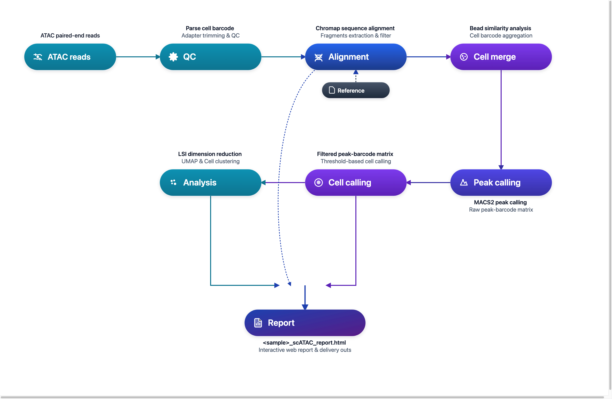

# DNBelab C Series HT scATAC Analysis Pipeline

Single-Cell ATAC Sequencing Data Analysis Guide

## Overview <a id="overview"></a>

This document provides a detailed guide for analyzing single-cell ATAC sequencing data using dnbc4tools.

**Workflow**: Raw Data → Quality Control → Alignment → Bead Merging → Peak Calling → Cell Identification → Dimensionality Reduction & Clustering → Analysis Report

<div align="center" style="margin: 1.5em 0;" markdown="block">
  
</div>

<div class="doc-callout doc-callout-info" markdown="block">
<strong>Usage Note:</strong> <code>$dnbc4tools</code> represents the executable path and must be replaced with the actual installation path. The backslash <code>\</code> is used to split a command across multiple lines for readability.
</div>

## File Preparation <a id="file-preparation"></a>

The analysis requires FASTQ files:

| File Type | Description |
| :--- | :--- |
| **ATAC Library** | Sequencing data containing cell barcodes and chromatin accessibility information |

> **Note**: Ensure that the FASTQ files are of good quality and record their paths for subsequent analysis.

## Reference Data <a id="reference-data"></a>

### Reference Database Input Files

| File Type | Format | Description |
| :--- | :--- | :--- |
| **Genome File** | FASTA | Contains the complete genome sequence of a species, including chromosomes, mitochondria, and other genetic information, typically the primary assembly. This file provides the foundation for genome analysis and alignment. |
| **Annotation File** | GTF | Contains detailed information about genes, transcripts, exons, and other functional regions in the genome. This file identifies the location, type, and related attributes of genes. |

> **Recommended Data Source**: It is recommended to use files from the [Ensembl database](https://www.ensembl.org/index.html). Ensembl's GTF files contain optional tags that facilitate filtering with `dnbc4tools tools mkgtf`.

> **GTF File Requirements**:
>
> - Must contain annotations of type `gene` or `transcript` as well as `exon`.
> - Attributes must include `gene_id` or `gene_name` and `transcript_id` or `transcript_name`.
> - The GFF file format is not supported.
> - The genome file and annotation file must be from corresponding versions.

### GTF File Processing (Optional)

For details on GTF file filtering, please [refer to the scRNA analysis pipeline](scRNA.md#gtf-file-processing-optional).

### Reference Database Construction

Before running the `dnbc4tools atac run` analysis, a reference database must be built. This step uses the annotation file (GTF) and reference genome (FASTA) to create Chromap alignment indexes and genomic region files for read alignment and statistical analysis.

#### Single-Species Reference Construction (e.g., Mouse)

```shell
# Build single-species reference database
$dnbc4tools atac mkref \
  --fasta genome.fa \
  --ingtf genes.gtf \
  --species Mus_musculus \
  --genomeDir /database/scATAC/Mus_musculus
```

#### Dual-Species Mixed Reference Construction (Human + Mouse)

Applicable for human-mouse mixed-cell validation experiments:

```shell
# Build dual-species mixed reference database (Human + Mouse; --prefix is unsupported for mixed species)
# Prepare FASTA and filtered GTF files for both species, separating multiple inputs with commas
$dnbc4tools atac mkref \
  --fasta GRCh38.primary_assembly.genome.fa,GRCm38.primary_assembly.genome.fa \
  --ingtf hg38.filtered.gtf,mm10.filtered.gtf \
  --species hg38,mm10 \
  --genomeDir /database/scATAC/hg38_mm10
```

> **Dual-Species Notes**:
>
> - `--fasta`: Provide genome FASTA file paths for both species, separated by a comma `,`.
> - `--ingtf`: Provide filtered GTF annotation paths for both species, separated by a comma `,` (order must strictly match `--fasta`).
> - `--species`: Declare concise identifiers for each species (e.g. `hg38,mm10`).
> - **Important Restriction**: When constructing a dual-species reference, the `--prefix` argument is **not supported** (due to differing chromosome naming rules between species).

**Output Directory:**

Upon successful execution, a reference database directory will be created at the specified location with the following structure:

```
/database/scATAC/Mus_musculus
├── fasta
│   ├── genome.fa
│   ├── genome.fa.fai
│   ├── genome.index
│   └── genome.index.log
├── genes
│   └── genes.gtf
├── ref.json
└── regions
    ├── chrom.sizes
    ├── promoter.bed
    └── tss.bed
```

**ref.json Example:**

The `ref.json` file records the main information of the database:

```json
{
    "species": "Mus_musculus",
    "input_fasta_files": [
        "genome.fa"
    ],
    "input_gtf_files": [
        "genes.gtf"
    ],
    "genome": "fasta/genome.fa",
    "index": "fasta/genome.index",
    "gtf": "genes/genes.gtf",
    "chrmt": "chrM",
    "chloroplast": "None",
    "chromeSize": "regions/chrom.sizes",
    "tss": "regions/tss.bed",
    "promoter": "regions/promoter.bed",
    "version": "3.2",
    "blacklist": "None",
    "genomesize": "mm"
}
```

 <strong>Note</strong>: Building the reference database can be time-consuming, depending on the genome size and computational resources. The main analysis pipeline is compatible with older database versions.

**Runtime Log Example:**

The following information will be printed during runtime:

```shell
 2025-11-12 16:13:32 Creating new reference folder at /opt/database/Mus_musculus
...done

 2025-11-12 16:13:32 Writing genome FASTA file into reference folder...
...done

 2025-11-12 16:13:33 Indexing genome FASTA file...
...done

 2025-11-12 16:13:34 Writing genes GTF file into reference folder...
...done

 2025-11-12 16:13:38 Extracting TSS and promoter regions from GTF file...
...done

 2025-11-12 16:13:42 Generating Chromap genome index...
...done

 2025-11-12 16:14:07 Writing reference JSON file...
...done
Analysis Complete
```

## Main Pipeline <a id="main-pipeline"></a>

The main pipeline can be used in two ways:

- **Single-sample analysis**: Run `dnbc4tools atac run` directly for a complete analysis of one ATAC library.
- **Multi-sample batch processing**: Use `dnbc4tools atac multi` to generate one run script per sample, which is useful for preparing batch jobs.

### Single-Sample Analysis

The ATAC main analysis pipeline processes single-cell ATAC library data from a single sample. The core workflow includes:

1. **Data Processing**: Perform quality control and alignment to generate the `fragments` file for all beads.
2. **Peak Calling**: Run peak calling on aggregated data to identify open chromatin regions.
3. **Cell Identification**: Identify valid cells using fragment information within peak regions.
4. **Advanced Analysis**: Perform cell filtering, dimensionality reduction, and clustering.
5. **Report Generation**: Integrate outputs from all steps and generate the HTML report plus other result files.

Two input methods are supported:

**Method 1: Directory Input (Recommended)**

```bash
$dnbc4tools atac run \
  --name sample \
  --fastqs /data \
  --genomeDir /opt/database/Mus_musculus \
  --threads 10
```

Directory structure example:
```text
/data/
├── sample_R1.fastq.gz
└── sample_R2.fastq.gz
```

Directory requirements:

- The `--fastqs` path should point to the FASTQ directory for the current ATAC library.
- R1/R2 FASTQ pairs should be placed directly under this directory.
- Automatic detection relies on R1/R2 markers in file names. The recommended naming patterns are `_R1`/`_R2` or `_R1_`/`_R2_`.
- Do not mix data from different samples or different libraries in the same input directory.

**Method 2: Explicit Individual FASTQ Inputs**

```bash
$dnbc4tools atac run \
  --name sample \
  --fastq1 /data/sample_R1.fastq.gz \
  --fastq2 /data/sample_R2.fastq.gz \
  --genomeDir /opt/database/Mus_musculus \
  --threads 10
```

### Execution Process

After auto-detecting the reagent version and dark reaction, the software begins the analysis. Here is an example:

```shell
──────────────────────────── Parsed FASTQ Inputs — 2026-11-03 16:26:21 ─────────────────────────────
┌───────┬──────────────────────────────────────────────────────────────────────────────────────────┐
│ Type  │ Path                                                                                     │
├───────┼──────────────────────────────────────────────────────────────────────────────────────────┤
│ Read1 │ /data/sample_R1.fastq.gz                                                                 │
│ Read2 │ /data/sample_R2.fastq.gz                                                                 │
└───────┴──────────────────────────────────────────────────────────────────────────────────────────┘
────────────────────────────────────────────────────────────────────────────────────────────────────

──────────────────────────── Chemistry Detection — 2026-11-03 16:26:23 ─────────────────────────────
┌─────────────────────────────────┬────────────────────────────────────────────────────────────────┐
│ Type                            │ Result                                                         │
├─────────────────────────────────┼────────────────────────────────────────────────────────────────┤
│ Read1                           │ darkreaction                                                   │
│ Read2                           │ darkreaction                                                   │
└─────────────────────────────────┴────────────────────────────────────────────────────────────────┘
────────────────────────────────────────────────────────────────────────────────────────────────────

 2026-11-03 16:26:23 Validating ATAC reference...
...done

 2026-11-03 16:26:53 Performing raw data quality control and alignment...
...done

 2026-11-03 16:42:28 Calculating bead similarity and merging beads within droplets...
...done

 2026-11-03 16:47:43 Processing fragments for peak calling...
...done

 2026-11-03 16:57:49 Generating raw peak count matrix...
...done

 2026-11-03 16:59:56 Calling cells for ATAC data...
...done

 2026-11-03 17:01:31 Generating cell-filtered peak count matrix...
...done

 2026-11-03 17:01:53 Generating filtered fragments and TSS enrichment...
...done

 2026-11-03 17:02:39 Calculating sequencing saturation metrics...
...done

 2026-11-03 17:03:48 Performing dimensionality reduction and clustering...
...done

 2026-11-03 17:05:41 Generating analysis report and summary statistics...
...done

 2026-11-03 17:06:20 Analysis Finished. Elapsed Time: 0:39:58
```

A successful run will end with `Analysis Finished`.

### Multi-Sample Batch Processing (Optional)

To simplify the analysis of multiple samples, you can use a configuration file to generate a shell script for each sample.

```shell
$dnbc4tools atac multi \
  --list sample.tsv \
  --genomeDir /opt/database/Mus_musculus \
  --threads 10
```

The `sample.tsv` file is tab-separated (`\t`) and contains two columns:

| Column | Content | Description |
| :---: | :--- | :--- |
| 1 | Sample Name | Unique sample identifier (e.g., `sample1`) |
| 2 | Library Sequencing Data | Paired FASTQs, `R1;R2` format, multiple files per read separated by commas `,` |

> **Note**: Multiple FASTQ files within one end should be separated by commas (`,`), and R1/R2 files by semicolons (`;`).

```tsv
sample1	/data/sample1_R1.fq.gz;/data/sample1_R2.fq.gz
sample2	/data/sample2_R1.fq.gz;/data/sample2_R2.fq.gz
sample3	/data/sample3_1_R1.fq.gz,/data/sample3_2_R1.fq.gz;/data/sample3_1_R2.fq.gz,/data/sample3_2_R2.fq.gz
```

After execution, a shell script is generated for each sample:

```shell
sample1.sh
sample2.sh
sample3.sh
```

Example content of `sample1.sh`:

```shell
$cat sample1.sh
/opt/software/dnbc4tools3.2/dnbc4tools atac run --name sample1 --fastq1 /data/sample1_R1.fq.gz --fastq2 /data/sample1_R2.fq.gz --genomeDir /opt/database/Mus_musculus --threads 10
```

You can then execute these scripts to run the main analysis.

## Results Interpretation <a id="results-interpretation"></a>

Upon completion, `outs` (outputs) and `logs` directories will be generated.

```
.
├── *_scATAC_report.html
├── filtered_peak_bc_matrix/
│   ├── barcodes.tsv.gz
│   ├── matrix.mtx.gz
│   └── peaks.bed.gz
├── fragments.tsv.gz
├── fragments.tsv.gz.tbi
├── metrics_summary.xls
├── raw_peak_bc_matrix/
│   ├── barcodes.tsv.gz
│   ├── matrix.mtx.gz
│   └── peaks.bed.gz
└── singlecell.csv
```
