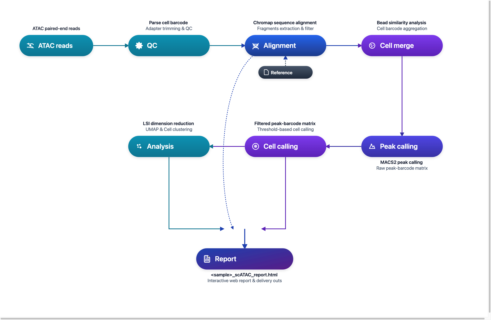

# DNBelab C Series HT scATAC 分析流程

单细胞 ATAC 测序数据分析说明

## 概述 <a id="概述"></a>

本文档详细介绍了使用 dnbc4tools 进行单细胞 ATAC 测序数据分析的完整流程。

**工作流程**：原始数据 → 质量控制 → 比对 → 微珠合并 → Peak调用 → 细胞识别 → 降维聚类 → 分析报告

<div align="center" style="margin: 1.5em 0;" markdown="block">
  
</div>

<div class="doc-callout doc-callout-info" markdown="block">
<strong>使用说明：</strong> <code>$dnbc4tools</code> 代表可执行程序路径，需替换为您的实际安装路径。本文示例使用换行符 <code>\</code> 分隔命令以提高可读性，实际分析时可写为单行。
</div>

## 文件准备 <a id="文件准备"></a>

分析需要 FASTQ 文件：

| 文件类型 | 说明 |
| :--- | :--- |
| **ATAC 文库** | 包含 Cell Barcode 和染色质开放区域信息的测序数据 |

> **注意**：确保 FASTQ 文件质量良好，并记录好文件路径用于后续分析。

## 参考数据库 <a id="参考数据库"></a>

### 参考数据库输入文件

| 文件类型 | 格式 | 说明 |
| :--- | :--- | :--- |
| **基因组文件** | FASTA | 包含特定物种的完整基因组序列，包括染色体、线粒体及其他遗传信息，通常为主装配版本。这些文件为基因组分析和比对提供基础数据。 |
| **注释文件** | GTF | 包含基因组中基因、转录本、外显子及其他功能区域的详细信息。该文件标识基因的位置、类型及其相关属性。 |

> **推荐数据来源**：优先使用 [Ensembl 数据库](https://www.ensembl.org/index.html) 提供的文件。Ensembl 的 GTF 文件包含可选标签，便于通过 `dnbc4tools tools mkgtf` 进行过滤。

> **GTF 文件要求**：
>
> - 必须包含 `gene` 或 `transcript` 类型以及 `exon` 类型的注释。
> - 属性中必须包含 `gene_id` 或 `gene_name` 以及 `transcript_id` 或 `transcript_name`。
> - 不支持 GFF 文件格式。
> - 基因组文件与注释文件需版本对应。

### GTF 文件处理（可选）

有关 GTF 文件过滤的详细信息，请[参考 scRNA 分析流程](./scRNA.md#gtf-file-processing-optional-zh)。

### 参考数据库构建

在运行 `dnbc4tools atac run` 分析之前，需要先构建参考数据库。此步骤使用注释文件（GTF）和参考基因组（FASTA）构建索引文件，用于测序 reads 的比对和统计分析。

#### 单物种参考数据库构建（以小鼠为例）

```shell
# 构建单物种参考数据库
$dnbc4tools atac mkref \
  --fasta genome.fa \
  --ingtf genes.gtf \
  --species Mus_musculus \
  --genomeDir /database/scATAC/Mus_musculus
```

#### 双物种混合参考数据库构建（人鼠混合）

适用于人-鼠细胞混合验证实验的联合参考数据库构建：

```shell
# 构建人-鼠双物种混合参考数据库（双物种不支持 --prefix 参数）
# 准备好两物种 FASTA 与过滤后的 GTF 文件，多个文件与物种标识使用逗号分隔
$dnbc4tools atac mkref \
  --fasta GRCh38.primary_assembly.genome.fa,GRCm38.primary_assembly.genome.fa \
  --ingtf hg38.filtered.gtf,mm10.filtered.gtf \
  --species hg38,mm10 \
  --genomeDir /database/scATAC/hg38_mm10
```

> **双物种建库说明**：
>
> - `--fasta`：提供待混合物种的基因组 FASTA 路径，使用逗号 `,` 分隔。
> - `--ingtf`：提供各物种过滤后的 GTF 注释文件路径，使用逗号 `,` 分隔（顺序需与 `--fasta` 严格对应）。
> - `--species`：声明各物种的简短标识符（如 `hg38,mm10`），用于在合并基因组中区分物种。
> - **重要限制**：双物种联合构建时**不支持** `--prefix` 参数（因不同物种染色体前缀命名规则不同）。

**输出目录：**

成功运行后，将在指定位置创建参考数据库目录，包含以下文件结构：

```
/database/scATAC/Mus_musculus
├── fasta
│   ├── genome.fa
│   ├── genome.fa.fai
│   ├── genome.index
│   └── genome.index.log
├── genes
│   └── genes.gtf
├── ref.json
└── regions
    ├── chrom.sizes
    ├── promoter.bed
    └── tss.bed
```

**ref.json 示例：**

其中 `ref.json` 文件记录数据库的主要信息：

```json
{
    "species": "Mus_musculus",
    "input_fasta_files": [
        "genome.fa"
    ],
    "input_gtf_files": [
        "genes.gtf"
    ],
    "genome": "fasta/genome.fa",
    "index": "fasta/genome.index",
    "gtf": "genes/genes.gtf",
    "chrmt": "chrM",
    "chloroplast": "None",
    "chromeSize": "regions/chrom.sizes",
    "tss": "regions/tss.bed",
    "promoter": "regions/promoter.bed",
    "version": "3.2",
    "blacklist": "None",
    "genomesize": "mm"
}
```

> **注意**：构建参考数据库可能需要较长时间，取决于基因组大小和计算机性能。软件主分析流程兼容旧版本数据库。

**运行日志示例：**

运行时打印信息，以下是一个示例：

```shell
 2026-04-03 16:32:43 Creating new reference folder at /database/scATAC/Homo_sapiens
...done

 2026-04-03 16:32:43 Writing genome FASTA file into reference folder...
...done

 2026-04-03 16:33:33 Indexing genome FASTA file...
...done

 2026-04-03 16:33:44 Writing genes GTF file into reference folder...
...done

 2026-04-03 16:33:59 Extracting TSS and promoter regions from GTF file...
...done

 2026-04-03 16:34:03 Generating Chromap genome index...
...done

 2026-04-03 16:42:28 Writing reference JSON file...
...done

 2026-04-03 16:42:28 ATAC reference building finished.
```

## 主分析流程 <a id="主分析流程"></a>

主分析流程包括单样本分析和多样本批处理两种使用方式：

- **单样本分析**：直接运行 `dnbc4tools atac run`，适用于单个 ATAC 文库的完整分析。
- **多样本批处理**：先通过 `dnbc4tools atac multi` 生成每个样本的运行脚本，适用于多个样本的批量任务准备。

### 单样本分析

ATAC 主分析流程使用单个样本单细胞 ATAC 文库测序数据。该流程的核心步骤包括：

1. **数据处理**：执行质控与比对，生成所有微珠的 `fragments` 文件。
2. **Peak 调用**：基于聚合数据进行 peak calling，识别开放染色质区域。
3. **细胞识别**：利用 peaks 区域的片段信息识别有效细胞。
4. **高级分析**：对细胞进行过滤、降维与聚类。
5. **报告生成**：整合各步骤结果，输出 HTML 网页报告和其他分析结果文件。

支持两种输入方式：

**方式一：目录输入方式（推荐）**

```bash
$dnbc4tools atac run \
  --name sample \
  --fastqs /data \
  --genomeDir /database/scATAC/Mus_musculus \
  --threads 10
```
目录结构示例：
```text
/data/
├── sample_R1.fastq.gz
└── sample_R2.fastq.gz
```

目录要求：

- `--fastqs` 指向当前 ATAC 文库的 FASTQ 目录。
- R1/R2 配对文件需直接放在该目录下。
- 自动识别依赖文件名中的 R1/R2 标识。建议使用 `_R1`/`_R2` 或 `_R1_`/`_R2_` 命名。
- 不同样本或不同文库的数据不要混放到同一输入目录中。

**方式二：独立显式指定 FASTQ 文件**

```bash
$dnbc4tools atac run \
  --name sample \
  --fastq1 /data/sample_R1.fastq.gz \
  --fastq2 /data/sample_R2.fastq.gz \
  --genomeDir /database/scATAC/Mus_musculus \
  --threads 10
```

### 运行过程

在对试剂版本和暗反应自动检测后，软件开始运行分析，以下是一个示例：
```shell
──────────────────────────── Parsed FASTQ Inputs — 2026-11-03 16:26:21 ─────────────────────────────
┌───────┬──────────────────────────────────────────────────────────────────────────────────────────┐
│ Type  │ Path                                                                                     │
├───────┼──────────────────────────────────────────────────────────────────────────────────────────┤
│ Read1 │ /data/sample_R1.fastq.gz                                                                 │
│ Read2 │ /data/sample_R2.fastq.gz                                                                 │
└───────┴──────────────────────────────────────────────────────────────────────────────────────────┘
────────────────────────────────────────────────────────────────────────────────────────────────────

──────────────────────────── Chemistry Detection — 2026-11-03 16:26:23 ─────────────────────────────
┌─────────────────────────────────┬────────────────────────────────────────────────────────────────┐
│ Type                            │ Result                                                         │
├─────────────────────────────────┼────────────────────────────────────────────────────────────────┤
│ Read1                           │ darkreaction                                                   │
│ Read2                           │ darkreaction                                                   │
└─────────────────────────────────┴────────────────────────────────────────────────────────────────┘
────────────────────────────────────────────────────────────────────────────────────────────────────

 2026-11-03 16:26:23 Validating ATAC reference...
...done

 2026-11-03 16:26:53 Performing raw data quality control and alignment...
...done

 2026-11-03 16:42:28 Calculating bead similarity and merging beads within droplets...
...done

 2026-11-03 16:47:43 Processing fragments for peak calling...
...done

 2026-11-03 16:57:49 Generating raw peak count matrix...
...done

 2026-11-03 16:59:56 Calling cells for ATAC data...
...done

 2026-11-03 17:01:31 Generating cell-filtered peak count matrix...
...done

 2026-11-03 17:01:53 Generating filtered fragments and TSS enrichment...
...done

 2026-11-03 17:02:39 Calculating sequencing saturation metrics...
...done

 2026-11-03 17:03:48 Performing dimensionality reduction and clustering...
...done

 2026-11-03 17:05:41 Generating analysis report and summary statistics...
...done

 2026-11-03 17:06:20 Analysis Finished. Elapsed Time: 0:39:58
```

当出现 `Analysis Finished` 消息时，表示分析已成功完成。

### 多样本批处理（可选）

为简化逐样本生成主分析流程的操作，可使用配置文件生成包含多个样本的主流程 shell 脚本。以下为示例步骤：

```shell
$dnbc4tools atac multi \
  --list sample.tsv \
  --genomeDir /database/scATAC/Mus_musculus \
  --threads 10
```

其中 `sample.tsv` 文件使用制表符 (`\t`) 分隔，包含两列：

| 列序号 | 列内容 | 格式与说明 |
| :---: | :--- | :--- |
| 1 | 样本名称 | 样本唯一标识符（如 `sample1`） |
| 2 | 文库测序数据 | 成对 FASTQ，`R1;R2` 格式，同端多文件用逗号 `,` 分隔 |

> **注意**：多个 FASTQ 文件以逗号（`,`）分隔，R1 和 R2 文件以分号（`;`）分隔。

```tsv
sample1	/data/sample1_R1.fq.gz;/data/sample1_R2.fq.gz
sample2	/data/sample2_R1.fq.gz;/data/sample2_R2.fq.gz
sample3	/data/sample3_1_R1.fq.gz,/data/sample3_2_R1.fq.gz;/data/sample3_1_R2.fq.gz,/data/sample3_2_R2.fq.gz
```

运行完成后输出：

```shell
sample1.sh
sample2.sh
sample3.sh
```

其中文件 sample1.sh 如下：

```shell
$cat sample1.sh
/opt/software/dnbc4tools3.2/dnbc4tools atac run --name sample1 --fastq1 /data/sample1_R1.fq.gz --fastq2 /data/sample1_R2.fq.gz --genomeDir /database/scATAC/Mus_musculus --threads 10
```

随后可执行这些脚本进行主流程分析。

## 结果解析 <a id="结果解析"></a>

分析完成后，将生成 `outs`（结果输出）和 `logs`（日志）目录。

```
.
├── *_scATAC_report.html
├── filtered_peak_bc_matrix/
│   ├── barcodes.tsv.gz
│   ├── matrix.mtx.gz
│   └── peaks.bed.gz
├── fragments.tsv.gz
├── fragments.tsv.gz.tbi
├── metrics_summary.xls
├── raw_peak_bc_matrix/
│   ├── barcodes.tsv.gz
│   ├── matrix.mtx.gz
│   └── peaks.bed.gz
└── singlecell.csv
```
