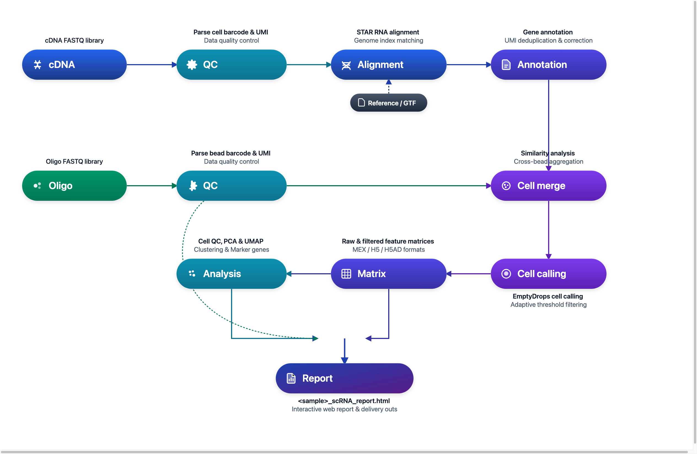

# DNBelab C Series HT scRNA Analysis Pipeline

Single-Cell RNA Sequencing Data Analysis Guide

## Overview <a id="overview"></a>

This document provides a complete guide on how to use dnbc4tools for single-cell RNA sequencing data analysis.

**Workflow**: Raw Data → Quality Control → Alignment → Cell Identification → Expression Matrix → Analysis Report

<div align="center" style="margin: 1.5em 0;" markdown="block">
  
</div>

<div class="doc-callout doc-callout-info" markdown="block">
<strong>Usage Note:</strong> <code>$dnbc4tools</code> represents the executable path and must be replaced with the actual installation path. The backslash <code>\</code> is used to split a command across multiple lines for readability.
</div>

## File Preparation <a id="file-preparation"></a>

Two types of FASTQ files are required for the analysis:

| File Type | Description |
| :--- | :--- |
| **cDNA Library** | Sequencing data containing Cell Barcodes, UMIs, and transcriptome information |
| **Oligo Library** | Contains Cell Barcode information for both large and small beads, and UMI information for small beads |

> **Note**: Ensure that the FASTQ files are of good quality and record their paths for subsequent analysis.

## Reference Data <a id="reference-data"></a>

### Reference Database Input Files

| File Type | Format | Description |
| :--- | :--- | :--- |
| **Genome File** | FASTA | Contains the complete genome sequence of a species (usually the primary assembly), including chromosomes, mitochondria, and other genetic information. This file is fundamental for genome alignment and analysis. |
| **Annotation File** | GTF | Provides detailed information on genes, transcripts, exons, and other functional regions in the genome. This file specifies the location, type, and attributes of genes. |

> **Recommended Data Source**: It is recommended to use files from the [Ensembl database](https://www.ensembl.org/index.html). Ensembl's GTF files contain optional tags that facilitate filtering with `dnbc4tools tools mkgtf`.

> **GTF File Requirements**:
>
> - Must contain annotations of type `gene` or `transcript` as well as `exon`.
> - Attributes must include `gene_id` or `gene_name` and `transcript_id` or `transcript_name`.
> - The GFF file format is not supported.
> - The genome file and annotation file must be from corresponding versions.

### GTF File Preprocessing (Optional) <a id="gtf-file-processing-optional"></a>

GTF files downloaded from sites like ENSEMBL and UCSC often contain many types of genes. Selecting specific gene types relevant to your research can reduce overlapping gene annotations and improve the uniqueness of alignments. For detailed parameter options, please refer to [Tools Parameters](../parameter/tools.md).

We provide three functions for GTF file processing:

| Function | Description | Command Entry Point |
| :--- | :--- | :--- |
| **Gene Type Statistics** | Count the number of various gene types in a GTF file | `dnbc4tools tools mkgtf --action stats` |
| **Correct GTF File** | Fill in missing information to ensure the GTF file meets analysis requirements | `dnbc4tools tools mkgtf --action check` |
| **Filter Gene Types** | Filter specific gene types based on research needs | `dnbc4tools tools mkgtf --type gene_biotype` |

#### Gene Type Statistics

```shell
# Count gene type quantities
$dnbc4tools tools mkgtf \
  --action stats \
  --ingtf genes.gtf \
  --output gtfstat.txt \
  --type gene_biotype
```

 <strong>Note</strong>: You need to check the tags in the GTF file to determine the <code>type</code>.

  

Example Output:

```shell
$cat gtf_type.txt
Type    Count
protein_coding  20006
lncRNA  17755
processed_pseudogene    10159
unprocessed_pseudogene  2605
misc_RNA        2221
snRNA   1910
miRNA   1879
TEC     1056
transcribed_unprocessed_pseudogene      950
snoRNA  943
transcribed_processed_pseudogene        503
rRNA_pseudogene 497
IG_V_pseudogene 187
transcribed_unitary_pseudogene  146
IG_V_gene       145
......
```

#### Correct GTF File

If a GTF file has incomplete content, the main analysis pipeline may fail due to incomplete annotations. This function can automatically fill in missing information in gene and transcript entries to ensure the pipeline runs smoothly.

```shell
# Correct GTF file
$dnbc4tools tools mkgtf \
  --action check \
  --ingtf genes.gtf \
  --output corrected.gtf
```

The software cross-references `gene_id` with `gene_name` and `transcript_id` with `transcript_name` to fill in missing details and flags locations where multiple gene information might exist.

#### Filter Gene Types

```shell
# Filter gene types
$dnbc4tools tools mkgtf \
  --ingtf genes.gtf \
  --output genes.filter.gtf \
  --type gene_biotype
```

Default included gene types:
```
protein_coding
lncRNA/lincRNA
antisense
IG_V_gene
IG_LV_gene
IG_D_gene
IG_J_gene
IG_C_gene
IG_V_pseudogene
IG_J_pseudogene
IG_C_pseudogene
TR_V_gene
TR_D_gene
TR_J_gene
TR_C_gene
```

You can also use the `include` parameter to customize the gene types to be retained:

```shell
# Custom gene type filtering
$dnbc4tools tools mkgtf \
  --ingtf genes.gtf \
  --output genes.filter.gtf \
  --type gene_biotype \
  --include protein_coding,lncRNA,lincRNA,\
        antisense,IG_V_gene,IG_LV_gene,IG_J_gene,\
        IG_C_gene,IG_V_pseudogene,IG_J_pseudogene,\
        IG_C_pseudogene,TR_V_gene,TR_D_gene,TR_J_gene,TR_C_gene
```

### Reference Database Construction

Before running the `dnbc4tools rna run` analysis, a reference database must be built. This step uses the annotation file (GTF) and reference genome (FASTA) to create an index for aligning and annotating the sequencing reads.

#### Single-Species Reference Construction (e.g., Human)

```shell
# Build single-species reference database
$dnbc4tools rna mkref \
  --fasta genome.fa \
  --ingtf genes.gtf \
  --species Homo_sapiens \
  --threads 20
```

#### Dual-Species Mixed Reference Construction (Human + Mouse)

Applicable for human-mouse cell mixing experiments (such as PDX models or cross-species multiplexing validation):

```shell
# Build dual-species mixed reference database (Human + Mouse)
# Prepare FASTA and filtered GTF files for both species, separating multiple inputs with commas
$dnbc4tools rna mkref \
  --fasta GRCh38.primary_assembly.genome.fa,GRCm38.primary_assembly.genome.fa \
  --ingtf hg38.filtered.gtf,mm10.filtered.gtf \
  --species hg38,mm10 \
  --threads 20
```

> **Dual-Species Notes**:
>
> - `--fasta`: Provide genome FASTA file paths for both species, separated by a comma `,`.
> - `--ingtf`: Provide filtered GTF annotation paths for both species, separated by a comma `,` (order must strictly match `--fasta`).
> - `--species`: Declare concise identifiers for each species (e.g. `hg38,mm10`), which will be prepended to chromosomes and gene names to avoid naming collisions.
> - **Naming Restrictions**: Species identifiers must not contain spaces, path slashes, or the reserved string `_and_`.

**Output Directory:**

Upon successful execution, a reference database directory will be created at the specified location with the following structure:

```
/opt/database/Homo_sapiens
├── fasta
│   ├── genome.fa
│   └── genome.fa.fai
├── genes
│   └── genes.gtf
├── ref.json
└── star
    ├── chrLength.txt
    ├── chrNameLength.txt
    ├── chrName.txt
    ├── chrStart.txt
    ├── exonGeTrInfo.tab
    ├── exonInfo.tab
    ├── geneInfo.tab
    ├── Genome
    ├── genomeParameters.txt
    ├── mtgene.list
    ├── SA
    ├── SAindex
    ├── sjdbInfo.txt
    ├── sjdbList.fromGTF.out.tab
    ├── sjdbList.out.tab
    └── transcriptInfo.tab
```

**ref.json Example:**

The `ref.json` file records the main information of the database.

```json
{
    "chrmt": "chrM",
    "genome": "/opt/database/Homo_sapiens/fasta/genome.fa",
    "genomeDir": "/opt/database/Homo_sapiens/star",
    "gtf": "/opt/database/Homo_sapiens/genes/genes.gtf",
    "input_fasta_files": [
        "genome.fa"
    ],
    "input_gtf_files": [
        "genes.filter.gtf"
    ],
    "mtgenes": "/opt/database/Homo_sapiens/star/mtgene.list",
    "species": "Homo_sapiens",
    "version": "3.2"
}
```

 <code>Note</code>: Building the reference database can be time-consuming, depending on the genome size and computational resources. The main analysis pipeline is compatible with older database versions.

**Runtime Log Example:**

The following information will be printed during runtime:

```shell
2025-11-12 15:56:12 Creating new reference folder at /opt/database/Homo_sapiens
...done

 2025-11-12 15:56:12 Writing genome FASTA file into reference folder...
...done

 2025-11-12 15:56:14 Indexing genome FASTA file...
...done

 2025-11-12 15:56:15 Writing genes GTF file into reference folder...
...done

 2025-11-12 15:57:11 Generating STAR genome index...
...done

 2025-11-12 15:59:29 Writing Reference JSON file into reference folder...
...done
Analysis Complete
```

## Main Pipeline <a id="main-pipeline"></a>

The main pipeline can be used in two ways:

- **Single-sample analysis**: Run `dnbc4tools rna run` directly for a complete analysis of one sample.
- **Multi-sample batch processing**: Use `dnbc4tools rna multi` to generate one run script per sample, which is useful for preparing batch jobs.

### Single-Sample Analysis

The main RNA analysis pipeline processes cDNA and Oligo library data from a single sample. Key steps include:

1.  **Data Processing**: Performs quality control, alignment, and functional region annotation.
2.  **Cell Identification**: Merges beads to identify valid cells.
3.  **Matrix Generation**: Creates raw and filtered gene expression matrices.
4.  **Advanced Analysis**: Filters cells, performs dimensionality reduction, clustering, and annotation on the filtered matrix.
5.  **Report Generation**: Outputs an HTML report and other result files.

Two input methods are supported:

**Method 1: Directory Input (Recommended)**

```bash
$dnbc4tools rna run \
  --name sample \
  --fastqs /data \
  --genomeDir /opt/database/Homo_sapiens \
  --threads 30
```

Directory structure example:
```text
/data/
├── cDNA/
│   ├── sample_cDNA_R1.fastq.gz
│   └── sample_cDNA_R2.fastq.gz
└── oligo/
    ├── sample_oligo_1_R1.fastq.gz
    ├── sample_oligo_1_R2.fastq.gz
    ├── sample_oligo_2_R1.fastq.gz
    └── sample_oligo_2_R2.fastq.gz
```

Directory requirements:

- The `--fastqs` directory must contain both `cDNA/` and `oligo/` subdirectories.
- Each subdirectory should contain the R1/R2 FASTQ pairs for the corresponding library.
- Automatic detection relies on R1/R2 markers in file names. The recommended naming patterns are `_R1`/`_R2` or `_R1_`/`_R2_`.
- Do not mix data from different samples or different libraries in the same input directory.

**Method 2: Explicit Individual FASTQ Inputs**

```bash
$dnbc4tools rna run \
  --name sample \
  --cDNAfastq1 /data/cDNA/sample_cDNA_R1.fastq.gz \
  --cDNAfastq2 /data/cDNA/sample_cDNA_R2.fastq.gz \
  --oligofastq1 /data/oligo/sample_oligo_1_R1.fastq.gz,/data/oligo/sample_oligo_2_R1.fastq.gz \
  --oligofastq2 /data/oligo/sample_oligo_1_R2.fastq.gz,/data/oligo/sample_oligo_2_R2.fastq.gz \
  --genomeDir /opt/database/Homo_sapiens \
  --threads 30
```

### Execution Process

After auto-detecting the reagent version and dark reaction, the software begins the analysis. Here is an example:

```shell
──────────────────────────── Parsed FASTQ Inputs — 2026-11-03 16:44:27 ─────────────────────────────
┌─────────────┬────────────────────────────────────────────────────────────────────────────────────┐
│ Type        │ Path                                                                               │
├─────────────┼────────────────────────────────────────────────────────────────────────────────────┤
│ cDNA Read1  │ /data/cDNA/sample_cDNA_R1.fastq.gz                                                 │
│ cDNA Read2  │ /data/cDNA/sample_cDNA_R2.fastq.gz                                                 │
│ oligo Read1 │ /data/oligo/sample_oligo_1_R1.fastq.gz,/data/oligo/sample_oligo_2_R1.fastq.gz      │
│ oligo Read2 │ /data/oligo/sample_oligo_1_R2.fastq.gz,/data/oligo/sample_oligo_2_R2.fastq.gz      │
└─────────────┴────────────────────────────────────────────────────────────────────────────────────┘
────────────────────────────────────────────────────────────────────────────────────────────────────

──────────────────────────── Chemistry Detection — 2026-11-03 16:44:28 ─────────────────────────────
┌───────────────────────────────────────────────┬──────────────────────────────────────────────────┐
│ Type                                          │ Result                                           │
├───────────────────────────────────────────────┼──────────────────────────────────────────────────┤
│ oligo Read1                                   │ darkreaction                                     │
│ oligo Read2                                   │ darkreaction                                     │
└───────────────────────────────────────────────┴──────────────────────────────────────────────────┘
────────────────────────────────────────────────────────────────────────────────────────────────────

──────────────────────────── Chemistry Detection — 2026-11-03 16:44:28 ─────────────────────────────
┌─────────────────────────────────────────────┬────────────────────────────────────────────────────┐
│ Type                                        │ Result                                             │
├─────────────────────────────────────────────┼────────────────────────────────────────────────────┤
│ cDNA Read1                                  │ darkreaction                                       │
└─────────────────────────────────────────────┴────────────────────────────────────────────────────┘
────────────────────────────────────────────────────────────────────────────────────────────────────

 2026-11-03 16:44:28 Validating RNA reference...
...done

 2026-11-03 16:45:35 Starting oligo library filtering...
...done

 2026-11-03 16:48:11 Starting cDNA library filtering...
...done

 2026-11-03 16:49:00 Correcting RNA barcodes and preparing alignment inputs...
...done

 2026-11-03 16:49:35 Performing read alignment and UMI counting...
...done

 2026-11-03 16:52:40 Calculating bead similarity and merging beads within droplets...
...done

 2026-11-03 16:52:51 Generating raw gene expression matrix...
...done

 2026-11-03 16:53:14 Calling cells and generating filtered cell barcodes...
...done

 2026-11-03 16:53:40 Generating cell-filtered gene expression matrix...
...done

 2026-11-03 16:53:54 Calculating sequencing saturation metrics...
...done

 2026-11-03 16:54:02 Generating per-barcode alignment and expression metrics...
...done

 2026-11-03 16:54:15 Generating position-sorted BAM file...
...done

 2026-11-03 16:55:13 Performing dimensionality reduction and clustering analysis...
...done

 2026-11-03 16:55:59 Generating analysis report and summary statistics...
...done

 2026-11-03 16:56:18 Analysis Finished. Elapsed Time: 0:11:51
```

When the message `Analysis Finished` appears, the analysis is successfully completed.

### Multi-Sample Batch Processing (Optional)

To simplify the analysis of multiple samples, you can use a configuration file to generate a shell script for each sample.

```shell
$dnbc4tools rna multi \
  --list sample.tsv \
  --genomeDir /opt/database/Homo_sapiens \
  --threads 30
```

The `sample.tsv` file is tab-separated (`\t`) and contains three columns:

| Column | Content | Description |
| :---: | :--- | :--- |
| 1 | Sample Name | Unique sample identifier (e.g., `sample1`) |
| 2 | cDNA Library Sequencing Data | Paired FASTQs, `R1;R2` format, multiple files per read separated by commas `,` |
| 3 | Oligo Library Sequencing Data | Paired FASTQs, `R1;R2` format, multiple files per read separated by commas `,` |

> **Note**: Multiple FASTQ files within one end should be separated by commas, and R1/R2 files by semicolons.

```tsv
sample1	/data/cDNA1_R1.fq.gz;/data/cDNA1_R2.fq.gz	/data/oligo1_R1.fq.gz,/data/oligo4_R1.fq.gz;/data/oligo1_R2.fq.gz,/data/oligo4_R2.fq.gz
sample2	/data/cDNA2_R1.fq.gz;/data/cDNA2_R2.fq.gz	/data/oligo2_R1.fq.gz;/data/oligo2_R2.fq.gz
sample3	/data/cDNA3_R1.fq.gz;/data/cDNA3_R2.fq.gz	/data/oligo3_R1.fq.gz;/data/oligo3_R2.fq.gz
```

After execution, a shell script will be generated for each sample:

```shell
sample1.sh
sample2.sh
sample3.sh
```

Example content of `sample1.sh`:

```shell
$cat sample1.sh
/opt/software/dnbc4tools3.2/dnbc4tools rna run --name sample1 --cDNAfastq1 /data/cDNA1_R1.fq.gz --cDNAfastq2 /data/cDNA1_R2.fq.gz --oligofastq1 /data/oligo1_R1.fq.gz,/data/oligo4_R1.fq.gz --oligofastq2 /data/oligo1_R2.fq.gz,/data/oligo4_R2.fq.gz --genomeDir /database/scRNA/Mus_musculus/mm10 --threads 30
```

You can then execute these scripts to run the main analysis.

## Results Interpretation <a id="results-interpretation"></a>

Upon completion, `outs` (outputs) and `logs` directories will be generated. The `outs` directory is structured as follows:

```
.
├── analysis/
│   ├── cluster.csv
│   ├── marker.csv
│   └── QC_Cluster.h5ad
├── anno_decon_sorted.bam
├── anno_decon_sorted.bam.bai
├── filtered_feature_bc_matrix.h5ad
├── filtered_feature_bc_matrix/
│   ├── barcodes.tsv.gz
│   ├── features.tsv.gz
│   └── matrix.mtx.gz
├── metrics_summary.xls
├── raw_feature_bc_matrix/
│   ├── barcodes.tsv.gz
│   ├── features.tsv.gz
│   └── matrix.mtx.gz
├── *_scRNA_report.html
└── singlecell.csv
```
