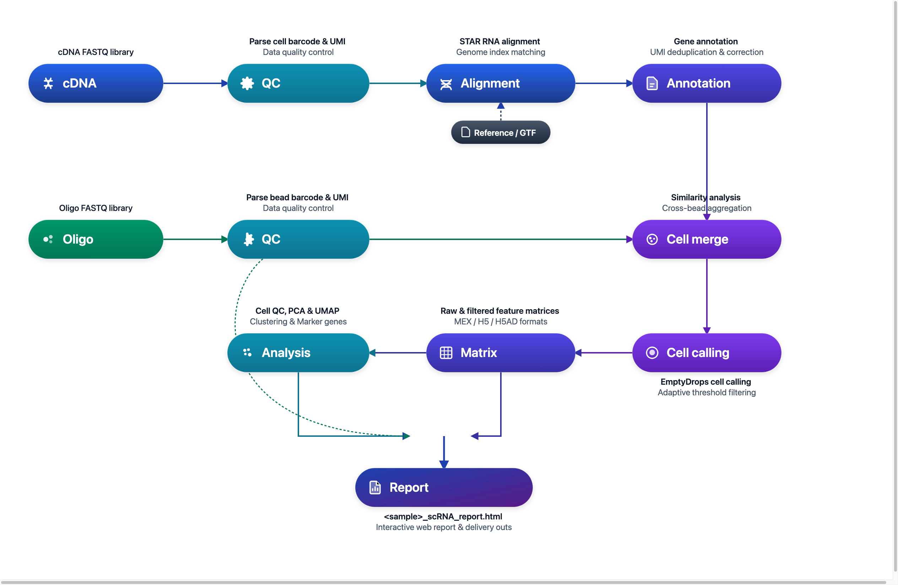

# DNBelab C Series HT scRNA 分析流程

单细胞 RNA 测序数据分析说明

## 概述 <a id="概述"></a>

本文档旨在提供一份完整的指南，详细介绍如何使用 dnbc4tools 对单细胞 RNA 测序数据进行分析。

**工作流程**：原始数据 → 质量控制 → 比对 → 细胞识别 → 表达矩阵 → 分析报告

<div align="center" style="margin: 1.5em 0;" markdown="block">
  
</div>

<div class="doc-callout doc-callout-info" markdown="block">
<strong>使用说明：</strong> <code>$dnbc4tools</code> 代表可执行程序路径，需替换为您的实际安装路径。本文示例使用换行符 <code>\</code> 分隔命令以提高可读性，实际分析时可写为单行。
</div>

## 文件准备 <a id="文件准备"></a>

分析需要两种类型的 FASTQ 文件：

| 文件类型 | 说明 |
| :--- | :--- |
| **cDNA 文库** | 包含 Cell Barcode、UMI 和转录组信息的测序数据 |
| **Oligo 文库** | 包含大小微珠的 Cell Barcode 信息及小微珠的 UMI 信息 |

> **注意**：请确保 FASTQ 文件质量良好，并记录文件路径以备后续分析使用。

## 参考数据库 <a id="参考数据库"></a>

### 参考数据库输入文件

| 文件类型 | 格式 | 说明 |
| :--- | :--- | :--- |
| **基因组文件** | FASTA | 包含特定物种的完整基因组序列（通常是主装配版本），涵盖染色体、线粒体及其他遗传信息。该文件是基因组比对和分析的基础。 |
| **注释文件** | GTF | 详细描述基因组中的基因、转录本、外显子等功能区域。此文件明确了基因的位置、类型及相关属性。 |

> **推荐数据来源**：优先使用 [Ensembl 数据库](https://www.ensembl.org/index.html) 提供的文件。Ensembl 的 GTF 文件包含可选标签，便于通过 `dnbc4tools tools mkgtf` 进行过滤。

> **GTF 文件要求**：
>
> - 必须包含 `gene` 或 `transcript` 类型以及 `exon` 类型的注释。
> - 属性中必须包含 `gene_id` 或 `gene_name` 以及 `transcript_id` 或 `transcript_name`。
> - 不支持 GFF 文件格式。
> - 基因组文件与注释文件需版本对应。

### GTF 文件预处理（可选） <a id="gtf-file-processing-optional-zh"></a>

从 ENSEMBL 和 UCSC 等网站下载的 GTF 文件通常包含多种类型的基因。根据您的研究兴趣选择特定的基因类型进行分析，可以有效减少基因注释的重叠，从而提高比对的唯一性。与多个基因非唯一比对的 reads 会被过滤。详细参数规范请参阅 [GTF 工具参数说明](../parameter/tools.md)。

我们提供以下三种 GTF 文件处理功能：

| 功能 | 说明 | 命令行入口 |
| :--- | :--- | :--- |
| **基因类型统计** | 统计 GTF 文件中各基因类型的数量 | `dnbc4tools tools mkgtf --action stats` |
| **GTF 文件校正** | 填补缺失信息，确保 GTF 文件符合分析要求 | `dnbc4tools tools mkgtf --action check` |
| **基因类型过滤** | 根据研究需要筛选特定基因类型 | `dnbc4tools tools mkgtf --type gene_biotype` |

#### 基因类型统计

```shell
# 统计基因类型数量
$dnbc4tools tools mkgtf \
  --action stats \
  --ingtf genes.gtf
```

> **注意**：软件会自动尝试识别 `type` 参数。如需手动确定，可查看 GTF 文件中的 tag。

  

输出示例：

```shell
Type    Count
protein_coding  20006
lncRNA  17755
processed_pseudogene    10159
unprocessed_pseudogene  2605
misc_RNA        2221
snRNA   1910
miRNA   1879
TEC     1056
transcribed_unprocessed_pseudogene      950
snoRNA  943
transcribed_processed_pseudogene        503
rRNA_pseudogene 497
IG_V_pseudogene 187
transcribed_unitary_pseudogene  146
IG_V_gene       145
......
```

#### GTF 文件校正

当 GTF 文件内容不完整时，主分析流程可能会因无法完全注释而中断。此功能能够自动填补基因（gene）与转录本（transcript）条目中的缺失信息，确保流程顺利进行。

```shell
# 校正GTF 文件
$dnbc4tools tools mkgtf \
  --action check \
  --ingtf genes.gtf \
  --output corrected.gtf
```

软件会根据 `gene_id` 和 `gene_name` 以及 `transcript_id` 和 `transcript_name` 互相填补，并提示可能存在多个基因信息的位置。

#### 基因类型过滤

```shell
# 基因类型过滤
$dnbc4tools tools mkgtf \
  --ingtf genes.gtf \
  --output genes.filter.gtf \
  --type gene_biotype
```

默认包含的基因类型：
```
protein_coding
lncRNA/lincRNA
antisense
IG_V_gene
IG_LV_gene
IG_D_gene
IG_J_gene
IG_C_gene
IG_V_pseudogene
IG_J_pseudogene
IG_C_pseudogene
TR_V_gene
TR_D_gene
TR_J_gene
TR_C_gene
```

也可使用 `include` 参数自定义需要保留的基因类型：

```shell
# 自定义基因类型过滤
$dnbc4tools tools mkgtf \
  --ingtf genes.gtf \
  --output genes.filter.gtf \
  --type gene_biotype \
  --include protein_coding,lncRNA,lincRNA,antisense,IG_V_gene,\
           IG_LV_gene,IG_J_gene,IG_C_gene,IG_V_pseudogene,\
           IG_J_pseudogene,IG_C_pseudogene,TR_V_gene,TR_D_gene,\
           TR_J_gene,TR_C_gene
```

### 参考数据库构建

在执行 `dnbc4tools rna run` 分析前，必须先构建参考数据库。此步骤利用注释文件（GTF）和参考基因组（FASTA）创建索引，用于后续测序 reads 的比对和注释。

#### 单物种参考数据库构建（以人类为例）

```shell
# 构建单物种参考数据库
$dnbc4tools rna mkref \
  --fasta genome.fa \
  --ingtf genes.filter.gtf \
  --species Homo_sapiens \
  --threads 20
```

#### 双物种混合参考数据库构建（人鼠混合）

适用于人-鼠细胞混合实验（如 PDX 模型或跨物种多重验证）的混合参考索引构建：

```shell
# 构建人-鼠双物种混合参考数据库
# 准备好两物种 FASTA 与过滤后的 GTF 文件，多个文件与物种标识使用逗号分隔
$dnbc4tools rna mkref \
  --fasta GRCh38.primary_assembly.genome.fa,GRCm38.primary_assembly.genome.fa \
  --ingtf hg38.filtered.gtf,mm10.filtered.gtf \
  --species hg38,mm10 \
  --threads 20
```

> **双物种建库说明**：
>
> - `--fasta`：提供待混合物种的基因组 FASTA 路径，使用逗号 `,` 分隔。
> - `--ingtf`：提供各物种过滤后的 GTF 注释文件路径，使用逗号 `,` 分隔（顺序需与 `--fasta` 严格对应）。
> - `--species`：声明各物种的简短标识符（如 `hg38,mm10`），用于在合并基因组中为染色体和基因添加物种前缀，防止重名混淆。
> - **命名限制**：物种名称中切勿包含空格、路径斜杠或保留字 `_and_`。

**输出目录：**

成功运行后，将在指定位置创建参考数据库目录，包含以下文件结构：

```
/database/scRNA/Homo_sapiens

├── fasta
│   ├── genome.fa
│   └── genome.fa.fai
├── genes
│   └── genes.gtf
├── ref.json
└── star
    ├── chrLength.txt
    ├── chrNameLength.txt
    ├── chrName.txt
    ├── chrStart.txt
    ├── exonGeTrInfo.tab
    ├── exonInfo.tab
    ├── geneInfo.tab
    ├── Genome
    ├── genomeParameters.txt
    ├── mtgene.list
    ├── SA
    ├── SAindex
    ├── sjdbInfo.txt
    ├── sjdbList.fromGTF.out.tab
    ├── sjdbList.out.tab
    └── transcriptInfo.tab
```

**ref.json 示例：**

其中 `ref.json` 文件记录了数据库的主要信息。

```json
{
    "chrmt": "chrM",
    "genome": "fasta/genome.fa",
    "genomeDir": "star",
    "gtf": "genes/genes.gtf",
    "input_fasta_files": [
        "genome.fa"
    ],
    "input_gtf_files": [
        "genes.filter.gtf"
    ],
    "mtgenes": "star/mtgene.list",
    "species": "Homo_sapiens",
    "version": "3.2"
}
```

> **注意**：构建参考数据库可能需要较长时间，具体取决于基因组大小和计算性能。软件主分析流程兼容旧版本数据库。

**运行日志示例：**

运行时将打印如下信息：

```shell
 2026-04-03 16:29:02 Creating new reference folder at /database/scRNA/Homo_sapiens
...done

 2026-04-03 16:29:02 Writing genome FASTA file into reference folder...
...done

 2026-04-03 16:29:57 Indexing genome FASTA file...
...done

 2026-04-03 16:30:09 Writing genes GTF file into reference folder...
...done

 2026-04-03 16:33:20 Generating STAR genome index...
...done

 2026-04-03 17:13:34 Writing Reference JSON file into reference folder...
...done

 2026-04-03 17:13:37 RNA reference building finished.
```

## 主分析流程 <a id="主流程分析"></a>

主流程分析包括单样本分析和多样本批处理两种使用方式：

- **单样本分析**：直接运行 `dnbc4tools rna run`，适用于单个样本的完整分析。
- **多样本批处理**：先通过 `dnbc4tools rna multi` 生成每个样本的运行脚本，适用于多个样本的批量任务准备。

### 单样本分析

RNA 主分析流程处理单个样本的 cDNA 和 Oligo 文库测序数据。该流程的核心步骤包括：

1. **数据处理**：执行质量控制、比对和功能区域注释。
2. **细胞识别**：合并微珠，识别有效细胞。
3. **矩阵生成**：生成原始及过滤后的基因表达矩阵。
4. **高级分析**：对过滤后矩阵进行细胞筛选、降维、聚类和注释。
5. **报告生成**：输出 HTML 格式的分析报告及其他结果文件。

支持两种输入方式：

**方式一：目录输入方式（推荐）**

```bash
$dnbc4tools rna run \
  --name sample \
  --fastqs /data \
  --genomeDir /opt/database/Homo_sapiens \
  --threads 30
```

目录结构示例：
```text
/data/
├── cDNA/
│   ├── sample_cDNA_R1.fastq.gz
│   └── sample_cDNA_R2.fastq.gz
└── oligo/
    ├── sample_oligo_1_R1.fastq.gz
    ├── sample_oligo_1_R2.fastq.gz
    ├── sample_oligo_2_R1.fastq.gz
    └── sample_oligo_2_R2.fastq.gz
```

目录要求：

- `--fastqs` 指向的目录必须包含 `cDNA/` 和 `oligo/` 两个子目录。
- 每个子目录内放置对应文库的 R1/R2 配对 FASTQ 文件。
- 自动识别依赖文件名中的 R1/R2 标识。建议使用 `_R1`/`_R2` 或 `_R1_`/`_R2_` 命名。
- 不同样本或不同文库的数据不要混放到同一输入目录中。

**方式二：独立显式指定 FASTQ 文件**

```bash
$dnbc4tools rna run \
  --name sample \
  --cDNAfastq1 /data/cDNA/sample_cDNA_R1.fastq.gz \
  --cDNAfastq2 /data/cDNA/sample_cDNA_R2.fastq.gz \
  --oligofastq1 /data/oligo/sample_oligo_1_R1.fastq.gz,/data/oligo/sample_oligo_2_R1.fastq.gz \
  --oligofastq2 /data/oligo/sample_oligo_1_R2.fastq.gz,/data/oligo/sample_oligo_2_R2.fastq.gz \
  --genomeDir /opt/database/Homo_sapiens \
  --threads 30
```

### 运行过程

在对试剂版本和暗反应自动检测后，软件开始运行分析，以下是一个示例：

```shell
──────────────────────────── Parsed FASTQ Inputs — 2026-11-03 16:44:27 ─────────────────────────────
┌─────────────┬────────────────────────────────────────────────────────────────────────────────────┐
│ Type        │ Path                                                                               │
├─────────────┼────────────────────────────────────────────────────────────────────────────────────┤
│ cDNA Read1  │ /data/cDNA/sample_cDNA_R1.fastq.gz                                                 │
│ cDNA Read2  │ /data/cDNA/sample_cDNA_R2.fastq.gz                                                 │
│ oligo Read1 │ /data/oligo/sample_oligo_1_R1.fastq.gz,/data/oligo/sample_oligo_2_R1.fastq.gz      │
│ oligo Read2 │ /data/oligo/sample_oligo_1_R2.fastq.gz,/data/oligo/sample_oligo_2_R2.fastq.gz      │
└─────────────┴────────────────────────────────────────────────────────────────────────────────────┘
────────────────────────────────────────────────────────────────────────────────────────────────────

──────────────────────────── Chemistry Detection — 2026-11-03 16:44:28 ─────────────────────────────
┌───────────────────────────────────────────────┬──────────────────────────────────────────────────┐
│ Type                                          │ Result                                           │
├───────────────────────────────────────────────┼──────────────────────────────────────────────────┤
│ oligo Read1                                   │ darkreaction                                     │
│ oligo Read2                                   │ darkreaction                                     │
└───────────────────────────────────────────────┴──────────────────────────────────────────────────┘
────────────────────────────────────────────────────────────────────────────────────────────────────

──────────────────────────── Chemistry Detection — 2026-11-03 16:44:28 ─────────────────────────────
┌─────────────────────────────────────────────┬────────────────────────────────────────────────────┐
│ Type                                        │ Result                                             │
├─────────────────────────────────────────────┼────────────────────────────────────────────────────┤
│ cDNA Read1                                  │ darkreaction                                       │
└─────────────────────────────────────────────┴────────────────────────────────────────────────────┘
────────────────────────────────────────────────────────────────────────────────────────────────────

 2026-11-03 16:44:28 Validating RNA reference...
...done

 2026-11-03 16:45:35 Starting oligo library filtering...
...done

 2026-11-03 16:48:11 Starting cDNA library filtering...
...done

 2026-11-03 16:49:00 Correcting RNA barcodes and preparing alignment inputs...
...done

 2026-11-03 16:49:35 Performing read alignment and UMI counting...
...done

 2026-11-03 16:52:40 Calculating bead similarity and merging beads within droplets...
...done

 2026-11-03 16:52:51 Generating raw gene expression matrix...
...done

 2026-11-03 16:53:14 Calling cells and generating filtered cell barcodes...
...done

 2026-11-03 16:53:40 Generating cell-filtered gene expression matrix...
...done

 2026-11-03 16:53:54 Calculating sequencing saturation metrics...
...done

 2026-11-03 16:54:02 Generating per-barcode alignment and expression metrics...
...done

 2026-11-03 16:54:15 Generating position-sorted BAM file...
...done

 2026-11-03 16:55:13 Performing dimensionality reduction and clustering analysis...
...done

 2026-11-03 16:55:59 Generating analysis report and summary statistics...
...done

 2026-11-03 16:56:18 Analysis Finished. Elapsed Time: 0:11:51
```

当出现 `Analysis Finished` 消息时，表示分析已成功完成。

### 多样本批处理（可选）

为简化多样本分析流程，可使用配置文件批量生成针对每个样本的 shell 脚本。

```shell
$dnbc4tools rna multi \
  --list sample.tsv \
  --genomeDir /opt/database/Homo_sapiens \
  --threads 30
```

其中 `sample.tsv` 文件使用制表符 (`\t`) 分隔，包含三列：

| 列序号 | 列内容 | 格式与说明 |
| :---: | :--- | :--- |
| 1 | 样本名称 | 样本唯一标识符（如 `sample1`） |
| 2 | cDNA 文库测序数据 | 成对 FASTQ，`R1;R2` 格式，同端多文件用逗号 `,` 分隔 |
| 3 | Oligo 文库测序数据 | 成对 FASTQ，`R1;R2` 格式，同端多文件用逗号 `,` 分隔 |

> **注意**：多个 FASTQ 文件以逗号分隔，R1 和 R2 文件以分号分隔。

```tsv
sample1	/data/cDNA1_R1.fq.gz;/data/cDNA1_R2.fq.gz	/data/oligo1_R1.fq.gz,/data/oligo4_R1.fq.gz;/data/oligo1_R2.fq.gz,/data/oligo4_R2.fq.gz
sample2	/data/cDNA2_R1.fq.gz;/data/cDNA2_R2.fq.gz	/data/oligo2_R1.fq.gz;/data/oligo2_R2.fq.gz
sample3	/data/cDNA3_R1.fq.gz;/data/cDNA3_R2.fq.gz	/data/oligo3_R1.fq.gz;/data/oligo3_R2.fq.gz
```

运行完成后，将为每个样本生成一个 shell 脚本：

```shell
sample1.sh
sample2.sh
sample3.sh
```

`sample1.sh` 文件内容示例：

```shell
$cat sample1.sh
/opt/software/dnbc4tools3.2/dnbc4tools rna run --name sample1 --cDNAfastq1 /data/cDNA1_R1.fq.gz --cDNAfastq2 /data/cDNA1_R2.fq.gz --oligofastq1 /data/oligo1_R1.fq.gz,/data/oligo4_R1.fq.gz --oligofastq2 /data/oligo1_R2.fq.gz,/data/oligo4_R2.fq.gz --genomeDir /database/scRNA/Mus_musculus/mm10 --threads 30
```

随后可执行这些脚本进行主流程分析。

## 结果解析 <a id="结果解析"></a>

分析完成后，将生成 `outs`（结果输出）和 `logs`（日志）目录。`outs` 目录结构如下：

```
.
├── analysis/
│   ├── cluster.csv
│   ├── marker.csv
│   └── QC_Cluster.h5ad
├── anno_decon_sorted.bam
├── anno_decon_sorted.bam.bai
├── filtered_feature_bc_matrix.h5ad
├── filtered_feature_bc_matrix/
│   ├── barcodes.tsv.gz
│   ├── features.tsv.gz
│   └── matrix.mtx.gz
├── metrics_summary.xls
├── raw_feature_bc_matrix/
│   ├── barcodes.tsv.gz
│   ├── features.tsv.gz
│   └── matrix.mtx.gz
├── *_scRNA_report.html
└── singlecell.csv
```
