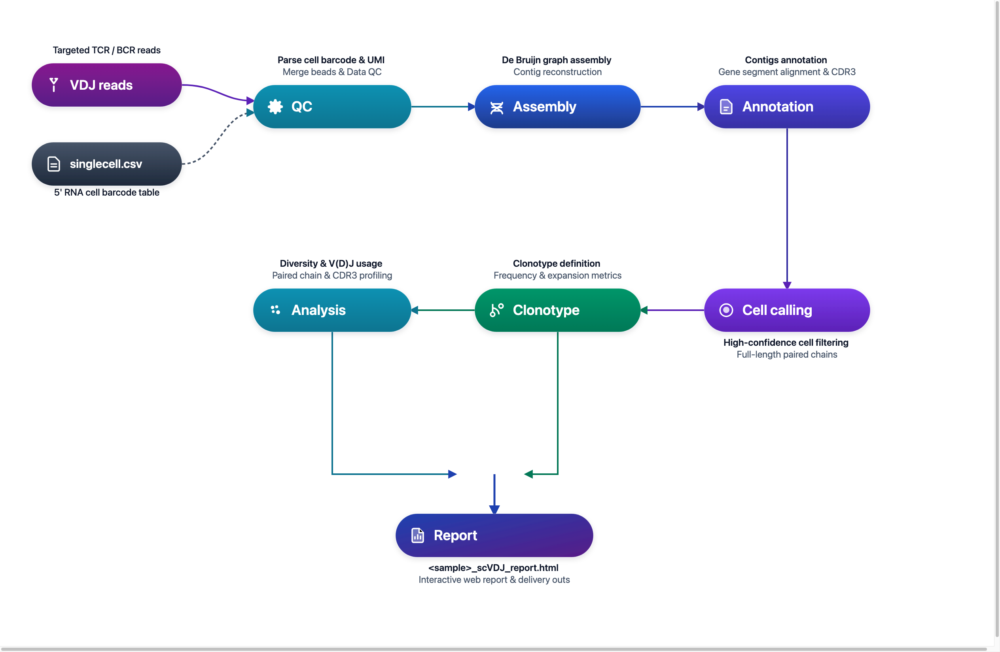

# DNBelab C Series HT scVDJ Analysis Pipeline

Single-Cell VDJ Sequencing Data Analysis Guide

## Overview <a id="overview"></a>

This document provides a detailed guide for analyzing single-cell VDJ sequencing data using dnbc4tools.

**Workflow**: Choose RNA-associated or standalone mode → VDJ read processing → Assembly & annotation → Conditional RNA-based filtering → Clonotype analysis → Report

<div align="center" style="margin: 1.5em 0;" markdown="block">
  
</div>

<div class="doc-callout doc-callout-info" markdown="block">
<strong>Usage Note:</strong> <code>$dnbc4tools</code> represents the executable path and must be replaced with the actual installation path. The backslash <code>\</code> is used to split commands across multiple lines for readability.
</div>

Two modes are supported: provide `--beadstrans` to use an RNA cell table for bead mapping and RNA-based cell filtering; or omit it to run VDJ without an RNA cell table. When omitted, `keep_all_cells` is enabled automatically, so assembled barcodes are not filtered by RNA cell calls and must not be treated as an RNA-confirmed cell set.

## File Preparation <a id="file-preparation"></a>

### 5' Transcriptome Analysis

For RNA-associated VDJ analysis, obtain a 5' RNA cell table using `dnbc4tools rna run --end5`, or reuse an existing table. Skip this step when running without an RNA cell table.

Here is an example script to generate an expression matrix for a single sample:

```shell
$dnbc4tools rna run \
	--name sample_5rna \
	--cDNAfastq1 /data/sample_cDNA_R1.fastq.gz \
	--cDNAfastq2 /data/sample_cDNA_R2.fastq.gz \
	--oligofastq1 /data/sample_oligo1_1.fq.gz,/data/sample_oligo2_1.fq.gz \
	--oligofastq2 /data/sample_oligo1_2.fq.gz,/data/sample_oligo2_2.fq.gz \
	--genomeDir /opt/database/Homo_sapiens \
	--threads 30 \
	--end5
```

<div class="doc-callout doc-callout-warn" markdown="block">
<strong>Prerequisite:</strong> An RNA `singlecell.csv` table is required only when RNA-based bead mapping and cell filtering are requested.
</div>

### Required Files for VDJ Analysis

The analysis requires the following files:

| File Type | Description |
| :--- | :--- |
| **FASTQ Files** | VDJ library sequencing data containing TCR or BCR sequence reads |
| **singlecell.csv File (RNA-associated mode)** | Optional for standalone VDJ; supplies RNA cell calls and bead mappings when `--beadstrans` is used |

In RNA-associated mode, `singlecell.csv` supplies the `cell` and `barcode` mappings and the `is_cell_barcode` flag (1 for called cells, 0 for background). Without `--beadstrans`, these RNA-based mappings and filters are not applied.

> **Note**: Ensure the path to the `singlecell.csv` file is correct, as this file is crucial for linking the transcriptome and VDJ analyses.

Example file content:

```csv
cell,reads,gene,umi,is_cell_barcode,barcode
CELL1118_N3,1485813,5693,57580,1,AGATCGCCTACGATCACGAT;GGTGGAAGGTGAGAGAAGCG;GTAGTTCTAGGCTAAGTACT
CELL1651_N3,805447,4881,32131,1,ATCTCAAGCCCACCGTGTGT;CATCAATTAAGTGATCGCAT;CCTAACTGAGGAACGCTTAG
CELL4_N3,820269,5649,30326,1,AACACCTGATCGTTCAATAA;AATTCGAAGGTAGTCGGAAT;CACATGTTACATGTTCTATA
CELL906_N3,656624,4853,28142,1,ACGTCCGCGTGACCATGTGC;AGGAGCTCCATTGATCTTAA;CAATCCGGAGAACGTATCTG
CELL1577_N2,672637,4610,24822,1,ATATTCTCACGTAACGGATG;TAGGAACTCGGCTTAGATCT
CELL2064_N2,542608,2355,23324,1,CATAAGCACTCACCGCTAGT;GTCTCACAGTTGTTCACTAG
CELL1332_N6,580950,4702,22953,1,AGGTGTAAGCCTACCGGACC;CGCACTCACCTAACATTGTG;CTTGCCGCGCTATCAATGCA;GCCACTAGTCGACGCGGTTG;GTCAGCATGCTCTTCCACAG;TCGATATCCTCACTCTTAAC
CELL726_N4,585934,4617,22660,1,ACCTACGGCGTTACTATGTG;CGACGCTCTCGACAGTTAGG;CGGCAGAGTCTTGGCGCTTA;TCCGACCGTATCTTCATCTC
CELL4010_N1,555308,4268,22554,1,AGAGAGTCGCAGCAAGCGAC
```

For a command without an RNA table, see the [standalone VDJ example](../quickstart.md#vdj-without-rna). The workflow image and RNA commands above illustrate the RNA-associated mode.

## Main Pipeline <a id="main-pipeline"></a>

The VDJ pipeline optionally uses a matched RNA cell table. Its main steps are:

1. Filter reads; apply RNA bead mappings when supplied.
2.  Align reads to VDJ gene segments and extract them.
3.  Perform de novo assembly and annotation.
4. Apply assembly/annotation rules; use RNA cell calls for filtering when the mode enables it.
5.  Integrate results from all steps to generate an HTML report and other output files.

### TCR Analysis

To run TCR analysis for a single sample, two input methods are supported:

**Method 1: Directory Input (Recommended)**

```shell
$dnbc4tools vdj run \
  --name sample_tcr \
  --fastqs /data/vdjt \
  --ref human \
  --chain TR \
  --beadstrans /sample_5rna/outs/singlecell.csv \
  --threads 10
```

Directory structure example:

```text
/data/vdjt/
├── sample_tcr_R1.fastq.gz
└── sample_tcr_R2.fastq.gz
```

**Method 2: Explicit Individual FASTQ Inputs**

```shell
$dnbc4tools vdj run \
  --name sample_tcr \
  --fastq1 /data/vdjt/sample_tcr_R1.fastq.gz \
  --fastq2 /data/vdjt/sample_tcr_R2.fastq.gz \
  --ref human \
  --chain TR \
  --beadstrans /sample_5rna/outs/singlecell.csv \
  --threads 10
```

### BCR Analysis

To run BCR analysis for a single sample, two input methods are supported:

**Method 1: Directory Input (Recommended)**

```shell
$dnbc4tools vdj run \
  --name sample_bcr \
  --fastqs /data/vdjb \
  --ref human \
  --chain IG \
  --beadstrans /sample_5rna/outs/singlecell.csv \
  --threads 10
```

Directory structure example:

```text
/data/vdjb/
├── sample_bcr_R1.fastq.gz
└── sample_bcr_R2.fastq.gz
```

**Method 2: Explicit Individual FASTQ Inputs**

```shell
$dnbc4tools vdj run \
  --name sample_bcr \
  --fastq1 /data/vdjb/sample_bcr_R1.fastq.gz \
  --fastq2 /data/vdjb/sample_bcr_R2.fastq.gz \
  --ref human \
  --chain IG \
  --beadstrans /sample_5rna/outs/singlecell.csv \
  --threads 10
```

> **Input Directory Requirements**:
>
> - The `--fastqs` path should point to the FASTQ directory for the current VDJ library.
> - R1/R2 FASTQ pairs should be placed directly under this directory.
> - Automatic detection relies on R1/R2 markers in file names. The recommended naming patterns are `_R1`/`_R2` or `_R1_`/`_R2_`.
> - TCR and BCR data should be run separately and should not be mixed in the same input directory.

### Execution Process

After auto-detecting the dark reaction, the software begins the analysis. Here is an example:

```shell
====================================================================================================
Running VDJ-B pipeline — 2026-11-02 18:00:13
====================================================================================================

====================================================================================================
Parsed FASTQ Inputs - 2026-11-02 18:00:13
====================================================================================================
Type         | Path                                                                                 
-------------+--------------------------------------------------------------------------------------
Read1        | /data/vdjb/sample_bcr_R1.fastq.gz                                                    
Read2        | /data/vdjb/sample_bcr_R2.fastq.gz                                                    
====================================================================================================


====================================================================================================
Chemistry Configuration - 2026-11-02 18:00:14
====================================================================================================
Type         | Result                                                                               
-------------+--------------------------------------------------------------------------------------
VDJ          | custom sequence structure                                                            
====================================================================================================


2026-11-02 18:00:14 Validating VDJ reference...
...done

2026-11-02 18:00:14 Starting VDJ library filtering...
...done

2026-11-02 18:03:46 Correcting VDJ barcodes and translating bead identities...
...done

2026-11-02 18:04:06 Preparing input data for VDJ assembly...
...done

2026-11-02 18:07:16 Performing VDJ sequence assembly and gene segment annotation...
...done

2026-11-02 18:26:09 Performing cell calling for VDJ data...
...done

2026-11-02 18:27:36 Generating VDJ clonotype analysis...
...done

2026-11-02 18:28:30 Converting VDJ results from cellbarcode to cell ID...
...done

2026-11-02 18:28:31 Analysis Finished. Elapsed Time: 0:28:17
```

A successful run will end with `Analysis Finished`.

## Results Interpretation <a id="results-interpretation"></a>

Upon completion, `outs` (outputs) and `logs` directories will be generated. The `outs` directory includes:

```
.
├── airr_annotations.tsv
├── all_contig_annotations.csv
├── all_contig.fasta
├── all_contig.fasta.fai
├── *_scVDJ_IG_report.html
├── clonotypes.csv
├── consensus_annotations.csv
├── consensus.fasta
├── consensus.fasta.fai
├── filtered_contig_annotations.csv
├── filtered_contig.fasta
├── filtered_contig.fasta.fai
└── metrics_summary.xls
```
