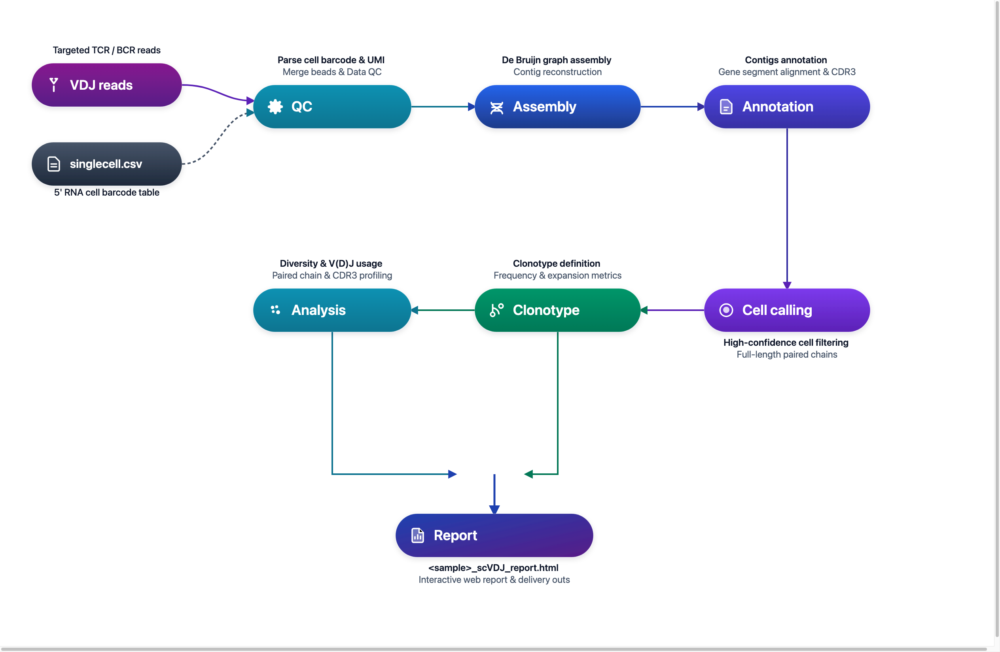

# DNBelab C Series HT scVDJ 分析流程

单细胞 VDJ 测序数据分析说明

## 概述 <a id="概述"></a>

本文档详细介绍了使用 dnbc4tools 进行单细胞 VDJ 测序数据分析的完整流程。

**工作流程**：选择 RNA 关联或独立模式 → VDJ 文库处理 → 序列组装注释 → 按模式应用 RNA 过滤 → 克隆型分析 → 报告

<div align="center" style="margin: 1.5em 0;" markdown="block">
  
</div>

<div class="doc-callout doc-callout-info" markdown="block">
<strong>使用说明：</strong> <code>$dnbc4tools</code> 代表可执行程序路径，需替换为您的实际安装路径。本文示例使用换行符 <code>\</code> 分隔命令以提高可读性，实际分析时可写为单行。
</div>

支持两种模式：提供 `--beadstrans` 时，使用 RNA 细胞表进行微珠映射及基于 RNA 的细胞过滤；省略时，可在没有 RNA 细胞表的情况下运行 VDJ。省略该参数会自动启用 `keep_all_cells`，不按 RNA 细胞识别结果过滤组装条形码，因此不能将这些条形码视为 RNA 已确认的细胞集合。

## 文件准备 <a id="文件准备"></a>

### 5' 端转录组分析

RNA 关联模式可通过 `dnbc4tools rna run --end5` 获取 5′ RNA 细胞表，也可复用已有表。无 RNA 细胞表模式跳过此步骤。

为单个样本生成表达矩阵，以下是一个示例步骤或脚本模板：

```bash
$dnbc4tools rna run \
	--name sample_5rna \
	--cDNAfastq1 /data/sample_cDNA_R1.fastq.gz \
	--cDNAfastq2 /data/sample_cDNA_R2.fastq.gz \
	--oligofastq1 /data/sample_oligo1_1.fq.gz,/data/sample_oligo2_1.fq.gz \
	--oligofastq2 /data/sample_oligo1_2.fq.gz,/data/sample_oligo2_2.fq.gz \
	--genomeDir /opt/database/Homo_sapiens \
	--threads 30 \
	--end5
```

<div class="doc-callout doc-callout-warn" markdown="block">
<strong>前置条件：</strong> 仅在需要 RNA 微珠映射及细胞过滤时，提供对应的 RNA `singlecell.csv` 表。
</div>

### VDJ 分析所需文件

分析需要以下文件：

| 文件类型 | 说明 |
| :--- | :--- |
| **FASTQ 文件** | VDJ 文库测序数据，包含 TCR 或 BCR 序列信息 |
| **singlecell.csv 文件（RNA 关联模式）** | 独立模式不要求提供；使用 `--beadstrans` 时提供 RNA 细胞识别与微珠映射信息 |

RNA 关联模式通过 `singlecell.csv` 的 `cell`、`barcode` 列提供映射，通过 `is_cell_barcode` 标记细胞（1）与背景（0）。未传入 `--beadstrans` 时，不应用这些基于 RNA 的映射和过滤。

> **注意**：确保 `singlecell.csv` 文件路径正确，该文件是连接转录组与 VDJ 分析的关键。

参考示例文件内容：

```csv
cell,reads,gene,umi,is_cell_barcode,barcode
CELL1118_N3,1485813,5693,57580,1,AGATCGCCTACGATCACGAT;GGTGGAAGGTGAGAGAAGCG;GTAGTTCTAGGCTAAGTACT
CELL1651_N3,805447,4881,32131,1,ATCTCAAGCCCACCGTGTGT;CATCAATTAAGTGATCGCAT;CCTAACTGAGGAACGCTTAG
CELL4_N3,820269,5649,30326,1,AACACCTGATCGTTCAATAA;AATTCGAAGGTAGTCGGAAT;CACATGTTACATGTTCTATA
CELL906_N3,656624,4853,28142,1,ACGTCCGCGTGACCATGTGC;AGGAGCTCCATTGATCTTAA;CAATCCGGAGAACGTATCTG
CELL1577_N2,672637,4610,24822,1,ATATTCTCACGTAACGGATG;TAGGAACTCGGCTTAGATCT
CELL2064_N2,542608,2355,23324,1,CATAAGCACTCACCGCTAGT;GTCTCACAGTTGTTCACTAG
CELL1332_N6,580950,4702,22953,1,AGGTGTAAGCCTACCGGACC;CGCACTCACCTAACATTGTG;CTTGCCGCGCTATCAATGCA;GCCACTAGTCGACGCGGTTG;GTCAGCATGCTCTTCCACAG;TCGATATCCTCACTCTTAAC
CELL726_N4,585934,4617,22660,1,ACCTACGGCGTTACTATGTG;CGACGCTCTCGACAGTTAGG;CGGCAGAGTCTTGGCGCTTA;TCCGACCGTATCTTCATCTC
CELL4010_N1,555308,4268,22554,1,AGAGAGTCGCAGCAAGCGAC
```

不使用 RNA 表的命令见[独立 VDJ 示例](../quickstart.md#vdj-without-rna)。上方流程图与 RNA 命令演示的是 RNA 关联模式。

## 主分析流程 <a id="主分析流程"></a>

VDJ 主流程可选使用匹配的 RNA 细胞表，主要步骤如下：

1. 进行读段过滤；提供 RNA 表时应用对应微珠映射
2. 比对 VDJ 基因区域并提取对应的 reads
3. 进行从头组装并注释
4. 按组装注释规则处理结果，并在相应模式下应用 RNA 细胞过滤
5. 整合各步骤结果生成 HTML 网页报告并输出分析结果

### TCR 分析

为单个样本运行 TCR 分析，支持两种输入方式：

**方式一：目录输入方式（推荐）**

```bash
$dnbc4tools vdj run \
  --name sample_tcr \
  --fastqs /data/vdjt \
  --ref human \
  --chain TR \
  --beadstrans /sample_5rna/outs/singlecell.csv \
  --threads 10
```

目录结构示例：

```text
/data/vdjt/
├── sample_tcr_R1.fastq.gz
└── sample_tcr_R2.fastq.gz
```

**方式二：独立显式指定 FASTQ 文件**

```bash
$dnbc4tools vdj run \
  --name sample_tcr \
  --fastq1 /data/vdjt/sample_tcr_R1.fastq.gz \
  --fastq2 /data/vdjt/sample_tcr_R2.fastq.gz \
  --ref human \
  --chain TR \
  --beadstrans /sample_5rna/outs/singlecell.csv \
  --threads 10
```

### BCR 分析

为单个样本运行 BCR 分析，支持两种输入方式：

**方式一：目录输入方式（推荐）**

```bash
$dnbc4tools vdj run \
  --name sample_bcr \
  --fastqs /data/vdjb \
  --ref human \
  --chain IG \
  --beadstrans /sample_5rna/outs/singlecell.csv \
  --threads 10
```

目录结构示例：

```text
/data/vdjb/
├── sample_bcr_R1.fastq.gz
└── sample_bcr_R2.fastq.gz
```

**方式二：独立显式指定 FASTQ 文件**

```bash
$dnbc4tools vdj run \
  --name sample_bcr \
  --fastq1 /data/vdjb/sample_bcr_R1.fastq.gz \
  --fastq2 /data/vdjb/sample_bcr_R2.fastq.gz \
  --ref human \
  --chain IG \
  --beadstrans /sample_5rna/outs/singlecell.csv \
  --threads 10
```

> **输入目录要求**：
>
> - `--fastqs` 指向当前 VDJ 文库的 FASTQ 目录。
> - R1/R2 配对文件需直接放在该目录下。
> - 自动识别依赖文件名中的 R1/R2 标识。建议使用 `_R1`/`_R2` 或 `_R1_`/`_R2_` 命名。
> - TCR 与 BCR 数据应分别运行，不要混放到同一输入目录中。

### 运行过程

在对暗反应自动检测后，软件开始运行分析，以下是一个示例：

```shell
====================================================================================================
Running VDJ-B pipeline — 2026-11-02 18:00:13
====================================================================================================

====================================================================================================
Parsed FASTQ Inputs - 2026-11-02 18:00:13
====================================================================================================
Type         | Path                                                                                 
-------------+--------------------------------------------------------------------------------------
Read1        | /data/vdjb/sample_bcr_R1.fastq.gz                                                    
Read2        | /data/vdjb/sample_bcr_R2.fastq.gz                                                    
====================================================================================================


====================================================================================================
Chemistry Configuration - 2026-11-02 18:00:14
====================================================================================================
Type         | Result                                                                               
-------------+--------------------------------------------------------------------------------------
VDJ          | custom sequence structure                                                            
====================================================================================================


2026-11-02 18:00:14 Validating VDJ reference...
...done

2026-11-02 18:00:14 Starting VDJ library filtering...
...done

2026-11-02 18:03:46 Correcting VDJ barcodes and translating bead identities...
...done

2026-11-02 18:04:06 Preparing input data for VDJ assembly...
...done

2026-11-02 18:07:16 Performing VDJ sequence assembly and gene segment annotation...
...done

2026-11-02 18:26:09 Performing cell calling for VDJ data...
...done

2026-11-02 18:27:36 Generating VDJ clonotype analysis...
...done

2026-11-02 18:28:30 Converting VDJ results from cellbarcode to cell ID...
...done

2026-11-02 18:28:31 Analysis Finished. Elapsed Time: 0:28:17
```

成功的运行会以 `Analysis Finished` 结束。

## 结果解析 <a id="结果解析"></a>

分析完成后，将生成 `outs`（结果输出）和 `logs`（日志）目录，其中 `outs` 目录包括：

```
.
├── airr_annotations.tsv
├── all_contig_annotations.csv
├── all_contig.fasta
├── all_contig.fasta.fai
├── *_scVDJ_IG_report.html
├── clonotypes.csv
├── consensus_annotations.csv
├── consensus.fasta
├── consensus.fasta.fai
├── filtered_contig_annotations.csv
├── filtered_contig.fasta
├── filtered_contig.fasta.fai
└── metrics_summary.xls
```
