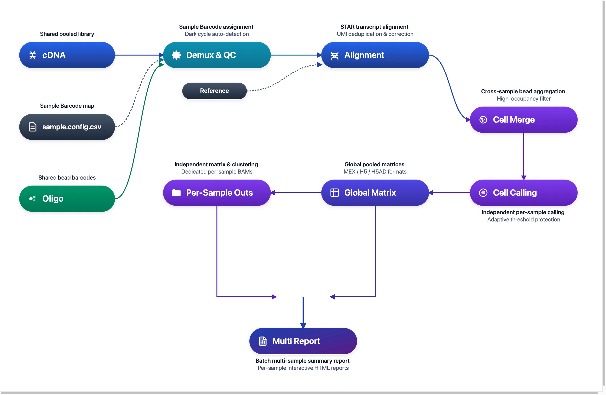

# DNBelab C Series HT C6 分析流程

多样本单细胞 RNA 测序混合建库与解复用分析说明

## 概述 <a id="概述"></a>

C6 是面向高通量单细胞 RNA 测序的多样本实验解决方案。多个生物学样本在实验建库阶段使用不同的 Sample Barcode 进行标记并基于 Sample Barcode 混合测序；生信分析阶段由 `dnbc4tools` 自动完成样本解复用、微珠聚合、逐样本独立细胞识别、表达定量与分析交付。

**工作流程**：数据输入 → Barcode 解复用 → 转录本比对 → 微珠聚合 → 逐样本独立 Cell Calling → 组合与样本报告交付

<div align="center" style="margin: 1.5em 0;" markdown="block">
  
</div>

> **使用说明**：`$dnbc4tools` 代表可执行程序路径，需替换为实际安装路径。C6 流程通过 `multi run` 子命令统一编排并自动完成解复用与多样本交付。

---

## 核心步骤解析 <a id="核心步骤解析"></a>

C6 混合建库与解复用分析涵盖从原始双文库输入到各样本结果输出的 5 个关键阶段：

| 步骤 | 阶段名称 | 核心处理逻辑 | 关键输入与产出交付物 |
| :---: | :--- | :--- | :--- |
| **01** | **数据准备与输入校验** | 共享双文库解析；暗反应自动自检；校验 `[samples]` 分段映射 | 共享 FASTQ、配置 CSV ➔ 规范化参数 |
| **02** | **条形码识别与样本分配** | 从 Oligo 提取 Sample Barcode 并基于白名单严格纠错匹配 | Oligo Reads ➔ 样本分配表、Unassigned 追踪 |
| **03** | **转录本比对与微珠聚合** | STAR 比对注释；基于相似度关联聚合同细胞微珠；全局高占用过滤 | cDNA Reads ➔ 比对 BAM、Bead 聚合标签 |
| **04** | **逐样本独立细胞识别** | 各样本完全隔离独立执行 EmptyDrops；自适应阈值保护 | 样本液滴集合 ➔ 各样本真实有效细胞集 |
| **05** | **结果归档与输出** | 各样本矩阵/报告/BAM 拆分；全局联合矩阵与批次报告 | `per_sample_outs/` 交付包 + 全局汇总 |

<div class="c6-stepper" markdown="block">

<div class="c6-step-item" markdown="block">

### 第一步：数据准备与输入校验 <a id="step-1"></a>

- **测序文库**：实验包含共享的一套 cDNA 文库与 Oligo 文库。
- **参数配置**：使用分段式 CSV 文件（如 `sample.config.csv`），在 `[samples]` 区块中声明各个样本名称与 Sample Barcode 的分配映射关系。
- **暗反应自检**：3.2 版本支持自动识别 cDNA 与 Oligo 的暗反应（Dark Cycles），无需人工干预。

<div class="c6-step-meta">
  <span class="c6-step-meta-label">核心机制</span>
  <span class="c6-step-pill">共享双端文库</span>
  <span class="c6-step-pill">暗反应自检</span>
  <span class="c6-step-pill">分段 CSV 映射</span>
</div>

</div>

<div class="c6-step-item" markdown="block">

### 第二步：条形码识别与样本分配 (Sample Barcode Assignment) <a id="step-2"></a>

- **条形码匹配**：从 Oligo reads 中提取 Sample Barcode 序列，基于内置白名单执行纠错匹配。
- **灵活映射**：将每一个液滴分配到对应的生物学样本；支持单一条形码（如 `BC01`）或同一生物学样本分配多个条形码（如 `BC02;BC03`）。
- **未分配追踪**：未识别 Sample Barcode 的读段计入 Unassigned 统计，用于查看未分配读段数量。

<div class="c6-step-meta">
  <span class="c6-step-meta-label">核心机制</span>
  <span class="c6-step-pill">白名单纠错</span>
  <span class="c6-step-pill">多 Barcode 聚合</span>
  <span class="c6-step-pill">Unassigned 追踪</span>
</div>

</div>

<div class="c6-step-item" markdown="block">

### 第三步：转录本比对与微珠聚合 (Bead Aggregation) <a id="step-3"></a> {#bead-aggregation}

- **高质量比对**：使用优化配置的 STAR 流程对 cDNA 进行参考基因组比对与基因功能区注释。
- **跨微珠聚合**：基于 Bead 序列的相似性评分算法，将同一物理细胞被捕获到的微珠关联聚合，并在合并标签中保留 Sample Barcode 后缀。
- **实验级高占用过滤**：默认启用 `high_occupancy_filter=true`，在整个实验全局尺度剔除高占用异常液滴，保障下游各样本细胞纯度。

<div class="c6-step-meta">
  <span class="c6-step-meta-label">核心机制</span>
  <span class="c6-step-pill">STAR 基因组比对</span>
  <span class="c6-step-pill">Bead 相似度聚合</span>
  <span class="c6-step-pill">全局高占用过滤</span>
</div>

</div>

<div class="c6-step-item" markdown="block">

### 第四步：逐样本独立细胞识别 (Per-Sample Cell Calling) <a id="step-4"></a>

- **独立细胞识别**：分配至各样本的液滴**相互独立执行细胞识别**，按各样本数据分别确定细胞集合。
- **智能截断与保护**：自动估计模式使用 EmptyDrops 进行细胞识别；3.2 为自动估计细胞数增加上下限约束。
- **同 UMI 冲突纠错**：同一细胞内比对到多个基因的歧义 UMI 依据 read 计数进行冲突裁决；无法唯一归属的 UMI 不计入表达量。

<div class="c6-step-meta">
  <span class="c6-step-meta-label">核心机制</span>
  <span class="c6-step-pill">样本隔离判定</span>
  <span class="c6-step-pill">EmptyDrops 自适应保护</span>
  <span class="c6-step-pill">UMI 冲突纠错</span>
</div>

</div>

<div class="c6-step-item" markdown="block">

### 第五步：结果归档与输出 <a id="step-5"></a> {#_4}

- **各样本分析**：每个样本在 `per_sample_outs/<sample>/` 下独立交付完整的表达矩阵（MEX、H5、H5AD 格式）、降维聚类分析（PCA、UMAP、Marker 基因）与单独的交互式 HTML 报告。
- **按样本拆分 BAM**：启用 BAM 时，按样本输出比对文件（`<sample>_alignments.bam`），同时保留未分配比对文件与共享 Oligo BAM。
- **全局合并矩阵**：在根目录下提供包含全部样本有效细胞的联合表达矩阵，保留纯净原始计数，方便后续按需导入下游批次校正工具（如 Harmony 等）。
- **批次综合报告**：生成全局 `<run>_multi_report.html`，集中展示各样本有效细胞数、测序饱和度对比及文库级质控指标。

<div class="c6-step-meta">
  <span class="c6-step-meta-label">核心机制</span>
  <span class="c6-step-pill">各样本 MEX/H5/H5AD</span>
  <span class="c6-step-pill">按样本拆分 BAM</span>
  <span class="c6-step-pill">全局联合矩阵</span>
  <span class="c6-step-pill">交互式双层报告</span>
</div>

</div>

</div>

---

## 输入配置 <a id="输入配置"></a>

C6 分析使用分段式 CSV 配置文件（通常命名为 `sample.config.csv`），包含以下三个核心分段：

| 分段名 | 用途 | 关键参数 |
| :--- | :--- | :--- |
| `[rna]` | 全局转录组与实验级设置 | `genomeDir`, `chemistry,scRNAC6`, `darkreaction,auto`, `no_bam` |
| `[libraries]` | 共享测序文库路径声明 | `fastqs` (指向包含 `cDNA/` 与 `oligo/` 的目录), `feature_types,rna` |
| `[samples]` | 样本与 Sample Barcode 映射表 | `sample_id`, `probe_barcode_ids`, `expectcells` (可选) |

### 最小可用配置示例

```csv
[rna]
genomeDir,/database/scRNA/Homo_sapiens
chemistry,scRNAC6
darkreaction,auto

[libraries]
fastqs,feature_types
/rawdata/c6_pooled_run,rna

[samples]
sample_id,probe_barcode_ids
Sample_1,BC01
Sample_2,BC02;BC03
```

> **可选 BAM 输出设置**：本示例保留默认的 `[rna] no_bam,false`，生成逐样本 BAM、未分配 BAM 和 Oligo BAM 及其适用的索引。若需节省存储空间，可在 `[rna]` 中添加 `no_bam,true`；此时不生成 BAM 文件及其索引。

> **提示**：若同一样本分配了多个条形码，使用分号 `;` 分隔（如 `BC02;BC03`）。详细参数规范请参阅 [C6 参数说明](../parameter/c6.md)。

---

## 主分析流程 <a id="主分析流程"></a>

### 运行命令

```bash
$dnbc4tools multi run \
  --name c6_demo \
  --csv sample.config.csv \
  --outdir ./results \
  --threads 16
```

### 运行前检查清单

<div class="doc-checklist" markdown="block">

<div class="doc-checklist-title">C6 运行前快速核对清单</div>

- **分析化学类型声明**：CSV 的 `[rna]` 区块中已正确配置 `chemistry,scRNAC6`。
- **共享测序数据路径**：`[libraries]` 中的 `fastqs` 路径有效，包含配对的 `cDNA/` 与 `oligo/` 子目录及 FASTQ 文件。
- **样本与 Barcode 映射**：`[samples]` 中的 `sample_id` 无重名，且 `probe_barcode_ids` 对应建库使用的 Sample Barcode（如 `BC01` 或 `BC02;BC03`）。
- **参考基因组索引完整**：`genomeDir` 指向完整有效的 STAR 参考数据库目录。

</div>

### 运行过程

在对暗反应自动检测与条形码校验后，软件开始多样本解复用与独立分析：

```shell
====================================================================================================
Running [samples] C6 RNA pipeline — 2026-11-02 18:11:02
====================================================================================================

====================================================================================================
Parsed FASTQ Inputs - 2026-11-02 18:11:02
====================================================================================================
Type         | Path                                                                                 
-------------+--------------------------------------------------------------------------------------
cDNA Read1   | /rawdata/c6_pooled_run/cDNA/sample_cDNA_R1.fastq.gz                                  
cDNA Read2   | /rawdata/c6_pooled_run/cDNA/sample_cDNA_R2.fastq.gz                                  
oligo Read1  | /rawdata/c6_pooled_run/oligo/sample_oligo_R1.fastq.gz                                 
oligo Read2  | /rawdata/c6_pooled_run/oligo/sample_oligo_R2.fastq.gz                                 
====================================================================================================


2026-11-02 18:12:21 Starting oligo library filtering...
...done

2026-11-02 18:13:26 Starting cDNA library filtering...
...done

2026-11-02 18:25:31 Correcting RNA barcodes and preparing alignment inputs...
...done

2026-11-02 18:27:22 Performing read alignment and UMI counting...
...done

2026-11-02 18:54:34 Calculating multi sample bead similarity and barcode translation...
...done

2026-11-02 18:54:56 Generating raw gene expression matrix...
...done

2026-11-02 18:57:42 Generating cell-filtered gene expression matrix...
...done

2026-11-02 18:58:02 Calculating sequencing saturation metrics...
...done

2026-11-02 18:58:34 Generating per-sample RNA matrices, saturation, and expression metrics...
...done

2026-11-02 18:59:23 Generating per-sample position-sorted BAM files...
...done

2026-11-02 19:04:24 Performing per-sample dimensionality reduction and clustering analysis...
...done

2026-11-02 19:05:12 Performing mixed-species classification for "mouselars2_and_macaca"...
...done

2026-11-02 19:05:13 Generating multi sample assignment outputs...
...done
✔ Prepared RNA summary metrics

====================================================================================================
Running combined report generation — 2026-11-02 19:05:14
====================================================================================================
Combined report sections:
✔ rna: success
✔ samples: success
✔ Outputs organized in ./results/c6_demo/outs

Analysis finished successfully!
```

当出现 `Analysis finished successfully!` 消息时，表示分析已成功完成。

---

## 结果解析 <a id="结果解析"></a>

### 输出目录结构

分析完成后，结果归档在 `<outdir>/<name>/outs/` 目录下：

```text
<outdir>/<name>/outs/
├── <name>_multi_report.html              # 批次多样本汇总报告
└── rna/
    ├── raw_feature_bc_matrix/            # 全局未过滤表达矩阵 (MEX)
    ├── filtered_feature_bc_matrix/       # 全局有效细胞表达矩阵 (MEX)
    ├── filtered_feature_bc_matrix.h5ad   # 全局有效细胞表达矩阵 (H5AD，无跨样本聚类)
    ├── singlecell.csv.gz                 # 全局液滴明细表 (含样本归属与微珠聚合关系)
    ├── metrics_summary.xls               # 全局实验汇总指标
    ├── multi_sample/                     # 样本拆分与质控明细
    │   ├── per_sample_metrics.csv        # 各样本生信指标对照表
    │   └── barcode_assignment_metrics.json # Sample Barcode 识别与分配统计
    └── per_sample_outs/<sample>/         # 【各样本结果输出目录】
        ├── filtered_feature_bc_matrix/   # 该样本有效细胞表达矩阵
        ├── <sample>_scRNA_report.html    # 该样本交互式 HTML 报告
        ├── metrics_summary.xls           # 该样本质控指标表
        └── analysis/                     # 该样本聚类、降维与 Marker 基因
```

### 重点输出文件说明

| 文件/目录 | 说明 |
| :--- | :--- |
| `<name>_multi_report.html` | 批次多样本汇总报告，集中展示各样本细胞数、饱和度对比及解复用质量 |
| `rna/per_sample_outs/<sample>/` | 各样本结果输出目录，包含该样本独立表达矩阵、分析图表与独立 HTML 报告 |
| `rna/filtered_feature_bc_matrix.*` | 全局合并表达矩阵，汇集全部样本有效细胞计数，方便导入下游批次校正工具 |
| `rna/singlecell.csv.gz` | 全局液滴明细表，记录 Bead-to-Cell 映射、Cell Calling 状态及 Sample Barcode 归属 |

> **详细输出说明**：请参阅 [C6 输出说明](../outs/c6.md) 了解各项指标与交付文件的完整解读。
